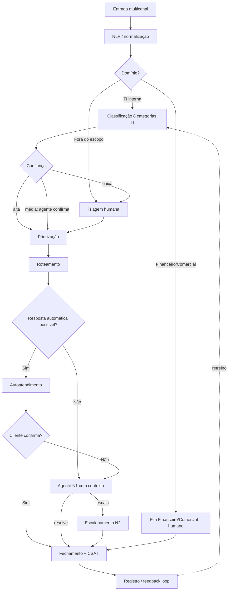

# 04 — Fluxograma do Chamado

**Desafio 002 · Fase 3** · Autor: Leonardo Candido Lopes · 08/11/2026
Versão visual interativa: **`04_fluxograma.html`**. É um arquivo autônomo, sem dependências externas: basta abrir no navegador. Passe o mouse ou clique nos blocos para ver os detalhes.

## Caminho principal

| # | Etapa | Regra | Saídas |
|---|---|---|---|
| 1 | **Entrada** (e-mail, chat, telefone, portal, redes sociais) | Grava `created_at` e o canal; o relógio de SLA começa | → 2 |
| 2 | **NLP**: normalização | Minúsculas, sem pontuação e números, remoção de boilerplate (38,1% das palavras no D2), mascaramento de dados pessoais | → 3 |
| 3 | **Domínio** | TI interna · Financeiro/Comercial · Fora do escopo | TI → 4 · Financeiro/Comercial → **F** · Fora do escopo → **H** |
| 4 | **Classificação de TI** (8 categorias) | Modelo treinado no D2 (47.602 exemplos após limpeza) | → 5 |
| 5 | **Confiança** | ≥ 0,85 automático · 0,60–0,85 assistido · < 0,60 humano (limiares para calibrar) | Alta → 6 · Média → agente confirma → 6 · Baixa → **H** |
| 6 | **Priorização** | Impacto × urgência + sinais no texto; o humano pode sobrescrever | → 7 |
| 7 | **Roteamento** | Fila = f(domínio, categoria, prioridade) | → 8 |
| 8 | **Há resposta automática possível?** | Categoria elegível (Purchase, Storage, Access-reset) **e** prioridade diferente de Crítica **e** confiança alta | Sim → 9 · Não → **A** |
| 9 | **Autoatendimento** | Link, fluxo de aprovação, consulta de PO | → 10 |
| 10 | **Cliente confirma?** | Sim → fechamento · Não → **A** (com histórico) | |
| 11 | **Fechamento** + CSAT | Grava `resolved_at` e a nota de satisfação | → **R** |

## Caminhos alternativos

- **A — Agente N1 com contexto enriquecido:** recebe texto, categoria, confiança, ação já tentada e histórico. Resolve → 11; ou escala → **N2**.
- **N2 — Escalonamento:** gatilhos são Crítica, incidente que afeta vários usuários, privilégio, reabertura ou SLA em risco. Resolve → 11.
- **F — Fila Financeiro/Comercial** (reembolso, pagamento, entrega, cancelamento, recomendação): decisão humana; a IA só resume e consulta. → 11.
- **H — Triagem humana** (baixa confiança ou fora do escopo): o humano classifica, e a categoria escolhida vira dado de treino. → 6.
- **R — Registro e melhoria contínua:** eventos, correções, reaberturas e CSAT alimentam os KPIs (`05_kpis.md`) e o retreino (`07_riscos.md`, governança). O ciclo volta para o passo 4.

