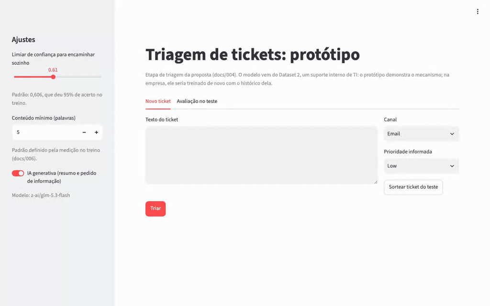
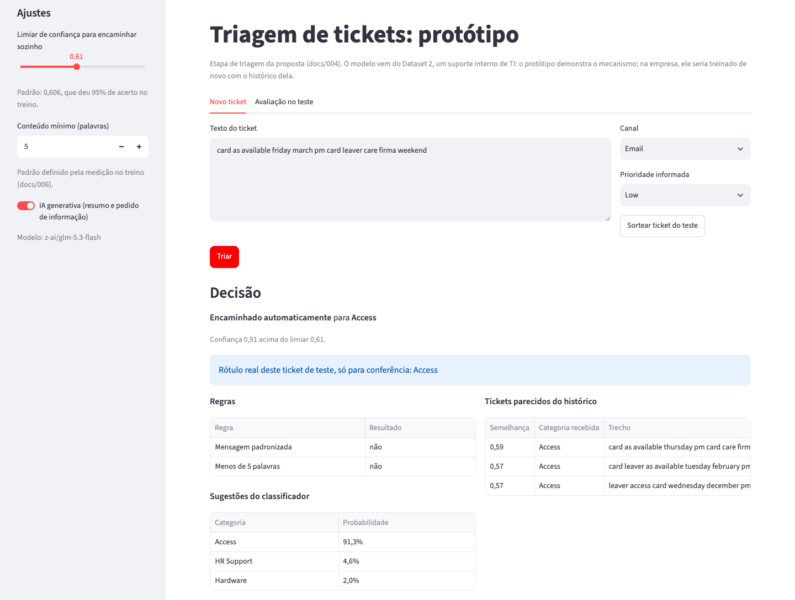
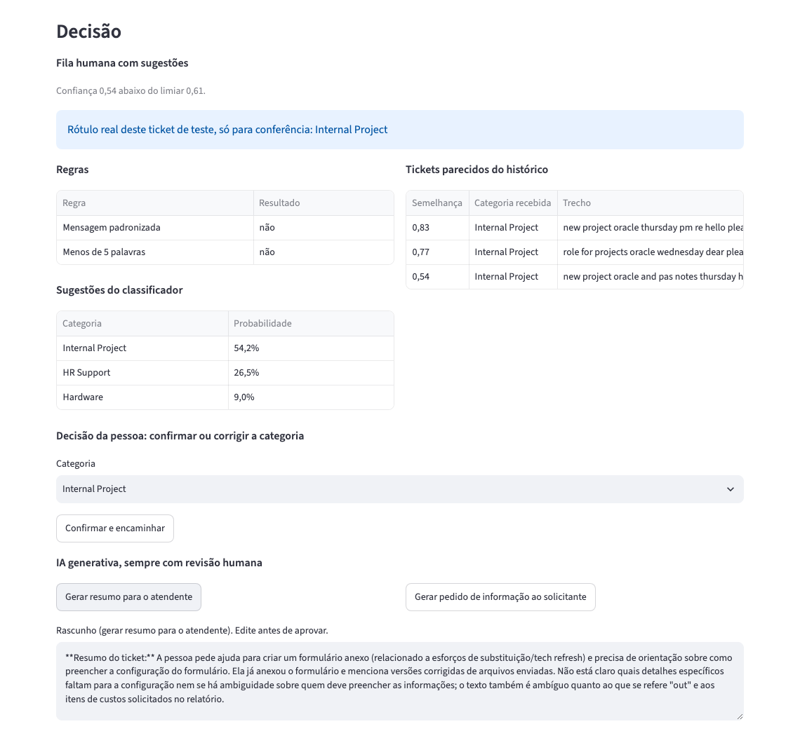
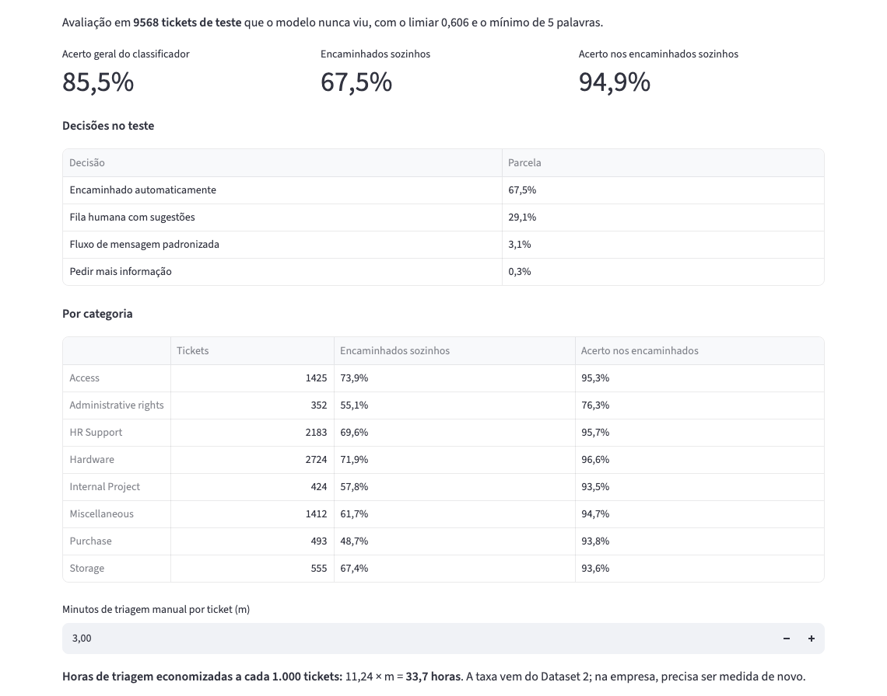

# Submissão — Anderson Silva — Challenge 002

## Sobre mim

- **Nome:** Anderson Silva
- **Challenge escolhido:** 002, Redesign de Suporte

---

## Executive Summary

O fluxo trava na entrada e na espera: 67,3% dos tickets estão parados (33,3% sem nenhuma resposta e 34,0% aguardando o cliente), por igual em todos os canais, prioridades e tipos. Nenhuma variável disponível explica o CSAT (um modelo com as 21 variáveis acerta 21,3% das notas, contra 20,9% do chute), e o tempo de resposta não pode ser testado, porque as colunas de tempo do Dataset 1 não medem duração. O desperdício que dá para medir é a triagem manual: 11,79 × m horas a cada 1.000 tickets, em que m são os minutos de triagem por ticket (35,4 horas com m = 3). A recomendação é começar pelo processo, sem IA, porque a IA precisa do histórico que ele cria: onde esse histórico existe (Dataset 2), um classificador encaminha 70,8% dos tickets sozinho com 95% de acerto, e o zero-shot acerta só 43%. O protótipo local repete o mecanismo em 9.568 tickets que o modelo nunca viu: encaminha 67,5% sozinho com 94,9% de acerto, manda o resto para uma pessoa com sugestões e usa a IA generativa só como rascunho aprovado por uma pessoa.

## O que ler, em ordem

| # | Arquivo | O que tem |
|---|---|---|
| 1 | Este README | O resumo, os resultados e o protótipo |
| 2 | [solution/docs/005-diagnostico-operacional.md](solution/docs/005-diagnostico-operacional.md) | Entrega 1: as três perguntas do Diretor, com a prova de que as colunas de tempo não medem duração |
| 3 | [solution/docs/004-proposta-automacao.md](solution/docs/004-proposta-automacao.md) | Entrega 2: o que automatizar e o que não, como funcionaria, fases, métricas, ganho e riscos |
| 4 | [solution/docs/006-prototipo.md](solution/docs/006-prototipo.md) | Entrega 3: como rodar, como foi medido e exemplos reais da IA generativa |
| 5 | [process-log/001-process-log.md](process-log/001-process-log.md) | Entrega 4: como usei a IA, onde ela errou e o que foi decisão minha |

Apoio: [solution/docs/003](solution/docs/003-arquitetura-fluxo-atendimento.md) (registros de cada etapa do atendimento), [process-log/002-audit-trail.md](process-log/002-audit-trail.md) (cada passo, com horário) e [docs/001-indice.md](docs/001-indice.md) (todos os arquivos).

---

## Solução

### Abordagem

1. **Entender os dados antes de responder.** Tratei os dados como reais e testei o que cada coluna significa. As colunas de tempo do Dataset 1 não medem duração (docs/005, Anexo A.1), então passaram a valer só como marcadores de status.
2. **Responder às três perguntas com testes, não com impressão.** Todo número vem de um script; nenhuma conta foi feita de cabeça.
3. **Usar o Dataset 2 como banco de prova do método.** Comparei o classificador supervisionado com o zero-shot (embeddings da OpenAI e Jev 1.14) nos mesmos tickets, e entendi por que o zero-shot erra: o rótulo segue a equipe dona do sistema, não o assunto.
4. **Testar a ligação entre os datasets antes de propor.** O modelo do Dataset 2 aplicado ao Dataset 1 não encontra ligação (V ≤ 0,041). Por isso o Dataset 1 precisa registrar os próprios rótulos antes de qualquer classificador.
5. **Propor e demonstrar.** Proposta em fases e protótipo com os números medidos em tickets que o modelo nunca viu.

### Resultados

| Pergunta ou entrega | Resultado | Onde |
|---|---|---|
| Onde o fluxo trava | 67,3% parados: 33,3% sem resposta e 34,0% aguardando o cliente; igual em todos os segmentos e combinações; indício de que a fila não respeita a prioridade | [docs/005](solution/docs/005-diagnostico-operacional.md), seção 1 |
| O que impacta o CSAT | Nenhuma variável disponível, nem em conjunto (21,3% contra 20,9% do chute) | [docs/005](solution/docs/005-diagnostico-operacional.md), seção 2 |
| Quanto se desperdiça | 11,79 × m horas de triagem a cada 1.000 tickets; o estoque parado não vira horas sem tempo registrado | [docs/005](solution/docs/005-diagnostico-operacional.md), seção 3 |
| O que automatizar | Supervisionado: 70,8% sozinho com 95% de acerto; zero-shot: 43%. Entre 3,7% e 12,5% são mensagens padronizadas, resolvíveis por regra | [docs/004](solution/docs/004-proposta-automacao.md) |
| Protótipo | 85,5% de acerto geral; 67,5% encaminhados sozinhos com 94,9% de acerto; 29,1% para a fila humana. Administrative rights fica em 76,3%, por isso o limiar deve ser por categoria | [docs/006](solution/docs/006-prototipo.md) |

#### Protótipo

A página roda localmente e não precisa dos datasets do Kaggle: ao abrir, ela treina o mesmo modelo avaliado com os arquivos de `solution/results/`.

```
cd solution
pip install -r requirements.txt
streamlit run scripts/008-triage-app.py --server.address 127.0.0.1
```

A IA generativa é opcional: ela liga com um arquivo `solution/.env` contendo `OPENROUTER_API_KEY=...`.



**Ticket encaminhado sozinho** (confiança acima do limiar):



**Ticket na fila humana**, com as sugestões, os tickets parecidos e um rascunho da IA generativa à espera de aprovação:



**Avaliação** nos 9.568 tickets de teste:



O print mostra 11,24 × m, e não os 11,79 × m da proposta, porque usa os 67,5% medidos uma única vez nos tickets de teste, e não os 70,8% da validação cruzada no Dataset 2 inteiro.

### Recomendações

1. **Fase 0, processo sem IA:** formulário de abertura com o problema, fila por prioridade, confirmação automática fora da métrica de primeira resposta, cobrança e fechamento automáticos e registro de cada etapa ([docs/003](solution/docs/003-arquitetura-fluxo-atendimento.md)).
2. **Fase 1, IA generativa de apoio, sempre com revisão humana:** resumo do ticket, rascunho de pedido de informação, sugestão de intenção, tickets parecidos e quase duplicatas.
3. **Fase 2, classificador só sugerindo:** taxa e limiar medidos por categoria no histórico da empresa.
4. **Fase 3, encaminhamento automático** acima do limiar de cada categoria e rascunho de resposta com uma base de soluções validadas.

### Limitações

- **O Dataset 1 não tem duração nem rótulo confiável:** não dá para medir tempo de resposta nem treinar um classificador nele.
- **O Dataset 2 é de outro domínio** (suporte interno de TI): os 70,8% e os 67,5% são referência e precisam ser medidos de novo no histórico da empresa.
- **Os dados são uma foto, sem datas reais:** o indício de que a fila ignora a prioridade precisa ser confirmado com o registro das etapas.
- **As horas economizadas dependem de m,** que precisa ser medido na operação.
- **O texto do Dataset 2 vem pré-processado,** sem pontuação e sem palavras como "not", o que limita os resumos da IA generativa.
- **O protótipo não tem integração** com um sistema de tickets, login nem banco de dados.

---

## Process Log — Como usei IA

O registro completo está em [process-log/001-process-log.md](process-log/001-process-log.md): as regras que dei à IA, a segunda sessão do Claude que usei em paralelo, a lista dos erros e a origem de cada decisão.

### Ferramentas usadas

| Ferramenta | Para que usei |
|------------|--------------|
| Claude Code (Claude Opus 5.5) | Análise dos dados, scripts em Python, testes estatísticos, documentos, protótipo, prints e vídeo, com cada passo no audit trail |
| Segunda sessão do Claude Code (Claude Opus 5.5) | Consultas de estratégia e revisão do andamento, só leitura (detalhes no process log) |
| Embeddings da OpenAI (text-embedding-3-large), pelo OpenRouter | Zero-shot, grupos de problema pelo texto, quase duplicatas e teste de sentido da resolução |
| Jev 1.14, pelo OpenRouter | Zero-shot por decisão, comparado ao supervisionado |
| GLM 5.3 Flash, pelo OpenRouter | IA generativa do protótipo, escolhida pelo custo; antes testei o Claude Opus 5.5, superdimensionado para a tarefa |
| scikit-learn, Streamlit, Playwright | Classificador e estatística locais, página do protótipo, prints e GIF |

### Workflow

1. **Regras antes de começar:** escrevi no `CLAUDE.md` como a IA devia trabalhar: fazer só o que eu pedir, registrar cada passo, erro e escolha no audit trail e nunca fazer conta de cabeça.
2. **Dataset 1, entender os dados** (audit trail, itens 38 a 101): a IA mediu e testou; eu defini as premissas de tratar os dados como reais e de usar as colunas de tempo só como marcadores de status (item 95).
3. **Dataset 2, método** (itens 102 a 133): classificador supervisionado, zero-shot com embeddings e Jev nos mesmos tickets, e o teste de ligação entre os datasets.
4. **Diagnóstico e proposta** (itens 134 a 171): a IA calculou e redigiu; eu aprovei a estrutura, a única premissa do desperdício e os ajustes de apresentação.
5. **Protótipo** (itens 172 a 189): a IA construiu e testou; eu troquei o modelo de IA generativa, pedi exemplos reais e uma iteração dos prompts e aprovei os textos.
6. **Submissão** (itens 190 em diante): página sem datasets, prints e vídeo automatizados e chat export limpo, com a minha conferência antes do commit.

### Onde a IA errou e como corrigi

- **Começou o desafio sem pedido** e apresentou conclusões antes de qualquer análise. Apontei, o trabalho foi desfeito e a avaliação inicial foi descartada (itens 27 e 33).
- **Fez contas de cabeça.** Proibi, e todo número passou a sair de um script (itens 49, 50 e 166).
- **Estimou horários no audit trail** em vez de medir. Pedi a correção pelo transcript, e o `date` passou a rodar antes de cada registro (itens 136, 149, 195 e 199).
- **Sugeriu só modelos Claude** para o zero-shot e entendeu errado o meu pedido sobre a OpenAI. Corrigi para embeddings da OpenAI e Jev (itens 115 e 119).
- **Supôs um mínimo de 8 palavras** e escreveu no código que era medido. A medição mostrou 5 (item 173).
- **Subiu a página visível na rede local,** com a chave do OpenRouter carregada. Passou a rodar só em 127.0.0.1 (item 177).
- **Registrou uma correção como aprovada por mim** antes de eu aprovar. Corrigido para "a confirmar", e eu confirmei depois (itens 187 e 188).

São 27 itens do audit trail com erro da IA, até o item 210; a lista completa está no process log.

### O que eu adicionei que a IA sozinha não faria

- **Tratar os dados como reais** e usar as colunas de tempo como marcadores de status, em vez de descartar o Dataset 1 (itens 74 e 95).
- **Levar uma proposta pronta para decisão,** não uma lista de perguntas para a equipe (item 60).
- **Ver o atendimento como uma sequência de tentativas,** com fechamento registrado, o que virou a arquitetura de registros do docs/003 (itens 62 a 66).
- **Testar Jev e os embeddings da OpenAI** no zero-shot, além da sugestão da IA, que só considerava modelos Claude (itens 110, 114 e 118).
- **Cruzar a descrição com a resolução** no Dataset 1, o que mostrou que a resolução não traz informação (itens 155 a 161).
- **Não usar o e-mail dos clientes,** nem com hash (item 169).
- **Trocar o Claude Opus 5.5 pelo GLM 5.3 Flash** na IA generativa, pelo custo (itens 180 e 181).

Parte das ideias veio da segunda sessão do Claude e foi enviada por mim; o process log lista quais.

---

## Evidências

- [ ] Screenshots das conversas com IA (no lugar delas, o chat export completo abaixo)
- [ ] Screen recording do workflow (há um GIF do protótipo funcionando, não do workflow)
- [x] Chat exports: [process-log/chat-exports/001-chat-export.md](process-log/chat-exports/001-chat-export.md)
- [ ] Git history (o projeto local não era um repositório Git; o audit trail registra cada passo com horário)
- [x] Outro: [audit trail](process-log/002-audit-trail.md) com cada passo, erro e decisão; scripts reprodutíveis em [solution/scripts/](solution/scripts/); prints e GIF do protótipo; exemplos reais da IA generativa com os textos que aprovei ([docs/006](solution/docs/006-prototipo.md), Anexo A)

---

_Submissão enviada em: 2026-11-03_
