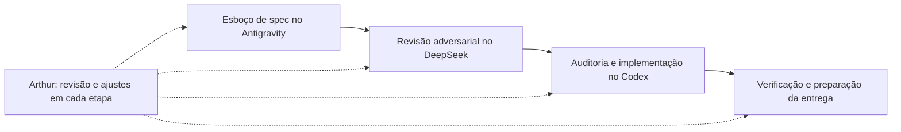

# Process Log — Especificação, revisão adversarial e implementação sob direção humana

**Candidato:** Arthur Lima  
**Desafio:** Challenge 003 — Lead Scorer (Vendas & RevOps)

> **Fluxo confirmado por Arthur:** o fluxo partiu de um esboço de especificação no Antigravity, passou por revisão adversarial do DeepSeek e seguiu para auditoria e implementação no Codex, com revisão e ajustes de Arthur em cada etapa. Este registro é uma síntese retrospectiva; não é uma transcrição das ferramentas. Atribuições anteriores de participantes e papéis que não correspondiam a esse fluxo foram removidas.

## 1. Ferramentas, papéis e participação humana

| Participante / ferramenta | Papel confirmado | Participação de Arthur |
|---|---|---|
| **Antigravity** | Esboço inicial da especificação da solução. | Revisar e ajustar o esboço antes de avançar para a revisão adversarial. |
| **DeepSeek** | Revisão adversarial da especificação. | Examinar as críticas e ajustar o direcionamento da solução. |
| **Codex** | Auditoria, implementação e verificação da solução, incluindo as revisões posteriores. | Revisar e ajustar o trabalho a cada etapa, orientar correções e decidir o que incorporar à entrega. |
| **Arthur Lima** | Condução contínua do fluxo entre ferramentas e revisão do trabalho produzido. | Manter a responsabilidade pelas escolhas de negócio, pelos ajustes e pelo conteúdo submetido. |

As ferramentas não substituíram minha revisão por um handoff automático entre agentes. Meu papel também não se limitou a aprovar a versão final: revisei e ajustei o trabalho ao longo de todo o fluxo. A identificação das ferramentas não pressupõe modelos específicos ou outras ferramentas que não confirmei.

## 2. Sequência do trabalho

1. **Esboço no Antigravity:** ponto de partida para definir a solução. Revisei e ajustei a especificação.
2. **Revisão adversarial no DeepSeek:** submeti o direcionamento à crítica e revisei os ajustes antes de seguir para implementação.
3. **Auditoria e implementação no Codex:** o código, os testes, a avaliação e a documentação foram implementados e revistos no Codex, com minhas revisões e ajustes ao longo das etapas. As primeiras versões continham defeitos reais, registrados abaixo; o uso de IA não garantiu acerto na primeira implementação.
4. **Preparação da entrega:** solicitei aplicação dos ajustes, visualização do produto e destaque ao componente humano. Também corrigi a própria narrativa de autoria ao identificar uma atribuição de ferramenta que não participou do fluxo.

Essas são etapas do fluxo confirmado, não uma contagem de prompts, sessões ou horas. O histórico técnico abaixo descreve mudanças verificáveis no código; não permite reconstruir literalmente a conversa original de cada ferramenta.

## Mapa de decisões humanas H1–H5

Os comentários H1–H5 foram adicionados na preparação da entrega para explicar decisões, não como registros contemporâneos de cada mudança. A implementação foi assistida pelo Codex; minha contribuição foi conduzir a revisão e ajustar o direcionamento a cada etapa. Não atribuo a mim descobertas feitas durante auditorias com IA nem atribuo a uma ferramenta a origem exclusiva de uma ideia sem registro que a sustente.

| ID | Problema revisto durante o fluxo | Decisão e intervenção de Arthur | Implementação e evidência |
|---|---|---|---|
| **H1 — Simplificar** | A versão anterior acumulava pesos manuais, EV/dia e dias restantes estimados sem ganho sustentado. | Rever o direcionamento e incorporar a simplificação para uma decisão comercial explícita de horizonte de 90 dias. | [`score_engaging_deals`](./solution/src/survival_and_scoring.py), ablação e tabelas do [relatório](./solution/artifacts/backtest_report.md). |
| **H2 — Separar cadastro de predição** | Conta ausente recebia penalidade sem validação; todos os fechados tinham conta preenchida no export. | Incorporar a crítica e tratar o cadastro como tarefa operacional, sem penalidade arbitrária na probabilidade. | [`build_enriched_pipeline`](./solution/src/data_loader.py), scorer e teste `test_missing_account_separated_from_win_probability`. |
| **H3 — Avaliar a fila real e expor limites** | Idade usava fechamento futuro, baselines estavam desalinhados e a avaliação só com resolvidos excluía parte da fila. | Orientar a correção e a apresentação da fila completa junto ao diagnóstico condicional, inclusive com seus resultados fracos. | [`run_prospective_queue_backtest`](./solution/src/backtest.py), avaliação condicional e [relatório](./solution/artifacts/backtest_report.md). |
| **H4 — Exigir verificações úteis** | Os testes originais não detectavam os defeitos de anti-leakage e paridade. | Incorporar a exigência de testes comportamentais e solicitar aplicação dos ajustes da revalidação. | [`test_mutating_future_outcomes_never_changes_past_predictions`](./solution/tests/test_engine.py), suíte de mutação, paridade, persistência e UI. |
| **H5 — Intervenção e rastreabilidade** | O botão inicialmente gravava feedback sem mudar a fila; a persistência precisava preservar decisões anteriores. | Revisar e ajustar o comportamento esperado com o Codex: intervenção funcional, rastreabilidade e estimativas originais preservadas. | [`apply_rep_overrides`](./solution/src/survival_and_scoring.py), [`FeedbackStore`](./solution/src/feedback_store.py) e AppTest de promoção/restauração. |

## 3. Falhas, correções e resultados verificáveis

| Falha ou hipótese da versão anterior | Ajuste realizado no Codex, sob revisão de Arthur | Como verificar |
|---|---|---|
| `GTXPro` e `GTX Pro` não coincidiam no join; `technolgy` tinha erro de grafia. | Normalização das chaves e auditoria dos dados. | `data_loader.py` e testes de schema. |
| `cycle_days` incorporava `close_date` futura no teste temporal. | Idade no instante de decisão e treino restrito aos eventos observáveis. | Teste que altera estágios, valores e datas futuros sem alterar predições anteriores. |
| O scorer ordenava as linhas e os baselines permaneciam na ordem anterior. | Avaliação em dataframe alinhado por `opportunity_id` e desempate determinístico. | `backtest.py`, teste de permutação e relatório reproduzível. |
| Penalidade por conta ausente e bônus por porte não tinham validação suficiente. | Retirada dos multiplicadores; higiene cadastral separada do score. | Teste de independência entre cadastro e probabilidade. |
| EV/dia e pesos compostos eram apresentados com rigor excessivo. | Motor `EV_90d`, ablação e distinção entre estimativa e regra operacional. | Código, README, UI e relatório. |
| Avaliar apenas os 970 resolvidos excluía 716 ainda abertos na coorte de junho. | Fila completa em horizonte fixo como avaliação principal; resolvidos como diagnóstico separado. | Três cortes móveis com janelas sobrepostas; AUC próxima do acaso no diagnóstico condicional. |
| Override não alterava a prioridade e o simulador duplicava a matemática. | Reordenação operacional e função canônica compartilhada entre lote e simulador. | Testes de override, paridade e interação via AppTest. |
| JSON podia perder atualizações e o reset excluía o histórico. | Lock, substituição atômica e evento `reset_all`; arquivo inválido não é sobrescrito. | Testes de concorrência, reset e corrupção. |

As correções de código não tornam os resultados causais. O Top 20% reúne **60,1%–63,7% da receita histórica observada** nos três cortes publicados, mas as janelas se sobrepõem. No diagnóstico condicional, as estratégias avaliadas têm AUC ~0,49–0,51; isso limita a interpretação, não estabelece um teto universal para outros modelos.

## 4. Meu componente humano

- **Revisar e ajustar a especificação:** decidir o que faz sentido para a rotina comercial antes de tratar o esboço como instrução definitiva.
- **Usar a crítica adversarial:** avaliar o que muda na solução ao passar da especificação pela revisão do DeepSeek e pela auditoria do Codex.
- **Intervir durante a implementação:** confrontar saídas, rever escolhas e orientar mudanças, em vez de delegar a responsabilidade pela entrega à ferramenta.
- **Revisar as evidências e a apresentação:** manter limitações e resultados desfavoráveis visíveis e corrigir inclusive erros na atribuição de autoria deste documento.

Isso descreve minha condução do processo. Não significa que escrevi manualmente todo o código ou descobri sozinho cada defeito.

## 5. Evidências e validação

- [Registro da revisão adversarial e das correções](./process-log/adversarial-red-team-audit.md): síntese retrospectiva, não transcrição literal.
- [Relatório de backtest](./solution/artifacts/backtest_report.md): regenerado a partir do código e conciliado com a documentação.
- [Suíte de testes](./solution/tests/test_engine.py): 19 testes aprovados na rechecagem, incluindo mutação, paridade, concorrência e UI.
- Histórico Git: `a715334` registra a primeira entrega; `2851ff1`, correções; `a31894c`, a refatoração para EV_90d. Esses commits mostram evolução técnica, não provam sozinhos qual pessoa ou ferramenta originou cada ideia. Os ajustes posteriores ainda não foram commitados.
- O launcher Windows foi validado em cópia limpa com instalação, `pip check` e testes; o health check do Streamlit respondeu HTTP 200. O launcher macOS/Linux não foi executado.

## 6. Ajustes de entrega e correção de autoria

Solicitei ao Codex a aplicação dos ajustes de compatibilidade com Python 3.12, limites do horizonte, narrativa estatística e persistência de feedback. Também solicitei visualizar o painel antes da submissão.

Na preparação da entrega, solicitei destaque à minha atuação na orquestração e revisão. A preparação incluiu roteiro de avaliação, mapa H1–H5, seções do template e comentários de decisão no código. Ao revisar o texto, identifiquei atribuições incorretas de ferramentas; esclareci o fluxo real e determinei sua correção em toda a submissão.

O process log é obrigatório segundo o guia; comentários de autoria no código não são uma exigência específica. As correções desta seção são de documentação e comentários e não alteram o comportamento executável.
