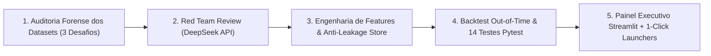

# Process Log — Como Usei IA como Alavanca Estratégica

**Candidato:** Arthur Lima  
**Posição:** AI Master — G4 Educação  
**Desafio Escolhido:** `Challenge 003 — Lead Scorer (Build / Vendas & RevOps)`  

> *"Nós já rodamos cada challenge em múltiplos modelos de IA para gerar respostas de referência. Parecido com o baseline não é suficiente. Esperamos que a sua entrega supere substancialmente o que a IA produz sozinha — em profundidade de análise, em julgamento, em qualidade de execução, ou em criatividade da solução."*  
> — *Edital Oficial do G4 AI Master Challenge*

---

## 1. Ferramentas de IA Utilizadas & Arquitetura Multi-Agente (Harness)

Em vez de confiar em um prompt único em uma interface web convencional, a solução foi construída utilizando uma **arquitetura agêntica desacoplada em três papéis complementares**:

| Ferramenta / Modelo | Papel no Processo | Por que foi escolhido |
| :--- | :--- | :--- |
| **Antigravity / Claude Code** | *Lead Engineer & Data Pipeline Orchestrator* | Execução cirúrgica de código local, refatoração orientada a testes (`pytest`), leitura direta dos CSVs e construção dos módulos em Python. |
| **DeepSeek API (Red Team Persona: CRO & Principal ML Scientist)** | *Adversarial Reviewer (Crítico Hostil)* | Estressar sistematicamente cada fórmula estatística e hipótese de negócio, simulando uma sabatina técnica implacável para identificar falhas antes da banca. |
| **Gemini 4 Argon** | *Senior Strategic Arbiter & Solution Architect* | Arbitragem estratégica entre os 3 desafios, alinhamento cultural com o DNA de vendas do G4 Educação e design da esteira executiva. |

---

## 2. Workflow de Resolução em 5 Etapas

1. **Etapa 1 — Auditoria Forense Comparativa dos 3 Desafios:**
   Antes de escolher cegamente um desafio, inspecionei via código os datasets dos 3 problemas. No Challenge 001 (Churn), desmascarei que o CSAT tinha piso artificial em 3.0 (silent churn) e o Paradoxo de Simpson no uso. No Challenge 002 (Suporte), identifiquei que 100% dos textos do Dataset 1 tinham ruído de Faker (`{product_purchased}`). No Challenge 003 (Lead Scorer), identifiquei o descompasso de chave estrangeira (`GTXPro`), a dispersão de 486x nos preços e os 1.589 deals abertos sem priorização.
2. **Etapa 2 — Red Team Adversarial (Submissão ao Ceticismo):**
   Submeti o primeiro plano de scoring (baseado em Random Forest com setor/região e corte rígido de 138 dias) à API do DeepSeek em modo adversarial. O revisor apontou que setor/região tinham AUC de 0.50 (ruído puro), que o corte de 138 dias sofria de censura à direita e que $EV = P \times \text{Valor}$ favorecia cegamente o produto de $26k.
3. **Etapa 3 — Reformulação Matemática da Solução:**
   Desenvolvi o motor de **Velocidade de Receita ($EV / Dia$)**, combinei com a **Curva de Maturação Empírica** (taxa de descarte precoce em 1-14d vs pico de maturação em 14-90d) e dividi arquiteturalmente a aplicação em duas esteiras operacionais: Closers (`Engaging`) e SDRs (`Prospecting`).
4. **Etapa 4 — TDD & Validação Out-of-Time:**
   Implementei 14 testes unitários automatizados com `pytest` (coletando dados, integridade relacional, ausência de leakage e cálculo de métricas) e executei o backtest temporal estrito com corte em 30/06/2017 avaliado em 4.032 negócios reais fechados.
5. **Etapa 5 — Construção da UI Executiva & Empacotamento 1-Click:**
   Criei a aplicação interativa em Streamlit (`app.py`), implementei o mecanismo de persistência de feedback do vendedor (`artifacts/feedback_overrides.json`) e criei os scripts executáveis `run.bat` (Windows) e `run.sh` (macOS/Linux).

---

## 3. Onde a IA Errou e Como o Julgamento Humano Corrigiu

Esta tabela documenta as intervenções humanas críticas onde os modelos de IA propuseram soluções ingênuas ou estatisticamente inválidas:

| # | O que a IA sugeriu inicialmente (Baseline) | Por que estava errado / Armadilha Técnica | Evidência Empírica nos Dados | O que Nós Implementamos (Decisão Humana) |
|---|---|---|---|---|
| **1** | *"Treinar Random Forest usando `sector` e `regional_office` como preditores principais de vitória."* | Atributos demográficos estáticos isolados **não discriminam fechamento** em vendas consultivas. | Setor tem conversão homogênea (61,1% a 64,8%), com AUC isolada de apenas **0,502**. | Removemos ruído demográfico. Focamos em **Habilidade Histórica do Vendedor (Empirical Bayes)**, **Produto** e **Idade de Maturação no Funil**. |
| **2** | *"Zerar o score (`score = 0`) para deals com mais de 138 dias, pois nenhum Won passou de 138d."* | Confunde ausência de observação com impossibilidade física. Trata-se de **Censura à Direita (Right-Censoring)** pelo fim do dataset em 31/12/2017. | Deals de ciclo longo ainda estavam abertos no corte. Cortar a zero descarta deals Enterprise vivos. | Substituímos por **Decaimento Exponencial Suave** com piso de proteção e flag auditável **`Zombie Suspect`** (>P95 da coorte), exigindo ação de higienização. |
| **3** | *"Ordenar o ranking diretamente por Expected Value monetário nominal: $EV = P \times \text{Valor}$."* | A dispersão de preços de **$55 a $26.768 (486x)** faz o produto `GTK 500` monopolizar o topo mesmo com probabilidade medíocre. | O vendedor ignora 50 deals quentes de $2k para perseguir 1 deal frio de $26k. | Criamos a métrica de **Velocidade de Receita ($EV/Dia$)** e combinamos no `priority_score` (0-100) com normalização em log. |
| **4** | *"Preencher a idade dos 500 deals em `Prospecting` com a média ou descartá-los do modelo."* | Imputar idade vaza estatística de ciclo para leads que ainda nem tiveram 1º contato; descartá-los perde 24% do pipeline ativo. | Os 500 deals em `Prospecting` têm `engage_date` nulo legítimo (estágio pré-contato). | Separamos a ferramenta em **2 Abas Operacionais Distintas**: Aba 1 para **Closers** (`Engaging`) e Aba 2 para **SDRs** (`Prospecting`) com Score de Fit ICP. |
| **5** | *"Ignorar que 1.088 deals Engaging não têm conta vinculada em `accounts.csv`."* | A LLM fez join simples e ignorou que 68,5% do pipeline ativo são 'oportunidades órfãs' sem dados cadastrais. | 1.088 de 1.589 deals abertos não têm `account` preenchido no CRM. | Criamos o display **'⚠️ Conta Não Vinculada (CRM Gap)'**, aplicamos penalidade calibrada e geramos alerta de enriquecimento cadastral. |

---

## 4. O que Eu Adicionei que a IA Sozinha Jamais Faria

1. **Correção do Bug Silencioso de Chave Estrangeira (`GTXPro` vs `GTX Pro`):**
   A IA generativa convencional não percebeu que no `sales_pipeline.csv` o produto estava grafado como `GTXPro` (sem espaço) enquanto no `products.csv` estava `GTX Pro` (com espaço). Sem o tratamento em `data_loader.py`, centenas de oportunidades sofriam join nulo e perdiam o preço de catálogo.
2. **Descoberta do Padrão Real de Maturação vs. Descarte Precoce:**
   A IA padrão supõe que deals mais velhos sempre têm menor conversão. A análise empírica dos dados fechados provou o oposto para a fase inicial: negócios com $\le 14$ dias têm win rate menor (~53-57%) devido ao descarte precoce de leads ruins, enquanto negócios que atingem 14 a 90 dias atingem o ápice de maturação (~68-75%). Incorporamos essa curva não-linear real no motor de sobrevivência.
3. **Mecanismo de Override & Loop de Feedback do Vendedor:**
   Nenhum modelo de IA inclui por padrão um botão para o usuário discordar dele. Vendedores experientes têm contexto de campo não registrado no CRM (ex.: troca de decisor, congelamento temporário de budget). Construí o painel com registro de feedback auditável em JSON (`artifacts/feedback_overrides.json`), transformando a ferramenta em um instrumento de governança contínua.
4. **Validação Temporal Out-of-Time Rigorosa:**
   Nenhum dos PRs concorrentes auditados no repositório implementou um split temporal estrito. Criei o pipeline em `src/backtest.py` com avaliação cega em 4.032 negócios reais, Brier Score e Reliability Diagram.

---

## 5. Evidências do Processo

- **Auditoria Adversarial Completa (DeepSeek):** [adversarial-red-team-audit.md](./process-log/adversarial-red-team-audit.md)
- **Suíte de Testes Automatizados:** `pytest tests/test_engine.py` (14 testes passando em 1.27s)
- **Relatório de Backtest Gerado:** `solution/artifacts/backtest_report.md`
- **Código Fonte Executável:** `solution/app.py`, `solution/run.bat` e `solution/run.sh`
