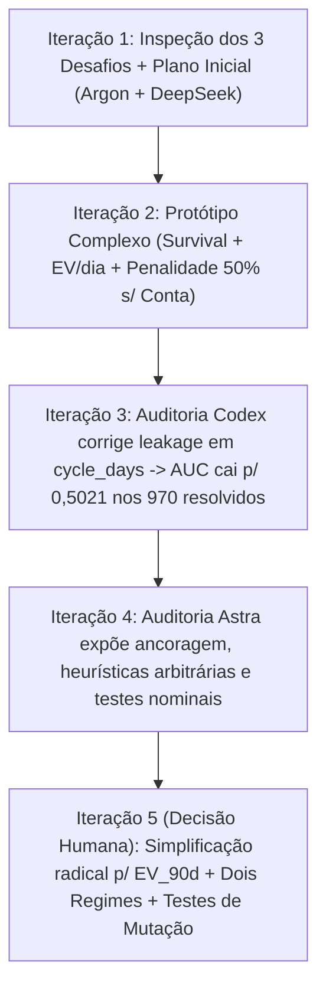

# Process Log — Orquestração Multi-Agente, Erros Reais e Simplificação Orientada por Evidência

**Candidato:** Arthur Lima  
**Posição:** AI Master — G4 Educação  
**Desafio Escolhido:** `Challenge 003 — Lead Scorer (Build / Vendas & RevOps)`  

> *Nota de transparência:* Este documento é um registro retrospectivo estruturado a partir das interações reais, commits intermediários e três auditorias independentes conduzidas durante o desenvolvimento. Onde propostas geradas por IA falharam no backtest ou prometeram mais do que os dados sustentavam, registramos explicitamente o erro, a origem da ideia e a decisão humana de simplificar.

---

## 1. Arquitetura de Trabalho com IA (Papéis Reais)

Em vez de aceitar a primeira saída de um único modelo, organizei o trabalho separando **geração/implementação** de **auditoria independente**:

| Agente / Ferramenta | Papel Real Exercido | Limitação Observada na Prática |
| :--- | :--- | :--- |
| **Gemini Argon (Plano Inicial & Refatoração Final)** | Triagem comparativa dos 3 desafios, desenho inicial da arquitetura de 4 abas e consolidação final pós-auditoria. | No plano inicial, ancorou prematuramente em uma fórmula complexa (`$EV/dia`, penalidade de `-50%` por conta ausente, bônus enterprise) antes de validar se cada termo superava um baseline simples. |
| **Antigravity / Claude Code** | Implementação local dos módulos Python, scripts `run.bat`/`run.sh`, interface Streamlit e execução de `pytest`. | Seguiu a especificação inicial e manteve a complexidade do motor mesmo quando o primeiro backtest corrigido na subpopulação resolvida mostrou `AUC = 0,5021`. |
| **DeepSeek API (Round 1 — Red Team Comercial)** | Crítica inicial às premissas ingênuas (dispersão de 486x nos preços e separação `Prospecting` vs `Engaging`). | Atribuiu o teto de 138 dias exclusivamente à censura à direita, sem verificar que coortes de nov/2016 tinham >400 dias de observação e continuavam sem fechamentos acima de 138 dias. |
| **Codex (Round 2 — Auditoria de Código & Leakage)** | Revisão técnica de implementação pré-submissão. | Detectou vazamento real de `close_date` em `cycle_days` e desalinhamento de índices nos baselines, mas não questionou se o motor ainda merecia sua complexidade após a correção derrubar as métricas no subconjunto resolvido. |
| **Astra (Round 3 — Auditoria Metodológica e Epistemológica)** | Revisão independente confrontando plano, código, testes e narrativa. | Identificou a ancoragem na tese inicial, a mistura entre heurística e probabilidade, o viés de seleção ao excluir os `716` casos não-fechados da fila, dois testes tautológicos, texto desatualizado na UI (`4.032` vs `970`) e atribuição imprecisa no log anterior. |

---

## 2. Linha do Tempo Real das Iterações (Incluindo Regressões)

1. **Iteração 1 — Escolha do Desafio e Saneamento Inicial:** Inspecionamos os CSVs dos três desafios e escolhemos o `Challenge 003` pela aderência direta à rotina comercial B2B. Corrigimos `GTXPro` → `GTX Pro` (`1.480` linhas) e `technolgy` → `technology`, e separamos `Engaging` (`1.589` deals com `engage_date`) de `Prospecting` (`500` deals sem `engage_date`).
2. **Iteração 2 — Construção do Motor Super-Parametrizado (Erro de Ancoragem):** Implementamos a proposta inicial combinando múltiplos multiplicadores manuais (`unlinked_account_penalty = 0.50`, `enterprise_boost = 1.04`, fórmula manual `expected_days_remaining`, `ev_per_day` e score híbrido `0.50/0.30/0.20`), além da aba de feedback do vendedor (que apenas gravava JSON sem alterar a fila).
3. **Iteração 3 — Correção de Leakage (Codex) e Alerta Ignorado:** O Codex identificou que `cycle_days` usava `close_date` futura em deals fechados após o corte e que o `sort_values` desalinhava os baselines. Corrigimos ambos os bugs. O resultado na subpopulação resolvida (`N = 970` em `30/06/2017`) caiu para `AUC = 0,5021` (abaixo da média histórica do vendedor, `0,5070`). Em vez de simplificar o modelo naquele momento, mantivemos a fórmula e justificamos o resultado apenas no texto do `README`.
4. **Iteração 4 — Auditoria Metodológica (Astra):** Eu (Arthur) submeti o repositório completo à revisão crítica do Astra. O diagnóstico apontou que: (a) a narrativa prometia mais do que a validação sustentava; (b) `account` ausente recebia penalidade arbitrária de `-50%`; (c) remover os `716` casos não-fechados avaliava uma subpopulação condicionada ao futuro, não a fila real do vendedor; (d) `test_temporal_split_zero_leakage` e `test_simulator_and_scorer_parity` não testavam vazamento nem paridade real; (e) `app.py` ainda exibia `4.032 negócios`; e (f) este `PROCESS_LOG` atribuía como criação exclusivamente humana o botão de discordância que já constava no plano inicial do Argon.
5. **Iteração 5 — Decisão Executiva de Simplificação e Reconstrução:** Com base na auditoria, auditei novamente os CSVs brutos com o agente e tomei a decisão explícita de **abandonar os pesos heurísticos arbitrários**, separar higiene cadastral de probabilidade, implementar os dois regimes de backtest (fila aberta completa em +90 dias vs. subpopulação condicional resolvida), tornar o override funcional na fila e substituir testes nominais por testes de mutação e invariância.

---

## 3. Registro Auditável de Decisões (Origem → Evidência → Decisão Humana → Resultado)

| # | Sugestão / Hipótese | Origem Inicial | Evidência Empírica Verificada nos Dados | Decisão Humana (Arthur) | Alteração Realizada no Código | Resultado Medido |
|---|---|---|---|---|---|---|
| **1** | Normalizar `GTXPro` → `GTX Pro` e separar `Prospecting` (`500`) de `Engaging` (`1.589`). | Agentes (Argon / Antigravity) na inspeção de schema | `1.480` linhas perdiam join com `products.csv`; `100%` de `Prospecting` está em `Central` sem `engage_date`. | **Aprovar e expandir auditoria** para documentar a assimetria regional (`East`/`West` com `0` em `Prospecting`) e os `5` vendedores sem deals. | `src/data_loader.py` normaliza chaves e audita funil regional; Aba 2 trata `Prospecting` como regra determinística de triagem. | Join `100%` íntegro nas `8.800` linhas; zero imputação artificial de datas em `Prospecting`. |
| **2** | Aplicar penalidade de `-50%` na probabilidade para deals sem `account` e `+4%` / `+12%` para contas Enterprise. | Plano inicial do Argon | **Hipótese refutada:** `100%` dos deals fechados (`4.238 Won` e `2.473 Lost`) têm `account` preenchido (`0` ausentes), provando artefato de fechamento. Correlação de `revenue`/`employees` com vitória é `-0,012` / `-0,008` (`62,9%` vs `63,5%`). | **Rejeitar e remover os multiplicadores.** Separar qualidade cadastral de probabilidade estatística. | Removidos `unlinked_account_penalty` e `enterprise_boost` de `src/survival_and_scoring.py`; criado `crm_hygiene_status` independente. | Elimina *snapshot leakage* histórico e impede punir arbitrariamente `68,5%` da fila aberta. |
| **3** | Manter fórmula composta (`expected_days_remaining`, `$EV/dia` e pesos logarítmicos `0.50/0.30/0.20`) e chamar tabela descritiva de `"Kaplan-Meier Proxy"`. | Plano inicial do Argon + Red Team DeepSeek | Dias corridos até fechamento não medem horas de esforço do vendedor; pesos `0.50/0.30/0.20` não superaram baseline no corte resolvido; tabela calculava proporções simples, não estimador produto-limite. | **Simplificar radicalmente o motor** e corrigir toda a terminologia técnica. | Motor reduzido a `EV_90d = P_90d(idade, vendedor) × Ticket_Mediano`; ablação `P_90d(apenas idade)` incluída; gráfico renomeado honestamente. | Código mais simples, interpretável em dólares no trimestre e com ablação explícita (`60,1%–63,4%` só com idade × ticket). |
| **4** | Avaliar o ranking apenas nos `970` deals abertos em `30/06` que fecharam (`Won`/`Lost`), descartando os `716` que continuaram abertos. | Implementação pós-Codex | Filtrar pelos `970` resolvidos usa o futuro para remover todo o passivo abandonado em `Engaging` (ex.: `350` deals já >90d em `30/06` tiveram `0` fechamentos em 184 dias). | **Publicar os dois regimes lado a lado** (Fila Aberta Completa em +90d e Subpopulação Condicional Resolvida), expondo também um bug sutil de desempate em `sales_price`. | `src/backtest.py` avalia 3 cortes móveis (`31/07`, `31/08`, `30/09`) na fila aberta (global e intra-vendedor) com desempate neutro por `opportunity_id`, mantendo a tabela condicional dos `970` resolvidos. | Fila aberta Top 20% captura `60,1%`, `60,9%` e `63,7%` da receita de 90d (vs `47,6%–49,9%` de Preço Nominal), enquanto documenta `AUC ~0,49–0,51` no condicional resolvido. |
| **5** | Botão de discordância / override do vendedor na interface. | Sugerido originalmente pelo Argon; criticado pelo Astra por não ter efeito funcional e por atribuição incorreta no log | Na versão anterior, clicar no botão apenas salvava JSON sem alterar a fila exibida ao usuário. | **Corrigir a atribuição de autoria neste log** e tornar o override **funcionalmente ativo** na ordenação operacional. | `apply_rep_overrides()` e `app.py` agora promovem (`⬆️`), pausam (`⏸️`), arquivam (`🗑️`) ou restauram (`🔄`) negócios em tempo real com `st.rerun()`, preservando `P_90d` e `EV_90d` originais. | Override auditável, funcional e coberto por teste unitário dedicado. |
| **6** | Suíte de testes de anti-leakage e paridade do simulador. | Implementação inicial + apontamento do Astra | `test_temporal_split_zero_leakage` testava apenas o filtro `<= t_cut` do próprio teste; `test_simulator_and_scorer_parity` testava apenas `> 0`. | **Substituir garantias nominais por testes capazes de falhar diante de regressões reais.** | `tests/test_engine.py` reescrito com corrupção deliberada de dados pós-corte (`Won <-> Lost`, `close_value * 100`), permutação aleatória de linhas, comparação par-a-par em 20 deals reais e `Streamlit AppTest`. | `13` testes comportamentais passando em ~8s, cobrindo motor, backtest e renderização das 4 abas da UI. |

---

## 4. Onde Esteve o Julgamento Humano Real

1. **Orquestrar auditorias cruzadas hostis (DeepSeek → Codex → Astra)** em vez de aceitar o código aparentemente pronto após o primeiro `pytest` verde.
2. **Decidir abandonar complexidade quando confrontado pelos dados:** autorizar a remoção da fórmula de velocidade diária e dos multiplicadores heurísticos inicialmente defendidos pelos próprios agentes, mantendo apenas o que sobreviveu à ablação *out-of-time*.
3. **Exigir publicação integral dos resultados desfavoráveis:** manter na UI e no `README` a tabela condicional (`Won` vs `Lost`, `AUC ~0,49–0,51`) ao lado da avaliação da fila aberta (`EV_90d`), deixando explícito para um gestor comercial exatamente o que a ferramenta resolve (triagem de passivo estagnado ponderada por ticket) e o que ela não resolve (adivinhar o vencedor de uma negociação ativa sem dados de interação).

---

## 5. Artefatos de Verificação

- **Histórico Detalhado das 3 Rodadas de Auditoria:** [`process-log/adversarial-red-team-audit.md`](./process-log/adversarial-red-team-audit.md)
- **Relatório Reprodutível de Backtest (Dois Regimes + Ablação):** [`solution/artifacts/backtest_report.md`](./solution/artifacts/backtest_report.md)
- **Suíte de Testes de Mutação, Invariância, Paridade e UI:** [`solution/tests/test_engine.py`](./solution/tests/test_engine.py) (`python -m pytest tests/test_engine.py -v`)
