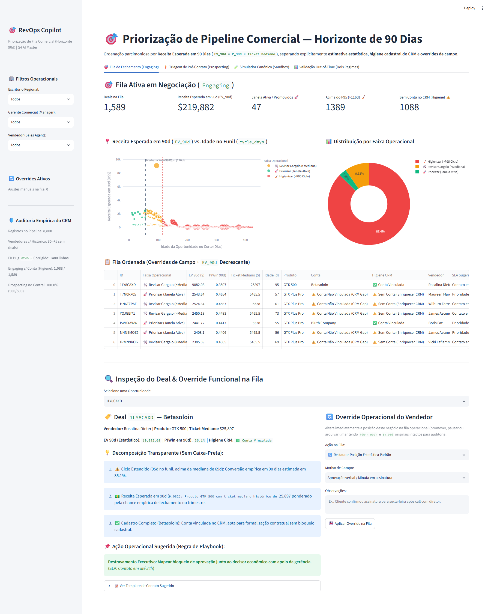
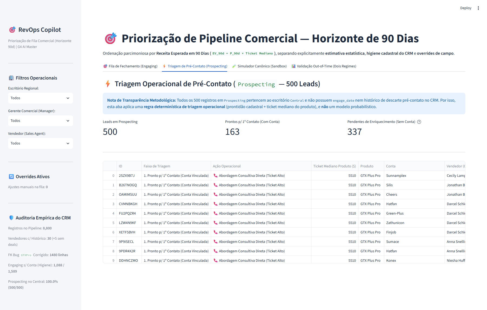
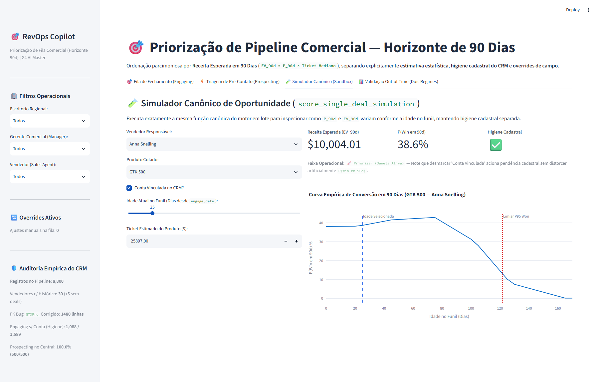
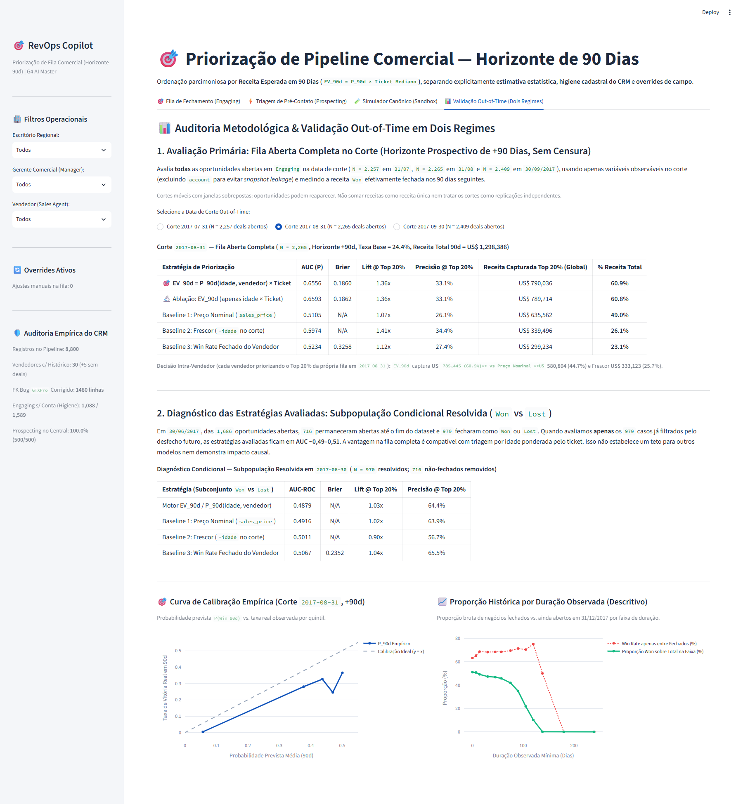

# Submissão — Arthur Lima — Challenge 003: Lead Scorer

## Sobre mim

- **Nome:** Arthur Lima
- **LinkedIn:** [linkedin.com/in/arthur-roleite](https://www.linkedin.com/in/arthur-roleite)
- **Challenge escolhido:** `Challenge 003 — Lead Scorer (Build / Vendas & RevOps)`
- **Repositório da Solução:** `submissions/arthur-lima/solution/`

---

## Executive Summary

Para ajudar vendedores a concentrar atenção nas oportunidades com maior receita esperada, construí um painel com filas de fechamento e prospecção, explicações e intervenção manual. O motor prioriza a carteira por `EV_90d = P_90d(idade, vendedor) × Ticket_Mediano`, com dados disponíveis na data da decisão. Em três cortes temporais móveis com janelas sobrepostas, o Top 20% selecionado reúne **60,1%–63,7% da receita histórica realizada nos 90 dias seguintes**, contra **47,6%–49,9%** do ranking por preço nominal (**aproximadamente +10 a +16 pontos percentuais de captura de receita histórica**); isso não demonstra receita incremental causada pela ferramenta. No diagnóstico apenas dos negócios que depois fecharam, as estratégias avaliadas ficam próximas do acaso (**AUC ~0,49–0,51**), por isso recomendo usar o protótipo para triagem assistida da carteira, preservando o contexto do vendedor e validando impacto em campo.

---

## ⚡ Como Rodar a Solução em 1 Comando

Requer **Python 3.12** e acesso à internet na primeira instalação das dependências. Os 4 CSVs oficiais estão incluídos em `solution/data/`. No Windows, o launcher tenta `python` e usa `py -3.12` como alternativa. Os launchers verificam a versão do Python e sincronizam as dependências também em ambientes já existentes.

### No Windows:
```cmd
cd submissions/arthur-lima/solution
run.bat
```
*(Cria/usa `venv`, instala `requirements.txt`, executa a suíte de testes automatizados de mutação/invariância/UI com `pytest` e inicia o painel em `http://localhost:8501`).*

### No macOS / Linux:
```bash
cd submissions/arthur-lima/solution
chmod +x run.sh
./run.sh
```

### Execução Manual:
```bash
cd submissions/arthur-lima/solution
pip install -r requirements.txt
python -m pytest tests/test_engine.py -v
streamlit run app.py
```

Para verificar instalação e testes sem manter o servidor aberto: `run.bat --check`
no Windows ou `./run.sh --check` no macOS/Linux. Se o `venv` tiver sido criado com
outra versão do Python, renomeie a pasta e execute novamente com Python 3.12.

---

### Roteiro de avaliação — 5 minutos

1. **Use:** rode a aplicação, abra a fila de Closers, inspecione os motivos de uma oportunidade e aplique um override; depois restaure a fila preservando o histórico.
2. **Questione:** na aba de validação, compare o ranking com os baselines e consulte também o diagnóstico dos resolvidos. A receita é observacional; os três horizontes se sobrepõem.
3. **Verifique meu julgamento:** escolha uma decisão [H1–H5](./PROCESS_LOG.md#decisoes-humanas), veja sua origem, o comentário no código e o teste correspondente. O modo `--check` executa a suíte sem manter o servidor aberto.

## Solução

### Abordagem

#### 1. Auditoria Empírica do CRM & Saneamento de Dados (`src/data_loader.py`)

- **Correção de Chave Estrangeira (`GTXPro` → `GTX Pro`):** `1.480` linhas em `sales_pipeline.csv` grafavam `GTXPro` sem espaço, quebrando o join com `products.csv`. Corrigimos também `technolgy` → `technology` em `accounts.csv`.
- **Preenchimento de `account` por estágio (`0` ausentes em fechados vs. `1.425` em abertos):** Como `Won` e `Lost` têm `0%` de ausência de `account`, a falta de conta em `1.088` deals `Engaging` e `337` `Prospecting` é compatível com diferenças de preenchimento por estágio; o export não registra quando a conta foi vinculada. Por isso, **excluímos `account` do cálculo de `P_90d`** (evitando *snapshot leakage* e penalidades arbitrárias) e a tratamos como tarefa explícita de higiene cadastral (`crm_hygiene_status`).
- **Assimetria Regional de Funil e Vendedores:** `100%` dos `500` leads em `Prospecting` pertencem ao escritório `Central`. Além disso, dos `35` nomes em `sales_teams.csv`, `30` possuem histórico em `sales_pipeline.csv` e `5` não possuem registros. O acúmulo desigual de negócios antigos ainda abertos em `Engaging` limita a comparação por win rate fechado `Won / (Won + Lost)`, que não considera a fila ainda sem desfecho.
- **Estimativa Point-in-Time de Ticket (`expected_won_value`):** Mediana histórica de `close_value` dos negócios `Won` por `(produto, escritório)` fechados estritamente até `as_of_date` (fallback para preço de catálogo quando não há histórico).

#### 2. Separação Estrita entre Estimativa Estatística e Regras Operacionais (`src/survival_and_scoring.py`)

| Camada | Natureza | Como Funciona |
| :--- | :--- | :--- |
| **`p_win_90d` e `ev_90d`** | **Estimativa Estatística** (validada *out-of-time*) | Aprende a taxa empírica de conversão em +90 dias por faixa de idade em snapshots semanais históricos cujas janelas de 90 dias já se encerraram até `as_of_date` (interpolação linear contínua, suavização Empirical Bayes `m=20`), multiplicada por ajuste moderado do vendedor (`m=50`) e pelo `expected_won_value`. |
| **`crm_hygiene_status`** | **Regra de Governança Cadastral** | Sinaliza `⚠️ Sem Conta (Enriquecer CRM)` para preenchimento obrigatório antes da proposta final, **sem alterar `p_win_90d`**. |
| **`action_tier` (`Engaging`)** | **Regra Operacional de Triagem** | Classifica a fila pela idade frente aos marcos históricos de `Won` do produto: `🚀 Priorizar (<= Mediana ~57d)`, `🛠️ Revisar Gargalo (Mediana–P95)` e `🧹 Higienizar (>P95 ~116d)`. |
| **Overrides de Campo (`app.py`)** | **Intervenção Humana Funcional** | Permite ao vendedor promover (`⬆️`), pausar (`⏸️`) ou arquivar (`🗑️`) negócios na fila operacional em tempo real (`artifacts/feedback_overrides.json`), mantendo `p_win_90d` e `ev_90d` originais visíveis e inalterados. |
| **Triagem `Prospecting` (`500` leads)** | **Regra Determinística** (não-probabilística) | Como não há `engage_date` nem log de descarte pré-contato no CRM, ordena de forma transparente por prontidão cadastral (`has_account`) e `expected_won_value`, sem inventar probabilidades não-verificáveis. |

---

### Resultados / Findings (`src/backtest.py`)

Publicamos **dois regimes complementares de avaliação** (com desempate neutro por `opportunity_id` e zero vazamento futuro, verificados por teste de mutação):

#### Regime 1 — Avaliação Operacional Primária: Fila Aberta Completa no Corte (Horizonte +90 Dias, Sem Censura)

Avalia **todas** as oportunidades abertas em `Engaging` disponíveis ao vendedor em três datas de corte mensais (`31/07/2017`, `31/08/2017` e `30/09/2017` — todas com janela futura completa de 90 dias até `31/12/2017`):

| Corte Out-of-Time | Estratégia | AUC (`P_90d`) | Brier | Lift @ Top 20% | Receita no Top 20% (Fila Global) | Receita no Top 20% (Intra-Vendedor) |
| :---: | :--- | :---: | :---: | :---: | :---: | :---: |
| **`2017-07-31`**<br>(`N = 2.257` abertos) | **🎯 EV_90d (Idade + Vendedor × Ticket)** | **0,7209** | **0,2046** | **1,31x** | **US\$ 1.033.856 (60,1%)** | **US\$ 1.030.733 (59,9%)** |
| | 🔬 Ablação: EV_90d (Apenas Idade × Ticket) | 0,7503 | 0,2043 | 1,31x | US\$ 1.033.818 (60,1%) | US\$ 1.030.733 (59,9%) |
| | Baseline 1: Preço Nominal (`sales_price`) | 0,5086 | N/A | 1,05x | US\$ 857.458 (49,9%) | US\$ 828.223 (48,2%) |
| | Baseline 2: Frescor (`-idade` no corte) | 0,5581 | N/A | 0,49x | US\$ 183.140 (10,7%) | US\$ 314.570 (18,3%) |
| | Baseline 3: Win Rate Fechado do Vendedor | 0,4945 | 0,3170 | 1,01x | US\$ 272.678 (15,9%) | N/A (constante por rep) |
| **`2017-08-31`**<br>(`N = 2.265` abertos) | **🎯 EV_90d (Idade + Vendedor × Ticket)** | **0,6556** | **0,1860** | **1,36x** | **US\$ 790.036 (60,9%)** | **US\$ 785.445 (60,5%)** |
| | 🔬 Ablação: EV_90d (Apenas Idade × Ticket) | 0,6593 | 0,1862 | 1,36x | US\$ 789.714 (60,8%) | US\$ 785.445 (60,5%) |
| | Baseline 1: Preço Nominal (`sales_price`) | 0,5105 | N/A | 1,07x | US\$ 635.562 (49,0%) | US\$ 580.894 (44,7%) |
| | Baseline 2: Frescor (`-idade` no corte) | 0,5974 | N/A | 1,41x | US\$ 339.496 (26,1%) | US\$ 333.123 (25,7%) |
| | Baseline 3: Win Rate Fechado do Vendedor | 0,5234 | 0,3258 | 1,12x | US\$ 299.234 (23,1%) | N/A (constante por rep) |
| **`2017-09-30`**<br>(`N = 2.409` abertos) | **🎯 EV_90d (Idade + Vendedor × Ticket)** | **0,6253** | **0,1756** | **1,37x** | **US\$ 776.685 (63,7%)** | **US\$ 701.740 (57,5%)** |
| | 🔬 Ablação: EV_90d (Apenas Idade × Ticket) | 0,6133 | 0,1754 | 1,36x | US\$ 773.270 (63,4%) | US\$ 701.740 (57,5%) |
| | Baseline 1: Preço Nominal (`sales_price`) | 0,4880 | N/A | 0,98x | US\$ 580.662 (47,6%) | US\$ 546.305 (44,8%) |
| | Baseline 2: Frescor (`-idade` no corte) | 0,8265 | N/A | 2,14x | US\$ 564.032 (46,2%) | US\$ 551.774 (45,2%) |
| | Baseline 3: Win Rate Fechado do Vendedor | 0,4925 | 0,3509 | 0,90x | US\$ 227.784 (18,7%) | N/A (constante por rep) |

**O que os três cortes indicam na ablação:** praticamente todo o ganho de captura de receita (`+10` a `+16` pontos percentuais sobre o Preço Nominal, tanto na fila global quanto dentro da carteira de cada vendedor) vem da **combinação simples entre a curva empírica de conversão por idade e o ticket mediano do produto**; o fator do vendedor atua apenas como critério fino de desempate entre carteiras (`+0,0%` a `+0,3%`).

#### Regime 2 — Diagnóstico Condicional: Subpopulação Resolvida (`Won` vs `Lost`, `N = 970` em `30/06/2017`)

Quando removemos *a posteriori* os `716` negócios que permaneceram abertos sem fechar e avaliamos apenas os `970` negócios que efetivamente chegaram a `Won` (`609`) ou `Lost` (`361`):

| Estratégia (Subconjunto `Won` vs `Lost`) | AUC-ROC | Brier | Lift @ Top 20% | Precisão @ Top 20% |
| :--- | :---: | :---: | :---: | :---: |
| Motor `EV_90d` | 0,4879 | N/A | 1,03x | 64,4% |
| Baseline 1: Preço Nominal (`sales_price`) | 0,4916 | N/A | 1,02x | 63,9% |
| Baseline 2: Frescor (`-idade` no corte) | 0,5011 | N/A | 0,90x | 56,7% |
| Baseline 3: Win Rate Fechado do Vendedor | 0,5067 | 0,2352 | 1,04x | 65,5% |

**Interpretação objetiva:** uma vez eliminados os negócios estagnados usando informação futura de quem fechou, as estratégias testadas com campos estáticos não distinguiram bem vitória de derrota nesse recorte entre negociações ativas (`AUC ~0,49–0,51`). Logo, o motor **não** substitui o contexto qualitativo do vendedor em negociações vivas — ele evita que a atenção comercial seja drenada pelo passivo acumulado em `Engaging` e pondera os negócios ativos pelo retorno esperado.

---

### Recomendações

1. **Padronizar o estágio `Prospecting` e a baixa de `Lost` em `East` e `West`:** eliminar a assimetria operacional em relação ao escritório `Central`, exigindo revisão quinzenal de negócios acima do P95 de ciclo (`~116` dias).
2. **Tornar `account` obrigatório na passagem para proposta comercial:** sanear os `1.088` registros sem conta em `Engaging` como rotina de qualidade cadastral, sem misturar falta de preenchimento com probabilidade estatística.
3. **Instrumentar telemetria de interações no CRM:** registrar data do último contato bidirecional, reuniões realizadas e envio de proposta para buscar melhorar o desempenho de `AUC ~0,49–0,51` observado nas estratégias avaliadas na subpopulação condicional `Won` vs `Lost`.
4. **Validar impacto causal em campo antes de automatizar bloqueios:** os ganhos de captura de receita no Top 20% são observacionais sobre coortes históricas; ganhos incrementais reais de receita exigem teste controlado por carteira/equipe.

---

### Limitações

Os horizontes dos três cortes se sobrepõem e uma oportunidade pode aparecer mais de uma vez. Os resultados não são replicações independentes, não devem ser somados como receita única e não demonstram impacto causal. As limitações observadas não estabelecem um teto universal para outros modelos.

1. **Sem telemetria de esforço ou atividades comerciais:** `EV_90d` mede receita esperada no horizonte de 90 dias corridos, não retorno por hora de trabalho do vendedor.
2. **Sem histórico de transição pré-contato em `Prospecting`:** os `500` registros em `Prospecting` não permitem estimar probabilidade empírica de qualificação; a Aba 2 opera estritamente como fila determinística de triagem.
3. **Recalibração automática ainda não acoplada aos overrides:** os overrides do vendedor reordenam imediatamente a fila operacional e ficam auditados em JSON, mas não reestimam os pesos estatísticos de `P_90d` automaticamente sem desfechos fechados verificados.

4. **Persistência local de feedback:** as gravações são serializadas por lock e publicadas por substituição atômica. Restaurar a fila adiciona um evento `reset_all`, preservando decisões anteriores. O JSON continua editável no disco e não é um registro inviolável nem um serviço de produção. Uma falha abrupta pode deixar `feedback_overrides.json.lock`: confirme que nenhuma instância está gravando antes de remover esse lock. JSON inválido é sinalizado e não é sobrescrito silenciosamente.

5. **Escopo da avaliação:** o backtest aceita exclusivamente 90 dias, com janela terminando até 31/12/2017 e fila não vazia. A API rejeita outros horizontes em vez de compará-los com o modelo de 90 dias. As medianas de ticket são uma aproximação de valor contratual, não uma estimativa validada de margem ou de esforço comercial.

---

## Process Log — Como usei IA

### Meu papel: orquestração, revisão e decisões

O fluxo partiu de um **esboço de especificação no Antigravity**, passou por **revisão adversarial do DeepSeek** e seguiu para **auditoria e implementação no Codex**. **Revisei e ajustei o trabalho em cada etapa**, conduzindo a evolução da especificação, as correções e a preparação da entrega. As primeiras versões tinham falhas; ao longo das revisões, ajustei o direcionamento para simplificar o motor e explicitar seus limites.

- **Direção:** orientar a entrega para a decisão do vendedor — quais oportunidades trabalhar — e coordenar implementação e revisão em etapas distintas.
- **Arbitragem:** incorporar as críticas que levaram à retirada de penalidades sem validação, à simplificação para `EV_90d` e à publicação dos resultados desfavoráveis junto aos favoráveis.
- **Critério de entrega:** exigir revisão das evidências, testes comportamentais e coerência entre código, interface e documentação; o Codex executou a implementação e as verificações, com minha revisão e meus ajustes durante o processo.

As contribuições das ferramentas são distinguidas das minhas revisões e decisões, sem presumir autoria exclusiva de cada ideia. O [mapa de decisões H1–H5](./PROCESS_LOG.md#decisoes-humanas) liga **origem da proposta → decisão de Arthur → implementação → evidência**. Os mesmos identificadores aparecem em comentários nos pontos relevantes do código.

### Ferramentas usadas

| Ferramenta / responsável | Contribuição |
| :--- | :--- |
| Antigravity | Esboço da especificação |
| DeepSeek | Revisão adversarial |
| Codex | Auditoria, implementação e verificação |
| **Arthur** | **Orquestração, revisão e ajustes em cada etapa** |

A [tabela de papéis e limitações](./PROCESS_LOG.md#papeis-ia) distingue a contribuição de cada ferramenta.

### Workflow

Esboço de spec no Antigravity → revisão adversarial no DeepSeek → auditoria e implementação no Codex, com minhas revisões e ajustes em cada etapa. O [process log](./PROCESS_LOG.md) registra esse fluxo, as correções técnicas e a preparação da entrega, sem transformar etapas em uma contagem não comprovada de sessões ou prompts.

### Onde a IA errou e como corrigi

Auditorias realizadas com agentes identificaram uso de data futura no aging, baselines desalinhados e testes que não detectavam os defeitos. Revisei e ajustei o trabalho ao longo das etapas, encaminhei as correções e conferi sua coerência com a entrega; auditoria e implementação foram realizadas no Codex. **Não atribuo a mim a descoberta exclusiva desses bugs.**

### O que eu adicionei que a IA sozinha não faria

Minha contribuição foi conduzir o processo e revisar e ajustar cada etapa: o esboço, a crítica adversarial e a implementação. A simplificação, os dois regimes de avaliação e o override tiveram contribuições dos agentes; minha responsabilidade foi escolher incorporá-los e exigir consistência na entrega. O [registro detalhado](./PROCESS_LOG.md#registro-decisoes) apresenta decisões, evidências e resultados, inclusive erros que sobreviveram às primeiras revisões.

Registro das críticas: [`process-log/adversarial-red-team-audit.md`](./process-log/adversarial-red-team-audit.md). A narrativa é retrospectiva; comentários no código explicam decisões e não substituem transcrições originais.

---

## Evidências

- [x] **Processo e componente humano:** [`PROCESS_LOG.md`](./PROCESS_LOG.md), mapa H1–H5 e comentários correspondentes no código, distinguindo proposta dos agentes, decisão do candidato e implementação.
- [x] **Suíte de Testes de Mutação, Invariância, Paridade, Persistência e UI:** `python -m pytest tests/test_engine.py -v` (testa corrupção deliberada de dados futuros, separação entre `account` e `P_90d`, permutação de linhas, paridade lote vs. simulador, reordenação funcional por override e renderização completa das 4 abas via `Streamlit AppTest`).
- [x] **Relatório Reprodutível dos Dois Regimes + Ablação:** [`solution/artifacts/backtest_report.md`](./solution/artifacts/backtest_report.md).
- [x] **Aplicação Interativa Executável em 1 Comando:** [`solution/app.py`](./solution/app.py), `run.bat` e `run.sh`.

### Capturas reais da aplicação

Capturas das quatro abas, com os dados oficiais e o filtro de vendedor em **Todos**. São evidências da interface executada; o processo de revisão está documentado no log acima.

#### Fila de Fechamento



#### Triagem de SDRs



#### Simulador Sandbox



#### Validação dos Dois Regimes


