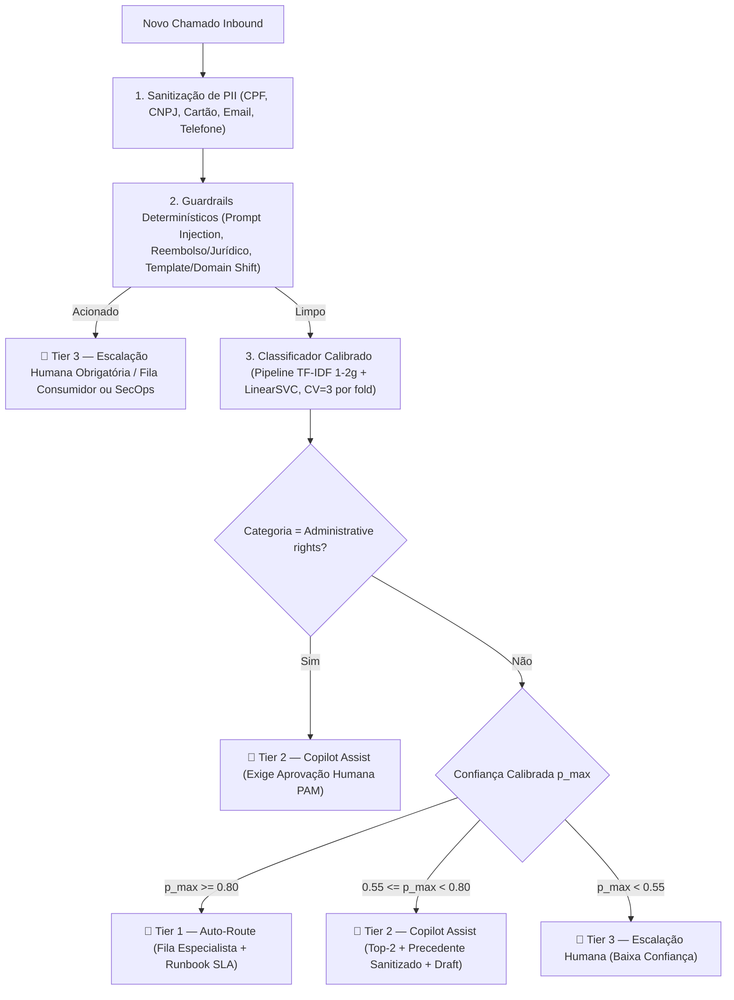
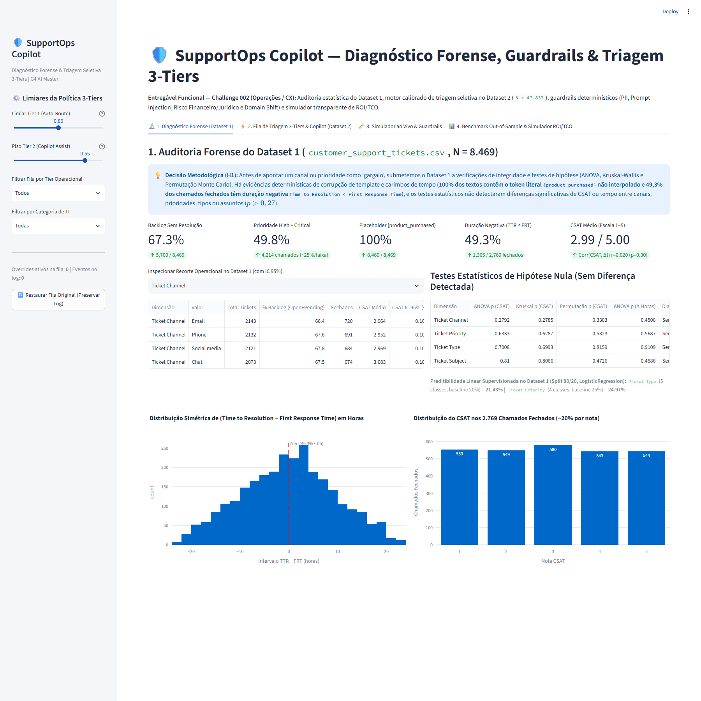
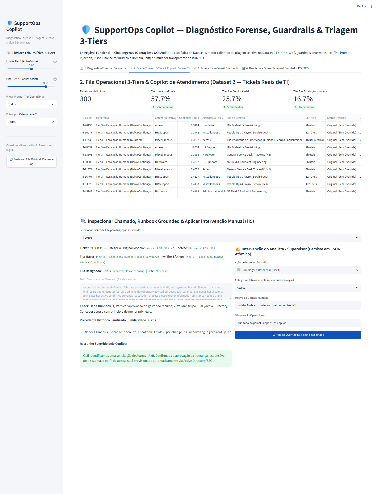
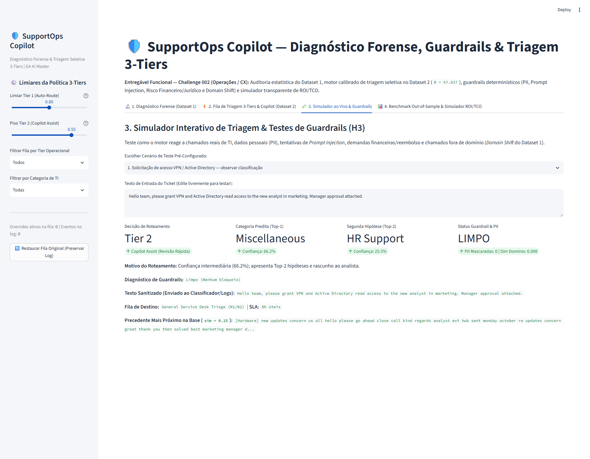
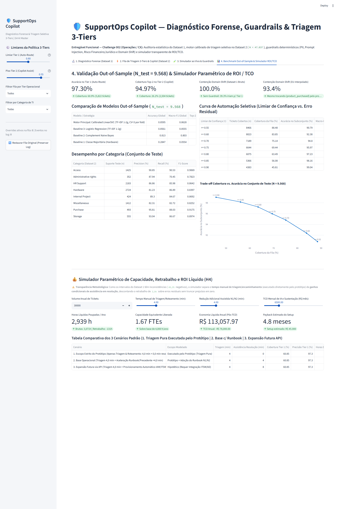

# Submissão — Arthur Lima — Challenge 002: Redesign de Suporte

## Sobre mim

- **Nome:** Arthur Lima
- **LinkedIn:** [linkedin.com/in/arthur-roleite](https://www.linkedin.com/in/arthur-roleite)
- **Challenge escolhido:** `Challenge 002 — Redesign de Suporte (Operações / CX — Diagnóstico + Automação + Build)`
- **Repositório da Solução:** `submissions/arthur-lima/challenge-002/solution/`

---

## Executive Summary

Construí o **SupportOps Copilot** para reduzir o trabalho de classificação e encaminhamento de chamados, com fila em três níveis, precedentes sanitizados e revisão humana. No teste com **9.568 tickets de TI**, o motor encaminha **60,85% da fila com 97,30% de acurácia**, reservando os demais para assistência ou escalação. No Dataset 1, encontrei placeholders em **100%** dos textos e intervalos temporais negativos em **49,30%** dos chamados fechados; por isso, não estimei desperdício real com esses tempos nem atribuí causas a canal ou prioridade. Recomendo um piloto de roteamento assistido, medindo tempo de triagem e custo de erro: o ROI abaixo é uma projeção com premissas explícitas, e o protótipo não executa a resolução técnica do chamado.

---

## ⚡ Como Rodar a Solução em 1 Comando

Requer **Python 3.12** e acesso à internet na primeira instalação das dependências. Os 2 CSVs oficiais estão incluídos em `solution/data/`. No Windows, o launcher tenta `python` e usa `py -3.12` como alternativa, validando versão, `pip check` e a suíte `pytest` antes de abrir a interface.

### No Windows:
```cmd
cd submissions/arthur-lima/challenge-002/solution
run.bat
```
*(Cria/usa `venv`, instala `requirements.txt`, executa a suíte de testes de mutação/invariância/paridade/guardrails/UI com `pytest` e inicia o painel em `http://localhost:8501`).*

### No macOS / Linux:
```bash
cd submissions/arthur-lima/challenge-002/solution
chmod +x run.sh
./run.sh
```

### Execução Manual:
```bash
cd submissions/arthur-lima/challenge-002/solution
pip install -r requirements.txt
python -m pytest tests/test_support_engine.py -v
python -m src.benchmark
streamlit run app.py
```

Para verificar instalação e testes sem manter o servidor aberto: `run.bat --check` no Windows ou `./run.sh --check` no macOS/Linux.

---

### Roteiro de avaliação — 5 minutos

1. **Audite o Diagnóstico (Aba 1):** inspecione os recortes de Canal, Prioridade e Tipo no Dataset 1 (com intervalos de confiança de 95%) e verifique os p-valores de ANOVA, Kruskal-Wallis e Permutação ($p > 0{,}27$), além do histograma de tempos negativos (`49,3% < 0h`).
2. **Opere a Fila 3-Tiers e o Copilot (Aba 2):** filtre por Tier, inspecione o precedente histórico sanitizado e aplique um override humano (`Homologar Tier 1`, `Reclassificar` ou `Escalar Tier 3`); depois restaure a fila preservando o log de auditoria.
3. **Teste os Guardrails ao Vivo (Aba 3):** execute os 5 cenários pré-configurados (acesso VPN, dúvida ambígua, *Prompt Injection*, reembolso de consumidor com CPF/cartão e privilégio administrativo PAM).
4. **Questione o Benchmark e o ROI (Aba 4):** consulte a curva Cobertura vs. Acurácia em `N_test = 9.568`, o teste de estresse de *Domain Shift* e varie separadamente o tempo manual de triagem e a redução assistida nos controles de ROI/TCO.
5. **Verifique o Julgamento Humano:** consulte o mapa [H1–H5](./PROCESS_LOG.md#decisoes-humanas) e execute `run.bat --check`.

---

## Solução

### Abordagem

#### 1. Diagnóstico Operacional & Auditoria Forense do Dataset 1 (`src/data_loader.py`)

O README do desafio propõe três perguntas sobre o Dataset 1 (`customer_support_tickets.csv`, `8.469` registros): *onde o fluxo trava*, *o que impacta satisfação* e *quanto estamos desperdiçando*. A inspeção estatística mostra que responder a essas perguntas apenas comparando médias brutas por canal ou prioridade levaria a conclusões não sustentadas pelos dados:

| Indicador Auditado no Dataset 1 (`N = 8.469`) | Valor Observado | Significado Técnico e Operacional |
| :--- | :---: | :--- |
| **Backlog Aberto / Pendente** | `5.700 / 8.469` (**`67,30%`**) | `2.819` *Open* (`33,29%`) + `2.881` *Pending Customer Response* (`34,02%`). Nenhum chamado não-fechado possui `Time to Resolution` ou `CSAT`. |
| **Distribuição Equitativa de Prioridades (`High` + `Critical`)** | `4.214 / 8.469` (**`49,76%`**) | As 4 faixas têm proporção quase idêntica (`~25%` cada), tornando o rótulo de prioridade pouco seletivo para ordenação de fila. |
| **Placeholder Literal `{product_purchased}`** | `8.469 / 8.469` (**`100,00%`**) | Evidência determinística de falha de template: todos os `8.469` textos de descrição contêm o token literal `{product_purchased}` não interpolado. |
| **Inversão Temporal nos Fechados (`TTR < FRT`)** | `1.365 / 2.769` (**`49,30%`**) | Evidência determinística de corrupção temporal: quase metade dos tickets fechados tem carimbo de resolução **anterior** à primeira resposta (média `-0,06 h`, mediana `+0,17 h`). |
| **Testes de Hipótese em CSAT e Tempo** | ANOVA $p \in [0{,}28; 0{,}81]$ | ANOVA, Kruskal-Wallis e Permutação não detectam diferenças significativas entre grupos; CSAT médio `2,991` sem correlação linear com duração ($r = 0{,}0199, p = 0{,}2958$). |
| **Preditibilidade Linear no Dataset 1** | `21,43%` (Tipo) / `24,97%` (Prioridade) | No classificador linear avaliado no split 80/20 (`N_test = 1.694`), a acurácia fica no patamar do baseline uniforme (`20,0%` para 5 tipos e `25,0%` para 4 prioridades). |

**Conclusão do Diagnóstico (Decisão H1):** Os testes realizados não detectaram diferenças significativas nas dimensões avaliadas. Os placeholders e as inversões temporais impedem tratar esses registros como medição confiável do fluxo. As proporções de prioridade e backlog são descritivas; não demonstram, isoladamente, ausência de triagem nem desperdício recuperável. O classificador linear testado não apresentou desempenho claramente superior ao baseline uniforme; isso não prova ausência geral de sinal nem impossibilidade de aprendizado por outros métodos.

#### 2. Arquitetura de Automação Seletiva em 3 Tiers & Guardrails (`src/triage_engine.py` e `src/guardrails.py`)

Para construir uma automação que funcione sobre chamados reais, treinamos o motor de triagem no **Dataset 2 (`all_tickets_processed_improved_v3.csv`, `N = 47.837` tickets reais de Service Desk corporativo em 8 categorias)**, separando estritamente a inferência estatística das regras determinísticas de segurança e negócio:



- **O que Automatizar (Tier 1 — Auto-Route):** Classificação e encaminhamento direto de chamados corporativos de TI (`Hardware`, `HR Support`, `Access`, `Storage`, `Purchase`, `Internal Project`, `Miscellaneous`) quando a confiança calibrada for $\ge 0{,}80$ e nenhum guardrail for acionado.
- **O que Assistir com Humano no Loop (Tier 2 — Copilot Assist):** Chamados com confiança intermediária ($0{,}55 \le p_{\max} < 0{,}80$) e solicitações de **`Administrative rights`** (que exigem validação humana de menor privilégio / PAM mesmo quando o texto é claro). O analista recebe as **Top-2 categorias**, o **precedente histórico sanitizado mais similar da base de treino** e um **rascunho estruturado de resposta/checklist**.
- **O que NÃO Automatizar em Hipótese Alguma (Tier 3 — Escalação Humana — Irrevogável para Auto-Route):**
  1. Tentativas de *Prompt Injection* ou subversão de instruções (`ignore previous instructions`, `approve immediate refund`, etc.);
  2. Demandas financeiras, estornos, cancelamentos de contrato, ameaças jurídicas (`Procon`, `lawsuit`) ou incidentes de perda/vazamento de dados (`data loss`, `ransomware`);
  3. Chamados fora do domínio de TI corporativo (*Domain Shift* — como os chamados de varejo/consumidor do Dataset 1 ou templates corrompidos `{product_purchased}`);
  4. Chamados ambíguos com confiança $< 0{,}55$.
  *(Tickets bloqueados por Guardrail jamais podem ser promovidos ao despacho automático Tier 1 por override acidental).*

---

### Resultados / Findings (`src/benchmark.py`)

Todos os números abaixo são reproduzíveis executando `python -m src.benchmark` ou `python src/benchmark.py` a partir de `solution/` (salvo em [`solution/artifacts/benchmark_report.md`](./solution/artifacts/benchmark_report.md)):

#### 1. Comparação de Modelos Out-of-Sample no Dataset 2 (`N_train = 38.269`, `N_test = 9.568`, `0,00%` duplicatas entre treino e teste)

| Modelo / Estratégia | Accuracy Global | Macro-F1 Global | Top-2 Accuracy |
| :--- | :---: | :---: | :---: |
| **🎯 Motor Principal: Calibrated LinearSVC (TF-IDF 1-2g, CV=3 por fold)** | **85,95%** | **0,8628** | **96,30%** |
| Baseline 3: Logistic Regression (TF-IDF 1-2g) | 85,61% | 0,8555 | N/A |
| Baseline 2: Complement Naive Bayes | 81,30% | 0,8030 | N/A |
| Baseline 1: Classe Majoritária (`Hardware`) | 28,47% | 0,0554 | N/A |

#### 2. Curva de Automação Seletiva no Conjunto de Teste (`N_test = 9.568` — Confiança Bruta vs. Tier 1 Operacional Pós-Guardrail/PAM)

| Limiar de Confiança ($\tau$) | Cobertos Bruto ($n$) | Cobertura Bruta (%) | Acurácia Bruta (%) | Tier 1 Operacional ($n$) | Cobertura Tier 1 Operacional (%) | Acurácia Tier 1 Operacional (%) |
| :---: | :---: | :---: | :---: | :---: | :---: | :---: |
| `>= 0,55` | 8.466 | 88,48% | **90,79%** | 8.048 | **84,11%** | **90,88%** |
| `>= 0,60` | 8.023 | 83,85% | **92,38%** | 7.642 | **79,87%** | **92,45%** |
| `>= 0,70` | 7.189 | 75,14% | **94,80%** | 6.869 | **71,79%** | **94,86%** |
| `>= 0,75` | 6.644 | 69,44% | **95,97%** | 6.354 | **66,41%** | **96,02%** |
| **`>= 0,80` (Padrão Tier 1)** | **6.075** | **63,49%** | **97,23%** | **5.822** | **60,85%** | **97,30%** |
| `>= 0,85` | 5.366 | 56,08% | **98,16%** | 5.162 | **53,95%** | **98,20%** |
| `>= 0,90` | 4.383 | 45,81% | **99,04%** | 4.242 | **44,34%** | **99,03%** |

Na configuração operacional padrão ($\tau_{\text{Tier 1}} = 0{,}80$, $\tau_{\text{Tier 2}} = 0{,}55$, com Guardrails e gate PAM para `Administrative rights`) sobre os `9.568` tickets de teste:
- **Tier 1 — Auto-Route:** **`5.822` tickets (`60,85%` da fila)** classificados e encaminhados automaticamente com **`97,30%` de acurácia** (`2,70%` de erro residual);
- **Tier 2 — Copilot Assist:** **`2.504` tickets (`26,17%` da fila)** assistidos com **`94,97%` de cobertura nas Top-2 categorias**;
- **Tier 3 — Escalação Humana:** **`1.242` tickets (`12,98%` da fila)** retidos para análise humana integral.

#### 3. Teste de Estresse de Domain Shift (Dataset 1 Consumidor aplicado ao Motor de TI Dataset 2)

- **Sem Guardrails de Domínio (usando apenas `confiança >= 0,80`):** **`3.329 / 8.469` (`39,31%`)** dos chamados de consumidor do Dataset 1 receberiam confiança $\ge 0{,}80$ e seriam falsamente despachados para filas internas de TI.
- **Com Guardrails Determinísticos (Dataset 1 Bruto):** **`0 / 8.469` (`0,00%`)** vão para o Tier 1 (**`100,00%` de contenção**).
- **Com Guardrails Determinísticos (Dataset 1 com `{product_purchased}` substituído pelo nome real do produto):** **`93,43%` de contenção** fora do Tier 1.

#### 4. Simulação Paramétrica de Capacidade, Retrabalho e TCO (Base 30.000 tickets/ano)

> **Transparência sobre Escopo e Premissas:** O protótipo executa **triagem, classificação, roteamento, recuperação de precedente e sugestão de checklist/rascunho** (não executa a resolução técnica de ponta a ponta no ERP/CMDB). Por isso, o simulador separa explicitamente o **Cenário 1 — Escopo Estrito do Protótipo (apenas triagem e roteamento: `4,0 min/ticket`, `0,0 min` de resolução)** dos cenários que adicionam ganhos condicionais de manuseio assistido (**Cenário 2**) ou integração futura de provisionamento (**Cenário 3**). Todos aplicam penalidade uniforme de retrabalho de **`2,0x`** sobre os `2,70%` de erros residuais no Tier 1 e permitem saldo líquido negativo caso o retrabalho supere o ganho bruto.

| Cenário Paramétrico (30.000 tickets/ano) | Escopo Modelado | Cobertura Tier 1 | Precisão Tier 1 | Horas Base/Ano | Horas Brutas Poupadas | (-) Retrabalho Erro | (=) Horas Líquidas/Ano | FTEs Liberados | Economia Líquida (Pós-TCO) | Payback Setup |
| :--- | :--- | :---: | :---: | :---: | :---: | :---: | :---: | :---: | :---: | :---: |
| **1. Escopo Estrito do Protótipo** (Triagem `4,0m` + Resolução `0,0m`, TCO R\$ 4,5k/mês) | Executado pelo Protótipo (Triagem Pura) | 60,85% | 97,30% | 2.000,0 h | 1.363,3 h | -65,6 h | **1.297,6 h** | 0,74 FTE | **R\$ 30.346,13 / ano** | 13,8 meses |
| **2. Base Operacional** (Triagem `4,0m` + Runbook/Draft N1/N2 `+4,0m`, TCO R\$ 6,5k/mês) | Protótipo + Adoção do Runbook N1/N2 | 60,85% | 97,30% | 4.000,0 h | 3.005,4 h | -131,3 h | **2.874,1 h** | 1,63 FTEs | **R\$ 108.818,95 / ano** | 5,0 meses |
| **3. Expansão Futura via API** (Triagem `4,0m` + Provisionamento IAM/ITSM `+8,0m`) | Hipotético (Requer Integração ITSM/AD) | 60,85% | 97,30% | 6.000,0 h | 4.582,1 h | -196,9 h | **4.385,2 h** | 2,49 FTEs | **R\$ 207.039,06 / ano** | 2,6 meses |

---

### Recomendações

1. **Corrigir a instrumentação do pipeline de tickets de consumidor (Dataset 1) antes de qualquer automação naquele fluxo:** eliminar a falha de interpolação `{product_purchased}`, sincronizar o registro de `First Response Time` e `Time to Resolution` no servidor (eliminando durações negativas) e substituir a prioridade não-seletiva por regras baseadas em impacto real.
2. **Implantar o roteamento seletivo em 3 Tiers no Service Desk de TI (Dataset 2) começando com $\tau_{\text{Tier 1}} = 0{,}85$ ou $0{,}80$:** no corte operacional pós-Guardrail/PAM, capturar entre **`53,95%` ($\tau = 0{,}85$, precisão `98,20%`)** e **`60,85%` ($\tau = 0{,}80$, precisão `97,30%`)** de classificação/roteamento automático imediato, mantendo `Administrative rights` sob aprovação humana PAM no Tier 2.
3. **Manter bloqueio determinístico irrevogável (Tier 3) para estornos, cancelamentos, incidentes de dados e chamadas fora de domínio:** nunca delegar decisões financeiras ou jurídicas a classificadores estatísticos sem alçada humana.
4. **Usar os overrides auditados (`support_overrides.json`) para retreino quinzenal supervisionado:** aproveitar as reclassificações dos supervisores N2 no Tier 2 para calibrar continuamente as classes de menor suporte (`Internal Project` e `Administrative rights`).

---

### Limitações

1. **Incompatibilidade de domínio entre Dataset 1 e Dataset 2:** o Dataset 2 comprova a eficácia do motor em **Service Desk de TI corporativo** (`8` categorias), mas não substitui um corpus real de e-commerce/consumidor para resolver automaticamente os chamados do Dataset 1; por isso o motor bloqueia `100%` do Dataset 1 bruto como *Domain Shift*.
2. **Ausência de timestamps no Dataset 2:** como `all_tickets_processed_improved_v3.csv` fornece apenas `Document` e `Topic_group` sem coluna temporal, a validação out-of-sample utiliza split estratificado determinístico (`80/20`, `random_state=42`, com `0,00%` de duplicatas entre treino e teste) em vez de corte cronológico.
3. **ROI dependente de parâmetros externos e do escopo de integração:** o protótipo automatiza a triagem/encaminhamento (Cenário 1); ganhos adicionais sobre o tempo de resolução (Cenários 2 e 3) são projeções condicionais à adoção do runbook pelos analistas ou à futura integração via API com ferramentas de ITSM/IAM.
4. **Persistência local de protótipo:** o histórico de overrides (`support_overrides.json`) utiliza lock de arquivo e substituição atômica local, mas não substitui um banco transacional multi-usuário em produção.

---

## Process Log — Como usei IA

### Meu papel: orquestração, revisão e decisões

O trabalho partiu do **dossiê e implementação estruturada no Antigravity**, incorporou as **críticas adversariais de revisão (DeepSeek / Red Team)** sobre os dados corrompidos do Dataset 1 e seguiu para **auditoria técnica no Codex**, sob minha revisão e ajustes em cada etapa. O [mapa de decisões H1–H5](./PROCESS_LOG.md#decisoes-humanas) detalha como cada hipótese foi validada, corrigida e testada no código.

### Ferramentas usadas

| Ferramenta / responsável | Contribuição |
| :--- | :--- |
| Antigravity | Estruturação da arquitetura 3-Tiers, implementação do motor, testes e painel |
| DeepSeek | Crítica adversarial prévia sobre anomalias do Dataset 1, TCO e guardrails |
| Codex | Auditoria independente de código, testes e consistência documental |
| **Arthur** | **Orquestração, revisão crítica e decisões de negócio/engenharia em cada etapa** |

---

## Evidências

- [x] **Processo e decisões humanas:** [`PROCESS_LOG.md`](./PROCESS_LOG.md) e [`process-log/adversarial-red-team-audit.md`](./process-log/adversarial-red-team-audit.md).
- [x] **Suíte Automatizada (9 testes de mutação no pipeline, invariância, paridade, guardrails, persistência e UI):** `python -m pytest tests/test_support_engine.py -v`.
- [x] **Relatório Reprodutível do Benchmark e Stress Test:** [`solution/artifacts/benchmark_report.md`](./solution/artifacts/benchmark_report.md).
- [x] **Aplicação Interativa Executável em 1 Comando:** [`solution/app.py`](./solution/app.py), `run.bat` e `run.sh`.

### Capturas reais da aplicação

#### 1. Diagnóstico Forense (Dataset 1)


#### 2. Fila de Triagem 3-Tiers & Copilot (Dataset 2)


#### 3. Simulador ao Vivo & Guardrails


#### 4. Benchmark Out-of-Sample & Simulador de ROI/TCO

