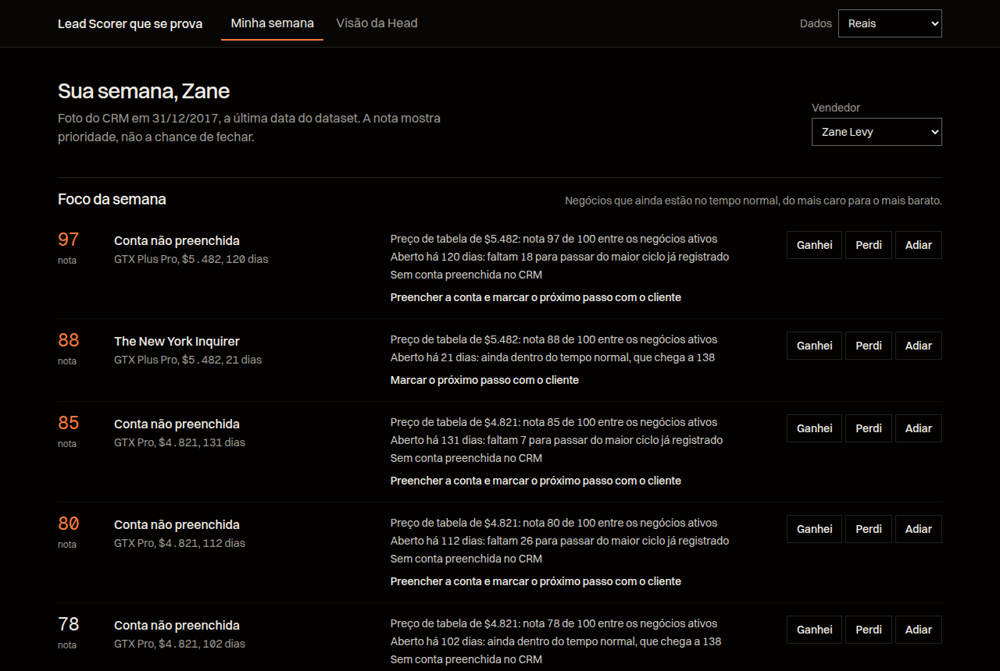
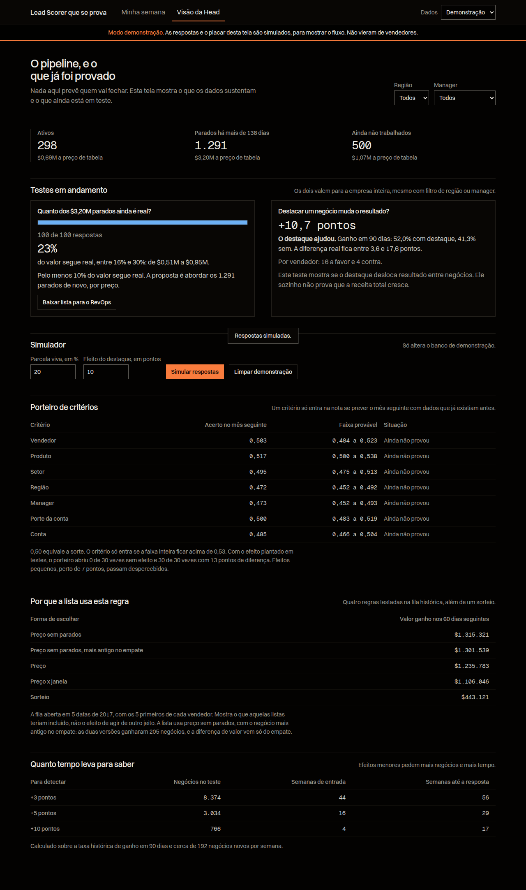

# Submissão — Caio Justo — Challenge 003

## Sobre mim

- **Nome:** Caio Justo
- **LinkedIn:** [linkedin.com/in/caio-justo](https://www.linkedin.com/in/caio-justo)
- **Challenge escolhido:** 003 — Lead Scorer

---

## Executive Summary

Testei os dados do CRM e nenhum critério do cadastro prevê quem vai fechar: vendedor, produto, setor, região, manager, porte e conta ficam perto do acaso (AUC de 0,47 a 0,52). Por isso, em vez de mais uma nota de chance, construí **uma ferramenta que diz onde focar e testa se essa recomendação funciona**. O vendedor abre na segunda e vê a lista com o motivo de cada negócio. A Head de RevOps recebe a resposta para a maior dúvida do pipeline: 81% dos negócios em Engaging, $3,2M a preço de tabela, já passaram do maior ciclo registrado, e uma amostra de 100 estima quanto disso ainda é real. A recomendação é rodar a checagem primeiro, porque é o caminho mais rápido e barato para limpar a fila. Na checagem, há uma sugestão opcional por LLM: o vendedor escreve uma linha sobre o negócio, e a IA sugere a resposta, que só vale quando ele confirma.



---

## Como rodar

Precisa só de Python 3.10 ou mais novo, sem instalar nada.

```bash
cd submissions/caio-justo/solution
python3 server.py
```

Abra http://localhost:8000. Para ver a tela com resultados, escolha **Dados: Demonstração**, vá em **Visão da Head** e clique em **Simular respostas**. Esse modo usa um banco separado e avisa em todas as telas que os dados são simulados.

Para ligar a sugestão por LLM, use a sua própria chave do OpenRouter. Sem chave, a ferramenta funciona igual, só sem esse campo.

```bash
OPENROUTER_API_KEY=sua-chave python3 server.py
```

```bash
python3 -m unittest discover -s tests   # 42 testes, com o provedor simulado
python3 analysis/analise.py             # refaz todos os números (cerca de 2 minutos)
```

---

## Solução

### Abordagem

1. Testar se dá para prever, antes de construir qualquer nota. Não deu.
2. Procurar o que os dados sustentam: o tempo de vida dos negócios e o preço.
3. Mapear as 228 submissões públicas. Encontrar os 1.291 negócios parados e a falta de sinal já era comum, e muitas terminam recomendando um piloto. O diferencial precisava ser esse teste já pronto dentro do produto.
4. Construir, e deixar os números derrubarem as próprias ideias. Os 15 erros encontrados estão em [`process-log/decisoes.md`](./process-log/decisoes.md).

Ideias próximas em outras submissões: #88 e #94 (o backtest muda o produto), #110 (poder estatístico), #155 e #204 (recomendam piloto com controle) e #183 (portão e grupo de controle como fase futura). Não copiei código de nenhuma delas.

### As cinco partes

| Parte | Para quem | O que faz |
|---|---|---|
| **Foco da semana** | Vendedor | Mostra até 5 negócios por vez, com motivo e próxima ação. Dá para adiar, sem mudar o sorteio |
| **Checagem dos parados** | Vendedor e Head | Sorteia 100 dos 1.291 parados. Com um clique por negócio, estima quanto dos $3,2M segue real |
| **Sorteio de destaque** | Head | Só metade dos negócios ativos vai para o foco, em pares parecidos dentro de cada vendedor. O placar compara os grupos |
| **Porteiro de critérios** | Head | Um critério só pode entrar na nota se prever o mês seguinte. Hoje, nenhum passa |
| **Sugestão por LLM** | Vendedor | Lê a nota escrita sobre um negócio parado e sugere uma das 4 respostas. O vendedor confirma, e a IA não mexe na nota nem nos cálculos |

### Lógica da nota

A nota de 0 a 100 mostra **prioridade, não chance de fechar**. É a posição do negócio entre os ativos.

1. **Fora da fila:** negócios com mais de 138 dias, o maior ciclo já registrado, vão para a checagem.
2. **Ordem:** preço de tabela, porque é o único valor conhecido antes de fechar e o valor final fica perto dele. No empate, vem o negócio mais antigo.
3. **Explicação:** cada linha traz os fatos em português, como "Aberto há 120 dias: faltam 18 para passar do maior ciclo já registrado".

Testei quatro regras na fila histórica de 2017. Os 5 primeiros de cada vendedor ganharam nos 60 dias seguintes:

| Regra | Valor ganho |
|---|---:|
| Preço sem parados | $1.315.321 |
| Preço sem parados, mais antigo no empate (a escolhida) | $1.301.539 |
| Preço | $1.235.783 |
| Preço x tempo restante | $1.106.046 |
| Sorteio | $443.121 |

A diferença entre as duas primeiras vem só do empate: ambas ganharam 205 negócios. Esse teste mostra o que cada lista teria incluído, não o efeito de agir diferente.

### Resultados



*Imagem do modo demonstração: as respostas e o placar são simulados.*

- **Sem sinal no cadastro:** AUC de 0,47 a 0,52 em 7 critérios, sempre prevendo o mês seguinte. O porteiro não abriu em 30 testes sem efeito e abriu em 30 de 30 com 13 pontos de diferença.
- **Pipeline inflado:** 1.291 de 1.589 negócios em Engaging estão acima de 138 dias.
- **Checagem:** com 100 respostas, a margem fica entre ±4,5 e ±8 pontos. Ela acertou de 92% a 98% das vezes em simulação, um pouco abaixo dos 95% nominais quando muitos negócios estão vivos.
- **Experimento:** detectar +10 pontos no ganho em 90 dias pede 766 negócios e cerca de 17 semanas.
- **LLM:** o Claude Haiku 5.5 acertou 59 de 60 notas de teste nas duas rodadas, contra 48 da regra de palavras, com tempo mediano de 1,4 s. As frases foram escritas pela IA que construiu a ferramenta, então o número deve estar otimista.
- **Calendário:** deals fechados no 3º mês do trimestre ganham 81%, contra 49% no 1º. A idade quase não muda isso dentro do mesmo mês. Não entra na nota, porque a data de fechamento só existe depois do resultado.


Os detalhes estão em [`solution/analysis/RESULTADOS.md`](./solution/analysis/RESULTADOS.md), e os artigos que sustentam cada decisão, em [`docs/EVIDENCIAS.md`](./docs/EVIDENCIAS.md).

### Recomendações

1. **Rodar a checagem nas próximas duas semanas (meta, ainda não medida).** São cerca de 4 respostas por vendedor. A linha de corte de 10% é uma sugestão minha e deve ser definida pela Head antes de ver o resultado.
2. **Decidir pelo resultado:** abaixo de 10% do valor, propor a retirada dos parados da fila; acima, abordar de novo por ordem de preço. A ferramenta exporta a lista e não altera o CRM sozinha.
3. **Tornar obrigatórios** conta, data do próximo passo e motivo de perda. Sem esses dados, não há o que prever.
4. **Olhar a região Central:** ela tem todos os 500 Prospecting e só 5 dos 298 ativos, e 6 vendedores estão sem nenhum negócio ativo.
5. **Para medir receita total,** sortear vendedores e depois negócios, ciente de que só um ganho muito grande apareceria com 30 vendedores.

### Custo e velocidade

A ferramenta roda sem API e sem custo por uso. A sugestão por LLM é opcional e custou cerca de $0,00007 por nota no teste, ou menos de 1 centavo de dólar para as 100 da checagem. A economia que importa é o tempo do vendedor em negócios sem chance, e ela **ainda não foi medida**, porque o dataset não tem horas trabalhadas. A velocidade vem de trocar um debate sobre o pipeline por uma amostra de 100 negócios. Não coloquei valor em reais, porque seria premissa sobre premissa.

### Limitações

- **Sem vendedores reais:** o fluxo funciona de ponta a ponta, mas o ganho real só aparece com o time usando. Nada aqui prova aumento de vendas.
- **Foto parada:** os dados terminam em 2017 e o protótipo não recebe negócios novos. Os 298 ativos não alcançam a meta do teste sozinhos, então é preciso ligar a um CRM.
- **Atenção limitada:** o destaque pode só tirar tempo de outros negócios. O sorteio por negócio não prova receita total.
- **Efeitos pequenos:** o porteiro não enxerga diferenças perto de 7 pontos, e detectar +3 pontos levaria mais de um ano.
- **Dados possivelmente gerados:** o padrão de calendário é regular demais. Se o dataset for artificial, as conclusões valem para ele, e o método é o que vai para a empresa real.
- **LLM testada em frases nossas:** são 60 frases escritas pela IA, não notas reais de vendedores. Com poucas frases, as diferenças entre os melhores modelos podem ser acaso.
- **Notas passam por terceiros:** o texto escrito vai ao OpenRouter e ao provedor do modelo. O pedido exclui provedores que coletam dados, mas não testei essa garantia. O vendedor não deve incluir dados sensíveis.
- **Vendedor não autenticado:** qualquer pessoa escolhe o vendedor na lista. Em produção, é preciso login.
- **Prospecting:** esses 500 negócios não têm data, então ficam só em ordem de preço e fora do teste.

---

## Process Log — Como usei IA

### Ferramentas usadas

| Ferramenta | Para que usei |
|---|---|
| Claude Code (Claude Opus 5.5), no T3 Code | Quase toda a execução: análise, código, testes, leitura dos PRs, pesquisa de artigos e redação deste documento |
| Subagentes do Claude Code | Leitura das submissões por desafio e das reviews públicas |
| OpenRouter | Teste de 6 modelos pequenos na sugestão por LLM. O Claude Haiku 5.5 ficou como padrão no produto |
| Playwright | Uso da ferramenta no navegador e capturas de tela |

### Workflow

1. Pedi para ler o desafio e escolhi o Lead Scorer, com a tese de usar o Jev para reduzir custo e ganhar velocidade.
2. A IA baixou os dados e testou. O score de vitória não funcionou e a documentação do Jev mostrou limites com números e datas.
3. Pedi para olhar todos os PRs e buscar algo pouco comum. A leitura mostrou que testes com o Jev na triagem já tinham falhado, e que os principais achados já eram conhecidos.
4. Tirei o Jev e pedi uma ideia inovadora. A IA propôs o Lead Scorer que se prova e testou nos dados.
5. Pedi uma explicação clara, aprovei e pedi base científica.
6. A IA construiu em etapas, verificando com dados e no navegador.
7. Decidi colocar uma LLM no produto, com modelos pequenos pelo OpenRouter. A IA integrou e testou, e escolhi o Haiku depois de ver os números.

O registro completo está em [`process-log/decisoes.md`](./process-log/decisoes.md).

### Onde a IA errou e como foi corrigido

Foram 15 erros documentados, quase todos encontrados pela própria IA ao verificar o trabalho. Os três que mais mudaram a entrega:

- **O score de vitória que ela mesma sugeriu** teve AUC de 0,49 no teste temporal, e saiu do produto.
- **A fórmula de preço x tempo restante** perdeu para a regra mais simples no replay: $1,11M contra $1,32M.
- **O prazo do experimento** caiu de uma promessa de 5 semanas para o número real, de cerca de 17.

### O que eu adicionei que a IA sozinha não faria

- A direção: reduzir custo e ganhar velocidade como problema de negócio.
- A decisão de olhar o que os outros já tinham feito antes de construir.
- A decisão de abandonar o Jev, que era a minha ideia inicial, em vez de forçar o uso.
- A exigência de entender a proposta em linguagem simples antes de aprová-la, e de ter fontes científicas.
- A decisão de colocar uma LLM no produto, usar modelos pequenos e ficar com o Haiku pela estabilidade.

Sendo direto: a maior parte do raciocínio técnico veio da IA, e este log não tenta mostrar o contrário.

---

## Evidências

- [x] Screenshots da ferramenta: [`process-log/screenshots/`](./process-log/screenshots/)
- [x] Git history desta branch
- [x] Scripts exploratórios, incluindo os que deram errado: [`process-log/scripts-exploratorios/`](./process-log/scripts-exploratorios/)
- [x] Registro de decisões: [`process-log/decisoes.md`](./process-log/decisoes.md)

---

_Submissão enviada em: 05/11/2026_
