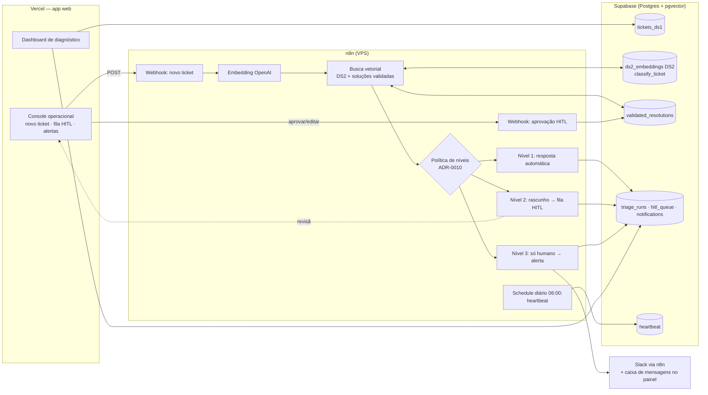

# Arquitetura (rascunho — evolui com as ADRs)

## Componentes
- **Dashboard (Q1):** responde às três perguntas do diagnóstico com o enquadramento da ADR-0003; inclui painel de confiabilidade dos dados e modelo de custo com premissas editáveis.
- **Console operacional (Q2/Q3):** onde se vê a automação funcionando — cola-se um ticket (ou sorteia-se um do holdout do DS2), e o console mostra categoria, confiança, casos similares, nível decidido e a ação tomada.
- **n8n:** caminho online (orquestração). Carga em lote dos embeddings fica num script reproduzível.
- **Supabase:** fonte única de dados, vetores e trilha de auditoria de cada decisão da IA.

## Modos de execução (para o avaliador)
1. **Deploy (principal):** URL da Vercel conectada ao Supabase e ao n8n da VPS.
2. **Fallback "sempre de pé":** se o n8n estiver fora, o dashboard continua funcional e o console mostra resultados pré-computados da avaliação (holdout) — o diagnóstico e as métricas do classificador nunca dependem de um serviço externo vivo.
3. **Setup local:** ver [`setup.md`](setup.md).

## Limites do plano Hobby da Vercel (conferidos na doc oficial em 09/11/2026)
Fontes: [Functions Limits](https://vercel.com/docs/functions/limitations) · [Hobby Plan](https://vercel.com/docs/plans/hobby).

| Limite (Hobby) | Valor | Impacto no console |
|---|---|---|
| Duração máxima de função | 300 s | Triagem leva poucos segundos (embedding + `classify_ticket` ~0,1 s + LLM). Folga grande |
| Active CPU | 4 CPU-h/mês | A espera por I/O (n8n, OpenAI, banco) **não conta**. Uso desprezível |
| Invocações de função | 1M/mês | Desprezível |
| Cron | 1×/dia | Sem uso: o keep-alive roda no n8n (ADR-0006, revisão de 10/11) |
| Região padrão | `iad1` (EUA); uma região, alterável | Configurar `gru1` (São Paulo), perto do Supabase `sa-east-1` |
| Uso | Não comercial / pessoal | Projeto de processo seletivo: dentro da regra |
| Estouro de limite | Recurso pausado por até 30 dias | Proteções abaixo |

Proteções: as rotas que chamam o n8n rodam no servidor (o segredo do webhook nunca vai ao navegador); limite de tamanho do texto livre; limite de gasto no projeto da OpenAI. O dashboard não depende do n8n (modo fallback acima).
