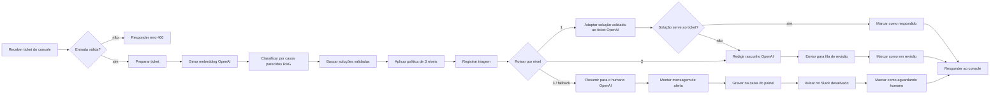
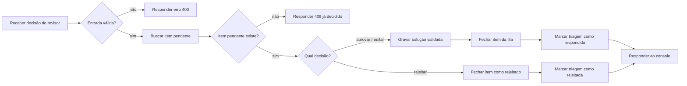
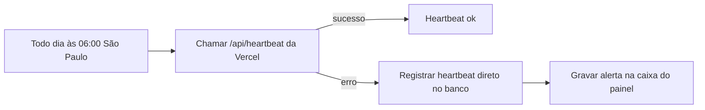

# Fluxos n8n — rascunho nó a nó (ADR-0011)

> **Status: ATIVO no n8n (fluxos 1 e 2), 10/11.** Rascunho v2 aprovado pelo Daniel (ADR-0012). Nós Postgres trocados por nós nativos do Supabase (ADR-0013). Testado ponta a ponta e pelo webhook de produção. O fluxo 3 espera o deploy da Vercel.
> Depois de aprovado: construir via MCP `n8n-g4`, exportar o JSON de cada fluxo para `solution/n8n/` e completar este documento (como importar e testar).
> Fontes consultadas no `n8n-g4` (09/11): SDK reference (guidelines), best practices de *triage*, *scheduling* e *chatbot* (a de *human_in_the_loop* ainda não tem documentação no servidor) e definições dos nós nativos listados abaixo.

## Status da construção (10/11)

| Fluxo | ID no n8n | Nós | Fonte versionada | Estado |
|---|---|---|---|---|
| G4 · Triagem de ticket (RAG + 3 níveis) | `msFVCvUdsmRq49pv` | 35 | [`solution/n8n/01_triagem.sdk.ts`](../solution/n8n/01_triagem.sdk.ts) | **Ativo** (10/11) · testado ponta a ponta e pelo webhook de produção |
| G4 · Aprovação HITL | `FWb7G9cGmMC69Q6D` | 16 | [`solution/n8n/02_aprovacao_hitl.sdk.ts`](../solution/n8n/02_aprovacao_hitl.sdk.ts) | **Ativo** (10/11) · testado (4 caminhos + produção) |
| G4 · Heartbeat diário (Supabase ativo) | `LpQK8XX5AZJrUCy8` | 6 | [`solution/n8n/03_heartbeat.sdk.ts`](../solution/n8n/03_heartbeat.sdk.ts) | Caminho de falha testado · inativo até o deploy da Vercel |

As versões de 09/11 (com nó Postgres) foram **arquivadas** no n8n: `ML8nNXH22pSaDF09`, `Mm1hZMJvQMQu1uQJ` e `RtQAhCEnwxEDQrd4`.

- **Nós nativos do Supabase (ADR-0013):** as tabelas usam o nó Supabase. As duas funções do RAG usam HTTP Request com a credencial Supabase na API REST (`/rest/v1/rpc/...`), porque o nó Supabase não chama funções. Uma credencial só: `G4 - Supabase`.
- **Credenciais (IDs conferidos):** `G4 - Supabase`, `G4 - OpenAI` e `G4 - Segredo do webhookk` (o nome tem um "k" a mais, sem efeito). O n8n auto-atribuiu as credenciais de outros contextos (`Supabase – padaria-bi`, `Waha VPS`) na criação. Todas foram trocadas pelos IDs G4 antes de qualquer execução.
- **Fonte versionada:** o código SDK recria cada fluxo igual via MCP. O export JSON ("Import from file") ainda está pendente.
- **Banco:** migrations `…0003_ops` e `…0004_rest_wrappers` aplicadas; playbook-semente **validado pelo Daniel** (14 soluções).

### Teste ponta a ponta (10/11, execuções manuais pelo MCP)
Tickets do holdout do DS2 (`source = holdout`). O rótulo real é conhecido e não foi usado pelo fluxo.

| # | Ticket (real) | Previsto · confiança | Nível · motivo | Resultado gravado |
|---|---|---|---|---|
| exec 191 | 25 (Purchase) | Purchase · 1,00 | **1** · confiança alta + solução validada | `auto_answered`; LLM adaptou a solução #11 (`fits: true`) |
| exec 194 | 282 (Storage) | Storage · 0,80 | **2** · confiança intermediária | Rascunho em `hitl_queue` #2 + 3 checagens em pt-BR (JSON) |
| exec 192 | 31 (Hardware) | Hardware · 0,62 | **3** · 35% dos votos em categoria sensível | Resumo pt-BR + alerta na caixa (`notifications` #2) |
| exec 193 | 7 (HR Support) | HR Support · 0,75 | **3** · categoria sensível | Resumo + alerta (`notifications` #1); a IA não respondeu ao cliente |
| exec 196 | HITL #2 · `edit` | — | — | `validated_resolutions` #15 (`source = hitl`, embedding 512) e triagem `answered_after_review`. A busca do RAG já devolve #15 em 1º lugar (sim 1,00) para o ticket 282 |
| exec 195 | HITL #1 · `reject` | — | — | Item e triagem `rejected` |
| exec 197 | HITL #2 de novo | — | — | **409** (já decidido) |
| exec 198 | `decision: "talvez"` | — | — | **400** |
| exec 199 | Heartbeat (Vercel inexistente) | — | — | Erro → `heartbeat` (`n8n-fallback`, ok = false) + alerta na caixa |

**Bug encontrado no teste e corrigido:** com `json_schema`, o nó OpenAI v2.3 entrega o JSON **já como objeto** em `output[0].content[0].text`, e o leitor tentava concatená-lo como texto. Na 1ª execução (exec 190), o caminho de segurança agiu como previsto: a leitura falhou, `fits` virou `false` e o ticket desceu para a revisão humana em vez de responder errado. Os três leitores foram corrigidos e o ticket refeito passou no nível 1. A triagem #1 e o item HITL #1 dessa execução ficaram no banco como registro e foram rejeitados no teste do fluxo 2.

**Webhook de produção (10/11, depois da ativação autorizada pelo Daniel):**

| Chamada | Resultado |
|---|---|
| Triagem sem header / com header errado | **403** "Authorization data is wrong!" |
| Triagem com `X-Webhook-Secret` certo (ticket 25) | **200** em 3,5 s → triagem #6, nível 1, `auto_answered`, solução #11 |
| Triagem com texto vazio | **400** |
| HITL sem header | **403** |
| HITL com header, item #2 já decidido | **409** |

**Não testado:** o nó Slack (desativado, sem workspace).

### Diferenças em relação ao rascunho v2 (ajustes da construção)
1. Fluxo 1: **"Preparar ticket" vem antes de "Entrada válida?"**. A best practice do n8n manda normalizar o payload do webhook primeiro.
2. Fluxo 1: a política virou **três Set nodes em sequência** ("Reunir resultado e limiares" → "Marcar termos de bloqueio" → "Aplicar política de 3 níveis"), porque um Set não lê campos que ele mesmo cria. Os limiares e a lista de bloqueio ficam editáveis num lugar só.
3. Fluxo 1: depois de cada nó OpenAI vem um Set que lê o JSON estruturado. Se o modelo sair do formato, o caminho é seguro: no nível 1 o ticket desce para o nível 2, e no nível 2 o revisor é avisado. O teste mostrou que esse caminho funciona.
4. Fluxo 1: o fallback do Switch e as falhas da OpenAI ou do banco têm caminho próprio (marca `status = 'error'` e responde 503).
5. Nós Supabase (ADR-0013): dois Set a mais ("Montar registro da triagem", "Montar item da fila") montam a linha exata para o *auto-map*. O fluxo 2 lê `hitl_queue` e `triage_runs` em dois nós.
6. Fluxo 3: sem o nó "Respondeu 200?". A saída de erro do HTTP Request já separa sucesso de falha.
7. Grupos visuais: o n8n só aceita grupos com uma entrada e uma saída, e nós com saída de erro não cabem nessa regra. Os trechos que cabem estão agrupados; os demais têm sticky notes.

### O que falta
1. Exportar os JSON finais para `solution/n8n/*.json`.
2. Fluxo 3: preencher a URL e a credencial `G4 – Cron da Vercel` depois do deploy, e então ativar.

## Visão geral

| # | Fluxo | Gatilho | Para quê |
|---|---|---|---|
| 1 | **Triagem de ticket** | Webhook (console da Vercel) | Classifica pelo RAG, aplica a política de 3 níveis da ADR-0010 e responde, rascunha ou alerta |
| 2 | **Aprovação HITL** | Webhook (console da Vercel) | Registra a decisão do agente; aprovação vira **solução validada** com embedding (ADR-0004) |
| 3 | **Heartbeat diário** | Schedule | Redundância do cron da Vercel para o Supabase free não pausar (ADR-0006) |

Princípios (ADR-0011): nós nativos, nomes em português, regra de negócio numa **nota (sticky)** ao lado do nó, sem nó de código. A lógica pesada (voto dos 50 vizinhos) fica na função SQL `classify_ticket`, já criada e validada no Supabase (migration `20261109000002_rag.sql`, validação em `solution/analysis/09_db_rag_validation.py`).

### Credenciais (dedicadas ao case, criadas pelo Daniel em 10/11)

| Nome no n8n | Tipo | Usada em |
|---|---|---|
| `G4 - Supabase` | `supabaseApi` (URL do projeto + service role key) | Fluxos 1, 2 e 3: nós Supabase e HTTP Request das funções do RAG |
| `G4 - OpenAI` | `openAiApi` | Fluxo 1: embedding e os 3 nós de redação |
| `G4 - Segredo do webhookk` | `httpHeaderAuth` (`X-Webhook-Secret`) | Webhooks dos fluxos 1 e 2 |
| `G4 – Cron da Vercel` | Custom Auth (template) | Fluxo 3, depois do deploy |
| `G4 – Slack` | `slackApi` | Opcional; nó desativado (ADR-0007) |

As credenciais de outros contextos do Daniel na mesma instância (`Supabase – padaria-bi`, `Waha VPS`, `BI Linear`) **não são usadas**. O n8n tenta auto-atribuí-las na criação por MCP. Por isso cada criação é seguida de `setNodeCredential` com os IDs G4 e de conferência (ADR-0013).

### Exceção justificada: embedding via HTTP Request
O nó nativo "Embeddings OpenAI" é um **sub-nó**: ele só se conecta a um Vector Store ou a um Agent e não tem saída no fluxo principal. Os nós de Vector Store (PGVector/Supabase) exigem a tabela no formato do LangChain e fariam a busca sozinhos, sem o voto ponderado da ADR-0010. Por isso o embedding é gerado com o nó **HTTP Request** usando a **credencial nativa da OpenAI** (sem chave no corpo do nó). É uma chamada só, com 3 campos. O parâmetro `dimensions: 512` devolve o mesmo vetor que o loader gravou (truncar + renormalizar).

---

## Fluxo 1 — Triagem de ticket



| # | Nome do nó | Tipo (nativo) | O que faz | Entrada → saída | Credencial |
|---|---|---|---|---|---|
| 1 | **Receber ticket do console** | Webhook (`POST /g4-support/triage`), auth **Header Auth**, `responseMode: responseNode` | Recebe o ticket do console | `{ ticket_text, source: "console"\|"holdout", ds2_id?, requested_by? }` | `G4 - Segredo do webhookk` |
| 2 | **Entrada válida?** | If | `ticket_text` não vazio e com até 4.000 caracteres; `source` em (`console`, `holdout`) | true → 3 · false → 2a | — |
| 2a | **Responder erro 400** | Respond to Webhook | `400 { error: "ticket_text obrigatório (até 4.000 caracteres)" }` | — | — |
| 3 | **Preparar ticket** | Edit Fields (Set) | `ticket_text` sem espaços nas pontas, `received_at = $now`, e repassa `source`/`ds2_id` | → `{ ticket_text, source, ds2_id, received_at }` | — |
| 4 | **Gerar embedding (OpenAI)** | HTTP Request `POST https://api.openai.com/v1/embeddings`, credencial predefinida OpenAI; *retry* 2× | Corpo: `{ model: "text-embedding-3-small", input: ticket_text, dimensions: 512 }` | → `data[0].embedding` (512 números) | `G4 - OpenAI` |
| 5 | **Classificar por casos parecidos (RAG)** | HTTP Request `POST /rest/v1/rpc/classify_ticket`, credencial Supabase | Corpo `{ query: <embedding> }` | → `{ category, confidence, sensitive_share, votes, similar_cases[5] }` | `G4 - Supabase` |
| 6 | **Buscar soluções validadas** | HTTP Request `POST /rest/v1/rpc/match_resolutions_json`, credencial Supabase | As 3 soluções validadas mais parecidas **da categoria prevista** (playbook-semente + aprovações do HITL) | → `{ resolutions: [...] }` (sempre um objeto, mesmo vazio) | `G4 - Supabase` |
| 7 | **Aplicar política de 3 níveis** | Edit Fields (Set) | Limiares num lugar só: `limiar_auto = 0.9`, `limiar_humano = 0.5`, `limiar_sensivel = 0.3`, `categorias_sensiveis = ["HR Support","Administrative rights"]`, `termos_bloqueio` (lista estreita medida, ver abaixo). Calcula `level` e `level_reason` (ver regra abaixo) | → `+ { level: 1\|2\|3, level_reason }` | — |
| 8 | **Registrar triagem** | Set "Montar registro da triagem" + Supabase · Create em `triage_runs` (auto-map) | Trilha de auditoria de toda decisão da IA, incluindo o embedding (reaproveitado na aprovação) | → linha com `id` | `G4 - Supabase` |
| 9 | **Rotear por nível** | Switch (rules) com `fallbackOutput: extra` | Regras: `level = 1` → saída "Automático"; `level = 2` → "Revisão humana"; `level = 3` → "Só humano". **Fallback → "Só humano"** (o caminho seguro; nada se perde) | 3 saídas | — |
| 1a | **Adaptar solução validada ao ticket (OpenAI)** | OpenAI · Text → Response (`gpt-5.4-mini`, raciocínio `low`, máx. 400 tokens de saída, saída `json_schema`) | **Decisão do Daniel:** o LLM adapta a solução validada mais parecida (`resolutions[0]`) ao ticket. Guarda-corpos no prompt: só reescreve e ajusta ao caso; **não acrescenta passo, prazo, promessa nem exceção** que não estejam na solução validada; responde no idioma do ticket. Se a solução não servir ao ticket, devolve `fits: false` e o ticket desce para o nível 2 | → `{ response_text, fits, resolution_id }` | `G4 - OpenAI` |
| 1a′ | **Solução serve ao ticket?** | If (`fits = true`) | true → 1b · false → 2a (vira nível 2; `level_reason` recebe "solução validada não se aplica") | — | — |
| 1b | **Marcar como respondido** | Supabase · Update `triage_runs` (filtro `id`) | `status = 'auto_answered'`, `response_text` e `resolution_id` (o texto validado de origem fica rastreável para auditoria amostral) | — | `G4 - Supabase` |
| 2a | **Redigir rascunho (OpenAI)** | OpenAI · Text → Response (`gpt-5.4-mini`, raciocínio `low`, máx. 600 tokens), saída `json_schema` | Instruções: agente de suporte, pt-BR, usar **somente** as soluções validadas e os 5 casos parecidos; não prometer prazo nem exceção; listar o que o revisor deve conferir | → `{ draft, checks[] }` | `G4 - OpenAI` |
| 2b | **Enviar para fila de revisão** | Supabase · Create em `hitl_queue` | Cria o item pendente com o rascunho e o que conferir | → `hitl_id` | `G4 - Supabase` |
| 2c | **Marcar como em revisão** | Supabase · Update `triage_runs` (filtro `id`) | `status = 'pending_review'` | — | `G4 - Supabase` |
| 3a | **Resumir para o humano (OpenAI)** | OpenAI · Text → Response (`gpt-5.4-mini`, raciocínio `low`, máx. 300 tokens), saída `json_schema` | **Não responde ao cliente.** Resume o pedido, aponta sinais de risco e explica por que caiu no nível 3 (`level_reason`) | → `{ summary, risk_signals[] }` | `G4 - OpenAI` |
| 3b | **Montar mensagem de alerta** | Edit Fields (Set) | Texto **idêntico** ao que iria para o Slack: categoria, confiança, motivo, resumo, link do console | → `{ title, body }` | — |
| 3c | **Gravar na caixa do painel** | Supabase · Create em `notifications` | Fonte de verdade da demo (ADR-0007): `channel_intended = 'slack'`, `delivered_slack = false` | → `notification_id` | `G4 - Supabase` |
| 3d | **Avisar no Slack** | Slack · Message → Post | Mesmo `body` no canal do suporte. **Desativado** (sem workspace); `onError: continue` para não derrubar o fluxo quando for ligado | — | `G4 – Slack` |
| 3e | **Marcar como aguardando humano** | Supabase · Update `triage_runs` (filtro `id`) | `status = 'awaiting_human'` | — | `G4 - Supabase` |
| 10 | **Responder ao console** | Respond to Webhook (JSON) | Um nó só, ligado ao fim dos 3 ramos (só um roda por execução) | `200 { triage_run_id, level, level_reason, category, confidence, votes, similar_cases, response_text \| draft \| summary, hitl_id?, notification_id? }` | — |

**Regra do nó 7 (ADR-0010 + mitigação da ADR-0010):**
1. **Nível 3** se a categoria prevista é sensível **ou** `sensitive_share ≥ 0,3` **ou** `confidence < 0,5` **ou** o texto contém termo de bloqueio (`bloqueado`, calculado no mesmo Set: `{{ $json.termos_bloqueio.some(t => new RegExp('\\b' + t + '\\b', 'i').test($json.ticket_text)) }}`).
2. **Nível 1** se `confidence ≥ 0,9` **e** existe solução validada da categoria (`resolutions` não vazio).
3. **Nível 2** no resto.

A expressão é uma única linha no Set, sem nó de código, por exemplo: `{{ $json.categorias_sensiveis.includes($json.category) || $json.sensitive_share >= 0.3 || $json.confidence < 0.5 || $json.bloqueado ? 3 : ($json.confidence >= 0.9 && $json.resolutions.length > 0 ? 1 : 2) }}`. Uma sticky note ao lado traz a tabela da ADR-0010 (31% / 28% / 41% no holdout).

**Lista de bloqueio, medida no holdout** (`solution/analysis/10_blocklist_eval.py` → `output/blocklist_eval.json`): a lista é usada como palavra inteira, sem diferenciar maiúsculas.

| Lista | Termos | Falsos positivos no nível 1 | Sensíveis que escapam para o nível 1 e são pegos |
|---|---|---|---|
| **Estreita (adotada)** | salary, payroll, bonus, termination, dismissal, resignation, lawsuit, legal, harassment, sick leave, maternity | **6 de 2.983 (0,2%)** | 1 de 15 |
| Ampla (descartada) | a estreita + contract, leaver, absence, admin rights, administrator, password | 637 de 2.983 (21,4%) | 1 de 15 |

Leitura: o risco de falso positivo vem de termos de TI comuns ("administrator" sozinho gera 421, "password" 173), e não dos termos de RH/jurídico. Os 15 "escapes" do holdout quase não têm conteúdo sensível; parecem ruído de rótulo (ex.: "very slow access to various sites" rotulado como HR Support). Por isso a lista quase não age no DS2. Ela serve para tickets novos com linguagem de RH/jurídico, e o custo de um falso positivo é só mandar o ticket para um humano.

**Falhas:** os nós 4, 5, 2a e 3a têm *retry* (2 tentativas). Se ainda falharem, a saída de erro grava `triage_runs.status = 'error'` e responde `503`. O console então cai no modo de resultados pré-computados (docs/architecture.md).

**O que já está medido no banco** (`output/db_rag_validation.json`, 500 tickets de teste): o nó 5 leva cerca de 64 ms (p50) e 142 ms (p95) da máquina local até o banco, contando a rede. Os níveis ficam em 32% / 29% / 38%, e o nível 1 acertou 100% da amostra.

---

## Fluxo 2 — Aprovação HITL



| # | Nome do nó | Tipo (nativo) | O que faz | Entrada → saída | Credencial |
|---|---|---|---|---|---|
| 1 | **Receber decisão do revisor** | Webhook (`POST /g4-support/hitl-decision`), Header Auth, `responseMode: responseNode` | Decisão vinda do console | `{ hitl_id, decision: "approve"\|"edit"\|"reject", final_text?, final_category?, reviewer, note? }` | `G4 - Segredo do webhookk` |
| 2 | **Entrada válida?** | If | `hitl_id` presente; `decision` válida; `final_text` obrigatório em `edit` | true → 3 · false → 2a | — |
| 2a | **Responder erro 400** | Respond to Webhook | — | — | — |
| 3 | **Buscar item pendente** | Supabase · Get Many `hitl_queue` (`id` = hitl_id **e** `status` = pending) + Supabase · Get Many `triage_runs` (`id`) | Duas leituras, porque o nó não junta tabelas; *always output data* na primeira | → item + ticket + embedding | `G4 - Supabase` |
| 4 | **Item pendente existe?** | If | Evita aprovar duas vezes (dois revisores ao mesmo tempo) | false → 4a | — |
| 4a | **Responder 409 (já decidido)** | Respond to Webhook | — | — | — |
| 5 | **Qual decisão?** | Switch (rules), fallback → "Responder erro 400" | `approve`/`edit` → 6 · `reject` → 6r | — | — |
| 6 | **Gravar solução validada** | Supabase · Create `validated_resolutions` | Insere em `validated_resolutions`: `category = final_category ?? category`, `problem_text = ticket_text`, `resolution_text = final_text ?? draft`, `embedding` **reaproveitado da triagem** (sem nova chamada à OpenAI), `source = 'hitl'`, `approved_by` | → `resolution_id` | `G4 - Supabase` |
| 7 | **Fechar item da fila** | Supabase · Update `hitl_queue` (filtro `id`) | `status = 'approved'\|'edited'`, `final_text`, `final_category`, `reviewer`, `decided_at = now()` | — | `G4 - Supabase` |
| 8 | **Marcar triagem como respondida** | Supabase · Update `triage_runs` (filtro `id`) | `status = 'answered_after_review'`, `response_text = final_text`, `resolution_id` | — | `G4 - Supabase` |
| 6r | **Fechar item como rejeitado** | Supabase · Update `hitl_queue` (filtro `id`) | `status = 'rejected'`, `review_note`, `decided_at` | — | `G4 - Supabase` |
| 7r | **Marcar triagem como rejeitada** | Supabase · Update `triage_runs` (filtro `id`) | `status = 'rejected'` (o ticket volta para atendimento manual) | — | `G4 - Supabase` |
| 9 | **Responder ao console** | Respond to Webhook | `200 { hitl_id, decision, resolution_id? }` | — | — |

**Efeito que vale mostrar no vídeo:** depois de aprovar um rascunho, um ticket parecido com confiança ≥ 0,9 já sai no **nível 1** com aquela solução. Esse é o "aprende com o humano" da ADR-0004.
**Correção de categoria pelo revisor (`final_category`):** é o rótulo humano. Hoje só alimenta `validated_resolutions`; num passo futuro pode virar votos extras no RAG.

---

## Fluxo 3 — Heartbeat diário (ADR-0006)



| # | Nome do nó | Tipo (nativo) | O que faz | Credencial |
|---|---|---|---|---|
| 1 | **Todo dia às 06:00 (São Paulo)** | Schedule Trigger (intervalo diário, timezone `America/Sao_Paulo`) | Horário definido pelo Daniel. O cron da Vercel roda em outro horário (proposta: 12:00 UTC = 09:00 em São Paulo), para os dois não coincidirem | — |
| 2 | **Chamar /api/heartbeat da Vercel** | HTTP Request `GET <URL do app>/api/heartbeat?source=n8n` (placeholder até o deploy); `onError: continueErrorOutput`; *retry* 3× | A rota faz leitura e escrita real no Supabase (`heartbeat`, `source = 'n8n'`) | `G4 – Cron da Vercel` |
| 3 | **Heartbeat ok** | No Operation | Fim do caminho de sucesso; a saída de erro do nó 2 leva ao 4 | — |
| 4 | **Registrar heartbeat direto no banco** | Supabase · Create em `heartbeat` (`source = 'n8n-fallback'`, `ok = false`, `detail` = erro) | Mantém o banco ativo mesmo com a Vercel fora | `G4 - Supabase` |
| 5 | **Gravar alerta na caixa do painel** | Supabase · Create em `notifications` (`kind = 'heartbeat_failure'`) | Aparece no painel como "último heartbeat com falha" | `G4 - Supabase` |

Best practice de *scheduling* aplicada: tarefa idempotente (inserir um heartbeat a mais não causa problema) e sem risco de sobreposição (a execução leva segundos, o intervalo é de 24 h). A URL pública do app na Vercel pode ficar no JSON exportado; quem não pode aparecer no repositório é a URL da VPS do n8n.

---

## Tabelas de apoio — schema (aplicado em 09/11)

Aplicado pela migration `20261110000003_ops.sql` (fonte de verdade: o arquivo). Todas as tabelas com RLS ligado e sem policy: o app lê por rotas de servidor (service role) e o n8n usa a credencial `G4 - Supabase` (service role).

```sql
-- Soluções validadas: playbook-semente por categoria + respostas aprovadas no HITL (ADR-0004)
create table public.validated_resolutions (
  id               bigint generated always as identity primary key,
  category         text not null,
  problem_text     text not null,                      -- ticket (ou descrição do playbook) que originou a solução
  resolution_text  text not null,                      -- texto aprovado por humano
  embedding        extensions.halfvec(512) not null,   -- embedding do problema (mesmo espaço do DS2)
  source           text not null check (source in ('playbook', 'hitl')),
  hitl_id          bigint,                             -- FK adicionada após hitl_queue
  approved_by      text,
  active           boolean not null default true,
  created_at       timestamptz not null default now()
);
create index on public.validated_resolutions using hnsw (embedding extensions.halfvec_cosine_ops);
create index on public.validated_resolutions (category) where active;

-- Toda decisão da IA (trilha de auditoria; alimenta o console e o dashboard)
create table public.triage_runs (
  id               bigint generated always as identity primary key,
  created_at       timestamptz not null default now(),
  source           text not null check (source in ('console', 'holdout')),
  ds2_id           integer references public.ds2_tickets (id),   -- quando sorteado do holdout: permite conferir o rótulo real
  ticket_text      text not null,
  embedding        extensions.halfvec(512),
  category         text,
  confidence       real,
  sensitive_share  real,
  votes            jsonb,
  similar_cases    jsonb,
  level            smallint check (level between 1 and 3),
  level_reason     text,
  status           text not null default 'received' check (status in
                     ('received', 'auto_answered', 'pending_review', 'awaiting_human',
                      'answered_after_review', 'rejected', 'error')),
  response_text    text,
  resolution_id    bigint references public.validated_resolutions (id)
);
create index on public.triage_runs (created_at desc);
create index on public.triage_runs (status);

-- Fila de revisão humana (nível 2)
create table public.hitl_queue (
  id               bigint generated always as identity primary key,
  triage_run_id    bigint not null unique references public.triage_runs (id) on delete cascade,
  draft_text       text not null,
  checks           jsonb,                              -- o que o revisor deve conferir (saída do LLM)
  status           text not null default 'pending' check (status in ('pending', 'approved', 'edited', 'rejected')),
  final_text       text,
  final_category   text,
  reviewer         text,
  review_note      text,
  created_at       timestamptz not null default now(),
  decided_at       timestamptz
);
create index on public.hitl_queue (status, created_at);
alter table public.validated_resolutions
  add constraint validated_resolutions_hitl_fk foreign key (hitl_id) references public.hitl_queue (id);

-- Caixa de mensagens do painel (ADR-0007): o mesmo texto que iria para o Slack
create table public.notifications (
  id               bigint generated always as identity primary key,
  triage_run_id    bigint references public.triage_runs (id) on delete cascade,
  kind             text not null check (kind in ('level3_alert', 'heartbeat_failure')),
  channel_intended text not null default 'slack',
  title            text not null,
  body             text not null,
  payload          jsonb,
  delivered_slack  boolean not null default false,
  read_at          timestamptz,
  created_at       timestamptz not null default now()
);
create index on public.notifications (created_at desc) where read_at is null;

-- Keep-alive (ADR-0006)
create table public.heartbeat (
  id      bigint generated always as identity primary key,
  ran_at  timestamptz not null default now(),
  source  text not null check (source in ('vercel-cron', 'n8n', 'n8n-fallback')),
  ok      boolean not null default true,
  detail  text
);

-- Soluções validadas mais parecidas dentro da categoria (nó 6 do fluxo 1)
create function public.match_resolutions(query extensions.halfvec(512), p_category text, k int default 3)
returns table (id bigint, resolution_text text, similarity double precision, source text)
language sql stable set search_path = public, extensions, pg_temp as $$
  select r.id, r.resolution_text, 1 - (r.embedding <=> query), r.source
  from public.validated_resolutions r
  where r.active and r.category = p_category
  order by r.embedding <=> query
  limit k
$$;
revoke execute on function public.match_resolutions(extensions.halfvec, text, int) from public, anon, authenticated;

alter table public.validated_resolutions enable row level security;
alter table public.triage_runs          enable row level security;
alter table public.hitl_queue           enable row level security;
alter table public.notifications        enable row level security;
alter table public.heartbeat            enable row level security;
```

Espaço: cada triagem guarda cerca de 1 KB de embedding. Mesmo 10 mil triagens somam cerca de 10 MB, e o banco está em 150 MB de 500.

---

## Decisões do Daniel (09/11) — ADR-0012

| # | Tema | Decisão | Onde entra |
|---|---|---|---|
| 1 | Texto do nível 1 | **O LLM adapta a solução validada ao ticket**, com guarda-corpos: não acrescenta nada além da solução; se ela não servir, o ticket desce para o nível 2 | Nós 1a e 1a′ |
| 2 | Pré-condição do nível 1 | **Só há nível 1 quando existe solução validada da categoria.** Exige o playbook-semente (1 a 3 soluções por categoria não sensível), rascunhado pela IA e revisado pelo Daniel | Nó 7 + seed de `validated_resolutions` |
| 3 | Lista de bloqueio | **Lista estreita** (11 termos de RH/jurídico): 0,2% de falsos positivos medidos. A ampla (21,4%) foi descartada | Nó 7 |
| 4 | Modelo | `gpt-5.4-mini` com raciocínio `low` e teto de tokens por nó (custo abaixo). Alternativa mais barata: `gpt-5.4-nano` (~3,6× menos) | Nós 1a, 2a, 3a |
| 5 | Idioma | Demo principal = sortear do holdout. O texto livre do console é **em inglês** (mesma língua da base), com aviso na tela. A resposta ao cliente sai no idioma do ticket, e o resumo e os pontos de checagem para o agente saem em pt-BR | Console + prompts |
| 6 | Heartbeat | n8n às **06:00 (São Paulo)**; cron da Vercel em outro horário | Fluxo 3 |

### Custo estimado da OpenAI (preços oficiais consultados em 09/11/2026)
Fonte: [OpenAI API pricing](https://developers.openai.com/api/docs/pricing). `gpt-5.4-mini`: US$ 0,75 por 1M tokens de entrada e US$ 4,50 por 1M de saída. `gpt-5.4-nano`: US$ 0,20 / US$ 1,25. `text-embedding-3-small`: US$ 0,02 por 1M.

| Chamada | Entrada (tokens) | Saída (tokens, inclui raciocínio `low`) | Custo por chamada |
|---|---|---|---|
| Embedding do ticket | ~100 | — | US$ 0,000002 |
| Nível 1 — adaptar solução | ~900 | ~400 | ~US$ 0,0025 |
| Nível 2 — rascunho | ~1.300 | ~600 | ~US$ 0,0037 |
| Nível 3 — resumo | ~500 | ~300 | ~US$ 0,0017 |
| **Média por ticket** (mix 31/28/41% da ADR-0010) | | | **~US$ 0,003** |

- **Medido no teste de 10/11:** o nó do nível 1 usou 274 tokens de entrada e 146 de saída (≈ US$ 0,0009), abaixo da estimativa.
- Com US$ 5, isso dá **~1.600 tickets** triados. A demo e os testes devem usar 100 a 300 (US$ 0,30 a 1,00).
- Referência real da sessão 01: a avaliação RAG + LLM (`07_rag_llm_eval.py`, 400 chamadas) usou 366K tokens de entrada e 29K de saída, cerca de US$ 0,40.
- As estimativas por chamada são de projeto. O primeiro teste real grava o uso de tokens, e este quadro é corrigido.
- Recomendação: definir um **limite de gasto no projeto da OpenAI** (Settings → Limits) para a chave usada no n8n.
