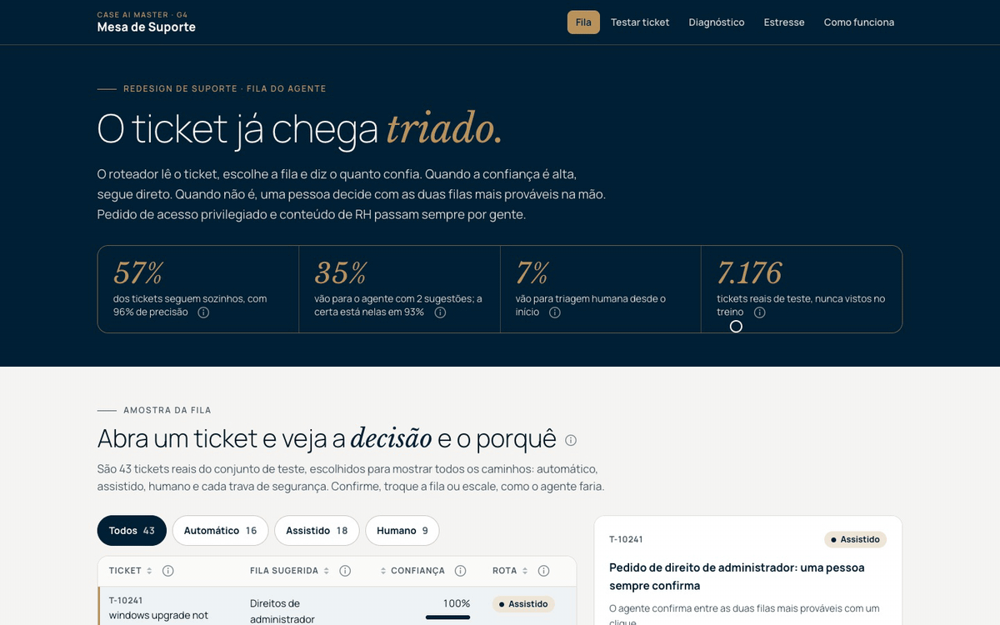

# Submissão: Fábio Will · Challenge 002, Redesign de Suporte

## Sobre mim

- **Nome:** Fábio Will
- **LinkedIn:** [linkedin.com/in/fabiowill](https://www.linkedin.com/in/fabiowill)
- **Challenge escolhido:** 002, Redesign de Suporte (Operações / CX)

---

## Executive Summary

A base operacional do desafio não sustenta diagnóstico de tempo nem de satisfação: são 8.469 tickets (não 30 mil), todos os carimbos cabem em 27 horas, 49,3% "resolvem" antes da primeira resposta e a nota de satisfação é sorteada (p = 0,80). Mesmo assim respondi as três perguntas do Diretor com número: a "combinação mais lenta" aparece por acaso em 52% dos embaralhamentos, nada na base mexe na nota, e o desperdício que dá para provar é a **triagem**. Construí um roteador em 47.837 tickets reais de TI que acerta a fila em 85,6% dos casos e, com sete travas, manda **57% dos tickets direto para a fila com 96% de precisão**, 35% para o agente confirmar entre duas sugestões (a certa está nelas em 93%) e 7% para triagem humana. Pedido de direito de administrador e conteúdo de RH nunca seguem sozinhos. Estressei a solução em nove cenários de operação e num pentest, do extremamente crítico ao leve: o pentest achou uma falha real (com 5 palavras comuns coladas, 42% dos tickets de RH e de administrador escapavam das travas), e duas travas novas levaram esse escape para 10% a 15%. **Recomendação:** ligar o roteador em modo assistido por 4 semanas, começar a registrar seis campos que hoje não existem e só então abrir o automático, fila por fila.

**Console no ar:** [fabiowill-challenge-002.vercel.app](https://fabiowill-challenge-002.vercel.app) · **Deck de 8 slides:** [`docs/apresentacao/`](docs/apresentacao/Fabio-Will-G4-Challenge-002.pdf) · **Rodar local:** ver [Setup](#setup)



---

## Solução

### Abordagem

1. **Ler o problema antes dos dados.** O Diretor pediu três coisas: onde perdemos tempo, o que automatizar e algo rodando. Separei o que precisa de dado operacional (tempo, satisfação) do que precisa de texto (triagem, resposta).
2. **Auditar antes de analisar.** Script de auditoria nos dois datasets ([`solution/analysis/01_audit_datasets.py`](solution/analysis/01_audit_datasets.py)). O Dataset 1 caiu: é sintético. O Dataset 2 passou: texto real, rótulos limpos, sem duplicata. Mesmo com o Dataset 1 caído, as três perguntas do Diretor foram respondidas nele, com teste de permutação.
3. **Comparar modelos com um critério de negócio.** Cinco candidatos, mesma divisão 70/15/15. O critério não foi só acerto: foi **confiança calibrada**, porque o gate depende dela.
4. **Desenhar a política antes do código da interface.** Limiar automático escolhido na validação para precisão de 95%, faixa assistida definida pelo acerto das duas sugestões, e travas para o que o limiar não vê.
5. **Quebrar antes de confiar.** Nove cenários de estresse com evidência medida e um pentest do modelo e do console. Cinco travas nasceram de falhas que o estresse e o pentest acharam.
6. **Entregar algo que o agente e o Diretor usam.** Console estático com a fila (colunas ordenáveis), o teste ao vivo, o painel do Diretor, os testes de estresse e o como funciona. Cada seção, coluna e número tem um ícone "i" que explica o que é e como ler.

### Resultados / Findings

**1. Diagnóstico: as três perguntas do Diretor (Dataset 1)**

| Pergunta | Resposta | Número que sustenta |
|---|---|---|
| Onde o fluxo trava? | Em nenhuma combinação que a base consiga mostrar | A mais lenta (E-mail · Baixa · Problema técnico) leva 10,3 h contra 6,7 h no geral. Embaralhando os tempos 2.000 vezes, o acaso cria uma combinação tão lenta quanto essa em 52% das vezes. Um a um, canal (p = 0,52), prioridade (p = 0,056) e tipo (p = 0,060) não passam de 0,05, nem antes de corrigir por múltiplos testes |
| O que impacta satisfação? | Nada que esteja na base | Correlação entre tempo e nota: 0,005. Prioridade, canal, tipo, produto e gênero: p de 0,28 a 0,70. A pior combinação (Telefone · Alta · Reembolso, nota 2,29 contra 2,99) aparece por acaso em 18% dos embaralhamentos |
| Quanto estamos desperdiçando? | Triagem: cerca de **87 horas por mês** | Com 2.500 tickets por mês, 3 minutos de triagem e R$ 45 por hora: 0,5 pessoa ou R$ 3.911 por mês, já descontados retrabalho e auditoria. Tempo de fila não vira hora sem o carimbo de abertura, que a base não tem |

O teste de permutação é o ponto: um painel de "combinação mais lenta" sempre acha uma entre 80. A pergunta é se ela é maior que o acaso, e aqui não é. Detalhe em [`01_audit_datasets.py`](solution/analysis/01_audit_datasets.py) e na página Diagnóstico.

Por que a base não sustenta mais que isso:

| Sinal no Dataset 1 | Medida |
|---|---|
| Registros | 8.469 (o CSV tem 29.808 linhas por causa de quebra de linha no texto) |
| Janela dos carimbos | 27 horas, para compras de 2020 a 2021 |
| Resolução antes da primeira resposta | 49,3% dos tickets fechados |
| Nota de satisfação | uniforme (cerca de 550 por nota, p = 0,80) |
| Texto de resolução | 1,4% das palavras aparecem no próprio ticket: frase aleatória |
| Marcador `{product_purchased}` | em 100% das descrições |

**Como os dois datasets se cruzam.** O Dataset 1 responde o diagnóstico e serve de prova de domínio errado: o roteador treinado no Dataset 2 mandaria 51% dos tickets do Dataset 1 sozinhos, 85% deles numa fila só (cenário E1). O Dataset 2 treina e mede o roteador. Juntar as duas bases num modelo só ensinaria ruído.

O painel do Diretor traz o business case como função, com as premissas à vista. É um ganho real e pequeno, e o painel mostra por quê.

**2. O roteador e o gate (Dataset 2, 7.176 tickets de teste nunca vistos)**

| Modelo | Acerto | F1 macro | Erro de calibração (ECE) |
|---|---|---|---|
| Sempre a fila mais comum | 28,5% | 0,055 | 0,715 |
| Naive Bayes complementar | 79,5% | 0,783 | 0,311 |
| **Regressão logística, palavras (escolhido)** | **85,6%** | **0,856** | **0,011** |
| SVM linear calibrado | 86,0% | 0,859 | 0,047 |
| Regressão logística, pedaços de palavra | 84,6% | 0,848 | 0,016 |

O SVM acerta 0,4 ponto a mais, mas a confiança dele é quatro vezes pior calibrada. A regressão logística ainda roda no navegador e explica cada decisão por palavra.

| Rota | Parcela | Qualidade |
|---|---|---|
| Automático | 57,4% | 96,2% de precisão |
| Assistido (duas sugestões) | 35,2% | a fila certa está entre as duas em 92,7% |
| Humano | 7,4% | triagem do zero |

**3. Testes de estresse e pentest (detalhe em [`03_stress_tests.py`](solution/analysis/03_stress_tests.py), [`05_adversarial.py`](solution/analysis/05_adversarial.py), [`docs/seguranca.md`](docs/seguranca.md) e na página Estresse)**

| Severidade | Cenário | Sem trava | Com trava |
|---|---|---|---|
| Extremamente crítico | Enxurrada de tickets de outro domínio (8.469) | 51% seguem sozinhos | 11%, e o disjuntor pausa o automático em 159 tickets, sem alarme falso no tráfego normal |
| Extremamente crítico | Surge uma fila que o modelo não conhece | 31% seguem sozinhos para fila errada | 31%: **a trava não pega**; quem pega é a taxa de override |
| Extremamente crítico | Acesso privilegiado ou RH na fila errada | 19 e 54 tickets | 6 e 18; nenhum ticket entra sozinho na fila de administrador |
| Extremamente crítico | **Pentest:** ticket de RH ou de administrador disfarçado com palavras coladas | 42% escapam com 5 palavras comuns; 86% a 100% no pior caso | 10% a 16%; com palavra intercalada, 2% a 7% |
| Crítico | Incidente multiplica uma categoria | precisão do automático 96% a 97% | estável |
| Crítico | **Pentest do console:** XSS, injeção de script, clickjacking, vazamento de dado, modelo adulterado | n/a | 10 de 10 ataques contidos, num Chrome real, no local e na URL publicada |
| Crítico | Erro de digitação (5%, 10%, 20%) | precisão cai para 94%, 92%, 86% | o texto mais quebrado vai para humano (16%, 54%, 98%); recalibrar o limiar devolve 95% a 96% até 10% de erro |
| Médio | Ticket curto (até 5 palavras) | 77% de acerto | cai para assistido |
| Médio | Ticket em português | 62% sozinhos com 20% de acerto | 100% para humano |
| Médio | Filas vizinhas que se confundem | RH e Hardware, Diversos e Hardware | duas sugestões no assistido |
| Leve | Calibração por fila | Direitos de administrador: ECE 0,113 | fila nunca automática |

A privacidade tem preço e ele está na mesa. A trava de conteúdo sensível custa 5 pontos de automação (70,5% para 65,6%) e corta pela metade os tickets sensíveis que iriam sozinhos para outra fila (73 para 34). A trava de trecho, que nasceu do pentest, custa mais 6,5 pontos (59,1%), leva esse vazamento a 26 e o ataque de palavras coladas de 42% para 10% a 15%.

### Recomendações

Em ordem:


1. **Semana 1:** ligar o roteador em **modo assistido** para todas as filas. O agente vê a sugestão e confirma. Mede-se a taxa de override por fila, que vira a linha de base.
2. **Semana 1:** registrar os **seis campos** que faltam (abertura, fila inicial e final, primeira atribuição, satisfação ligada ao ticket, reabertura, custo hora). Em 4 semanas, tempo e satisfação passam a ser medidos.
3. **Semana 4:** abrir o **automático** só nas filas com override abaixo de 5% e auditoria cega acima de 95%. Direitos de administrador continua sempre assistido.
4. **Semana 6:** **rascunho de resposta com LLM** a partir de tickets resolvidos parecidos, com o agente editando e enviando. Só depois que a base de resoluções reais existir: a do Dataset 1 é aleatória.
5. **Sempre:** auditoria cega de 2% do automático, disjuntor de distribuição, recalibração semanal do limiar, retreino mensal com os tickets confirmados.

### O que não automatizar

| Não automatizar | Por quê |
|---|---|
| Conceder direito de administrador | Segurança. A IA escolhe a fila; conceder é humano, com dupla checagem |
| Responder ou decidir assunto de RH | Dado pessoal (LGPD). A IA só roteia, e conteúdo com cara de RH não segue sozinho para outra fila |
| Aprovar compra | Decisão financeira com alçada |
| Enviar resposta ao cliente | O rascunho poupa tempo; quem envia responde pelo que foi dito |
| Ticket fora do que o modelo conhece | Outro idioma, outro domínio ou fila nova vão para humano |

### Limitações

- **Tempo e satisfação não foram diagnosticados** porque a base não permite. O business case usa premissas declaradas para minutos, volume e custo; só as parcelas e a taxa de erro são medidas.
- **O Dataset 2 vem pré-processado** (minúsculas, parte das palavras comuns removidas). Em produção o modelo deve ser treinado no histórico real da operação, no idioma dela.
- **A trava de histórico parecido** roda na análise, não no navegador: precisa do índice de tickets. No console rodam 6 das 7 travas.
- **Segurança tem custo medido:** as travas barram 4,1% dos tickets normais (vão para humano), e com 5 palavras coladas ainda escapam 15% dos pedidos de administrador e 10% dos de RH. O dano é de rota, não de acesso.
- **Rascunho com LLM não foi construído**: sem base de resolução real, ele aprenderia a escrever ruído. A arquitetura e as proteções estão na página Como funciona.
- **Uma fila nova não é detectada** pelas travas (cenário E2). A proteção é operacional: override por fila e retreino.
- Os limites do disjuntor (PSI 0,25) e o piso de vocabulário (0,55) são regras práticas calibradas nestes dados; em produção, recalibrar com tráfego real.

---

## Setup

Requisitos: Python 3.12, Node 20.9 ou mais novo.

```bash
# 1. Dados (Kaggle, CC0): baixar para solution/data/
#    customer_support_tickets.csv            (suraj520/customer-support-ticket-dataset)
#    all_tickets_processed_improved_v3.csv   (adisongoh/it-service-ticket-classification-dataset)

# 2. Análise (auditoria, laboratório, estresse, exportação para o app)
cd solution
python3.12 -m venv .venv && .venv/bin/pip install -r analysis/requirements.txt
cd analysis
../.venv/bin/python 01_audit_datasets.py
../.venv/bin/python 02_model_lab.py
../.venv/bin/python 03_stress_tests.py
../.venv/bin/python 05_adversarial.py      # pentest do modelo: ataques de evasão
../.venv/bin/python 04_export_app_data.py
../.venv/bin/python -m pytest -q

# 3. Console
cd ../app
npm ci
npm run check      # typecheck + testes (paridade Python × navegador) + build estático com CSP por hash
npm run serve      # serve out/ com os mesmos cabeçalhos do vercel.json (http://localhost:4180)
npm run pentest    # em outro terminal: 10 ataques ao console num Chrome real
```

O console é estático: não tem servidor, chave de API nem banco. O texto digitado no teste ao vivo não sai do navegador (o pentest confere: 0 requisição depois de digitar). Cabeçalhos em [`solution/app/vercel.json`](solution/app/vercel.json), modelo de ameaça e resultados em [`docs/seguranca.md`](docs/seguranca.md).

---

## Process Log: como usei IA

> A vaga pede para mostrar com clareza qual foi o meu papel e qual foi o papel da IA. Essa separação está em cada etapa abaixo e, em detalhe, em [`process-log/README.md`](process-log/README.md).

### Ferramentas usadas

| Ferramenta | Para que usei |
|---|---|
| Claude Code (modelo Claude Opus 5.5) | Execução: leitura das reviews públicas do repositório, auditoria, laboratório, estresse, console, medição da marca |
| Subagentes do Claude Code | Síntese das 197 reviews públicas do avaliador; pesquisa de literatura com checagem de fonte |
| scikit-learn, Next.js, Vitest, Lighthouse | Modelo, console, testes de paridade e auditoria de desempenho |

### Workflow

| Etapa | Meu papel | Papel da IA |
|---|---|---|
| Escolha do desafio | Escolhi o 002 entre os quatro | Mediu os quatro datasets, mostrou que o 004 é ruído puro e recomendou o 002 |
| Régua de avaliação | Pedi uma leitura profissional do teste antes de começar | Leu e sintetizou as 197 reviews públicas do avaliador |
| Auditoria e modelo | Não decidi nesta etapa; revisei o resultado no console e nos documentos antes de publicar | Propôs auditar antes de analisar, rodou os testes estatísticos, treinou e comparou cinco modelos |
| Estresse | Exigi cenários reais em quatro severidades, com evidência | Implementou os nove cenários e as travas, e mediu de novo a cada mudança |
| Boas práticas | Pedi o estudo de livros e práticas de mercado | Pesquisou e conferiu as fontes; a auditoria cega veio daí (viés de automação) |
| Marca | Defini usar a identidade da G4, respeitando a marca à risca | Mediu logo, cores, fontes e contraste nas páginas atuais da G4 |
| Console | Defini a régua: profissional, rápido, seguro e validado visualmente | Construiu, testou e fotografou cada página |
| Segurança | Pedi pentest e estresse de segurança | Montou o ataque ao modelo e ao console; achou a falha de palavras coladas e propôs as travas de trecho e de sequência |
| Trade-offs | Pedi a medição do custo de cada ponto e deleguei a escolha à recomendação | Mediu o custo de cada limiar e recomendou 0,05 e o trecho de 8 palavras a 0,70, que ficaram |

### Onde a IA errou e como corrigi

1. **Faixa assistida sem sentido.** O primeiro desenho escolheu o limiar assistido pela precisão acumulada e criou uma faixa com 60% de acerto. Redefini a faixa pelo acerto das duas sugestões (91%).
2. **Confiança alta em texto estranho.** Só com o limiar, 51% dos tickets de outro domínio seguiriam sozinhos. Entraram a trava de novidade e o disjuntor.
3. **A trava de novidade não pegava português.** 62% iriam sozinhos com 20% de acerto. Entrou a trava de vocabulário.
4. **A trava de vocabulário pegava demais.** Calibrada em texto limpo, mandava 77% dos tickets com 5% de erro de digitação para humano. Recalibrada para separar idioma de digitação.
5. **O disjuntor dava alarme falso.** A janela pequena com categoria vazia disparava o índice. Entrou suavização; zero alarme falso em 20 simulações.
6. **Laboratório e estresse com modelos diferentes** (20 mil e 10 mil termos). Unifiquei.
7. **Um "bug" que não era bug.** O print da home mostrava erro de URL; a causa era o meu script de captura montando `//`. Corrigido no script, não no app.
8. **Travas que só olhavam o ticket inteiro.** O pentest mostrou que 5 palavras comuns coladas faziam 42% dos tickets de RH e de administrador escaparem. Entraram as travas de trecho e de sequência.
9. **Cache que quebraria o próximo deploy.** O modelo ia com cache imutável de um ano sob nome fixo: depois de um retreino, quem já tinha visitado ficaria com o modelo velho. O arquivo passou a levar o hash do conteúdo no nome.
10. **Dependência vulnerável.** A primeira versão da ferramenta de pentest puxava pacotes com falha alta conhecida, e o pytest fixado tinha alerta. Os dois foram trocados por versões sem alerta (`npm audit` e `pip-audit` limpos).
11. **Número velho por ordem de execução.** A exportação rodou em paralelo com o estresse e poderia copiar resultado antigo; e a taxa de rejeição indevida não contava a trava nova. Rodei em sequência e corrigi a métrica (2,2% para 4,1%).

### O que eu adicionei que a IA sozinha não faria

- **Exigir estresse em quatro severidades com evidência real.** Foi essa exigência que revelou cinco falhas que o primeiro desenho tinha (texto de outro domínio, português, digitação, filas sensíveis, alarme falso), e cada uma virou uma trava medida.
- **Exigir pentest e segurança.** Foi o que achou a falha de palavras coladas, o cache que quebraria o deploy e as dependências com alerta.
- **Exigir boas práticas com fonte.** A auditoria cega de 2% saiu daí: override baixo pode ser só confiança demais na máquina.
- **A régua de qualidade do produto:** identidade da G4 medida, desempenho, segurança e validação visual de cada tela.

---

## Evidências

- [x] Screenshots do console: [`process-log/screenshots/`](process-log/screenshots/)
- [x] Animações do console em uso (GIF e MP4): fila, teste ao vivo, painel do Diretor, estresse e celular em [`process-log/screenshots/animados/`](process-log/screenshots/animados/)
- [x] Deck executivo de 8 slides: [`docs/apresentacao/`](docs/apresentacao/)
- [x] Pentest do console e do modelo: [`process-log/security/`](process-log/security/) e [`docs/seguranca.md`](docs/seguranca.md)
- [x] Git history com a evolução do trabalho
- [x] Conversa com a IA, curada (minhas mensagens como escrevi e o resumo de cada resposta): [`process-log/chat-exports/conversa-curada.md`](process-log/chat-exports/conversa-curada.md)

---

_Submissão enviada em: 13/11/2026_
