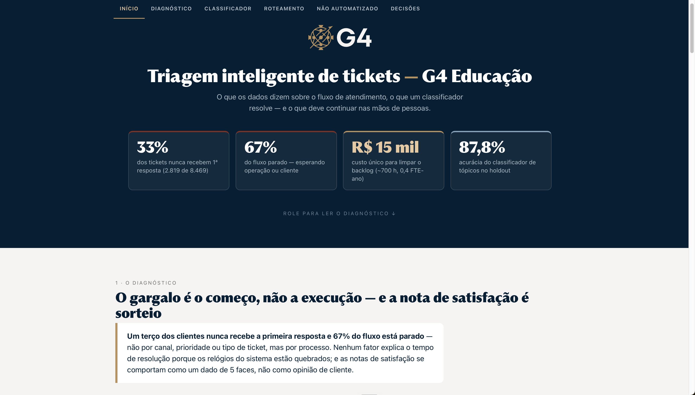
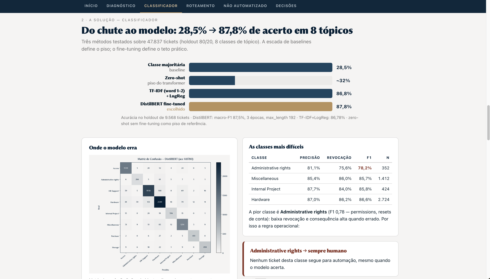
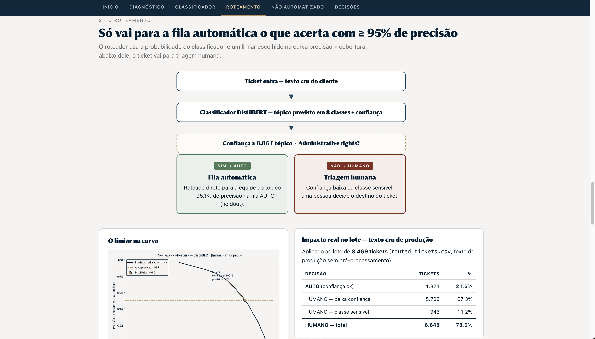

# Submissão — Felipe Oshiro — Challenge 002

## Sobre mim

- **Nome:** Felipe Oshiro
- **LinkedIn:** https://www.linkedin.com/in/felipe-oshiro/
- **Challenge escolhido:** 002 — Redesign de Suporte (`process-002-support`)

---

## Executive Summary

67% do fluxo de atendimento está parado e 33,3% dos tickets (2.819 de 8.469) nunca recebem uma primeira resposta — o gargalo é o começo do processo, não a execução. Construí um classificador DistilBERT fine-tuned (87,8% de acurácia, macro-F1 0,875 em 8 tópicos) alimentando um roteador por confiança: **95,05% de precisão na fila automática com 80,7% de cobertura no holdout**, com regras explícitas do que a IA nunca decide (acessos administrativos, resposta final ao cliente, qualquer decisão guiada por CSAT). Principal recomendação: ligar o AUTO no modo conservador hoje e recalibrar o limiar com texto de produção real antes de escalar — a cobertura em texto cru cai de 80,7% para 21,5% (distribution shift documentado, medido no lote real).

---

## Prévia da solução (sem executar código)

> Prints do dashboard final (`solution/dashboard/dashboard_g4.html`). O arquivo é self-contained — para ver ao vivo, basta abrir no navegador; os prints abaixo dão a prévia sem baixar nada.

<!-- Salve os prints com estes nomes exatos (recorte as seções correspondentes do dashboard em tela cheia, ~1440px de largura): -->

---

## Solução

### Abordagem

Análise exploratória primeiro (`docs/relatorio_fluxo_atendimento.md`): onde o fluxo trava, o que impacta satisfação (resposta: nada — a nota se comporta como sorteio, p>0,25, R²=2%) e quanto se desperdiça. Só depois da evidência: comparação de 4 abordagens de classificação com protocolo único (holdout estratificado 80/20, seed 7) → roteamento por confiança com precisão ≥ 0,95 → impacto medido no lote de produção de 8.469 tickets → dashboard executivo self-contained.

### Resultados / Findings

- Baseline majoritária 28,5% · TF-IDF+LogReg 86,78% · **DistilBERT 87,80% / macro-F1 0,8747** (`solution/artifacts/`)
- Limiar 0,86: precisão AUTO **95,05%**, cobertura **80,7%** no holdout (`solution/artifacts/router_threshold.json`)
- Lote de produção: **21,5% AUTO / 78,5% humano** — com a leitura honesta do porquê (distribution shift; `solution/README.md` seção 1.3)
- 4 portas que ficam sempre com humano: Administrative rights (pior F1: 0,782), baixa confiança, resposta final ao cliente, qualquer decisão por CSAT
- Produto: `solution/dashboard/dashboard_g4.html` (arquivo único, abrir direto no navegador) + CLI (`solution/scripts/route_tickets.py`) + app Streamlit com classificação em tempo real

### Recomendações

1. Regra permanente: **nenhum ticket sem primeira resposta** — medir diariamente `tickets sem resposta ÷ tickets abertos`
2. Recalibrar o limiar com confianças medidas sobre texto de produção real (caminho para elevar os 21,5% de AUTO com segurança)
3. Coletar os 3 timestamps (`created_at`, `first_response_at`, `resolved_at`) — pré-condição para SLA e priorização
4. Reconstruir a medição de CSAT antes de usá-la para qualquer decisão

### Limitações

- Alvo de 90% de acurácia não atingido (DeBERTa tentada e descartada: loss NaN no MPS)
- Cobertura AUTO baixa em texto cru (21,5% vs 80,7% no holdout — distribution shift documentado)
- Sem prioridade automática (o dataset não tem sinal de prioridade aprendível)
- CSAT inutilizável (comportamento de sorteio)

Detalhes completos: seção 5 de `solution/README.md`.

---

## Process Log — Como usei IA

> **Este bloco é obrigatório.** Sem ele, a submissão é desclassificada.

### Ferramentas usadas

| Ferramenta | Para que usou |
|------------|--------------|
| opencode (assinatura Go) — modelo GLM 5.3 Flash, effort high | EDA completa, treino dos modelos (TF-IDF e DistilBERT), roteador, dashboard, app Streamlit e organização desta submissão |

### Workflow

Narrativa passo a passo em **`process-log/narrativa.md`** — como decompus o problema, onde a IA entrou em cada etapa, quantas iterações foram necessárias.

### Onde a IA errou e como corrigi

Documentado em `process-log/narrativa.md` — destaques: zero-shot LLM próximo do baseline (descartado), DeBERTa com loss NaN no MPS, e a tentativa de reportar a cobertura do holdout como se valesse para produção — corrigida medindo o lote real.

### O que eu adicionei que a IA sozinha não faria

A decisão de rotear **por confiança** (precisão ≥ 0,95) em vez de perseguir acurácia máxima; reconhecer que o CSAT é sorteio e não deixar nada dependendo dele; manter o humano em Administrative rights por custo de erro; e a honestidade em relatar o distribution shift em vez de vender os 80,7% de cobertura. Além disso, três inputs que a IA não teria sozinha: (1) a direção de **replicar a identidade visual da G4** no dashboard — varredura do site da G4 e engenharia reversa do design em tokens concretos; (2) aplicar as **boas práticas do livro "Storytelling com Dados"** à narrativa e aos textos do relatório de EDA; (3) o pedido de **gráficos dedicados** para visualização, incluindo a ideia do **gráfico de correlação de Pearson** entre timestamps — que provou, em vez de afirmar, que os relógios do sistema estavam quebrados.

---

## Evidências

- [x] Screenshots das conversas com IA → `process-log/screenshots/`
- [x] Chat exports → `process-log/chat-exports/` (EDA, classificador, dashboard)
- [x] Narrativa escrita → `process-log/narrativa.md`
- [x] Print de custo/uso do modelo → `process-log/screenshots/custo-uso-glm53flash.png`
- [x] Git history (commits incrementais por etapa: EDA → modelos → roteador → dashboard → submissão)
- [x] Outro: dashboard navegável em `solution/dashboard/dashboard_g4.html` + prévia em prints (`docs/dashboard/`)

---

_Submissão enviada em: 2026-11-11_
