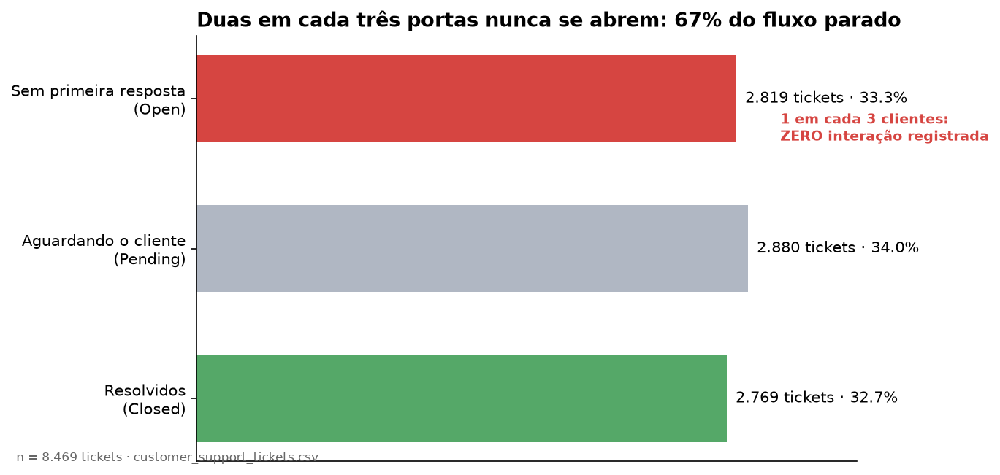
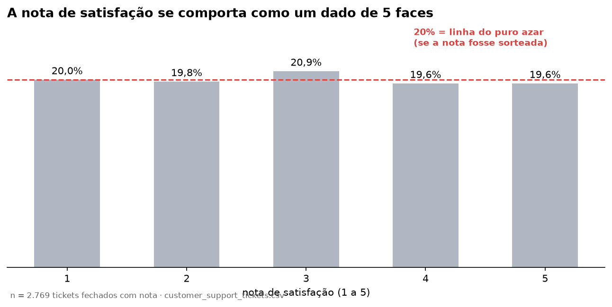
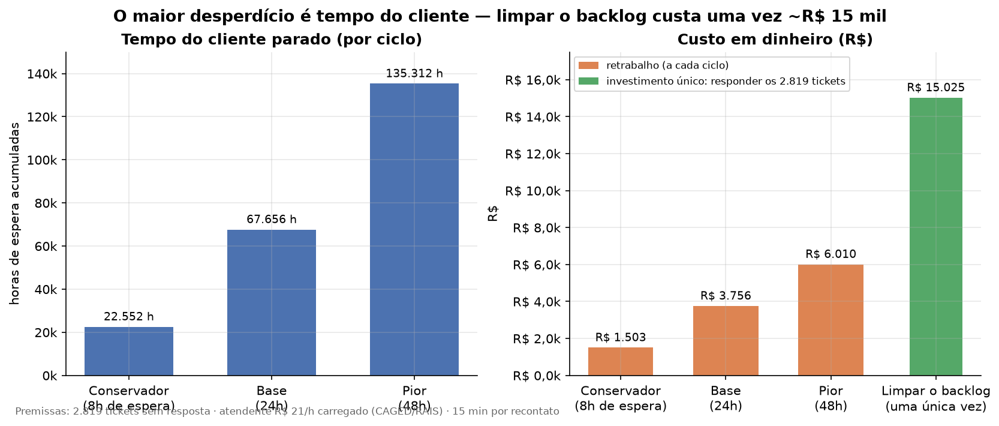
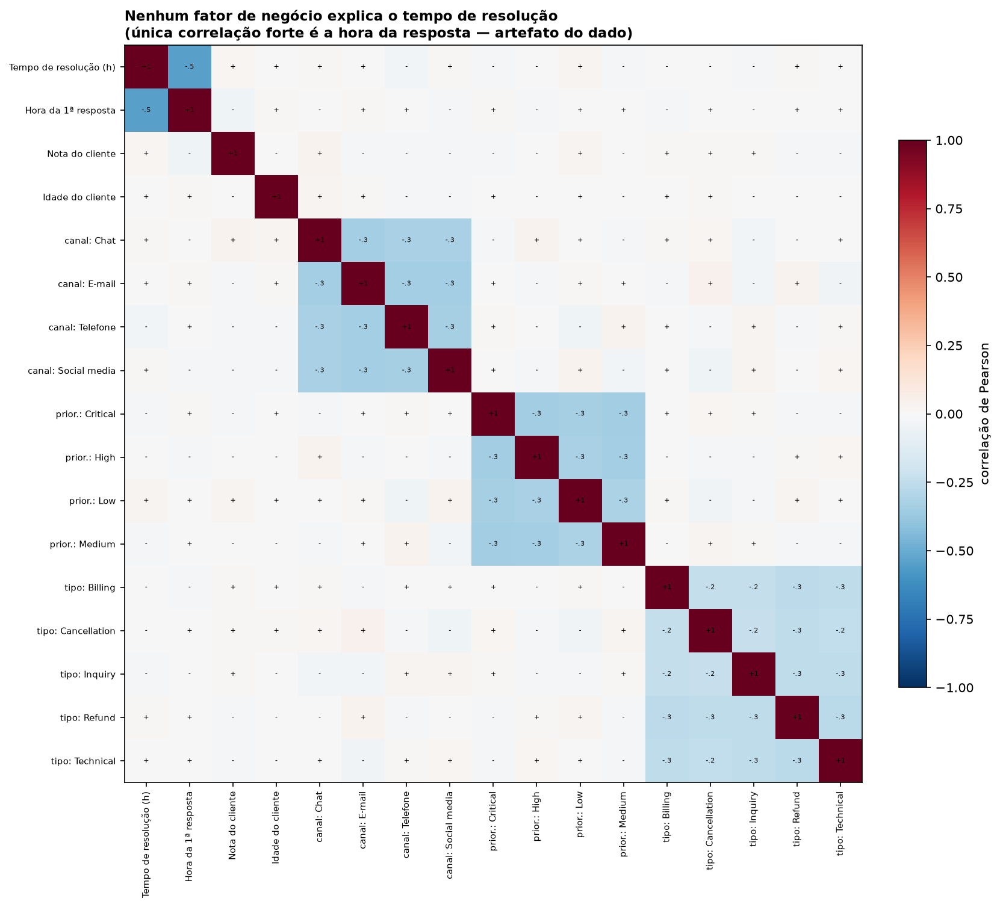

# Relatório de Análise Exploratória dos dados do fluxo de atendimento CX

> **Perguntas do desafio:** (1) Onde o fluxo trava? Gargalos por canal, prioridade, tipo de ticket. Quais combinações geram os piores tempos de resolução? (2) O que impacta satisfação? Quais variáveis mais influenciam o Customer Satisfaction Rating? (3) Quanto estamos desperdiçando? Onde está o maior desperdício recuperável?
>
> **Dataset:** 8.469 tickets · 17 colunas · grão validado: 1 linha = 1 ticket (`Ticket ID` único, 0 duplicatas) · **Data:** 2026-11-10

---

## A ideia central (leia em 30 segundos)

> **Um terço dos clientes nunca recebe a primeira resposta e 67% do fluxo está parado — não por canal, prioridade ou tipo de ticket, mas por processo. Recuperar custa uma única vez ~R$ 15 mil; continuar parado custa, a cada ciclo. Nenhum fator explica o tempo de resolução porque os relógios do sistema estão quebrados — e as notas de satisfação são sorteio, não opinião de cliente.**

**Como ler este relatório:** cada pergunta do desafio segue a mesma narrativa — *contexto* (onde estamos), *tensão* (o que os dados revelam de contrário ao esperado), *decisão* (o que fazer amanhã). O método narrativo segue "Storytelling com Dados" (Cole Nussbaumer Knaflic): uma mensagem por gráfico, destaque por cor apenas no que importa, e as provas estatísticas completas deixadas para a seção **Evidências** — aqui, só o que muda decisão.

---

## Pergunta 1 — Onde o fluxo trava?

### Contexto

A operação de atendimento é um balcão com três portas: o pedido do cliente chega pela primeira, alguém da equipe o recebe e responde pela segunda, e o caso se resolve pela terceira. São 8.469 pedidos na base — cerca de 11,6 por dia.

### A tensão

**Duas de cada três portas nunca se abrem:**

- **2.819 tickets (33,3%) nunca receberam um simples "recebemos, estamos cuidando disso"** — zero interação registrada. Esta é a porta travada.
- Mais 2.880 (34,0%) já foram respondidos e agora aguardam o cliente — a bola está fora da quadra da operação.
- Só 32,7% se resolveram. E quando o fluxo anda, anda rápido: a resolução leva horas, não dias. **O gargalo não é a execução do atendimento — é o começo dele.**

### E os gargalos por canal, prioridade e tipo de ticket?

Nenhum. O percentual de tickets parados sem resposta é **~33% igual em todos os estratos** — Phone 34,5% vs Email 32,7%; Critical 32,5% vs Low 33,7%; Refund 32,2% vs Technical 34,5%. Nenhum teste estatístico separa um canal, uma prioridade ou um tipo dos demais (provas em Evidências). **O travamento é sistêmico: é a mesma parede para todo mundo.**

### E as combinações que geram os piores tempos de resolução?

Aqui o dado vira contra a pergunta: **os relógios do sistema estão quebrados.**

- 49,3% dos tickets fechados aparecem como **resolvidos antes de respondidos** (cronologicamente impossível, mínimo de −23,2h).
- Os dois timestamps vivem numa janela de 27 horas em 06/2023, descolados da compra (2020–21) — e a "duração" decai monotonicamente com a hora em que a resposta foi registrada: madrugada = +8h, horário comercial = −8h.
- Com durações inviáveis e independentes (ρ=0,056), a combinação canal × prioridade × tipo não tem sinal (teste de conjunto sobre 80 células: p=0,37; modelo com todos os atributos explica 2% da variância).

**Qualquer ranking de "combinação mais lenta" construído sobre estes números seria inventado.** A resposta honesta é: com o registro atual, não dá para medir. Provas completas em Evidências.

### Decisão

Instalar a regra permanente: **nenhum ticket sem primeira resposta** — e medir diariamente `tickets sem resposta ÷ tickets abertos`, na origem, não via "tempo de resolução".

---

## Pergunta 2 — O que impacta a satisfação?

### Contexto

A nota (1 a 5) só existe para tickets fechados: n=2.769, média 2,99.

### A tensão

**A nota se comporta como um dado de 5 faces** — cada nota aparece com praticamente a mesma frequência (~20% cada). Uma base real de clientes jamais se comporta assim: na vida verdadeira os extremos dominam. Este padrão é o de alguém que **sorteou números e os escreveu como se fossem opiniões**.

E quando comparamos os grupos — os três candidatos da pergunta e todos os demais:

- **Tempo de resposta/resolução:** quem esperou mais deu nota igual à de quem foi atendido na hora (correlação ≈ zero, p=0,25).
- **Canal:** chat, telefone, e-mail e redes sociais, indistinguíveis (p=0,28).
- **Tipo de problema:** qualquer variação é do tamanho do puro acaso (p=0,70).
- Idade, gênero, produto (42 itens), subject (16), dia da semana, tamanho do texto de resolução: nada. O modelo com todos juntos explica **2% da variância** — o tamanho exato do ruído.

Os dois "quase-achados" da exploração (hora da resposta e o canal Chat) desaparecem ao corrigir para o número de comparações feitas — são falsos positivos clássicos. Bateria completa em Evidências.

### Decisão

**Não priorize nenhum investimento por esta nota** — qualquer plano (treinar equipe, mudar canal, acelerar fila) seria guiado por sorteio. Para ter uma nota de verdade: pedir avaliação a **todos** os tickets fechados (hoje 2/3 nunca recebem a pesquisa) e registrar junto os tempos reais.

**A ironia reveladora:** o maior destruidor real de satisfação é exatamente o achado da Pergunta 1 — não responder. Este dataset não registra essa ligação porque a nota não veio do cliente.

---

## Pergunta 3 — Quanto estamos desperdiçando?

### Contexto — o que é medido e o que é estimado

**Medido, sem premissa:** 67,3% do fluxo parado (5.700 tickets); 67,3% da base nunca gerará nota (cegueira de medição); 49,3% dos "tempos" existentes são cronologicamente impossíveis.

**Estimado, com premissas declaradas:** o sistema não guarda a data de criação do ticket, então a espera real é cenário, não medição. Premissas: atendente de suporte no Brasil a **R$ 21/hora** carregado (dados oficiais CAGED/RAIS: custo para a empresa R$ 3.508/mês na jornada de 38h/sem; salário mediano R$ 1.828–2.579/mês); 15 minutos por recontato; espera média de 8, 24 ou 48 horas conforme o cenário. Benchmark de teto: SDR da G4 Educação (Glassdoor, R$ 5–6 mil/mês) ≈ R$ 42/h carregado — dobraria os custos abaixo.

### A tensão

| Cenário | Espera média | Clientes que retornam | Horas de espera do cliente | Custo do retrabalho |
| --- | --- | --- | --- | --- |
| Conservador | 8h | 10% | 22.552 h | R$ 1,5 mil/ciclo |
| Base | 24h | 25% | 67.656 h | R$ 3,8 mil/ciclo |
| Pior | 48h | 40% | 135.312 h | R$ 6,0 mil/ciclo |

**O custo de limpar a pilha** — responder os 2.819 tickets parados, a 15 minutos cada — é de **cerca de 700 horas: meio ano de uma pessoa em tempo integral (0,4 FTE-ano), aproximadamente R$ 15 mil, uma única vez** (R$ 30 mil no padrão SDR da G4).

**Tradução direta:** o desperdício principal é **tempo de cliente parado, não folha de pagamento**. E o custo escondido mais grave é a cegueira: dois em cada três pedidos não produzem nenhuma medida de qualidade — a liderança gerencia a operação enxergando um terço dela, com metade dos relógios quebrados.

### Onde está o maior desperdício recuperável (por ordem de impacto)

1. **A fila silenciosa** — os 2.819 tickets sem resposta. Único grupo 100% nas mãos da operação. Campanha única de resposta (R$ 15 mil) + regra permanente.
2. **Os relógios quebrados** — registrar a data real de abertura, resposta e resolução. Barato, resolve em semanas, vale para sempre.
3. **A fila do "aguardando o cliente"** (2.881) — lembretes proativos destravam casos parados.
4. **As filas erradas** — tickets encaminhados à equipe errada morrem sem resposta; a triagem automática já testada neste desafio (85% de acerto em 8 categorias) ataca a origem.

### Decisão (o que fazer amanhã)

Aprovar a campanha única de limpeza do backlog; instalar o SLA de primeira resposta; mandar o BI registrar as três datas por ticket. O resto do fluxo se destrava sozinho — os tickets respondidos começam a fluir ou a fechar.

---

## O que não podemos concluir (e o dado que faltaria)

- **Tempo ponta-a-ponta real** — não existe data de criação do ticket.
- **SLA por canal/prioridade/tipo** — timestamps inviáveis e nenhum sinal nos segmentos.
- **Satisfação verdadeira** — a nota atual não veio do cliente.
- **Causa do backlog por janela de entrada** — não há data de chegada do ticket.

O dado a coletar: `created_at`, `first_response_at`, `resolved_at` como timestamps reais, incluindo tickets Open; durações sempre posteriores à resposta.

---

## Evidências (para quem quiser conferir cada número)

### Saúde dos dados

| Item | Valor |
| --- | ---: |
| Linhas totais | 8.469 |
| Duplicatas (linha inteira / chave) | 0 / 0 |
| Closed (dados completos) | 2.769 (32,7%) |
| Pending Customer Response | 2.880 (34,0%) |
| Open (sem primeira resposta) | 2.819 (33,3%) |

Missing é 100% estrutural: cada coluna existe só quando o ticket chega àquele estágio (`Time to Resolution`, `Resolution` e CSAT só para Closed; `First Response Time` ausente exatamente nos Open). Assinaturas de dataset sintético: IDs sequenciais, segmentos ~uniformes, respostas uniformes 24h/dia, metade das durações negativas.

### Pergunta 1 — testes de gargalo e de tempo

| Teste | Resultado |
| --- | --- |
| Backlog (% Open) por prioridade / canal / tipo | 32,5–34,5% — sem diferença |
| Tempo de resolução: prioridade / canal / tipo | Kruskal p=0,64 / 0,46 / 0,92 |
| CSAT por prioridade / canal / tipo | p=0,63 / 0,28 / 0,70 |
| Omnibus 80 combos (canal×prioridade×tipo) | Kruskal H=82,5, p=0,37 |
| Modelo com todos os atributos de negócio (69 dummies + idade) | R² = 0,021 |
| Só a hora da resposta (artefato) | ρ=−0,54; R²=0,297 |
| TTR × FR (timestamps) | ρ=0,056 — quase independentes |

Por que filtrar só os fechados seria erro (viés de sobrevivência): o maior gargalo mora exclusivamente nas linhas incompletas — 100% dos Open nunca receberam resposta e não existem na análise filtrada; o denominador ficaria inflado 3×; e o missing é o dado, não ruído. A duração (só fechados) é legítima para uma pergunta e um escopo: "entre resolvidos, qual a duração".

### Pergunta 2 — bateria completa sobre a nota

| Fator | Resultado | Veredito |
| --- | --- | --- |
| Tempo de resolução | ρ=+0,02 (p=0,25) | sem efeito |
| Tempo × prioridade | ρ entre −0,02 e +0,04 nos 4 estratos | sem efeito |
| Canal (4) | 2,95–3,08 (p=0,28) | sem efeito |
| Tipo (5) | 2,93–3,03 (p=0,70) | sem efeito |
| Subject (16) / Prioridade / Gênero / Idade / Produto (42) | todos p>0,25 | sem efeito |
| Dia da semana | p=0,57 | sem efeito |
| Tamanho do texto de resolução | r=+0,02 (p=0,28) | sem efeito |
| Hora da resposta / canal Chat (quase-achados) | p=0,037→0,11 / p=0,046→0,18 (Bonferroni) | descartados |
| Contraste produtos extremos (Fitbit 2,54 vs Garmin 3,22) | p conjunto=0,67 | ruído |

### Correlação de Pearson (matriz completa)

Tudo apagado, exceto a linha da hora da resposta (−0,55) — artefato mecânico da geração, não parâmetro de negócio.

### Reprodutibilidade

Python 3.12 · pandas 3.1.1 · SciPy 1.18 · matplotlib · scikit-learn. Testes: Kruskal-Wallis (por atributo e omnibus), Spearman, Pearson (direto e point-biserial com Bonferroni), η² por ranks, modelos lineares R². Gráficos gerados neste relatório: `funil_fluxo.png`, `csat_sorteio.png`, `cenarios_desperdicio.png`, `matriz_pearson_resolucao.png`. Versões deste relatório: `.md`, `.xhtml` (XML) e `.html` (HTML5) — nos dois últimos, as imagens estão embutidas em base64.
