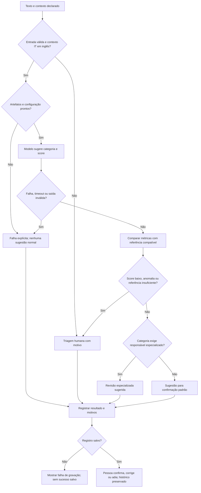

# Proposta de automação — S01

**Uma triagem assistida local: sugerir a categoria de um ticket IT, explicar quando
precisa de atenção e manter uma fila de revisão com anomalias filtráveis.** A
pessoa confirma, corrige ou adia a decisão. Não há resposta enviada ao cliente,
execução de compra/permissão ou integração com helpdesk nesta entrega.

Esta é a especificação para implementar depois da V00, não uma funcionalidade já
construída. O [contrato técnico](../knowledge/solution-scope.md) é a autoridade
para entradas, saídas, precedência das regras, persistência e aceite.

## Por que esta automação

O [diagnóstico](operational-diagnosis.md) encontrou muitos registros não encerrados
e limitações de instrumentação. Uma assistência à classificação é uma hipótese de
redução de esforço de triagem que pode ser demonstrada e avaliada com os 47.837
textos IT classificados. Não afirmamos que ela resolve a fila do arquivo de clientes:
o [uso complementar](../knowledge/dataset-usage.md) mantém os domínios separados.

O escopo evita gerar respostas a partir de resoluções não validadas e mantém a
conferência humana. O benefício pretendido é preparar uma decisão de categoria
mais rapidamente; essa redução de minutos ainda precisa ser medida num piloto.

## Fluxo proposto

O modelo não conhece o rótulo verdadeiro na entrada. Um score alto também não
prova que um texto manual está no domínio correto. A escolha de contexto é
declarada pelo operador; documentos processados do dataset não garantem que todo
seu conteúdo já existia na abertura do ticket.

## Onde entra a pessoa

- **Todos os casos:** confirmar ou corrigir antes de qualquer uso operacional.
- **Triagem geral:** contexto desconhecido/cliente, entrada vazia ou longa demais,
  vocabulário desconhecido, score baixo, anomalia ou falta de referência suficiente.
- **Responsável especializado:** Access, Administrative rights, Purchase e
  HR Support, quando as demais verificações permitem uma sugestão utilizável.
  É uma política de desenho; não é uma conclusão de risco medido nos dados.
- **Falhas técnicas:** modelo/configuração ausente, timeout, resposta inválida ou
  gravação indisponível ficam visíveis, com encaminhamento manual, nunca como sucesso.

Limites de desenho: 10 mil caracteres sem truncamento silencioso e orçamento de
5 segundos para o worker do modelo. Não são resultados de qualidade ou latência.
Os limiares de score e os parâmetros de cauda serão escolhidos em validação sob
o protocolo da V00, sem usar o teste final para ajustá-los.

## Anomalias altas e baixas

Comparar **score do modelo** e **tamanho do texto normalizado** com valores do mesmo
contexto, categoria predita, versão e definição de métrica. As referências virão
da validação e serão congeladas. A regra usa quantis inferior/superior, com no
mínimo 100 registros comparáveis; esse mínimo é uma convenção, não garantia estatística.

| Situação | Registro e ação |
| --- | --- |
| Abaixo/acima dos limites | Possível anomalia baixa/alta; preservar valor e sugerir investigação humana |
| Dentro dos limites, incluindo igualdade | Ordinário; ainda passa pela confirmação normal da categoria |
| Referência insuficiente ou sem predição válida | Não avaliado, com motivo explícito; não inventar faixa normal ou score zero |

Um valor raro pode ser correto. O filtro será combinado por direção, motivo e
estado de revisão; categoria, métrica e versão também ficarão visíveis. Uma
investigação pode confirmar valor válido, confirmar problema ou permanecer adiada.
O valor original e a referência ficam preservados, mesmo depois de uma correção.

## O que o avaliador verá

Uma interface local com **Triagem** e **Revisão/anomalias**, compartilhando a mesma
regra com CLI/avaliação. Será possível inserir texto IT ou usar um exemplo de
desenvolvimento, ver categoria/destino sugeridos e motivo, abrir registros anteriores
e revisar alertas. Um refresh não deverá duplicar execuções nem apagar histórico.
Exemplos do teste reservado não alimentarão a demonstração durante o desenvolvimento.

Stack escolhida: **Python, scikit-learn, Streamlit e SQLite**. Pipeline reúne o
processamento do texto e o classificador; Streamlit oferece a tabela de revisão;
SQLite guarda as decisões entre sessões. As versões exatas foram fixadas e
verificadas na [V00](evaluation-protocol.md), sem implementar a interface ou treinar
classificadores. [Pipeline](https://scikit-learn.org/stable/modules/compose.html),
[tabelas Streamlit](https://docs.streamlit.io/develop/api-reference/data/st.dataframe),
[SQLite](https://docs.python.org/3.12/library/sqlite3.html).

O banco e os textos permanecerão locais e fora do Git. Revisões serão eventos
separados, sem sobrescrever predição ou alimentar treino/teste automaticamente.
Não haverá autenticação de papéis empresariais: o rótulo de operador será declarado,
e testes automáticos serão identificados como testes, não aprovação humana.

## Como saber se funciona

1. **Software:** entradas normais e falhas percorrem o fluxo correto; gravação,
   recarga, filtros combinados e revisão preservam valores e versões. Os casos
   críticos do contrato precisam passar antes de demonstrar o protótipo.
2. **Modelo:** comparar com baselines e reportar macro F1, erros por classe e suporte.
   Medir erro das sugestões utilizáveis junto da cobertura e da carga humana;
   não chamar essa cobertura de resolução automática.
3. **Anomalias:** expor alertas altos/baixos, não avaliados e revisões. Sem julgamento
   real dos alertas, não alegar uma taxa medida de alarmes falsos.
4. **Operação:** medir latência/falhas localmente e, num piloto representativo futuro,
   minutos, revisão e retrabalho. As 29,75 h/mês da A01 continuam hipótese.

S01 está concluída como escopo e contrato. A [V00](evaluation-protocol.md) congelou
conjuntos, candidatos, custos ilustrativos e critérios antes da implementação.
A [I01](prototype.md) implementou o protótipo local e selecionou modelo/gate apenas
em treino/validação. A [V01](final-evaluation.md) concluiu o benchmark final, sem
reajuste e com exposição consumida. **Próxima etapa: E01**; adjudicação humana e
ganho operacional medido continuam pendentes.
