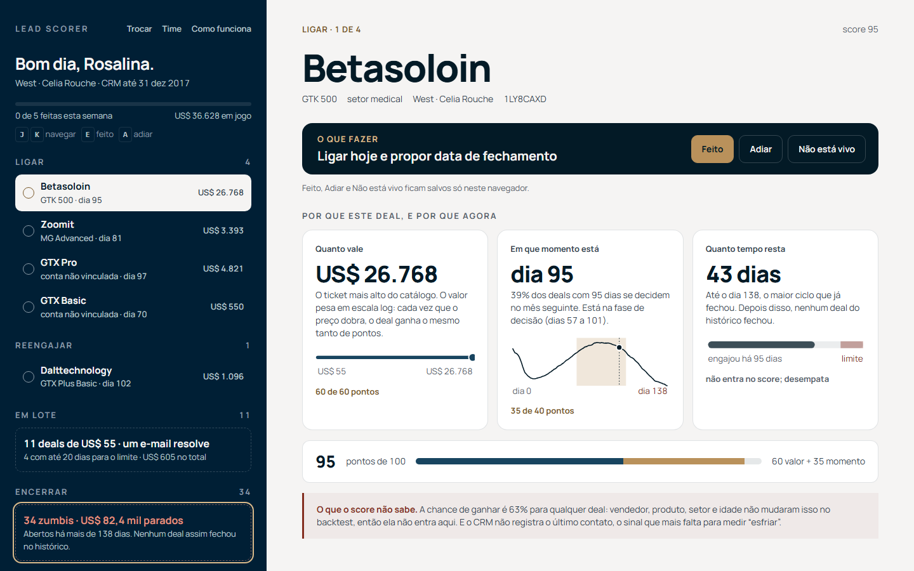
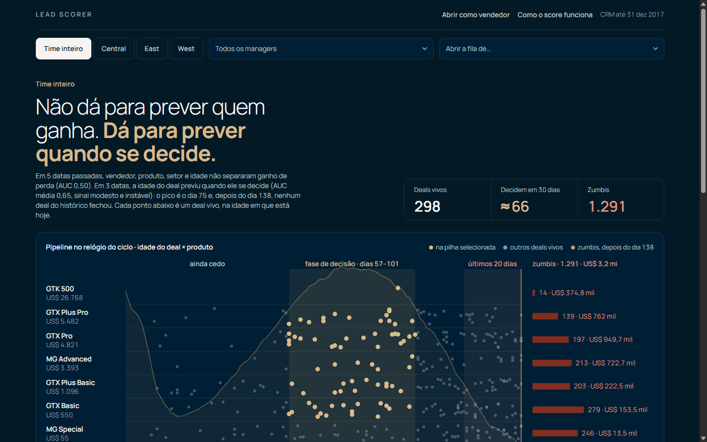

# Submissão — Guilherme (Breq) — Challenge 003

## Sobre mim

- **Nome:** Guilherme (Breq)
- **LinkedIn:** _[preencher]_
- **Challenge escolhido:** 003 — Lead Scorer (Vendas / RevOps)

---

## Executive Summary

Construí o **Lead Scorer**, um app web que o vendedor abre na segunda de manhã e vê, em uma frase e uma lista, em quais deals focar, por quê e qual o próximo passo.

Antes de construir, testei cada sinal voltando a datas passadas e pontuando os deals só com o que se sabia naquele dia. O achado central é que **nenhum atributo do CRM prevê se um deal será ganho** (vendedor, produto, setor, porte e idade têm AUC ~0,50, igual a cara ou coroa). Em compensação, **81% do pipeline Engaging já passou do maior ciclo que algum deal levou para fechar (138 dias)**, e o que dá para prever é **quando** um deal se decide: o pico é aos 75 dias, e depois de ~100 dias o deal esfria e tende a virar zumbi.

Por isso o score combina **valor (60 pts) e momento de decisão (40 pts)**, e separa os 1.291 zumbis numa fila de higiene. **Recomendação principal:** limpar o pipeline zumbi esta semana (US$ 3,2 mi em valor de tabela travado) e concentrar o time nos 298 deals vivos: ligar para os 89 em fase de decisão e forçar o sim ou o não nos 98 cuja janela fecha em até 20 dias.

---

## Solução

**Rodar:** `cd solution && npm install && npm run build && npm start` → http://localhost:3000 (detalhes em [`solution/README.md`](solution/README.md)).

### Abordagem

1. **Entender o pedido.** A dor é "tempo em deal que não fecha" e "oportunidade boa esfriando". O usuário é o vendedor, não técnico, numa segunda de manhã. Requisito: explicar o porquê de cada score.
2. **Explorar os dados** (`solution/analysis/01-03`) desconfiando do óbvio: win rate por cada atributo, estabilidade entre semestres e qualidade dos dados.
3. **Testar antes de construir** (`04`): a chance de ganhar não é previsível, o que derrubou minha primeira proposta de score.
4. **Ficar só com o que sobreviveu** (`05`, corrigido no `06`): valor, momento de decisão e corte de zumbi.
5. **Construir em TDD**: motor de score puro e testado, teste de integração que cruza o app com a análise em Python, e por cima a UI.
6. **Revisão independente**: um agente revisor de código e estatística e uma agente de QA de interface, rodando em paralelo no Maestri. A revisão achou **dois vieses no meu backtest**, corrigidos com Kaplan-Meier, e a QA rodou 3 rodadas.

### Resultados / Findings

| Achado | Evidência |
|---|---|
| Chance de ganhar não é previsível com estes dados | AUC 0,50–0,52 em todas as variantes; Brier pior que a média global |
| 81% do pipeline Engaging é zumbi | 1.291 de 1.589 com mais de 138 dias; dos 411 deals que estavam assim em datas passadas, 0 fecharam depois |
| O momento de decisão é previsível pela idade | AUC média 0,65 (0,53–0,79) fora da amostra, com calibração média boa (previsto 25%, real 26%) |
| Deals esfriam depois de ~100 dias | A chance de decisão cai de 44% (75 dias) para 13% (120 dias) e 2% (135 dias) |
| Valor concentra a receita | Top 20% por valor = ~50% da receita ganha |
| "Fim de trimestre converte 81%" é artefato | Efeito igual em todos os dias do mês, não só no fim |
| Qualidade do CRM | 68% dos deals abertos sem conta; `GTXPro` × `GTX Pro`; `technolgy` |

**O que o vendedor vê** (identidade G4: navy, off-white e dourado, Manrope):

- **Entrada:** "Bom dia. Quem está abrindo?". O vendedor escolhe o nome (com busca; quem tem fila vem primeiro e quem não tem deals vivos fica num grupo à parte) e cai na fila dele. O app lembra o último vendedor neste navegador e abre direto na fila; "Trocar" esquece. Gerente e RevOps entram por "ver o time".
- **A fila da semana** (esquerda): "Bom dia, Rosalina.", progresso "0 de 5 feitas" com o valor em jogo e os deals agrupados pelo verbo da ação: **Ligar**, **Forçar sim ou não**, **Reengajar** e **Preparar proposta**. Os deals de ticket baixo viram uma linha só (**Em lote**: "11 deals de US$ 55, um e-mail resolve"), os zumbis outra (**Encerrar**; o lote vem por urgência, e cada linha traz o ID do deal) e a prospecção, outra.
- **A ficha do deal** (direita): o que fazer agora ("Ligar hoje e propor data de fechamento"), com **Feito**, **Adiar** e **Não está vivo**. Abaixo, "Por que este deal, e por que agora" em três cartões desenhados (quanto vale, em que momento está, quanto tempo resta), a soma do score (60 valor + 35 momento) e **"O que o score não sabe"**: a chance de ganhar é igual para qualquer deal e o CRM não registra o último contato.
- **Ação variada pelo valor:** `src/lib/playbook.ts` deriva a próxima ação do status, do valor, da idade e dos dias restantes (tabela em [`docs/scoring.md`](docs/scoring.md)). No time, a divisão passou de 98/89/75/25/11 para Ligar 72, Decidir 76, Reengajar 53, Preparar 35 e Lote 62, com os dias concretos no texto.
- **Teclado:** J e K navegam a fila, E marca como feito, A adia. No celular a fila é a tela inicial e a ficha abre por cima, com "← Fila".
- **Feito, Adiar e Não está vivo** ficam salvos **só no navegador** (`localStorage`), com aviso na tela. Não há backend nem login: trocar de navegador ou limpar os dados apaga as marcações.
- **Visão do time** (gerente, RevOps): a tese ("não dá para prever quem ganha, dá para prever quando se decide") e o **mapa idade × produto** (cada deal vivo é um ponto, a curva de decisão por trás, a faixa dourada é a fase de decisão e à direita do limite ficam os zumbis por produto). Abaixo, as pilhas em tabela, que acendem os pontos no mapa. Filtros por região e manager, busca e abertura da fila de qualquer vendedor.
- **Como o score funciona:** a curva com as fases "cedo / decisão / esfriando" e o que foi testado e descartado.
- Estados vazios (vendedor sem deals vivos, busca sem resultado), `prefers-reduced-motion` respeitado e sem rolagem horizontal em 390 px.

Lógica completa, fórmulas e evidências: [`docs/scoring.md`](docs/scoring.md).

### Recomendações

1. **Esta semana: higiene.** Cada vendedor confirma ou fecha os próprios zumbis (pilha Encerrar). Enquanto 81% do pipeline for fantasma, nenhuma previsão de receita feita a partir do CRM é confiável.
2. **Toda segunda: Foco da semana + Janela fechando.** São os deals vivos de maior valor na fase de decisão, e os que vão estourar o ciclo.
3. **Tratar 100 dias como alerta.** Depois disso, o deal esfria. Reengajar na hora, em vez de esperar.
4. **Regra de processo:** deal Engaging sem decisão em 138 dias fecha automaticamente como perdido (ou pede justificativa).
5. **Coletar o dado que falta:** atividade (último contato, reunião, e-mail). "Esfriar" se mede por tempo sem contato, e hoje o CRM não registra isso. É o próximo sinal a testar pelo mesmo backtest.
6. **Parar de priorizar por perfil de conta ou de vendedor.** Os dados mostram que isso não muda a chance de fechar.

### Limitações

- "Hoje" é fixado em 31/12/2017, a última data do CRM. Em produção, seria a data real e o modelo seria recalculado a cada carga (já é automático).
- O corte de 138 dias vem deste histórico e é heurístico. Com dados reais, usaria um percentil por produto.
- O momento é um sinal modesto (AUC média 0,65) e instável entre períodos. Ordena melhor que o acaso, mas não é certeza.
- Valor = preço de tabela (não há desconto ou quantidade no CRM).
- O CRM é só leitura: o vendedor marca Feito, Adiar e Não está vivo no navegador, mas nada é gravado no CRM (não marca um zumbi como perdido lá).
- Dataset sintético: os números valem para ele, e o que se transfere é o **método**.
- Sem autenticação: hoje qualquer pessoa vê o pipeline inteiro.
- Feito, Adiar e Não está vivo ficam só no navegador de quem marcou (`localStorage`). A visão do time **não conta** essas marcas: um deal marcado como feito pela vendedora continua em "Ligar" na pilha do time. Fechar esse ciclo pede gravar a ação no servidor.
- Viewport testado: 390 a 1440 px, no Chrome. Abaixo de 360 px o texto do mapa fica menor que 13 px (em 320 px, ~11,5 px); Firefox, Safari e leitor de tela real não foram testados.
- Ao reabrir com o vendedor lembrado, a tela de entrada pode piscar antes de abrir a fila.
- Se outra aba apagar as marcações, a fila da aba aberta se atualiza, mas o aviso para leitor de tela fica desatualizado até a próxima ação.

Mais em [`docs/scoring.md`](docs/scoring.md#limitações).

---

## Process Log — Como usei IA

Narrativa completa: [`process-log/process-log.md`](process-log/process-log.md). Achados da revisão e o que foi feito com cada um: [`process-log/review-findings.md`](process-log/review-findings.md).

### Ferramentas usadas

| Ferramenta | Para que usou |
|------------|--------------|
| Claude Code (Claude Opus) no Maestri | Agente principal: exploração em pandas, backtest, desenho do score, app Next.js em TDD, documentação |
| Agente "Esquadro" (Codex, Maestri) | Revisão independente de código, estatística (vazamento, viés, censura) e segurança, só leitura |
| Agente "Retina" (Maestri) | QA de interface no navegador (Edge via CDP): 3 rodadas, fluxos, mobile e acessibilidade, só leitura |
| Agente "Torno" (Maestri) | Implementou ajustes de UI em `DealRow` e `TeamTable`, em paralelo, com escopo de arquivos isolado |
| Edge headless | Capturas da build de produção para revisão visual |

### Workflow

1. Li o brief e defini stack, escopo e local antes de abrir os dados.
2. A IA explorou o dataset; eu aprovei a direção (zumbis fora do ranking, sem setor e porte no score).
3. O backtest derrubou a proposta de "chance de ganhar"; redesenhamos em cima do que passou no teste.
4. Construção em TDD: motor puro → integração com os CSVs reais → UI.
5. Revisão delegada em paralelo: o Esquadro achou viés de seleção e censura no meu backtest, e a Retina achou 11 problemas de UI.
6. Correção: momento refeito com Kaplan-Meier (números reportados caíram, e isso foi documentado), estado "esfriando" criado, validações de borda, UI ajustada (parte por mim, parte pelo Torno).
7. QA de confirmação (rodadas 2 e 3) e documentação.

### Onde a IA errou e como corrigi

- **Propôs pontuar a chance de ganhar** por vendedor e idade. O backtest mostrou AUC ~0,50, e a chance saiu do score.
- **Backtest com viés de seleção:** testou o momento só com deals que *acabaram* fechando, ou seja, usou o futuro pra escolher a amostra. Reportei AUC 0,66–0,87; o número honesto é 0,53–0,79 (média 0,65). Achado pelo revisor independente.
- **Curva ignorando censura:** estimou a chance de decisão só com fechados. Previa 41% num mês em que 10% se decidiram. Corrigido com Kaplan-Meier (previsto 25%, real 26% na média).
- **Contou zumbis em dobro:** "589" eram observações repetidas de 411 deals.
- **Bug na fase de decisão:** um limiar simples juntava o pico inicial da curva com o pico do ciclo. Corrigido com teste.
- **Números arredondados ou errados** na documentação ("quase todos perdidos", "12 deals vivos"). Conferi contra a saída dos scripts e corrigi.
- **Fez tudo sozinha** no início. Mudei isso: revisão, QA e parte da implementação foram para agentes especializados, em paralelo.

### O que eu adicionei que a IA sozinha não faria

- Exigir **evidência fora da amostra** antes de qualquer sinal entrar no score, e **revisão independente da própria evidência**. Foi o revisor que pegou o viés que eu teria defendido numa banca.
- **Reenquadrar o problema:** o maior ganho não é prever quem ganha, é limpar o que morreu e agir antes que o vivo esfrie.
- **Desconfiar do achado bonito** (fim de trimestre) e descartá-lo com evidência.
- **Decisões de produto pensadas no vendedor:** frase antes de tabela, ação em cada deal, chance mostrada com honestidade e zumbi separado do deal vivo.

---

## Evidências

- [x] Screenshots (`process-log/screenshots/`, interface antiga (01–03) e redesign (04), além das 3 rodadas de QA)
- [ ] Screen recording do workflow
- [ ] Chat exports (`process-log/chat-exports/`), _a incluir_
- [x] Git history (branch `submission/guilherme-breq`)
- [x] Outro: scripts de análise versionados, inclusive a versão com viés e a corrigida (`solution/analysis/05` e `06`), 93 testes automatizados (35 do motor de score + 58 do playbook, das marcações e da interface) e relatório da revisão (`process-log/review-findings.md`)

---

_Submissão enviada em: [data]_
