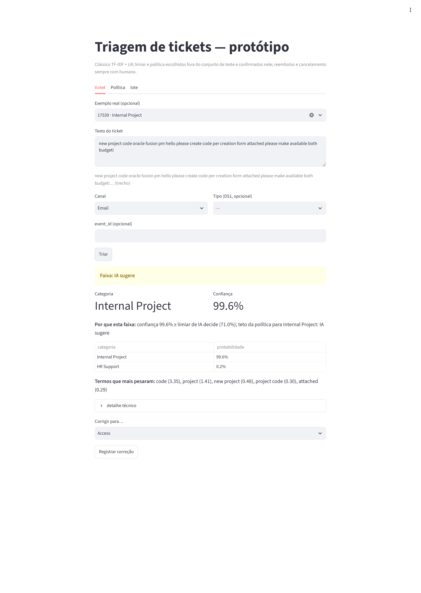
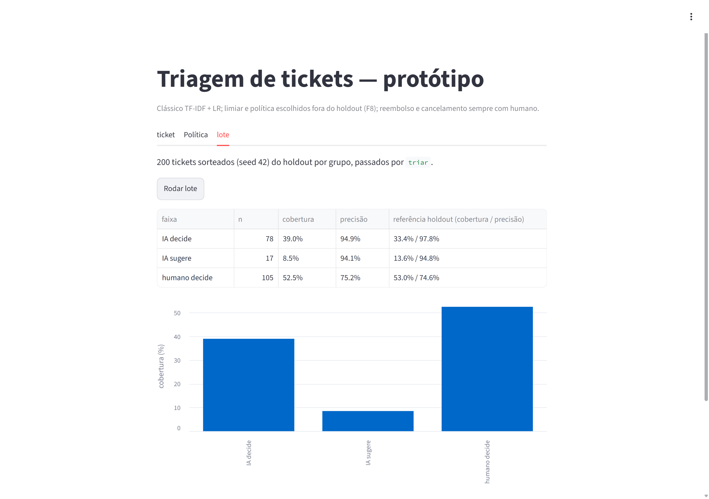
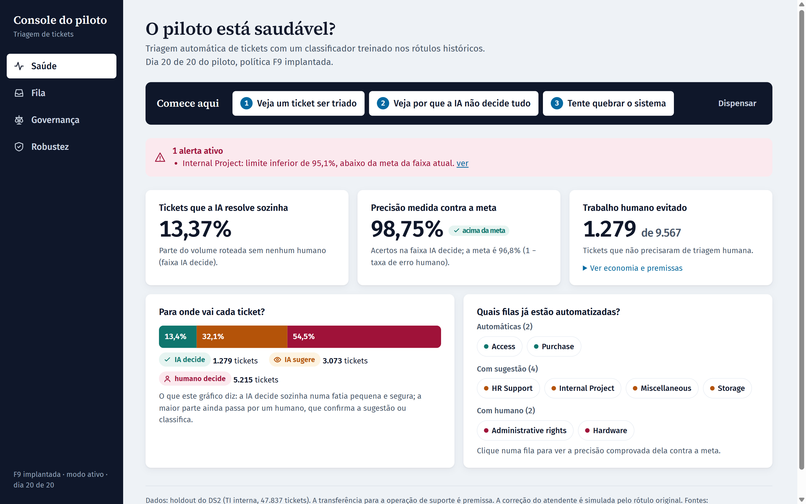

# Submissão — Gustavo Covaleski — Challenge 002

**Console do piloto:** https://console-piloto-triagem.vercel.app · abre localmente com duplo clique em `console/index.html`.

## Sobre mim

- **Nome:** Gustavo Covaleski
- **LinkedIn:** https://www.linkedin.com/in/gustavo-henrique-covaleski
- **Challenge escolhido:** 002 — Redesign de Suporte

---

## Executive Summary

Nesta submissão, eu:

- auditei os dois datasets;
- congelei um holdout separado por grupo de quase-duplicados antes de qualquer modelo;
- comparei um classificador clássico com um LLM;
- transformei o resultado numa política "IA decide / IA sugere / humano decide" por categoria, com um protótipo testado para produção.

O que encontrei:

- **Tempo e satisfação:** os dados de hoje não permitem achar gargalo de tempo nem fator de satisfação, porque o problema é a medição.
- **Automação:** a seleção fora da dobra indicou 5 categorias (33,4% do volume); a confirmação no teste sustentou 2 (≈ 13,4%); só essas são ativadas. Nelas, a IA decide sozinha com precisão de 98,8% (em tickets reais de TI; a transferência para a operação de suporte é premissa).
- **Taxonomia:** as 8 categorias seguem convenções que nem um revisor externo (46,7% de concordância) nem um LLM (26,5% na faixa de dúvida) reproduzem.

A recomendação é um piloto de 4 semanas:

- instrumentar 5 eventos;
- ativar a triagem em modo sombra e, depois, "IA decide" só em Access e Purchase, as 2 categorias confirmadas no teste;
- escrever a definição das filas com o time;
- **não** contratar LLM para classificar.

Detalhes no [memo de 1 página](docs/memo-diretor.md).

---

## Solução

### Abordagem

- **Fases com portão humano** (F0 a F9). Cada fase tem uma spec escrita no chat do Projeto, executada pelo Claude Code, com report revisado contra os arquivos gerados. As specs e os reports estão em [`process-log/planning/`](process-log/planning/).
- **Regras fixadas antes de ver o resultado:**
  - consequência de cada armadilha dos dados (F1);
  - critério da automação: limite inferior do IC 95% da precisão ≥ 1 − taxa de erro humano (*e*);
  - *e* = o menor entre o *e* da revisão adjudicada e o dos quase-duplicados;
  - regra de faixa por categoria (F4);
  - regra de adoção do detector de injeção (F6).
- **Limiar e política escolhidos com predições fora da dobra no treino; holdout usado uma única vez** (F8). Depois, **confirmação por categoria no holdout; a regra só rebaixa** (F9, decisão conservadora pós-hoc). Na F3/F4 eles tinham sido escolhidos no próprio holdout; a revisão pré-push corrigiu isso.
- **Holdout congelado antes de qualquer modelo**, separado por grupo de quase-duplicados (TF-IDF, cosseno ≥ 0,90). O holdout aleatório foi mantido só para medir vazamento.
- **Os dois datasets cruzados por premissa explícita:** o DS2 (TI interna, texto) mede o roteamento; o DS1 (suporte ao cliente) define a regra de ação e o que não é mensurável. Ver [política](docs/politica.md).

### Resultados / Findings

| Achado | Número | Arquivo |
|---|---|---|
| DS1: resolução antes da 1ª resposta nos tickets fechados | 49,30% | `solution/outputs/f1_ds1_auditoria.json` |
| DS2: texto já pré-processado | 0% de maiúsculas; palavras funcionais em 24,94% | `solution/outputs/f1_ds2_auditoria.json` |
| Vazamento por quase-duplicados | +0,31 p.p. no agregado; localizado: 91,84% (com quase-duplicado no treino) × 84,97% (sem) | `solution/outputs/f3_classico.json` |
| Clássico (TF-IDF + LR), holdout por grupo | acurácia 85,07% (IC 84,34–85,79) | `solution/outputs/f3_classico.json` |
| LLM (Claude Haiku 5.5) × clássico na faixa de dúvida | 26,5% × 69,5% (mesmos 400 tickets); US$ 0,15 por 1.000 | `solution/outputs/f3_llm.json` |
| Ruído de rótulo: "original errado" em que o modelo segue o original | 18 de 21 (convenção da taxonomia, não erro aleatório) | `solution/outputs/f3_h2.json` |
| Faixas da política implantada (limiar 0,71 / 0,64 fora da dobra + confirmação por categoria no holdout): IA decide / IA sugere / humano | 13,37% (precisão 98,75%, IC 97,98–99,23) / 32,12% / 54,51%. A seleção fora da dobra sozinha daria 33,42% em IA decide (5 categorias); a confirmação sustentou 2 | `solution/outputs/f8_faixas.json` (`implantada`, `selecao_oof`) |
| Categorias rebaixadas na confirmação no holdout | HR Support e Storage → IA sugere (LI 0,9604 e 0,9582); Administrative rights → humano (LI 0,8968) | `solution/outputs/f8_politica_por_categoria.csv` |
| Injeção (100 pares): troca de rótulo / alvo atingido, clássico | 9% / 3%; com a política implantada, 0 de 6.395 pares em "IA decide" (limite superior 0,06%) e 860 (13,45%) saem para humano: o ataque não engana a decisão automática, mas gera carga humana e reduz a cobertura. Na seleção fora da dobra eram 80 de 15.985, todos para Storage (chaves `dano_ampliado_f8` e `dano_ampliado_f8_oof`) | `solution/outputs/f5_injecao.json` |
| Detector de injeção | falso positivo de 4,75% > 1% → **não adotado** | `solution/outputs/f6_detector.json` |
| Latência de ponta a ponta (`triar`, com mascaramento e log) | p50 2,79 ms / p95 5,12 ms | `solution/outputs/f5_latencia.json` |
| Economia de triagem (cenário com etapa separada) | R$ 7.018,66/ano na base (premissas) | `solution/outputs/f8_economia.csv` |

Mais detalhes:
- [diagnóstico](docs/diagnostico.md);
- [instrumentação](docs/instrumentacao.md);
- [política](docs/politica.md);
- [fluxo](docs/fluxo.md);
- [produção](docs/producao.md);
- capturas do protótipo em [`process-log/screenshots/`](process-log/screenshots/): [IA decide](process-log/screenshots/1_ia_decide.png), [humano pela política](process-log/screenshots/3_humano_politica.png), [reembolso](process-log/screenshots/4_reembolso.png), [duplicado](process-log/screenshots/5_duplicado.png), [política](process-log/screenshots/7_politica.png).







Outras telas do console: [fila do atendente](process-log/screenshots/v2_fila.png), [governança com Hardware](process-log/screenshots/v3_governanca_hardware.png), [robustez: injeção F8 × F9](process-log/screenshots/v4_robustez_injecao.png), [robustez: modo sombra](process-log/screenshots/v5_robustez_sombra.png), [celular](process-log/screenshots/v6_celular.png), [antes e depois](process-log/screenshots/antes_depois.png).

### Recomendações

1. **Instrumentar os 5 eventos** (`ticket_criado`, `resposta_agente`, `status_mudou`, `reatribuido`, `csat_respondido`). Sem eles, nenhum diagnóstico de tempo é possível ([instrumentação](docs/instrumentacao.md)).
2. **Rodar a triagem em modo sombra** por 2 a 3 semanas, medindo a precisão pelas correções e o tempo de confirmação em "IA sugere".
3. **Ativar "IA decide" só em Access e Purchase**, as 2 categorias confirmadas no teste, se a meta se confirmar no piloto. HR Support, Storage, Internal Project e Miscellaneous ficam em "IA sugere"; Administrative rights e Hardware ficam com humano. Hardware sobe para "IA sugere" se as correções do piloto mostrarem precisão ≥ meta (hoje 95,18% fora da dobra, com limite inferior 0,9462 contra a meta de 0,9545; `solution/outputs/f8_politica_por_categoria.csv`).
4. **Escrever com o time a definição das 8 filas.** Administrative rights teve 6 de 6 rótulos contestados na revisão.
5. **Não contratar LLM para classificar.** Ele acerta menos (26,5% × 69,5%) e não é determinístico.

### Limitações

- **DS1 sintético:** tempos invertidos, CSAT uniforme, texto com template não preenchido. Ele entra só por metadados e por regra de negócio.
- **DS2 de outro domínio** (TI interna) **e pré-processado.** A transferência para o suporte ao cliente é premissa, não resultado.
- **Revisão de rótulos com um único revisor** (60 tickets).
- **Taxa de erro humano:** o *e* usado na decisão (3,82%) vem da discordância entre quase-duplicados, como estimativa do erro humano. O *e* da revisão adjudicada foi de 31,79%.
- **Precisão medida contra rótulos com ruído próprio:** conservador se o ruído for aleatório, otimista se for sistemático.
- **LLM testado com 1 exemplo por categoria** e sem `temperature = 0`, que o Haiku 5.5 não aceita: não é determinístico.
- **Ganho da faixa "IA sugere" não quantificado:** o tempo de confirmação deve ser medido no piloto.
- **Câmbio:** a grade de câmbio que aparece em `f3_*.json` não foi usada em nenhuma conclusão.
- **Retreino** de 21,5 s a 78,2 s, na mesma máquina.
- **Treino sem máscara, inferência com máscara:** o modelo é treinado no texto original e classifica o texto mascarado. O efeito é desprezível no DS2, que tem 0 dado pessoal por regex (`solution/outputs/f1_ds2_auditoria.json`).
- **Export da sessão:** contém os mesmos 2 trechos do DS2 de `docs/politica.md`; mantido sem edição para preservar a evidência.
- **Console do piloto:** simula a correção do atendente com o rótulo original; a classificação de texto livre roda no protótipo Streamlit local. Contém o texto de 300 tickets do DS2 (até 400 caracteres cada), exceção aprovada pelo Gustavo.
- **Tempo total acima do orçamento:** ver o [process log](process-log/process-log.md).

---

## Process Log — Como usei IA

### Ferramentas usadas

| Ferramenta | Para que usou |
|------------|--------------|
| Claude, no chat do Projeto | Planejamento, crítica, especificação de cada fase, revisão dos números nos arquivos gerados e condução dos portões |
| Claude Code | Execução das specs: código, testes, medições e reports |
| Claude Haiku 5.5 (API) | Braço LLM do experimento (F3) e do teste de injeção (F5); fora do caminho de decisão |

### Workflow

1. **F0:** reescrever o pedido em 3 perguntas mensuráveis, ranquear hipóteses e escolher o escopo, num portão humano.
2. **F1:** auditar os dados, congelar grupos e holdout, e preparar a planilha cega de revisão.
3. **F2:** diagnóstico com MDE e instrumentação.
4. **F3:** revisão cega e adjudicação (humano); depois, o experimento clássico × LLM e as faixas.
5. **F4:** política por categoria e fluxo.
6. **F5:** protótipo com prontidão testada.
7. **F6:** lacunas da F5, detector de injeção e rollback.
8. **F7:** comunicação.
9. **F8:** correções da revisão pré-push (idempotência, limiar fora do holdout, modelo versionado, app).
10. **F9:** confirmação por categoria no holdout; a política implantada só rebaixa.

Cada fase seguiu o mesmo ciclo: spec → execução → report → revisão → decisão registrada.

### Onde a IA errou e como corrigi

Resumo da tabela do [process log](process-log/process-log.md):

- **Critério da Q2 invertido:** a IA comparou precisão com taxa de erro. Corrigido no portão F0.
- **Critério de "confirmada" das armadilhas definido depois de ver os dados.** Registrado como tal.
- **Ruído de rótulo inflado:** "360 tickets em grupos com conflito". O recálculo deu 118 (3,8%).
- **Spec de CSV sem prever o Excel online:** a leitura da revisão quebrou e foi convertida sem alterar o conteúdo.
- **Previsão do F0 de que o vazamento seria "número de capa":** a medição derrubou a hipótese (+0,31 p.p.).
- **Revisão pré-push (F8):** colisão de chave de idempotência, corrida entre processos, limiar e política escolhidos no holdout, e rollback de modelo não executável. As duas primeiras foram reproduzidas antes da correção.

### O que eu adicionei que a IA sozinha não faria

Registrado como decisão minha no [process log](process-log/process-log.md):

- **Premissas de custo:** premissas editáveis com sensibilidade obrigatória.
- **Preço do LLM:** consultado na fonte oficial.
- **Revisão de rótulos:** cega, feita por mim e sem sugestão pré-preenchida, seguida de adjudicação.
- **Regra de automação:** regra de decisão em 3 faixas amarrada ao IC do erro humano.
- **Cenário B:** cenário sem etapa de triagem (economia zero), que justifica o evento `reatribuido`.
- **Repasse e conferência:** divisão de trabalho com repasse por arquivo e conferência dos números.
- **Repositório:** regras de repositório e de segredo.
- **Deploy:** cortado.
- **Regra registrada:** mantida na F4, mesmo com a cobertura caindo de 57% para 13%.

Também meus, anteriores à execução ou fora das tabelas de decisão:
- **Raio-x das 57 submissões do 002** antes de planejar, para separar o que já é baseline do que diferencia.
- **As 7 hipóteses de diferenciação** que orientaram o escopo e foram ranqueadas no portão F0.
- **Ordem de corte definida antes de estourar:** amostra do LLM de 400 para 150 chamadas, curva com 3 limiares, e os testes de falha da F5 nunca cortados.
- **Plano B:** manter o escopo cheio e declarar o estouro de tempo, em vez de fundir política e protótipo.
- **Planilha adjudicada no repositório** como evidência da revisão humana.
- **Coluna "Já vi em produção"** da [matriz de falhas](docs/producao.md): três falhas que já sustentei em produção (webhook duplicado, robô travando, injeção em triagem de documentos), cada uma ligada ao teste que a cobre aqui.

---

## Evidências

- [x] Process log com decisões por fase: [`process-log/process-log.md`](process-log/process-log.md)
- [x] Specs e reports de cada fase: [`process-log/planning/`](process-log/planning/)
- [x] Revisão de rótulos adjudicada: [`process-log/revisao_rotulos_adjudicada.csv`](process-log/revisao_rotulos_adjudicada.csv)
- [x] Screenshots do protótipo: [`process-log/screenshots/`](process-log/screenshots/)
- [x] Chat export da sessão do Claude Code (F1 a F7): [`process-log/chat-exports/claude-code-f1-a-f7.md`](process-log/chat-exports/claude-code-f1-a-f7.md)
- [x] Git history: um commit por fase na branch `submission/gustavo-covaleski`

---

## Como rodar

1. **Ambiente:** Python 3.11+.
   ```
   python -m venv .venv
   .venv/Scripts/python -m pip install -r requirements.txt   # Linux/macOS: .venv/bin/python
   ```
2. **Dados:** baixe os 2 CSVs ([Customer Support Ticket Dataset](https://www.kaggle.com/datasets/suraj520/customer-support-ticket-dataset) e [IT Service Ticket Classification Dataset](https://www.kaggle.com/datasets/adisongoh/it-service-ticket-classification-dataset)) para `../../../data/`, relativo a esta pasta, ou defina `DATA_DIR`.
3. **`.env` (opcional):** fica fora do repositório, em `../../../.env`, com `ANTHROPIC_API_KEY`. Só os scripts de LLM (`f3_llm.py`, `f5_injecao.py`) o usam.
4. **Scripts, em ordem:**
   - F1: `f1_verificar_dados.py`, `f1_auditoria_ds1.py`, `f1_auditoria_ds2.py`, `f1_planilha_revisao.py`. `f1_auditoria_ds2.py` gera `f1_splits.csv`, o holdout oficial (não regenere).
   - F2: `f2_diagnostico.py`.
   - F3: `f3_classico.py`, `f3_faixas.py`, `f3_h2.py`, `f3_llm.py`, depois `f3_faixas.py` de novo.
   - F4: `f4_politica.py`.
   - F5 e F6: `f5_injecao.py` (`--so-classico`, `--dano-ampliado`), `f5_latencia.py`, `f6_detector.py`.
   - F8 e F9: `f8_oof.py`, depois `f9_confirmacao.py` (acrescenta a política implantada; rodar sempre depois do `f8_oof.py`), depois `f5_injecao.py --dano-ampliado-f8`.
   - F10: `f10_console_dados.py` gera `console/data.js` (rodar depois da F9).

   Todos ficam em `solution/` e rodam com `python solution/<script>.py`.
5. **Testes:** `pytest solution/tests -q`. O golden set e o portão de qualidade estão incluídos.
6. **Protótipo:** `streamlit run solution/app.py`. A primeira execução treina o modelo e o guarda em `modelo_cache/`.

---

_Submissão enviada em: 04/11/2026_
