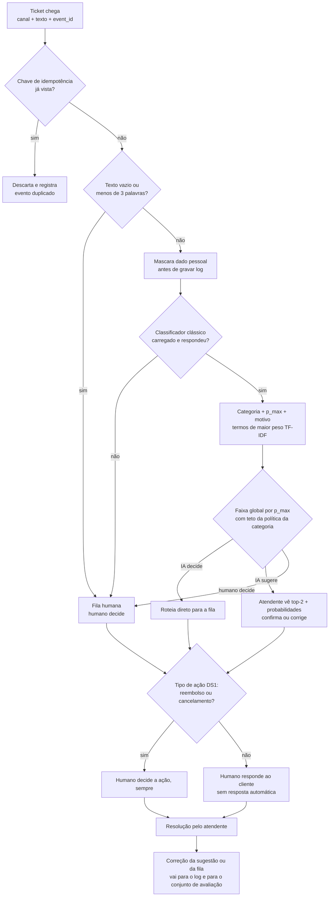

# Fluxo do ticket: da entrada à resolução

## Etapas

1. **Entrada.** A chave de idempotência é o `event_id`. Sem ele, usa-se o hash do texto normalizado + canal + janela de tempo. Evento duplicado é descartado e registrado (evento `ticket_criado` em `docs/instrumentacao.md`).
2. **Validação.** Texto vazio ou com menos de 3 palavras vai direto para humano decide. O DS2 tem 14 tickets assim e nenhum vazio (`solution/outputs/f1_ds2_auditoria.json`, `textos_menos_de_3_palavras` e `textos_vazios`).
3. **Mascaramento** de dado pessoal (e-mail, telefone, nome) antes de gravar qualquer log. No DS1, 8.469 de 8.469 linhas têm e-mail válido (`f1_ds1_auditoria.json`, T8).
4. **Classificação.** Categoria, `p_max` e motivo (os termos de maior peso do TF-IDF para a classe prevista). O modelo é o clássico da F3, com latência p50 de 0,43 ms e p95 de 0,65 ms por ticket (`f3_classico.json`).
5. **Faixa.** Faixa global por `p_max` (0,71 / 0,64, escolhidos fora do holdout; `f8_faixas.json`), limitada pela política implantada da categoria (`f8_politica_por_categoria.csv`, coluna `politica_implantada`).
6. **Regra de ação do DS1**, aplicada **depois** do roteamento: reembolso e cancelamento ficam sempre com humano (`docs/politica.md`).
7. **Resolução** pelo atendente. A correção da sugestão vai para o log e para o conjunto de avaliação.

## Tabela de falhas

| Falha | Como detecta | O que o sistema faz | Quem é avisado |
|---|---|---|---|
| Evento duplicado | `event_id` (ou hash de texto + canal + janela) já registrado | Descarta e registra o descarte; não reclassifica | Ninguém em tempo real; a contagem diária de duplicados vai para o painel de operação |
| Texto vazio ou com menos de 3 palavras | Contagem de palavras após a normalização | Vai para a fila humana, sem chamar o classificador | Atendente da fila humana (o ticket chega marcado "texto insuficiente") |
| Erro do classificador ou modelo não carregado | Exceção na carga ou na predição; tempo de resposta acima do limite | **Fallback: fila humana**; registra o erro no log estruturado | Responsável técnico (alerta); atendente recebe o ticket normalmente |
| Injeção de instrução no texto | Não há como impedir na entrada; o clássico não executa instruções, só pontua termos | Classifica normalmente. A taxa de troca de rótulo sob injeção é **medida na F5** (clássico × LLM) | Ninguém, até a F5 medir; se a taxa for relevante, entra como regra |
| Categoria nova ou drift | Queda da cobertura semanal da faixa IA decide em relação à base (13,37% do holdout, política implantada; `f8_faixas.json`) ou aumento das correções do atendente | Mantém o roteamento; a categoria afetada é rebaixada para IA sugere até reavaliação no conjunto de avaliação | Responsável pela operação de suporte |
| Dado pessoal no texto | Regex de e-mail, telefone (8+ dígitos) e URL; lista de nomes conhecidos | Mascara antes de gravar o log; o texto original fica só no sistema de tickets | Ninguém (comportamento padrão); falha do mascaramento é pega pelo teste da F5 |
