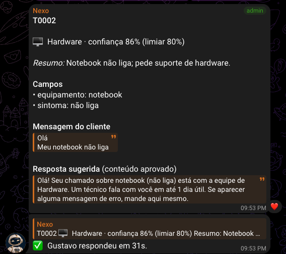
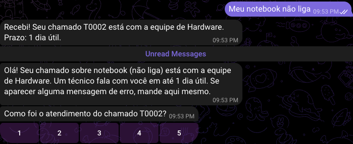

# Submissão — Gustavo Paraguassu — Challenge 002

## Sobre mim

- **Nome:** Gustavo Paraguassu
- **LinkedIn:** https://www.linkedin.com/in/guscfpara/
- **Challenge escolhido:** 002 — Redesign de Suporte

---

## Executive Summary

O Dataset 1 não tem sinal operacional. É sintético: nenhuma variável explica tempo nem satisfação, e um modelo prevê CSAT tão bem quanto um chute (20,6% contra 20,9%). Por isso não aponto "gargalos" nele, e levei o diagnóstico para onde há sinal: o roteamento dos 47.837 chamados do Dataset 2.

Construí um assistente que **roda de verdade no Telegram**, com o cliente no privado e os atendentes num grupo com um tópico por fila. Ele faz quatro coisas:

- entende o pedido em português e extrai os campos;
- pergunta ao cliente o que falta;
- sugere a fila com um classificador treinado no histórico (86,1% no teste);
- prepara a resposta a partir de conteúdo aprovado.

O roteamento só é automático quando a fila passa de 95% de acerto medido. **Nenhuma resposta de mérito sai sem um atendente**, e RH e permissão de administrador nunca são roteados sozinhos.

No cenário base (premissas declaradas), triagem e retrabalho caem de ~1.390 para 470 a 880 horas por ano. O valor depende de a sugestão acelerar ou não a triagem. Somam-se ~160 h/ano por o atendente não digitar a resposta. Automatizar tudo daria menos horas no papel, mas 2,7 vezes mais transferências e ~2.300 chamados sensíveis por ano na fila errada.

**Recomendação:** piloto de 4 semanas com o assistente sugerindo e o humano decidindo, medido pelas métricas que o próprio bot já registra. Critérios de seguir e parar estão no [memo de 1 página para o Diretor](docs/memo-diretor.md).

---

## Solução

### Abordagem

1. **Auditar os dados antes de analisar.** O Dataset 1 tinha 8.469 linhas (não ~30 mil), distribuições uniformes e o placeholder `{product_purchased}` em 100% das descrições. Testei se existia algum sinal antes de concluir qualquer coisa.
2. **Escrever as minhas hipóteses antes de a IA propor estratégia.** São as H1 a H9, em [process-log/01](process-log/01-hipoteses-antes-da-ia.md), e cada uma foi testada ou virou plano de medição.
3. **Testar no Dataset 2 sem me enganar.** O split de treino e teste é feito por grupos de chamados quase idênticos (cosseno ≥ 0,8), para um "gêmeo" não cair no treino e outro no teste.
4. **Transformar acurácia em política e custo.** Defini um limiar de confiança por fila e travas para filas sensíveis, e calculei horas e exposições por ano para cada política.
5. **Construir no canal real e medir com pessoas.** O resultado é um bot no Telegram, mais um teste com colegas com e sem o assistente.

### Resultados

#### 1. Diagnóstico operacional (Dataset 1): o que o dado permite dizer

| Pergunta do Diretor | O que os dados mostram | Evidência |
|---|---|---|
| Onde o fluxo trava? | Nenhuma combinação de canal, prioridade e tipo difere do acaso. A "pior" combinação fica 5,97 h acima da melhor; com os tempos embaralhados 500 vezes, essa diferença tem mediana de 4,69 h (p=0,08). A prioridade não altera o tempo: Critical = Low (p=0,074). Em 49,3% dos chamados fechados, a "resolução" vem antes da primeira resposta. | [02](process-log/analysis-outputs/02_signal_tests_ds1.out.txt), [01](process-log/analysis-outputs/01_profile_ds1.out.txt) |
| O que impacta a satisfação? | Nada mensurável. Os 6 fatores testados têm p entre 0,28 e 0,81. Um modelo prevê o CSAT com 20,6% de acerto (chute: 20,9%; AUC 0,499). | [02](process-log/analysis-outputs/02_signal_tests_ds1.out.txt) |
| Quanto desperdiçamos? | O Dataset 1 não mede isso: não há duração confiável. O único sinal utilizável é que **34% dos chamados estão parados esperando o cliente**, o que dá ordem de grandeza à espera (H4). As horas vêm do cruzamento com o Dataset 2 (item 2). | [04](process-log/analysis-outputs/04_cost_of_error.out.txt) |

Há também a assinatura de gerador aleatório: 0 de 21 pares de variáveis associados, todas as categorias uniformes (p de 0,12 a 0,80) e o tipo do chamado independente do assunto. Um relatório que apontasse "gargalo no canal X" com esse dado estaria vendendo ruído.

#### 2. Onde se perde tempo (Dataset 2, cruzado com a escala do Dataset 1)

- **Chamado na equipe errada (H3b): "Hardware" vira o ralo.** Recebe por engano 24,7% dos pedidos de permissão de admin, 14,5% dos de Compras e 8,9% dos de RH. Chamado de RH na fila de TI significa dado pessoal exposto.
- **Os próprios humanos discordam.** Em 5,2% dos pares quase idênticos, as filas são diferentes. Uso isso como a taxa de erro da triagem manual hoje e como teto (~95%) de qualquer modelo.
- **Pedidos repetidos (H1) são formulários, não dúvidas.** 13,3% dos chamados têm um gêmeo. Os maiores grupos são pedido de compra (800 iguais) e desligamento (234). Isso se resolve com regra no sistema de origem, sem IA.
- **Falta de dados (H3a).** O tamanho do texto não prevê erro: de 6 a 20 palavras o acerto é 88%, acima de 40 palavras, 84% (só 55 chamados têm menos de 6). Medido pelos campos obrigatórios, **só 44% das primeiras mensagens trazem o que a equipe precisa.**

**Horas por ano, 30 mil chamados** ([04_cost_of_error.py](solution/analysis/04_cost_of_error.py)):

| Política | Automático | Transferências/ano | Horas/ano | Sensíveis na fila errada/ano |
|---|---|---|---|---|
| P0 Hoje: 100% triagem humana | 0% | 1.563 | 1.391 | 0 |
| P1 100% automático | 100% | 4.177 | 1.044 | 2.275 |
| P2 Automático se confiança ≥ 0,90 | 52,7% | 1.040 | 733 | 159 |
| P3 Limiar por fila (meta 95%) | 73,2% | 1.472 | 636 | 564 |
| P4 = P3 + RH e admin sempre com humano | 54,2% | 1.486 | 486 | 282 |
| **P5 = P4 + trava de sensibilidade** | **45,4%** | **1.334** | **470** | **81** |
| P5c = P5, se a sugestão não acelerar a triagem (conservador) | 45,4% | 1.334 | 880 | 81 |

As premissas são rotuladas e têm faixa: 2 min de triagem manual (1 a 4), 0,5 min confirmando uma sugestão (0,3 a 1) e 15 min por transferência (8 a 30). Na faixa baixa–alta, a P5 fica entre 260 e 940 h/ano, contra 708 a 2.782 h/ano hoje.

**A P5c existe por um achado contra mim:** a estimativa KLM (item 5) indica que ler o card para decidir *só a fila* não é mais rápido que ler a mensagem crua. Por isso a faixa honesta de economia é **510 a 920 h/ano**.

#### 3. O que automatizar, o que só sugerir e o que nunca automatizar

| | O quê | Por quê (dado) |
|---|---|---|
| **Automático** | Rotear para a equipe quando a confiança passa do limiar da fila e a fila não é sensível | Limiar calibrado para ≥ 95% de acerto por fila. No teste em português, 97% de acerto no que foi sozinho |
| **Automático** | Perguntar ao cliente o campo obrigatório que falta (uma vez, texto aprovado) | 56% das primeiras mensagens chegam incompletas, e a pergunta evita uma ida e volta do atendente |
| **Automático** | Autoatendimento de troca e desbloqueio de senha, com botão "falar com atendente" | Caso simples e delimitado (minha H6) |
| **Sugere, humano decide** | Fila na triagem (3 opções), resumo, campos e **resposta pronta de conteúdo aprovado** | O top-2 do classificador acerta 96,3%. O atendente sempre envia, edita ou troca a fila |
| **Nunca** | Rotear RH ou permissão de admin sem humano | 8,9% do RH e 24,7% do admin vão parar em Hardware |
| **Nunca** | Deixar o LLM decidir a fila | Sozinho, o LLM acerta **43%**: "Outlook pedindo senha" é *permissão de admin* nesta empresa. A fila é convenção interna, e só o histórico a conhece |
| **Nunca** | Resposta livre do LLM, ação irreversível, compromisso financeiro | Minha H7: o LLM marca o risco, e o chamado vai para humano |

#### 4. Como funciona na prática

```
Cliente (Telegram, privado) ── mensagem em português
  │
  ├─ 1. Máscara de PII (e-mail, CPF, telefone, cartão)                  regra
  ├─ 2. Claude Haiku 5.5: resumo, campos, inglês p/ roteador, riscos    IA, mas não decide
  ├─ 3. Classificador do histórico: fila + confiança                    IA validada (86,1%)
  ├─ 4. Política
  │      falta campo obrigatório?              → pergunta 1 vez ao cliente
  │      troca de senha, com confiança?        → autoatendimento + "falar com pessoa"
  │      limiar ok, fila não sensível, sem risco → card direto no tópico da equipe
  │      senão                                 → card na "Triagem humana" (top-3)
  ├─ 5. Atendente (grupo com tópico por fila): ✅ Enviar · ✏️ Editar · 🔀 Outra fila
  └─ 6. Cliente recebe a resposta + CSAT 1–5. Se escrever de novo: "mesmo assunto ou novo?"

Cada passo vira um evento com horário (solution/runtime/eventos.jsonl): 1ª resposta, tempo de
atendimento, transferências, reaberturas, edições do rascunho, CSAT. É a minha H9 instrumentada.
```

O núcleo ([engine.py](solution/app/engine.py)) não sabe que existe Telegram, e o WhatsApp é o próximo adaptador. A escolha do Telegram está em [D5](process-log/02-decisoes.md): ele é grátis e o avaliador consegue testar.

#### 5. Validação do protótipo

**Classificador** ([03](process-log/analysis-outputs/03_ds2_core.out.txt)):
- 86,1% de acerto, macro-F1 0,857, top-2 96,3%.
- Split aleatório: 86,2%. O vazamento por quase-duplicados é desprezível.
- Confiança ≥ 0,90 cobre 52,7% do volume com 98,1% de acerto.

**Quanto histórico a empresa precisa:**

| Chamados rotulados | 250 | 1.000 | 4.000 | 16.000 | 38.579 |
|---|---|---|---|---|---|
| Acerto | 59,5% | 72,4% | 79,9% | 84,0% | 86,1% |

**Português de chat** ([05](process-log/analysis-outputs/05_pt_eval.out.txt)): 160 chamados do teste foram reescritos em português pelo Opus 5.5, que **não recebeu a fila**.

| | Haiku 5.5 (escolhido) | Opus 5.5 (48 casos) |
|---|---|---|
| Acerto do pipeline | 72% (texto original em inglês: 85%) | 71% |
| Vai sozinho / acerto no que vai sozinho | 23% / **97%** | 17% / 88% |
| Custo por mensagem · latência | US$ 0,0005 · 2,1 s | US$ 0,019 · 4,1 s |

Com o português cai a **cobertura**, não a **qualidade**: a política protege contra a mudança de entrada. O Opus não melhora o resultado e custa 40 vezes mais.

**Teste com pessoas: não foi feito.** A minha rodada no bot foi só um teste técnico ([D12](process-log/02-decisoes.md)). Pedi à IA para emular o teste, e ela recusou: tempo e viés de automação de pessoas não saem de um modelo, e simular seria evidência inventada. No lugar, fizemos uma **estimativa por KLM** (Keystroke-Level Model, método clássico de UX que soma tempos-padrão de ler, decidir, tocar e digitar) sobre os 160 chamados, com o card exatamente como o bot mostra ([estimativa_klm.py](solution/experiment/estimativa_klm.py)):

| Estimativa, não medição: mediana (faixa) | SEM assistente | COM assistente | Diferença |
|---|---|---|---|
| Atendimento completo (fila + resposta) | 50 s (27–120) | 31 s (22–60) | **−38%** (−16% a −50%) |
| Só decidir a fila | 13 s | 18 s | **+39%, mais lento** |

O ganho vem de não digitar a resposta, não do roteamento. O card atual é verboso para quem só precisa confirmar a fila (recomendação 2). O [protocolo](solution/experiment/PROTOCOLO.md) do teste com pessoas está pronto para o piloto: 16 chamados por pessoa, com e sem assistente, medindo tempo, acerto e **viés de automação**.

**Ao vivo, no Telegram** ([prints](process-log/screenshots/)): o cliente mandou só "Olá". A confiança seria de 73%, abaixo do limiar, e o chamado iria para triagem humana. Em vez disso, o bot pediu detalhes. Com "Meu notebook não liga", a confiança subiu para 86%, o card foi **direto para Hardware** com os campos preenchidos e eu respondi em 31 s, sem editar. Custo de API do chamado inteiro: US$ 0,0008.

| Atendente (tópico Hardware) | Cliente |
|---|---|
|  |  |

### Recomendações (em ordem)

1. **Piloto de 4 semanas na fila de maior volume (Hardware), com o assistente sugerindo e o humano decidindo.** Medir pelos eventos do bot e comparar com P0.
2. **Enxugar o card de triagem:** fila, confiança e resumo em uma linha, com os campos recolhidos. A estimativa KLM mostra que hoje ele custa mais leitura do que a mensagem crua.
3. **Retreinar com o histórico próprio em português.** A curva acima diz o tamanho: ~4 mil chamados rotulados chegam a ~80%. Os limiares por fila se recalibram no mesmo script.
4. **Resolver os formulários repetidos na origem, com regra e não com IA** (pedido de compra e desligamento).
5. **Dar dono ao conteúdo aprovado** ([conteudo_aprovado.json](solution/app/conteudo_aprovado.json), aprovado por mim no protótipo): cada fila com o seu responsável e prazos reais.
6. **RH e permissão de admin em grupos separados**, com acesso restrito. No protótipo são tópicos, que o Telegram não restringe por pessoa.
7. **WhatsApp como segundo canal** (Cloud API oficial da Meta; custos levantados em [D5](process-log/02-decisoes.md)), usando o mesmo núcleo.

### Limitações

- O Dataset 1 é sintético: o diagnóstico de tempo e satisfação diz o que **não** dá para concluir, e as horas dependem de premissas, que estão rotuladas e com faixa.
- O português do teste foi gerado por IA a partir de um inglês pré-processado (sem números nem nomes). Mensagens reais serão mais variadas, e os campos faltantes estão superestimados.
- Os campos obrigatórios por fila e os textos de resposta são proposta minha, que precisa de validação de cada equipe.
- **O teste com pessoas não foi feito.** Os tempos com e sem assistente são uma estimativa KLM. Acerto humano de fila e viés de automação só serão conhecidos no piloto.
- É protótipo: o estado fica em JSON, e o bot roda num único processo (pronto para container: `Dockerfile` e `fly.toml`).
- Parte dos "erros" do modelo é rótulo errado no dataset (ex.: "erro de conexão no Exchange" rotulado como permissão de admin). Há uma amostra para revisão humana em [revisao_humana_vazamentos.csv](solution/outputs/revisao_humana_vazamentos.csv).

---

## Como rodar

Requisitos: Python 3.11. Os dados vêm do Kaggle: [Dataset 1](https://www.kaggle.com/datasets/suraj520/customer-support-ticket-dataset) e [Dataset 2](https://www.kaggle.com/datasets/adisongoh/it-service-ticket-classification-dataset). Coloque os CSVs em `solution/data/raw/`.

```bash
cd submissions/gustavo-paraguassu
python3.11 -m venv .venv && .venv/bin/pip install -r solution/requirements.txt
cd solution && PY=../.venv/bin/python

# Análises (cada uma salva o output em outputs/ e é citada neste README)
$PY analysis/01_profile_ds1.py data/raw/customer_support_tickets.csv
$PY analysis/02_signal_tests_ds1.py data/raw/customer_support_tickets.csv
$PY analysis/03_ds2_core.py data/raw/all_tickets_processed_improved_v3.csv outputs   # ~3 min; gera models/router.joblib
$PY analysis/04_cost_of_error.py outputs/ds2_test_predictions.csv data/raw/customer_support_tickets.csv outputs
OFFLINE=1 $PY analysis/05_pt_eval.py          # reproduz a avaliação em português pelo cache, sem chave

# Protótipo sem Telegram e sem chave
OFFLINE=1 $PY -m app.simulate --cenarios      # o que o bot faz com os 16 chamados do teste
$PY -m tests.test_fluxo_bot                   # o bot inteiro, de ponta a ponta, com um Telegram falso
OFFLINE=1 $PY experiment/estimativa_klm.py    # estimativa KLM de tempo com e sem assistente

# Bot real: crie um bot no @BotFather e um arquivo .env em submissions/gustavo-paraguassu/:
#   TELEGRAM_BOT_TOKEN=...      ANTHROPIC_API_KEY=...   (sem a chave, roda em modo degradado)
$PY -m app.telegram_bot
# Num grupo com Tópicos ativados, com o bot como administrador: /configurar   (teste com colegas: /rodada P1)

# Servidor: o mesmo bot em container (testado localmente; usa 239 MB de RAM)
docker build -t nexo-bot . && docker run -e TELEGRAM_BOT_TOKEN=... -e ANTHROPIC_API_KEY=... -v nexo:/data nexo-bot
```

---

## Process Log — Como usei IA

### Ferramentas usadas

| Ferramenta | Para que usei |
|---|---|
| Claude Code (Claude Opus 5.5) | Par de trabalho em sessão única: levantamento dos 226 PRs concorrentes, análises, código do protótipo e documentação. A IA executa; as decisões-chave são minhas ([02-decisoes.md](process-log/02-decisoes.md)) |
| Claude Haiku 5.5 (API) | Componente do produto: entender o português, extrair campos, marcar riscos |
| Claude Opus 5.5 (API) | Gerar as mensagens de teste em português e servir de comparação contra o Haiku |
| Pyright (IDE) | Pegou um bug que a IA não viu (E10) |
| LetsBot (MCP) | Avaliado para WhatsApp e descartado por custo e por não ser a minha IA ([D5](process-log/02-decisoes.md)) |

### Workflow

1. Pedi o levantamento dos PRs já enviados. O 003 tinha 48% das submissões e o 002, 23%. **A IA recomendou o 003; escolhi o 002**, por ser o mais próximo do trabalho real de um AI Master.
2. A IA auditou o Dataset 1 e encontrou o dado sintético. Pedi para parar ali e **escrevi as minhas hipóteses antes de qualquer proposta** (H1 a H9).
3. Pedi 5 diferenciais em relação aos concorrentes. A IA contou nos 50 PRs do 002: ninguém tinha canal real, preenchimento de campos nem teste com pessoas. **Decidi fazer os cinco.**
4. Canal: questionei o custo do WhatsApp até chegar à **minha ideia de usar o Telegram**, com WhatsApp como próximo adaptador.
5. A IA testou as minhas hipóteses no Dataset 2. Duas saíram diferentes do esperado (H1 e H3a) e estão registradas assim.
6. Modelo de LLM: aprovei Haiku com comparação contra Opus. **A medição decidiu** (D7, D8).
7. Testei o bot no Telegram e **encontrei o bug de reabertura** (E14), corrigido no mesmo dia.
8. Aprovei o conteúdo de respostas e escrevi a **minha visão de comprador enterprise**: patrocinador, riscos e critérios de seguir, parar e contratar. A IA montou o [memo](docs/memo-diretor.md) a partir dela.
9. Pedi para emular o teste com pessoas. A IA recusou apresentar simulação como resultado de pessoas e propôs a estimativa KLM, rotulada. Ela trouxe um achado contra a minha premissa de tempo de triagem, que entrou no README como cenário conservador (P5c).

### Onde a IA errou e como corrigi

A tabela completa (E1 a E14) está em [02-decisoes.md](process-log/02-decisoes.md#onde-a-ia-errou-até-aqui-e-como-foi-corrigido). Os erros que mais importaram:

- **E1:** a IA aplicou um teste estatístico de dado contínuo à idade, que é inteira, e gerou um falso "não uniforme".
- **E6 a E8:** o primeiro teste de ponta a ponta com mensagens reais mostrou três decisões erradas do bot. A troca de senha era tratada como risco de segurança, havia pergunta da fila errada e texto vago ia para uma fila com 87% de confiança.
- **E13:** um script quebrou depois de gastar API. Os resultados órfãos foram tirados do repositório, e o script reproduz idêntico offline.
- **E14:** a regra da IA reabria qualquer mensagem dentro de 48 h. **Achei no uso real:** "Como eu peço férias?" reabriu um chamado sobre notebook. Isso sujava justamente a métrica de reabertura. Agora o cliente confirma se é o mesmo assunto.

### O que eu adicionei que a IA sozinha não faria

- **A escolha do desafio**, contra a recomendação da IA.
- **A leitura do problema** (H1 a H9), escrita antes de qualquer estratégia da IA. O protótipo é a minha H8: *"um assistente que prepara respostas para revisão do atendente"*.
- **A regra de resposta só com conteúdo aprovado** (H5) e a **lista do que nunca automatizar** (H7), que viraram travas no código.
- **O canal:** a ideia do Telegram, depois de questionar o custo do WhatsApp.
- **O escopo:** incluir os cinco diferenciais, e não só o pacote mínimo.
- **O teste no uso real**, que achou um bug que os testes automáticos não cobriam.
- **A visão de comprador enterprise** do memo, sem edição da IA, e a **aprovação do conteúdo** como dono.

---

## Evidências

- [x] Chat export: [conversa completa com a IA](process-log/chat-exports/conversa-completa.md), gerada por [exportar_conversa.py](process-log/chat-exports/exportar_conversa.py)
- [x] Registro de decisões e erros: [02-decisoes.md](process-log/02-decisoes.md); hipóteses antes da IA: [01](process-log/01-hipoteses-antes-da-ia.md)
- [x] Git history: commits por etapa, na ordem em que o trabalho aconteceu
- [x] Outputs de cada análise: [process-log/analysis-outputs/](process-log/analysis-outputs/)
- [x] Screenshots do bot: [process-log/screenshots/](process-log/screenshots/). Os prints 01 e 02 mostram o bug E14 antes da correção; os 03 a 05, o fluxo corrigido
- [ ] Teste com pessoas: não realizado. Estimativa KLM no lugar (D12)

---

_Submissão enviada em: (a preencher)_
