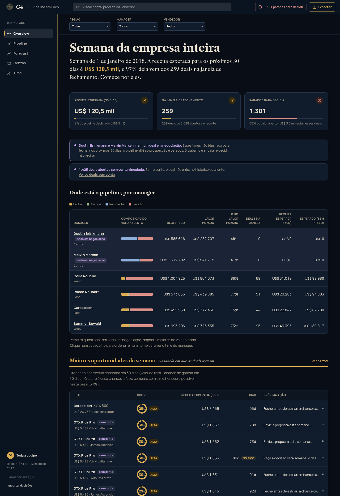

# Submissão — ROBERTO QUIRINO — Challenge 003

## Sobre mim

- **Nome:** Roberto Quirino
- **LinkedIn:** https://www.linkedin.com/in/roberto-quirino/
- **Challenge escolhido:** 003 (Lead Scorer)

---

## Executive Summary

Construí o Pipeline em Foco, um app de vendas em React com um motor de scoring em Python. Na segunda de manhã ele mostra a cada vendedor em que deals trabalhar, o que fazer em cada um e por quê, e mostra ao gestor em que time o pipeline está parado. Um script formata a mesma fila em texto para cada vendedor; ele tem código de envio por Slack ou email, mas nesta entrega só foi usado para imprimir. Antes de pontuar qualquer coisa, testei cada característica do CRM contra o acaso: vendedor, conta, tamanho da conta, produto, setor, região e manager não mudam a chance de ganhar nesta base. O sinal que passou foi a idade do deal, e é ela que define o score. O achado que mais importa para a Head de RevOps: 65% do pipeline declarado (US$ 3,2 mi de US$ 5,0 mi) está em deals parados além do maior ciclo que a base já fechou.

App publicado: https://hisdevotions-afk.github.io/ai-master-challenge/



---

## Setup

Para só ver, abra o link acima. Para rodar local (Node 22+):

```bash
cd submissions/hisdevotions-afk/solution/app
npm install
npm run dev          # http://localhost:5173
```

O `data.json` com os scores já está versionado, então não precisa de Python para ver o app. Para recalcular (Python 3.12+, sem dependências):

```bash
cd submissions/hisdevotions-afk/solution/engine
python3 scoring.py                    # lê ../data/*.csv e grava ../app/public/data.json
python3 scoring.py --ref 2017-11-30   # simula outro "hoje"
python3 test_scoring.py               # testes do motor (ou python3 -m pytest)
```

O bot lê o mesmo `data.json` e não escreve texto novo, só reformata as filas:

```bash
python3 notify.py --agent "Hayden Neloms"                       # imprime no terminal
python3 notify.py --agent "Hayden Neloms" --webhook $SLACK_URL  # Slack (incoming webhook)
python3 notify.py --agent "Hayden Neloms" --to time@empresa.com # email (precisa de SMTP_HOST)
python3 notify.py --all --targets targets.json                  # um digest por vendedor, cada um no seu destino
python3 test_notify.py
```

Sem `--webhook`, `--to` ou `--targets` o bot só imprime. Trecho real da saída:

```
*Feche esta semana* (5)
  - Konmatfix — GTX Plus Pro — US$ 721 em 30d: Peça um sim ou não esta semana: em 21 dias o deal passa do maior ciclo que a base já fechou. É cliente da casa, fale com quem aprovou a última compra; junte com os outros 9 deals abertos da conta.
  - Sem conta vinculada — MG Advanced — US$ 604 em 30d: Feche antes de esfriar: a chance cai a cada semana, e em 3 dias fica abaixo de metade do pico.
```

---

## O que o vendedor e o gestor veem

| Tela | Pergunta que responde |
|---|---|
| Overview | Para o vendedor: "em que eu trabalho esta semana?", com quatro filas com verbo (feche, decida, mantenha em movimento, engaje) e a ação do momento. Para o gestor, sem vendedor escolhido: "onde está o problema?", com uma linha por manager (ou por vendedor do time) mostrando a composição do pipeline por fila, o valor parado e a receita esperada; um clique abre o recorte |
| Pipeline | "Como está tudo?" Lista e kanban na mesma ordem das filas. Na fila Decidir dá para decidir em lote, com desfazer |
| Ficha do deal | "Por que esse score?" Os motivos, a curva histórica e o contexto da conta |
| Forecast | "Quanto vai entrar?" Declarado, esperado (sem prazo) e próximos 30 dias, por região, manager ou vendedor, na mesma tabela da Overview: barra de composição por linha, ordenável e clicável para descer um nível |
| Contas | "Qual o histórico com esse cliente?" |
| Time | "Quem produz o quê?" Receita ganha, ticket médio e higiene de pipeline de cada pessoa |

Todas as telas têm filtro em cascata de região, manager e vendedor. Com um vendedor escolhido, a Overview abre com "Bom dia, Hayden."

---

## Lógica do scoring

Antes de usar qualquer característica, testei cada uma com uma simulação: se todos os grupos tivessem a mesma chance de ganhar, com que frequência o acaso produziria diferenças tão grandes quanto as dos dados?

| Característica | p vs. acaso | No score? |
|---|---|---|
| Idade do deal | < 0,001 | Sim |
| Mês de fim de trimestre | < 0,001 | Não: diz quando o deal é registrado, não se um aberto vai fechar |
| Vendedor / Vendedor × produto | 0,30 / 0,22 | Não |
| Produto / duração do ciclo por produto | 0,48 / 0,10 | Não |
| Tamanho da conta (receita / funcionários) | 0,64 / 0,78 | Não |
| Região / Manager / Conta / Setor | 0,78 / 0,88 / 0,95 / 0,99 | Não |

O score é `P(ganhar nos próximos 30 dias | idade)`, em %. A curva aprende com os 6.711 deals fechados e também com os abertos: um deal aberto há 90 dias que não fechou é evidência de que 90 dias não garantem fechar em 30. Nesta base o melhor score possível é 31% (deals com 85 dias). Por isso a tela mostra o score junto de uma faixa que compara com esse máximo, e um deal de 28% aparece como "alta". O valor do deal não entra no score.

As filas são ordenadas pela receita esperada em 30 dias (valor × score), que aparece ao lado do score na mesma tabela.

Os limites das filas saem dos dados e se ajustam com outra base:
- *Avançar*: menos de 44 dias, ainda cedo para fechar.
- *Fechar*, de 44 a 138 dias, com a ação mudando conforme a fase: antes do pico, "envie a proposta"; no pico (85 dias), "peça a decisão"; depois dele, "feche antes de esfriar"; a partir de 115 dias, quando a chance cai abaixo de metade do pico, "peça um sim ou não".
- *Decidir*: 138 dias ou mais. Nenhum deal da base fechou depois disso. A sugestão de encerrar ou confirmar vem de quanto o deal passou do limite, comparado com a mediana dos parados (653 para encerrar, 648 para confirmar). Falta de conta no CRM é falha de cadastro e não indica que o deal morreu, então ela não pesa na sugestão; vira uma tarefa de cadastro dentro da própria ação.
- *Prospectar*: ainda não engajado, sem score.

A conta não muda a chance de ganhar (p = 0,95), então fica fora do score. Mas saber que o cliente já comprou 34 vezes ou que tem outros 13 deals abertos muda a conversa do vendedor, e por isso entra como motivo e no texto da ação.

Não há LLM em tempo de execução. Todo texto é montado a partir dos números, então sempre bate com o dado e ninguém precisa de chave de API.

Duas correções nos dados: `GTXPro` virou `GTX Pro` (1.480 deals perdiam o preço no join) e `technolgy` virou `technology`.

---

## Recomendações para a Head de RevOps

1. Limpar o forecast esta semana: 1.301 deals (US$ 3,2 mi) estão além de qualquer ciclo já fechado. Cada vendedor decide os seus na fila Decidir.
2. Cadastrar as contas: 1.425 dos 2.089 deals abertos (68%) estão sem conta. Sem conta não há histórico do cliente, e o contexto que melhora a ação some.
3. Cobrar receita e higiene de pipeline. Receita e volume variam muito entre vendedores (de US$ 1,15 mi a US$ 0 no histórico), mas a taxa de ganho não varia além do acaso (p = 0,30), e ranquear por ela seria ranquear ruído.
4. Registrar atividade no CRM, como emails e reuniões. Hoje a idade é o único sinal. Com atividade, o score passa a distinguir o deal velho que tem reunião marcada para amanhã.

---

## Limitações

- Alguns padrões são limpos demais para uma operação real: a região Central não tem nenhum deal em negociação, e todos os 500 prospects estão lá; 62% do pipeline aberto passou do maior ciclo já fechado. O app mostra esses achados, mas eles podem vir de como a base foi gerada. Em uma empresa real, eu confirmaria no CRM antes de mudar a cobrança do time.
- O CRM não registra atividade, então um deal com 150 dias e reunião marcada para amanhã aparece como parado.
- Os dados são um retrato de 31/12/2017. Em produção o motor rodaria toda noite e as decisões voltariam para o CRM. Hoje ficam no `localStorage`, com exportar e importar em JSON.
- Há viés de sobrevivência no limite de 138 dias. A base termina em 31/12/2017, e um deal aberto há 150 dias pode ter um desfecho que ainda não foi registrado. Por isso a fila Decidir pede requalificar ou encerrar, e o sistema nunca encerra sozinho.
- O pico da curva depende de um ponto só: a idade com o maior valor entre as que têm pelo menos 30 deals, e pode mudar com a amostra. Suavizar a curva antes de procurar o pico resolveria.
- O envio do script de notificação não foi testado com Slack ou email reais: os testes cobrem a formatação e a escolha de destino, e nenhuma mensagem foi enviada. O `sales_teams.csv` também não tem email nem Slack de ninguém, então `targets.json` é um diretório mantido à mão (em produção viria do SSO).
- Para escalar, trocar `load()` por uma query no CRM é a única mudança necessária. Com uma base 100 vezes maior, a curva precisa de um algoritmo O(n log n), anotado no código.

---

## Process Log — Como usei IA

O registro completo, com os erros, está em [`process-log/PROCESS.md`](process-log/PROCESS.md). O histórico de commits da branch mostra a evolução.

| Ferramenta | Para que usei |
|---|---|
| Claude Code (Claude Opus 5.5 e Claude Sonnet 5) | Exploração dos dados, testes estatísticos, motor de scoring, script de notificação e testes |
| Codex (`/codex:adversarial-review`) | Revisão adversarial da correção do motor, por um modelo diferente do que a escreveu |

### Onde a IA errou e como corrigi

| Erro | Como apareceu | Correção |
|---|---|---|
| Sugeriu "esse vendedor fecha 40% menos que os pares" | Teste de significância: p = 0,22 | Nenhuma feature entra no score sem passar no teste |
| Rotulou 2 vendedores como acima ou abaixo da média | 35 comparações a 95% geram 1 ou 2 falsos positivos | Correção de Bonferroni e um teste que impede o rótulo |
| A curva de "fecham em 30 dias" ignorava os deals abertos | Auditoria externa do motor | Os abertos entraram no denominador |
| O score tinha correlação de 0,90 com o preço, quase "ordenar por valor" | Mesma auditoria | O score virou a chance de ganhar em 30 dias, sem o preço |
| No celular, a página ficava com 712 px numa tela de 390 px | Auditoria final, renderizando num iframe de 390 px | Coluna do grid em `minmax(0, 1fr)` |
| A ficha do deal dizia "28% de chance de **fechar**" ao lado de "chance de fechar 40%" | Review crítico com olhar de avaliador (seção 20 do PROCESS.md) | Um número só, "chance de ganhar em 30 dias", com o mesmo nome em todas as telas |
| A Overview mostrava US$ 116,8 mil e US$ 120,5 mil como a mesma "receita esperada" | Mesmo review | Os dois lugares usam o mesmo total |
| Deal sem conta era sugerido para "encerrar como perdido" | Mesmo review: 68% dos abertos não têm conta, e isso é cadastro, não sinal | A sugestão usa só o tempo parado; a conta vira tarefa de cadastro |
| Os 259 deals da fila Fechar tinham a mesma frase de ação | Mesmo review | Ação por fase da curva e pelo histórico da conta |

### O que eu adicionei que a IA sozinha não faria

- A ideia de que o deal "morto" pede uma decisão de encerrar ou requalificar, em vez de um alerta que nunca para, vem do CRM que eu uso em produção.
- A IA começou com uma tela só. Eu puxei o escopo para um app de vendas completo, usando o Salesforce como referência.
- Conferi os números na tela antes de irem para o README. Vários erros da tabela só apareceram porque revisei a saída em vez de aceitar "os testes passaram".
- No fim, pedi um review com o olhar de um diretor que vai avaliar o trabalho. Ele achou problemas de leitura que nenhum teste pegaria, como três probabilidades para o mesmo deal e a falta de uma visão para o gestor.

---

## Evidências

- [x] Process log: [`process-log/PROCESS.md`](process-log/PROCESS.md)
- [x] Screenshots da versão atual em [`process-log/screenshots/`](process-log/screenshots/) (12 a 17); as de versões anteriores ficam em `screenshots/old/`
- [x] Git history: commits da branch `submission/hisdevotions-afk`

---

_Submissão enviada em: 07/11/2026_
