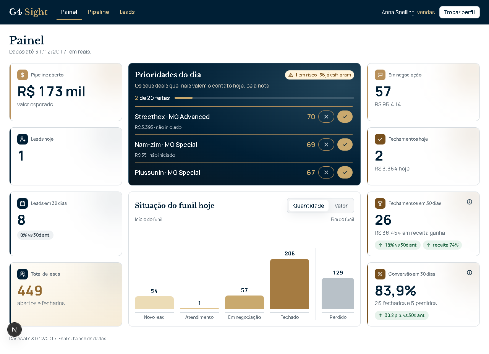
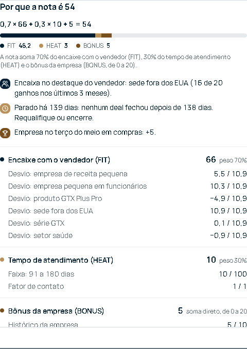
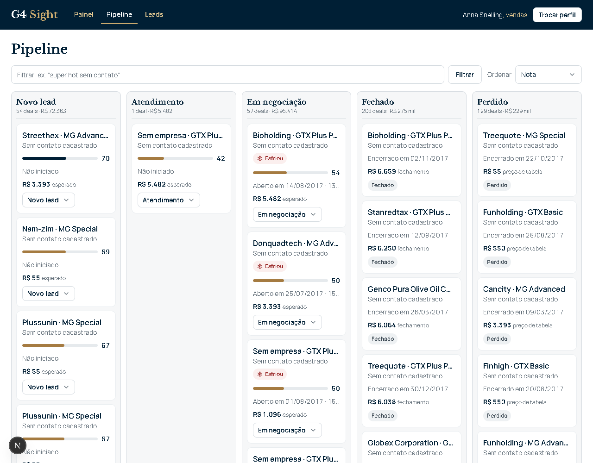
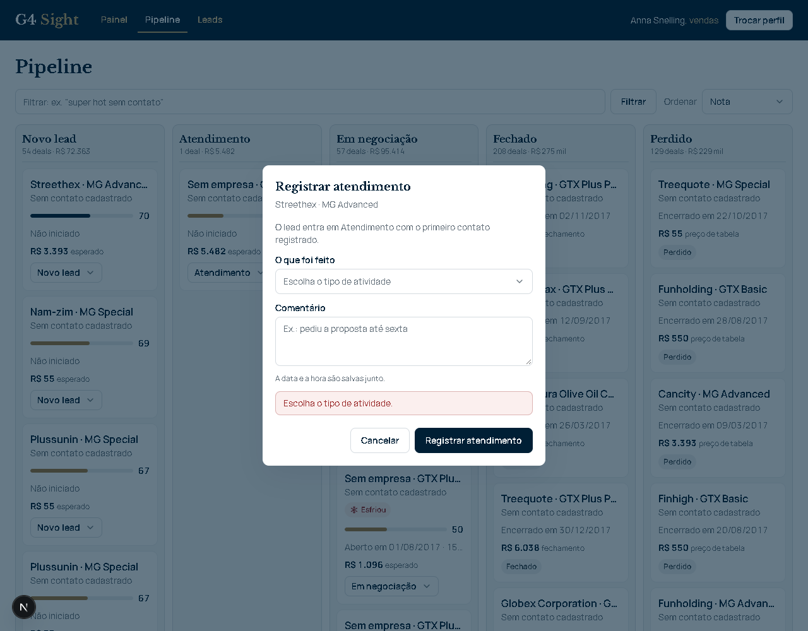
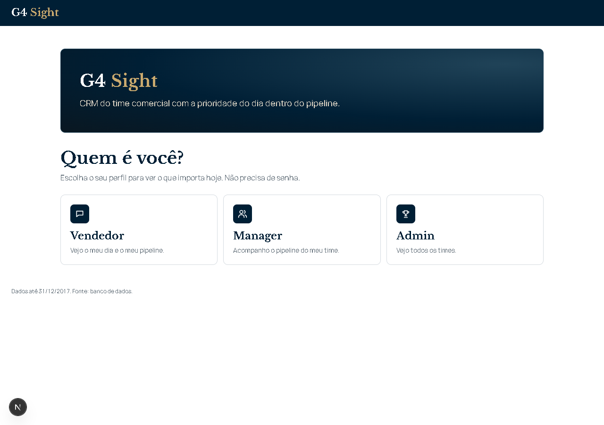

# Submissão — Leandro Maia Mallet — Challenge 003

## Sobre mim

- **Nome:** Leandro Maia Mallet
- **LinkedIn:** https://www.linkedin.com/in/leandro-maia-mallet/
- **Instagram:** [@leandromaia.fly](https://www.instagram.com/leandromaia.fly/)
- **Challenge escolhido:** 003 — Lead Scorer

---

## Executive Summary

Construí o **G4 Sight**, o CRM do time comercial com a prioridade do dia dentro do pipeline. Está no ar em **https://g4-sight.vercel.app**, ligado a um banco Postgres com os 8.800 deals reais do dataset.

Antes de pontuar qualquer coisa, testei o sinal dos dados. Nenhum atributo do deal (produto, setor, porte, conta, região) separa ganho de perda. O que varia de verdade é **o vendedor**: cada um converte melhor em um recorte diferente.

Por isso a nota mede o **encaixe do lead no ponto forte do vendedor dono** (FIT, 70%) e **o tempo de atendimento** (HEAT, 30%), mais um bônus pelo histórico de compra da empresa. Cada nota vem com a conta e os motivos em frases simples.

Recomendação principal: usar a nota para **distribuir os leads novos para o vendedor de maior encaixe e atender em até 1 dia**. Com isso, o encaixe médio dos leads sem contato subiu de 49,5 para 73,4 na redistribuição.

---

## Solução

### Como rodar

- **No ar:** https://g4-sight.vercel.app. Escolha um perfil (vendedor, manager ou admin); não há senha.
- **Local:** [solution/app/COMO-RODAR.md](solution/app/COMO-RODAR.md) (Node 20+, `npm ci`, `npm run dev`). Sem credenciais, o app abre com os dados do arquivo.
- **Score em Python (referência):** `python solution/scoring/calcular_score.py` (detalhes em [solution/scoring/validacao.md](solution/scoring/validacao.md)).
- **Testes:** `npm test` no app (183 testes, entre eles a paridade do motor TypeScript com o Python) e `python -m unittest scoring/test_regra.py` (13 testes).

### Abordagem

1. **Entender o pedido antes da tecnologia.** A Head de RevOps disse que o time não vai abrir mais uma ferramenta. Li isso como: **a prioridade tem que estar dentro do CRM que o vendedor já usa**. O produto virou o próprio CRM (Painel, Pipeline, Leads), com a nota em cada cartão.
2. **Dados primeiro.** Limpeza reproduzível e teste de sinal de 18 variáveis, com intervalo de confiança, qui-quadrado conferido por permutação e correção para comparações múltiplas ([findings.md](solution/analysis/findings.md)). Resultado: taxa de ganho de 63,2% em quase todo recorte. Só o tempo tem sinal, e nenhum atributo isolado tem.
3. **Mudar a pergunta.** Se o deal não muda a chance, o que muda é **quem atende e quando**. A nota passou a ser por vendedor, com o tempo de atendimento como parte dinâmica.
4. **Premissas antes de código.** Fixei regras de arquitetura, banco, backend e frontend do meu padrão de trabalho ([02-premissas.md](process-log/02-premissas.md)):
   - prefixos de domínio no banco;
   - chave estrangeira em toda relação;
   - nada se apaga (só remoção lógica);
   - auditoria de toda mudança;
   - marca do G4.
5. **Construção em paralelo, com papéis fixos.** Uma sessão de IA orquestrou, e quatro construíram: dados e banco, score, telas e QA. Toda tarefa virou uma ordem numerada, e toda entrega foi conferida por outra sessão antes do commit e testada no ar antes de ser dada como feita.

### A lógica do score

**NOTA = 0,70 × FIT + 0,30 × HEAT + BÔNUS** (FIT e HEAT de 0 a 100; bônus de 0 a 20; nota de 0 a 120). Especificação completa em [regra-lead-score.html](solution/scoring/regra-lead-score.html) e [desenho.md](solution/scoring/desenho.md).

| Parte | O que mede | Como |
|---|---|---|
| **FIT (70%)** | Encaixe do lead no ponto forte do vendedor dono | Taxa de ganho do vendedor em cada característica do lead (produto, série, setor, porte por receita, porte por funcionários, empresa, sede) nos últimos 3 meses, com encolhimento para a média dele: (ganhos + 20 × taxa do vendedor) / (fechados + 20). Característica com menos de 10 casos não conta. FIT = 50 + 50 × (média dos desvios do lead) / (desvio do destaque do vendedor). Vendedor sem destaque ou sem histórico = 50. Recalculado todo domingo. |
| **HEAT (30%)** | Urgência pelo tempo de atendimento | 8 faixas de dias desde a abertura: até 1 dia = 100; 2–7 = 85; 8–15 = 70; 16–30 = 55; 31–60 = 40; 61–90 = 25; 91–180 = 10; 181 ou mais = 0. Prospecção sem data = 50. Multiplicado por um fator do último contato registrado. |
| **BÔNUS (0–20)** | Empresa que compra muito | Terços da receita ganha da empresa: 0, +5 ou +10. A janela de compra por calendário está pronta, mas vale 0: nenhuma empresa compra numa época própria além do acaso. |

O valor do deal **fica fora da nota**, porque não se sabe o valor antes de atender. Ele aparece só como contexto no cartão.

**Regras de operação:**
- **Prioridades do dia:** 20 leads por dia. No topo ficam o lead novo com FIT ≥ 75 e o atendimento atrasado; depois a nota; no empate, o HEAT. O ✓ exige o tipo de atividade e um comentário, e vai para a linha do tempo do lead.
- **Domingo:** os leads sem contato são redistribuídos com equilíbrio entre os 35 vendedores, para o de maior FIT, com limite de ativos por vendedor.
- **Repasse:** se o lead muda de faixa de tempo sem contato, vai para outro vendedor, desde que o lead entre no top 5 da lista dele, com FIT ≥ 75 e no máximo 3 pontos abaixo do dono.
- **Automação:** tudo isso roda sozinho, todo dia, dentro do próprio app (Vercel Cron). A data de negócio anda 1 dia por dia real a partir de 31/12/2017.

### Resultados

**O app (no ar):**
- **Entrada:** escolha de perfil, sem senha.
- **Painel:**
  - números do pipeline em reais e o funil em 5 etapas (Novo lead, Atendimento, Em negociação, Fechado, Perdido);
  - **Prioridades do dia**: 20 leads, com a nota e uma barra; o clique abre o porquê da nota.
- **Pipeline:**
  - 5 colunas, e o estágio muda arrastando o cartão;
  - o lead passa sozinho de Novo lead para Atendimento no primeiro contato;
  - filtro em texto livre ("ganhos em 2017 varejo").
- **Leads e Contas:** base completa, cadastro, tags, comentários, ações em lote com desfazer e a ficha de cada empresa com o padrão de compra.
- **Deal:** linha do tempo, comentários e a explicação da nota (a conta, a barra por parte, os motivos e os pontos de cada componente).
- **Perfis:** o vendedor vê o seu dia; o manager vê o time e uma lista só com o que pede ação dele; o admin vê todos.

**Telas** (em [docs/screenshots/](docs/screenshots/)):

| Painel do vendedor | Prioridades do dia | Por que a nota |
|---|---|---|
|  |  |  |
| **Pipeline** | **Registrar atendimento** | **Entrada** |
|  |  |  |

**Números** (2.089 deals abertos):
- **Top 5 de cada vendedor (execução 11):** 94,9% são deals ativos.
- **Redistribuição do 1º domingo (conferido no banco):**
  - os 35 vendedores ficaram com lead: de 23 a 106 abertos cada, contra 0 a 111 antes. O máximo é de quem já tinha muitos deals em negociação, que não mudam de dono;
  - o FIT médio dos leads sem contato subiu de 49,5 para 73,4.
- **Paridade do motor:** o motor em TypeScript reproduz o Python deal a deal (2.089 de 2.089) e troca a troca.

**Qualidade:**
- **Banco:** 34 migrations, com RLS e sem política pública, sem DELETE nem TRUNCATE, auditoria por gatilho, gravação só por funções e limite de escritas por usuário e global.
- **Revisão:** cada migration foi revisada e validada por uma sessão diferente da que escreveu ([solution/qa](solution/qa)).
- **Testes no ar:** dois ciclos completos, com prints ([teste-banco-online.md](solution/qa/teste-banco-online.md), [teste-n1-n4-online.md](solution/qa/teste-n1-n4-online.md)).

### Recomendações

1. **Atender o lead novo de alto encaixe em até 1 dia.** É onde a nota mais pesa e onde o vendedor certo faz diferença.
2. **Distribuir por encaixe, não por rodízio.** A redistribuição de domingo e o roteamento do lead novo já fazem isso. Medir a conversão por vendedor nos próximos 3 meses para confirmar o ganho.
3. **Registrar todo contato.** Sem contato registrado, o HEAT e o repasse trabalham no escuro. O ✓ com tipo e comentário é o hábito que alimenta a ferramenta.
4. **Limpar o pipeline parado.** 81% dos deals em negociação estão abertos há mais tempo que qualquer deal que já fechou. A ação sugerida "desistir" e o filtro "esfriou" servem para isso.
5. **Com dados reais**, ligar a janela de compra do bônus (com 2+ anos de histórico) e recalibrar os pesos com um backtest.

### Limitações

- **Dados fictícios.** A fonte declara a empresa como fictícia, e os padrões medidos confirmam isso: nenhum atributo tem sinal. A nota é uma regra explicável e pronta para dados reais, e não um modelo preditivo validado.
- **Sem backtest do score.** A comparação com filas simples (por valor, por idade) no histórico ficou desenhada ([desenho.md](solution/scoring/desenho.md), seção 3), mas não rodou.
- **Sem login.** O perfil é escolhido na tela (decisão minha para o desafio). Por isso as funções de gravação não conferem o dono do deal. A proteção vem da trava de contexto, dos limites de escrita, da auditoria e do desfazer. Com login, a conferência por dono vira obrigatória.
- **Regras ainda em aberto:**
  - o máximo de repasses por lead e a penalidade para quem perde lead estão em branco no banco (sem limite e sem penalidade);
  - a trava do dono pelo manager ainda não existe.
- **Não construído:** a importação de leads por CSV na tela (a função do banco existe) e o cadastro de empresa nova com o banco ligado.
- **Moeda:** os valores aparecem em reais, com os mesmos números do dataset (que está em dólar), sem conversão.

---

## Process Log — Como usei IA

> Narrativas em [process-log/](process-log/): [00-preparacao.md](process-log/00-preparacao.md) e [02-premissas.md](process-log/02-premissas.md). Registro de decisões, uma linha por decisão: [decisoes.md](process-log/decisoes.md) (49 decisões). Auditoria de cada entrega: [audit.md](process-log/audit.md).

### Ferramentas usadas

| Ferramenta | Para que usei |
|------------|--------------|
| Claude Code (Opus), 1 sessão orquestradora | Coordenar 4 sessões por ordens numeradas, auditar cada entrega, manter o registro de decisões e fazer todos os commits e publicações |
| Claude Code, sessão de dados e banco | Limpeza, teste de sinal e as migrations do banco |
| Claude Code, sessão de score | A regra do score em Python, a carga no banco e o motor em TypeScript com paridade |
| Claude Code, sessão de telas | O app em Next.js, as rotas, a rotina agendada e algumas migrations |
| Claude Code, sessão de QA | Revisão e aplicação de cada migration e testes do app no ar |
| Antigravity (Gemini) | Segunda opinião para o nome do produto (10 sugestões) |
| Vercel, Supabase | Publicação e banco |

### Workflow

1. **Preparação:** li o desafio com a IA, escolhi o 003 e decidi trabalhar em sessões dedicadas, com as decisões registradas na hora.
2. **Canvas do projeto:** situação atual, situação desejada, marcos e riscos, numa folha só.
3. **Dados:** pedi recortes específicos, entre eles a taxa por produto e preço, a concentração das top empresas, as faixas de tempo de venda e o padrão de cada vendedor. Foi daí que saiu a virada: **o score por vendedor**.
4. **Premissas:** trouxe o meu padrão de desenvolvimento e cortei o que não servia.
5. **Especificação antes de código:** todas as telas, depois todas as migrations, depois as telas em código. O banco é especificado, escrito por uma sessão e validado e aplicado por outra.
6. **Regra do score em iterações** (decisões 28–40): FIT por vendedor em vez de chance por segmento; HEAT em 8 faixas definidas por mim; valor fora da nota; bônus da empresa; FIT ≥ 75 para furar a fila; repasse com travas e mini penalidade; ✓ com atividade e comentário; redistribuição de domingo só dos leads sem contato.
7. **Construção e QA no ar:** cada entrega passou por testes, por revisão de outra sessão, pela publicação e por uma conferência no ar.
8. **Ajustes de produto vendo o app no ar:** o Painel refeito pelo modelo que desenhei, o funil em 5 etapas, 20 prioridades sem fila, a explicação da nota, os valores em reais e a tela de entrada.
9. **Automação:** o motor portado para TypeScript, com o relógio da data de negócio e a rotina diária ligada.

### Onde a IA errou e como corrigi

- **Premissas inventadas.** Pedi o meu padrão adaptado, e a IA acrescentou 6 premissas próprias. Mandei tirar.
- **"Protótipo".** A IA tratou a entrega como protótipo. Corrigi: é versão final, para uso.
- **Banco gravado duas vezes e ordens velhas na fila** entre sessões. Parei todas as sessões e criei as regras de coordenação: ordem numerada com confirmação, dono único por pasta e quadro de status (decisão 39).
- **Bug inexistente.** A IA reportou um erro de contagem que era leitura errada de um print reduzido. A sessão de telas conferiu o HTML e mostrou que estava certo.
- **Achados de segurança.** A revisão automática de cada commit apontou falhas (limite de escrita contornável, contexto do sistema forjável, disjuntor que derrubava o app). Cada uma virou uma migration ou correção, revisada e aplicada por outra sessão.
- **Painel fora do meu modelo.** A IA padronizou os objetos, mas não seguiu o modelo de Painel que eu tinha desenhado. Depois tentou um fundo escuro, contra a minha regra de fundo branco. Cancelei e mandei refazer pelo modelo.
- **Rotina que desfez a redistribuição.** No primeiro teste no ar, a rotina usou a lista antiga de vendedores e devolveu 261 leads. Foi achado na conferência da própria rodada, corrigido e rodado de novo. Nada foi apagado, e as trocas ficaram registradas.
- **Hash errado.** Uma sessão reportou um sha256 que não era o do arquivo. A conferência do hash antes de aplicar no banco pegou.

### O que eu adicionei que a IA sozinha não faria

- **O produto é o CRM**, e não uma ferramenta ao lado. Foi a leitura da frase da Head de RevOps.
- **O score por vendedor.** Quando os dados mostraram que nenhum atributo do deal tem sinal, fui olhar o que cada vendedor domina.
- **O tempo como urgência de atendimento**, com faixas definidas por mim e o lead novo de alto encaixe atendido em 0 ou 1 dia.
- **O valor fora da nota** ("nunca se sabe o valor antes de atender"), com a exceção da empresa que compra muito virando bônus.
- **As regras de operação do time:** furar a fila, o repasse que gera pressão para atender, a mini penalidade, o ✓ que exige registro, a redistribuição semanal com equilíbrio e todo vendedor com lead.
- **O desenho do Painel**, o funil com Atendimento automático e o padrão visual.
- **A disciplina do processo:** premissas antes de código, especificação antes de banco, nada se apaga, e cada entrega conferida por outra sessão e testada no ar.

---

## Evidências

- [x] Registro de decisões: [process-log/decisoes.md](process-log/decisoes.md)
- [x] Auditoria de cada entrega: [process-log/audit.md](process-log/audit.md)
- [x] Narrativas: [00-preparacao.md](process-log/00-preparacao.md), [02-premissas.md](process-log/02-premissas.md)
- [x] Git history: 100+ commits na branch `submission/leandro-mallet`
- [x] Relatórios de QA, com prints dos testes no ar: [solution/qa/](solution/qa/)
- [ ] Chat exports: [process-log/chat-exports/](process-log/chat-exports/)
- [x] App no ar: https://g4-sight.vercel.app

---

_Submissão enviada em: [data]_
