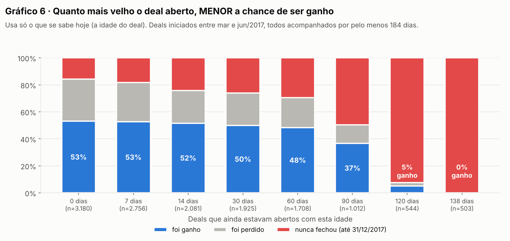
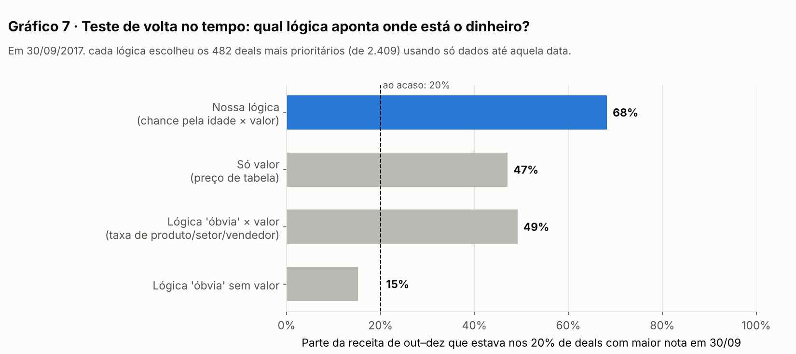
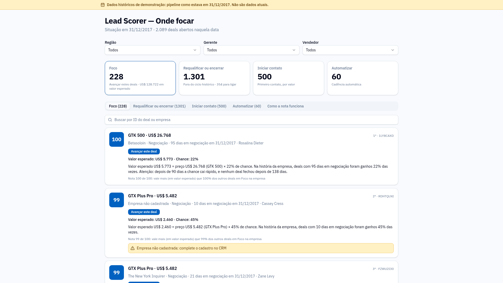

# Submissão — Liberato Gonçalves Gouveia — Challenge 003

## Sobre mim

- **Nome:** Liberato Gonçalves Gouveia
- **LinkedIn:** _(a preencher)_
- **Challenge escolhido:** 003 — Lead Scorer (Vendas / RevOps)

---

## Executive Summary

Construí um Lead Scorer funcionando: **https://lead-scorer-liberato.lovable.app**. Ele mostra a cada vendedor onde focar e explica o porquê de cada deal.

A análise dos dados derrubou a premissa óbvia. Produto, setor, região, gerente, vendedor e empresa **não preveem** se um deal será ganho: um modelo de machine learning com todas essas informações acertou 54%, e o chute acerta 50%. O que separa um deal do outro é a **idade** e o **valor**. A chance de um deal aberto ser ganho cai de 47% (deal novo) para 26% aos 90 dias e chega a 0% aos 138, porque nenhum deal da história fechou depois disso. A nota é **chance pela idade × preço**.

Num teste de volta no tempo (lógica montada só com dados até 30/09/2017 e conferida com o que aconteceu até 31/12), os 20% de deals com maior nota concentravam **68% da receita** que entrou depois. Ordenando só pelo preço, seriam 47%, e com uma lógica "óbvia" por produto, setor e vendedor, 49%.

**Principal recomendação:** limpar o pipeline. **82% dos deals em negociação (1.301 de 1.589) estão fora do ciclo histórico.** Os 228 deals do Foco devem concentrar o tempo do time.

---

## Solução

| | |
|---|---|
| **Aplicação (abrir no navegador)** | https://lead-scorer-liberato.lovable.app |
| **Motor do score (Python)** | [`solution/motor/`](solution/motor/): calcula listas, notas e explicações, com 14 testes automáticos |
| **Tela (Lovable)** | [`solution/app/`](solution/app/): só exibe o resultado do motor, sem recalcular nada |
| **Lógica aprovada** | [`docs/ficha-da-logica.md`](docs/ficha-da-logica.md) |
| **Dados** | [`solution/data/`](solution/data/): arquivos oficiais do Kaggle (CC0), conferidos byte a byte |

### Como rodar

```bash
# Motor (Python 3.10+)
cd solution/motor
pip install pandas numpy pytest
python gerar_scores.py          # gera saida/deals_priorizados.json e .csv
python -m pytest -v tests/      # 14 testes, incluindo o teste contra vazamento de futuro
```

Para usar a tela, basta abrir o link acima. Para rodar a tela localmente, veja [`solution/app/README.md`](solution/app/README.md).

### Abordagem

1. **Entender antes de construir.** Li as regras e o baseline do G4. Fiz um raio-X dos dados e encontrei 3 problemas: o produto "GTXPro" não bate com o catálogo em 1.480 linhas; 70% dos deals vivos não têm empresa cadastrada; e os deals em prospecção não têm data.
2. **Testar o óbvio antes de usar.** Taxas de ganho por grupo ficaram todas entre 60% e 65%. Uma simulação (o "teste da moeda") mostrou que a diferença entre vendedores é do tamanho da sorte. Machine learning com validação cruzada e com validação no tempo deu AUC de 0,48 a 0,54.
3. **Achar o sinal real sem vazamento de futuro.** Usei só o que se sabe sobre um deal aberto: a idade dele. A curva de chance mostra que **deal velho fecha menos**, e o limite de 138 dias se repete em todas as safras.
4. **Transformar em decisão.** Separei os deals em 4 listas (Foco, Requalificar ou encerrar, Iniciar contato, Automatizar), cada uma com uma ação e uma explicação em linguagem simples. Validei com o teste de volta no tempo.
5. **Construir para durar.** O motor Python é separado da tela, com a configuração fora do código e 14 testes, entre eles a sabotagem do futuro: embaralhar tudo o que aconteceu depois da data de corte não muda a priorização. A tela no Lovable só exibe e foi testada contra os números do motor.

### Resultados / Findings

**A nota usa só o que tem efeito comprovado:**

| Fator | Prevê o resultado? | Evidência |
|---|---|---|
| Produto, setor, região, gerente, empresa | Não | Taxas de ganho entre 60% e 65%; teste estatístico em produto, gerente e empresa com p de 0,37 a 0,94 |
| Vendedor | Não | A diferença (55% a 70%) é do tamanho da sorte: simulação com 10.000 rodadas |
| Todas as características juntas | Não | AUC 0,54 (validação cruzada) e 0,48 a 0,52 (validação no tempo) |
| **Idade do deal aberto** | **Sim** | Chance de 47% → 26% (90 dias) → 5% (120 dias) → 0% (138 dias) |
| **Valor** | **Sim (é o que mais varia)** | De US$ 55 a US$ 26.768, quase 500 vezes |



**As 4 listas em 31/12/2017:**

| Lista | Deals | Ação |
|---|---|---|
| Foco | 228 (~13 por vendedor) | Avançar, em ordem de valor esperado |
| Requalificar ou encerrar | 1.301 | 354 ligações (preço ≥ US$ 4.000) e 947 encerramentos |
| Iniciar contato | 500 | Primeiro contato, por valor (sem % de chance: não há histórico) |
| Automatizar | 60 | Cadência automática (preço < US$ 100) |

**Teste de volta no tempo** (2.409 deals em negociação em 30/09/2017):



**A tela:** faixa fixa avisando que os dados são de 31/12/2017, filtros por região, gerente e vendedor, nota de 0 a 100, ação e o porquê de cada deal.



### Recomendações

1. **Limpar o pipeline nesta semana.** Fazer 354 ligações de requalificação nos deals de US$ 4.000 ou mais e encerrar os outros 947. Hoje há US$ 3,2 milhões em preço de tabela parados fora do ciclo histórico, o que distorce a previsão de vendas.
2. **Focar nos 228 deals do Foco,** na ordem da nota, com atenção redobrada aos que passam de 90 dias, porque a chance cai rápido.
3. **Corrigir o cadastro:** 70% dos deals vivos não têm empresa.
4. **Automatizar os deals de valor muito baixo** (60 hoje).
5. **Registrar o que falta para melhorar a nota:** atividades (ligações, e-mails, reuniões) e a data de entrada em prospecção. Recalcular a curva de chance todo mês, rodando o motor de novo.

### Limitações

- **Base fictícia** (Maven Analytics) e "fotografada" em 31/12/2017. A tela deixa isso explícito.
- **Sem dados de atividade,** que provavelmente são o sinal mais forte num CRM real.
- **Prospecção sem % de chance:** a base não tem histórico dessa etapa, então a lista é ordenada só pelo valor.
- **As porcentagens dependem do período usado na curva.** Um deal novo tem 47% (mar–ago/2017) ou 53% (mar–jun/2017), mas a ordem dos deals praticamente não muda: correlação 0,997.
- **O padrão de fim de trimestre** (49% dos ganhos registrados em mar/jun/set/dez) não foi usado, porque exigiria informação futura.
- **A tela lê os dados do GitHub,** então uma atualização leva até ~5 minutos para aparecer, por causa do cache.
- **Os testes da tela** foram feitos por script no navegador, comparando com os números do motor. _(A confirmar: conferência visual e com cliques reais pelo Liberato.)_

---

## Process Log — Como usei IA

> O registro completo está em [`process-log/`](process-log/): o [diário de bordo](process-log/diario-de-bordo.md) da análise, os [registros por etapa](process-log/registros-por-etapa.md) (Registros 00 a 11), os scripts com as saídas, os prompts e as versões anteriores.

### Ferramentas usadas

| Ferramenta | Para que usei |
|---|---|
| **Claude** (app Claude, modo agente) | Execução técnica: análise dos dados, motor Python e testes, prompts e construção da tela no Lovable, verificações, documentação e git |
| **ChatGPT** | Copiloto estratégico e analista crítico: revisão das propostas do Claude, questionamento de premissas, orientação sobre GitHub e PR |
| **Lovable** | Construção e publicação da tela (3 mensagens, 3,7 créditos) |
| **GitHub** | Entrega, histórico de versões e fonte de dados da tela |

### Workflow

1. Escolhi o case 003 e defini que o Claude executaria e eu decidiria, com parada para aprovação em cada fase.
2. O Claude analisou os dados. Parei a execução para exigir explicações em linguagem simples e um diário de bordo.
3. Defini 9 regras de trabalho: fases com autorização, linguagem simples, não inventar nada, separar sugestão da IA de decisão minha, evitar vazamento de futuro, não abrir PR sem autorização, entre outras.
4. **Fase 1, verificação:** a análise foi refeita contra vazamento de futuro, e uma conclusão central se inverteu. Baixei o arquivo oficial do Kaggle, e o Claude confirmou que ele é idêntico, byte a byte, aos dados usados.
5. **Fase 2, lógica:** a lógica foi definida e testada com o teste de volta no tempo. Escolhi os limites (US$ 100 e US$ 4.000) e o formato da nota.
6. **Fase 3a, motor:** motor Python com testes automáticos, incluindo a sabotagem do futuro. Validei o resultado.
7. Exigi 7 verificações antes do Lovable: só arquivos na minha pasta, link público, os 2.089 deals classificados, o limite de US$ 4.000, a data histórica em destaque e a reprodutibilidade.
8. **Fase 3b a 3d, tela:** aprovei o prompt com ajustes; o Claude construiu e publicou no Lovable e testou a tela contra os números do motor.
9. **Fase 4, entrega:** código completo da tela, teste a partir de cópia limpa, este README e checklist final.

### Onde a IA errou e como corrigi

| Erro da IA | Como apareceu | Correção |
|---|---|---|
| Concluiu que "deal com mais de 14 dias fecha mais (65–75%)". A conta ignorava os deals que nunca fecham e usava a duração total, que é informação futura. | Na revisão que eu pedi, com a regra de evitar vazamento de futuro | Refeita só com a idade atual: a chance **cai** com a idade (Gráfico 6) |
| O próprio teste de volta no tempo usava o limite de 138 dias calculado com dados futuros | O Claude encontrou antes de apresentar | O limite agora é calculado só com o passado. O resultado não mudou |
| A lista de vendedores para a tela deixava de fora 5 pessoas sem deals | Teste automático | A lista agora vem do cadastro da equipe |
| A tela mostrava a chance com 1 ponto de diferença em 7 deals (arredondamento duplo) | O agente do Lovable apontou | O motor passou a entregar o texto da chance pronto |
| Dois deals com "Nota 100", e o texto do segundo dizia "vale mais que 100% dos outros" | Captura de tela do app | A nota passou a ser arredondada para baixo, e um teste garante que ela nunca exagera |
| O diário atribuía a mim regras que tinham sido sugeridas pela IA | Na revisão que eu pedi | A documentação agora separa o que a IA sugeriu do que eu decidi |
| A ficha da lógica dizia que o aviso de empresa só estava aprovado no Foco | **Eu apontei** | A ficha foi corrigida para as 4 listas |

### O que eu adicionei que a IA sozinha não faria

- **Controle do processo.** Parei a IA quando não entendi o que ela fazia e passei a exigir explicação, documentação e autorização a cada fase.
- **Regras contra os erros típicos da IA.** Não inventar decisões, testes ou resultados; separar sugestão de decisão; evitar vazamento de futuro. Foi essa última regra que levou à descoberta do erro principal da análise.
- **Duas IAs com papéis separados:** o Claude executa e o ChatGPT revisa criticamente. A decisão final é sempre minha.
- **Verificação antes de avançar:** 7 verificações antes do Lovable e teste a partir de uma cópia limpa antes da entrega.
- **Decisões de negócio:** os limites de US$ 100 e US$ 4.000, as 4 listas, o aviso de cadastro, a faixa de "dados históricos" e a regra de que a tela pode contar e somar, mas não recalcular. *Transparência:* na maioria dessas decisões, as opções foram formuladas pela IA, e o meu papel foi escolher, ajustar e exigir validação. Isso está registrado decisão por decisão nos registros por etapa.
- **Encontrar inconsistências na documentação,** como a do aviso de empresa e a do limite de US$ 4.000.

---

## Evidências

- [x] Screenshots: [`process-log/prints/`](process-log/prints/) (antes e depois das correções, desktop e celular)
- [ ] Screen recording
- [ ] Chat exports _(pendente: link ou exportação da conversa com o Claude e trechos das revisões com o ChatGPT)_
- [x] Git history: commits na branch `submission/liberato-gouveia`
- [x] Outro: diário de bordo, registros por etapa, scripts de análise com as saídas, prompts enviados ao Lovable e versões anteriores dos documentos

---

_Submissão enviada em: [data]_
