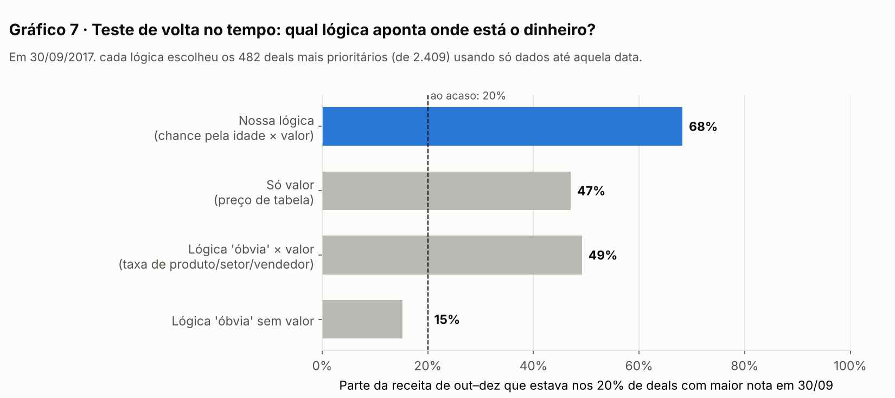

# Ficha da lógica do Lead Scorer

> **Status:** proposta da IA (Claude), testada nos dados reais em 04/11/2026 e **aguardando aprovação do Liberato**. Os valores marcados como *provisório* são decisão dele.
> Evidências: `process-log/analises/fase2_logica.py` e `process-log/analises/resultados/fase2_resultados.txt`.

## Princípio

A nota usa **só o que se sabe hoje** sobre um deal: a etapa em que está, há quantos dias está aberto e o preço do produto. Nada do que só se descobre quando o deal termina entra na conta. Produto, setor, empresa, gerente e vendedor também **não entram**, porque os testes mostraram que não preveem o resultado (Etapas 4 e 6 do diário).

## As 4 listas (situação em 31/12/2017, com os limites provisórios)

| Lista | Quais deals entram | Ordem | Ação na tela | Deals |
|---|---|---|---|---|
| **1. Foco** | Em negociação, com até 138 dias e preço ≥ US$ 100 | Valor esperado | "Avançar este deal" | 236 |
| **2. Requalificar ou encerrar** | Em negociação há mais de 138 dias | Preço | Preço ≥ US$ 1.000: "Ligar para requalificar". Abaixo disso: "Encerrar no CRM" | 1.291 |
| **3. Iniciar contato** | Em prospecção | Preço (sem % de chance) | "Fazer o primeiro contato" | 500 |
| **4. Automatizar** | Em negociação, com até 138 dias e preço < US$ 100 | Valor esperado | "Incluir na cadência automática" | 62 |

Um deal sem empresa cadastrada mostra o aviso **"Empresa não cadastrada: complete o cadastro"**. Na lista Foco, isso foi decisão do Liberato (Registro 03). Nas outras listas, é sugestão da IA ainda não validada.

## A nota da lista Foco

**Valor esperado = chance pela idade × preço de tabela**

Chance de ser ganho para um deal aberto há X dias. É a curva oficial, montada com os deals iniciados entre 01/03 e 14/08/2017, os mais recentes cujo resultado já é conhecido:

| Idade | 0 d | 14 d | 30 d | 60 d | 75 d | 90 d | 100 d | 110 d | 120 d | 130 d | 138 d |
|---|---|---|---|---|---|---|---|---|---|---|---|
| Chance | 47% | 44% | 42% | 39% | 34% | 26% | 18% | 11% | 5% | 1% | 0% |

- **Nota de 0 a 100:** a posição do deal entre todos os deals do Foco. 100 é o maior valor esperado da empresa e 50 é o meio da fila. *(Formato a decidir: em US$, de 0 a 100 ou os dois.)*

## O que o vendedor lê (exemplos reais da simulação)

- **Foco:** *"Valor esperado US$ 2.313 = US$ 5.482 (GTX Plus Pro) × 42% (chance de um deal com 21 dias)"*
- **Requalificar:** *"Aberto há 282 dias. Nenhum deal da história fechou depois de 138 dias."*
- **Iniciar contato:** *"Em prospecção: não há histórico para estimar a chance. Ordenado pelo valor."*
- **Automatizar:** *"Valor US$ 55 abaixo do mínimo de US$ 100 para atenção individual."*

## Parâmetros (ficam na configuração, não no código)

| Parâmetro | Valor | Como é definido | Opções e impacto |
|---|---|---|---|
| Limite de ciclo | 138 dias | **Automático:** o maior ciclo entre os deals fechados até a data de referência | — |
| Valor mínimo do Foco | US$ 100 *(provisório)* | Decisão do Liberato | US$ 100: Foco com 236 deals (~11 por vendedor). US$ 600: 178 (~8). US$ 1.100: 123 (~6). |
| "Deal grande" na requalificação | US$ 1.000 *(provisório)* | Decisão do Liberato | US$ 1.000: 766 ligações (~28 por vendedor). US$ 3.000: 563 (~21). US$ 4.000: 350 (~13). US$ 5.000: 153 (~6). |
| Início da observação | 01/03/2017 | É o primeiro dia com fechamentos registrados na base | — |

## Como sabemos que funciona: teste de volta no tempo

Fingimos que hoje era 30/09/2017 e montamos a lógica **só com dados até essa data**. Em seguida, conferimos o que aconteceu de fato até 31/12/2017 com os 2.409 deals que estavam em negociação (Gráfico 7):

| Lógica | Receita de out–dez que estava nos 20% de deals com maior nota | Taxa de ganho desses deals | Deals fora do padrão (>138 dias) entre eles |
|---|---|---|---|
| **Nossa (chance pela idade × valor)** | **68%** | **35%** | **0%** |
| Só valor | 47% | 23% | 23% |
| "Óbvia" (taxa de produto/setor/vendedor × valor) | 49% | 24% | 21% |
| "Óbvia" sem valor | 15% (pior que escolher ao acaso, que daria 20%) | 20% | 24% |

Se cada vendedor olhasse os seus 10 primeiros deals, a nossa lógica reuniria 50% da receita futura. As alternativas reuniriam 31%, 30% e 10%.

## Limitações conhecidas

- **As porcentagens absolutas dependem do período usado na curva.** Com os deals de mar–jun/2017, um deal novo tem 53% de chance. Com os de mar–ago/2017, tem 47%. A **ordem** dos deals praticamente não muda: a correlação entre as duas ordens é 0,997, e 1 seria idêntica.
- **Prospecção sem % de chance:** a base não guarda nenhum histórico de quantos deals saem da prospecção.
- **Sem dados de atividade:** ligações, e-mails e reuniões seriam o próximo sinal a testar numa base real.
- **Base fictícia:** os dados são da Maven Analytics.
- **Fim de trimestre:** 49% dos ganhos são registrados em mar/jun/set/dez, mas usar isso exigiria informação futura. Fica só como observação.
