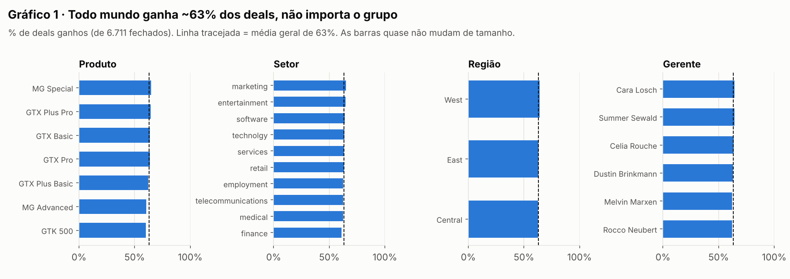
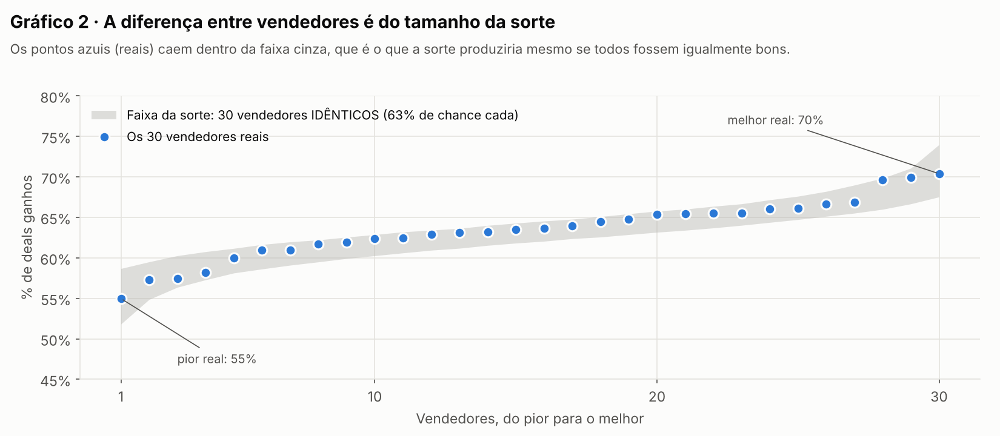
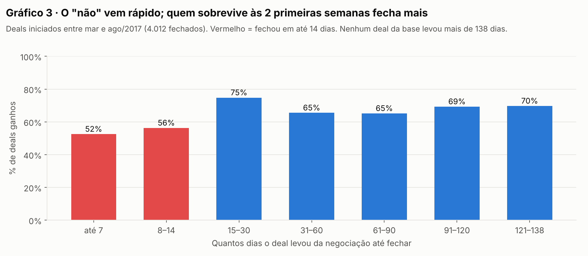
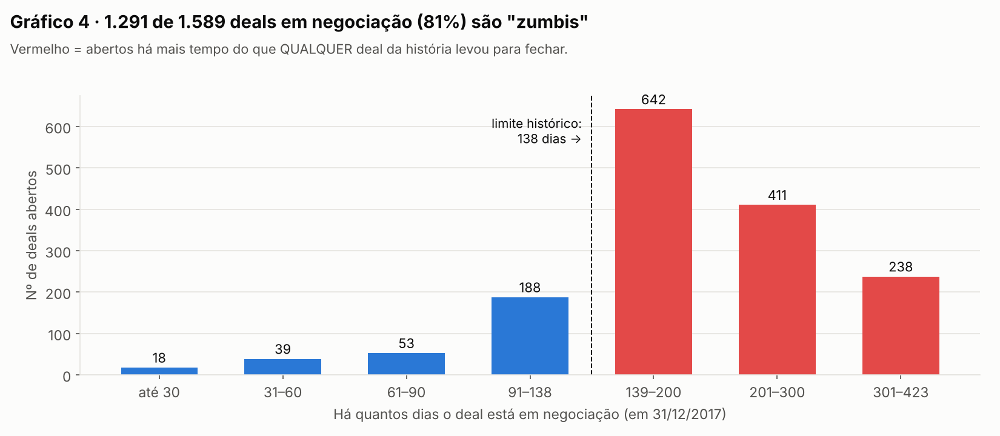
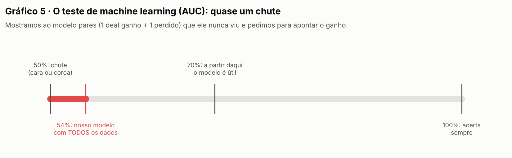

# Diário de bordo: como o case foi resolvido

**Candidato:** Liberato Gonçalves Gouveia
**Case:** 003 Lead Scorer (Vendas / RevOps)
**Ferramenta de IA:** Claude (app Claude, modo agente com acesso a terminal, Python e internet)
**Divisão do trabalho:** Liberato toma as decisões de negócio e aprova cada etapa. O Claude faz a execução técnica (baixar dados, rodar análises, escrever código) e explica cada passo.

> **O que é este documento:** é a peça principal do *process log*, o registro de como a IA foi usada, que o G4 exige em toda entrega. Ele conta, etapa por etapa, o que foi feito, por quê, o que deu errado e quem decidiu o quê. Junto com ele vão os scripts, os gráficos, os prints da conversa com o Claude e o histórico de versões.
>
> Este diário é atualizado a cada etapa. Cada número citado aqui vem de um script salvo na pasta `analises/`, junto com a saída dele em `analises/resultados/`. Qualquer pessoa pode rodar de novo e conferir.

---

## Etapa 0: Ler as regras antes de começar (03/11)

**O que foi feito:** leitura completa do repositório do desafio: regras gerais, guia de submissão, regras do Pull Request, modelo de README e os 4 cases.

**O que aprendemos e que mudou a estratégia:**
- O G4 já passou cada case pelo Claude, pelo GPT e pelo Gemini. Entregar algo parecido com essas respostas elimina o candidato. Precisamos **superar** o que a IA faz sozinha.
- Sem registro do processo (este diário), a entrega é desclassificada.
- O case 003 pede **software funcionando**, não um documento. Ele tem que usar os dados reais, explicar **por que** cada deal tem nota alta ou baixa e ser fácil para um vendedor que não é técnico.

## Etapa 1: Escolha do case e da forma de trabalhar (03/11, decisão do Liberato)

- **Case escolhido:** 003 Lead Scorer, por ser o mais próximo da experiência do Liberato com CRM e geração de leads (Motor de Leads, OrbittaIA).
- **Forma de trabalho:** o Liberato decide e o Claude executa, com paradas de aprovação.

## Etapa 2: Conseguir os dados reais

**O que foi feito:** o case manda baixar os dados do Kaggle (site de bases de dados). O ambiente do Claude tem a internet restrita e o Kaggle está bloqueado. A saída foi procurar cópias públicas da mesma base no GitHub.

**Como garantimos que os dados são os certos:**
1. A base é pública e conhecida. Ela foi criada pela Maven Analytics e mostra uma empresa **fictícia** que vende hardware.
2. Baixamos **duas cópias independentes**, de pessoas diferentes, e comparamos as duas registro por registro: **o conteúdo é idêntico**.
3. As contagens batem exatamente com o que o README do case descreve: 8.800 oportunidades, 85 contas, 35 vendedores e 7 produtos.
4. A única diferença entre as cópias: uma delas corrigiu o nome do produto "GTXPro" para "GTX Pro". Usamos a versão **sem correção**, que é mais fiel à original, e fazemos a correção dentro do nosso código (ver Etapa 3).

**Pendência:** se o Liberato quiser confirmar 100%, pode baixar o arquivo original do Kaggle num computador e comparar. É opcional.

## Etapa 3: Raio-X dos dados (o que tem, o que falta, o que está errado)

**O que foi feito:** um script, ou seja, uma receita de instruções que o computador executa (`analises/eda1.py`), contou registros, campos vazios, datas e inconsistências.

**O que encontramos:**

| Achado | Por que importa |
|---|---|
| O pipeline tem 4.238 ganhos, 2.473 perdidos, 1.589 em negociação e 500 em prospecção | Só os **2.089 abertos** (negociação + prospecção) recebem nota. Os fechados servem para aprender o que funciona. |
| **1.425 dos 2.089 deals abertos (68%) não têm empresa cadastrada** | O vendedor não sabe para quem ligar. É um problema de cadastro no CRM, não de vendas. |
| O produto aparece como "GTXPro" em 1.480 linhas, mas no catálogo o nome é "GTX Pro" | Sem corrigir, 1.480 deals ficariam **sem preço**, e qualquer nota que use valor sairia errada. |
| Os deals em prospecção não têm data de início | Não dá para medir há quanto tempo estão parados. |
| Os dados vão de out/2016 a 31/dez/2017 | A ferramenta "enxerga" o pipeline como estava em **31/12/2017**, como se hoje fosse esse dia. |
| 5 vendedores não têm nenhum deal | Provavelmente são contratações novas. Não afetam a nota. |
| Erros de digitação ("technolgy", "Philipines") | São detalhes, mas mostram que a base não é limpa. |

## Resumo das Etapas 4, 5 e 6

> Testamos se as características "óbvias" de um deal (produto, setor, vendedor…) ajudam a prever se ele vai ser ganho. **Não ajudam.** O que ajuda é **há quanto tempo o deal está vivo** e **quanto ele vale**. A ferramenta foi desenhada em cima disso.

## Etapa 4: As características "óbvias" fazem diferença?

**A pergunta.** Sabendo o produto, o setor da empresa, a região, o gerente ou o vendedor de um deal, dá para saber se ele tem mais chance de ser ganho? A maioria das ferramentas de score parte desse princípio e dá pontos para "o produto que mais vende", "o setor que mais compra" e assim por diante.

**Como respondemos.** Pegamos os 6.711 deals que já terminaram, ganhos ou perdidos, e fizemos uma conta simples para cada grupo: de cada 100 deals daquele grupo, quantos foram ganhos? Por exemplo, dos 1.436 deals de GTX Basic, 915 foram ganhos, o que dá **64 em cada 100**. Dos 1.084 de MG Advanced, 654 foram ganhos, ou **60 em cada 100**.

**O que encontramos (Gráfico 1).** Todos os grupos ficam colados na média de 63%. O pior produto ganha 60 de cada 100 e o melhor, 65. Com setor, região e gerente acontece a mesma coisa.

**E os vendedores?** Aqui a diferença parece maior: o pior ganha 55 de cada 100 e o melhor, 70. À primeira vista, alguns vendedores parecem bem melhores que outros. Mas será que são?

**O teste da moeda (Gráfico 2).** Fizemos uma simulação no computador (`analises/simulacao_sorte.py`). Criamos 30 vendedores **imaginários e idênticos**, todos com exatamente 63% de chance de ganhar cada deal e cada um com a mesma quantidade de deals do vendedor real correspondente. Repetimos isso 10.000 vezes. Mesmo sendo idênticos, **só por sorte o "pior" fica em ~56% e o "melhor" em ~70%**. É praticamente a mesma diferença que vemos entre os vendedores reais (55% a 70%).

É como 30 pessoas jogando moeda: alguém vai tirar mais caras que os outros, e isso não quer dizer que ele joga moeda melhor.

**O que isso muda na ferramenta.** Produto, setor, região, gerente e vendedor **não entram na nota**. Eles aparecem na tela como informação, mas não mexem no ranking. Uma ferramenta que desse pontos por eles estaria ordenando os deals por sorte.

> **Para explicar na entrevista:** "Antes de dar peso a qualquer característica, testei se ela realmente separa deal ganho de perdido. Nenhuma das óbvias separa. A diferença entre os vendedores, por exemplo, é do mesmo tamanho que a sorte produziria com 30 vendedores idênticos."

## Etapa 5: Então o que faz diferença? Tempo e valor

**A pergunta.** Se as características do deal não ajudam a prever, o que ajuda?

**Tempo: o "não" vem rápido (Gráfico 3).** Olhamos quantos dias cada deal levou do início da negociação até terminar:
- Deals que terminam nas **2 primeiras semanas** são ganhos só 52–56% das vezes. Muitos clientes dizem "não" logo de cara.
- Deals que **passam das 2 primeiras semanas** são ganhos 65–75% das vezes.
- **O deal mais demorado de toda a história da empresa levou 138 dias** para fechar. Nenhum passou disso.

*Um cuidado que tomamos:* a base só começa a registrar fechamentos em março/2017. Por isso, um deal iniciado no fim de 2016 só aparece se fechou depois dessa data. Ou seja, só aparecem os que "sobreviveram" bastante tempo, e isso faria os deals antigos parecerem melhores do que são. Para escapar dessa distorção, o Gráfico 3 usa só deals iniciados entre março e agosto/2017, que tiveram tempo de sobra para terminar.

**Os "zumbis" (Gráfico 4).** Com o limite de 138 dias em mãos, olhamos os deals que ainda estão em negociação. Em 31/12/2017, **1.291 dos 1.589 (81%) estavam abertos há mais de 138 dias**, alguns havia 423 dias. Nenhum deal da história ficou vivo tanto tempo e depois fechou. Na prática, são deals mortos que ninguém encerrou no CRM: eles inflam o pipeline e roubam a atenção do vendedor.

**A armadilha que evitamos.** Uma olhada rápida no Gráfico 3 sugere que "quanto mais tempo o deal dura, mais ele fecha". Quem para nessa leitura coloca os zumbis **no topo** do ranking. Esse raciocínio só vale até 138 dias. Depois disso não existe nenhum exemplo real que o sustente. É o tipo de erro que uma ferramenta montada sem olhar os dados cometeria.

**Valor.** O preço dos produtos vai de US$ 55 (MG Special) a US$ 26.768 (GTK 500), e os deals ganhos fecham praticamente pelo preço de tabela. Como a chance de fechar é parecida entre os deals vivos, **o valor é o que mais diferencia um deal do outro na hora de priorizar**. Um exemplo: os **428 deals abertos de MG Special somam US$ 23.540**, menos de 1% do valor em aberto e menos do que um único GTK 500.

> **Para explicar na entrevista:** "O que separa deal bom de deal ruim aqui é tempo e valor. O 'não' vem nas primeiras duas semanas, e quem passa disso fecha mais. Só que nenhum deal da história passou de 138 dias, então 81% do pipeline aberto é zumbi e não pode ficar no topo da lista."

## Etapa 6: Contraprova com machine learning

**A pergunta.** E se as características, combinadas de um jeito que não pensamos, conseguissem prever o resultado? Para descartar essa hipótese, usamos machine learning.

**O que é, em uma frase.** Um programa que estuda milhares de exemplos e tenta descobrir um padrão sozinho. Demos a ele **todas** as informações de cada deal: produto, preço, vendedor, gerente, região, setor, tamanho e país da empresa, histórico de compras da empresa e mês de início (`analises/model_check.py`).

**Como testamos de forma justa (prova com gabarito escondido).** Dividimos os deals em 5 partes. O programa estuda 4 delas e tenta adivinhar o resultado da 5ª, que nunca viu. Repetimos 5 vezes, escondendo uma parte diferente a cada vez.

**Como lemos a nota (AUC).** Mostramos ao programa pares de deals que ele nunca viu, sempre um ganho e um perdido, e perguntamos qual dos dois foi ganho. A AUC é a porcentagem de acertos. Quem chuta acerta 50%. Um modelo útil costuma passar de 70%.

**Resultado:** o programa acertou **54%** (Gráfico 5). Mesmo com todas as informações juntas, ele é quase um chute. Isso confirma, por outro caminho, o que as Etapas 4 e 5 mostraram.

**O que isso muda na ferramenta.** A nota de cada deal se baseia só no que tem efeito comprovado:
**chance de fechar (pela idade do deal) × valor do produto.**
A tela vai explicar isso ao vendedor em linguagem simples.

> **Para explicar na entrevista:** "Para garantir que não estava deixando passar nada, pedi ao Claude que treinasse um modelo com todas as variáveis e o testasse em deals que ele nunca tinha visto. Ele acertou 54%, quase cara ou coroa. Por isso a nota usa só tempo e valor, e eu consigo explicar cada ponto dela."

## Etapa 7: Decisões do Liberato (04/11)

Com base nos achados acima, o Liberato decidiu:

1. **Deals zumbis (mais de 138 dias):** saem do ranking de foco e vão para uma lista separada, "Requalificar ou encerrar".
2. **Deals de valor muito baixo (ex.: MG Special):** saem do foco do vendedor e são marcados para cadência automática (mensagens em lote).
3. **Usuário:** o vendedor, com a "minha lista do dia", mais uma visão do gerente usando filtros por vendedor, gerente e região.
4. **Regras de experiência em vendas que entram na ferramenta:**
   - **Requalificar antes de matar:** um deal grande parado ganha uma ligação de requalificação antes de ser encerrado.
   - **Deal sem conta = sem dono:** um deal sem empresa cadastrada vira tarefa de cadastro antes de qualquer contato.
   - **Janela de ouro (14 a 138 dias):** um deal que já passou da primeira semana e ainda está dentro do ciclo normal é onde o vendedor tem mais alavanca, e por isso ganha destaque.

---

## Verificações que evitaram conclusões erradas (até aqui)

| O que poderia dar errado | Como foi pego |
|---|---|
| 1.480 deals sem preço por causa do nome "GTXPro" | Raio-X comparou os nomes do pipeline com os do catálogo (Etapa 3) |
| Superestimar deals antigos por causa do corte de datas da base | Análise refeita só com os deals que tiveram tempo de fechar (Etapa 5, Gráfico 3) |
| Colocar zumbis no topo ao extrapolar "deal longo fecha mais" | Limite de 138 dias tirado do histórico real (Etapa 5, Gráfico 4) |
| Dar nota usando fatores que são ruído | Simulação do "teste da moeda", teste estatístico e modelo de machine learning (Etapas 4 e 6) |

## Glossário

- **Pipeline:** a lista de todas as oportunidades de venda e da etapa em que cada uma está.
- **Deal / oportunidade:** uma possível venda de um produto para uma empresa.
- **Etapas do deal:** Prospecting (prospecção, contato inicial) → Engaging (negociação) → Won (ganho) ou Lost (perdido).
- **Taxa de ganho:** de cada 100 deals fechados, quantos foram ganhos.
- **Script Python:** um arquivo com instruções que o computador executa. Fica salvo, então qualquer pessoa pode rodar de novo e chegar aos mesmos números.
- **CSV:** uma planilha em formato de texto simples.
- **Simulação:** o computador "inventa" milhares de cenários seguindo uma regra (aqui, a de que todos os vendedores são iguais) para ver o que a sorte sozinha produz.
- **Machine learning:** um programa que aprende padrões a partir de exemplos, em vez de seguir regras escritas por uma pessoa.
- **p (valor-p):** a chance de uma diferença aparecer só por sorte. Abaixo de 0,05, a diferença é considerada real.
- **AUC:** a nota de um modelo de previsão. 50% é chute e acima de 70% é útil.
- **Ciclo:** os dias entre o início da negociação e o fechamento.
- **Deal zumbi:** um deal aberto há mais tempo do que qualquer deal já levou para fechar.
- **Valor esperado:** a chance de fechar × o valor. Um deal de US$ 5.000 com 60% de chance "vale" US$ 3.000 na fila de prioridade.
- **Fork / branch / Pull Request:** a forma de entregar no GitHub. O fork é a sua cópia do repositório do G4. A branch é uma linha de trabalho dentro dessa cópia. O Pull Request é o pedido para o G4 receber a sua pasta.

## Evidências deste processo

- Este diário
- Os scripts e as saídas em `analises/` (dá para rodar de novo e conferir cada número)
- Os gráficos em `graficos/`, gerados pelo script `analises/graficos.py` a partir dos dados reais
- As versões anteriores deste diário em `versoes/`, que mostram como o texto foi revisado
- A conversa com o Claude: prints ou link de compartilhamento, a serem anexados em `process-log/`

---

## Apêndice técnico (para avaliadores)

| Teste | Resultado | Leitura |
|---|---|---|
| Qui-quadrado de homogeneidade, taxa de ganho por vendedor | χ²=33,3; gl=29; p=0,26 | Não rejeita "todos iguais" |
| Idem por produto | χ²=6,5; gl=6; p=0,37 | Não rejeita |
| Idem por gerente | χ²=2,4; gl=5; p=0,79 | Não rejeita |
| Idem por conta (85 empresas) | χ²=64,6; gl=84; p=0,94 | Não rejeita |
| Idem vendedor × produto (células com n ≥ 15) | χ²=149,2; gl=148; p=0,46 | Não rejeita |
| Simulação binomial (10.000 rodadas, p=0,632, n real de cada vendedor) | Amplitude real 15,4 p.p.; em 36,9% das rodadas a amplitude simulada foi ≥ a real | A amplitude real é típica do acaso |
| HistGradientBoosting, validação cruzada estratificada com 5 folds | AUC 0,543 | Sem poder preditivo útil |
| Regressão logística, mesmas features | AUC 0,520 | Idem |
| Ciclo dos deals fechados | máx. 138 dias; p95 = 114,5; p99 = 127 | Base do limite "zumbi" |

Features usadas nos modelos: dummies de vendedor, produto, gerente, região, setor e país; preço; receita, funcionários e ano de fundação da conta; vitórias anteriores da conta (no geral e no mesmo produto) antes da data de início do deal; mês e dia da semana de início; razão preço/receita.

## Revisões deste diário

| Data | O que mudou | Por quê |
|---|---|---|
| 04/11 (madrugada) | Primeira versão (Etapas 0 a 7) | Registro inicial do processo |
| 04/11 (tarde) | Etapas 4, 5 e 6 reescritas com exemplos, 5 gráficos e uma simulação nova ("teste da moeda"). Os detalhes técnicos foram para este apêndice | O Liberato leu a primeira versão e achou essas etapas difíceis de entender. Se quem conduz o processo não entende, o vendedor e o avaliador também não vão entender. A versão anterior está em `versoes/` |
