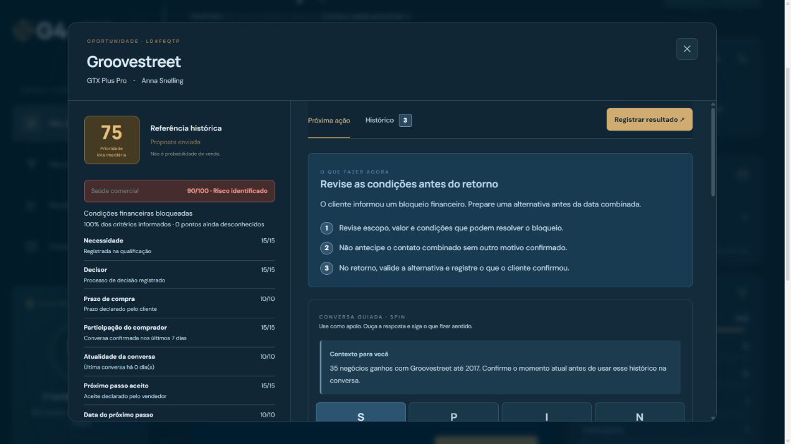

# Submissão — Rafael Dias — Challenge 003

## Sobre mim

- **Nome:** Rafael Dias
- **LinkedIn:** [Rafael Dias](https://www.linkedin.com/in/rafaelpereiradias1222/)
- **Challenge escolhido:** 003 — Lead Scorer (Vendas / RevOps)

## Executive Summary

Construí o **G4 Sales Priority**, uma aplicação que transforma o pipeline em uma rotina de ação por vendedor, com contexto do cliente, explicação da prioridade e registro do próximo passo. Das 8.800 oportunidades do dataset, 2.089 estão abertas e 1.425 dessas não possuem conta identificada, lacuna tratada como trabalho de cadastro. A solução separa referência histórica, saúde da negociação e urgência operacional, sem apresentar a nota como probabilidade de fechamento. Recomendo um piloto com vendedores para validar clareza e qualidade das decisões antes de escalar para uso compartilhado.

## Solução

### Executar em poucos passos

Pré-requisitos: Node.js 20.9+ e npm. A aplicação inclui os CSVs públicos e o snapshot preparado; o modo local não exige Supabase, conta externa, API de IA ou arquivo de segredos.

Na pasta deste README:

```sh
cd solution
npm ci
npm run dev
```

No Windows PowerShell, use `npm.cmd ci` e `npm.cmd run dev` caso a execução de `npm.ps1` esteja bloqueada. Abra **http://127.0.0.1:3000** no navegador. Se a porta estiver ocupada, use `npm.cmd run dev -- --port 3003` e abra a porta indicada. Mantenha o terminal aberto.

Para reproduzir a preparação e validar o código, com o servidor parado:

```sh
npm run data
npm run check
```

Para executar o build produzido: `npm start`. No PowerShell, esses comandos também aceitam `npm.cmd`. O [README técnico](solution/README.md) detalha manutenção, Supabase opcional e publicação. O [roteiro de avaliação](docs/roteiro-de-avaliacao.md) apresenta uma demonstração guiada.

### Abordagem

1. Inspecionei as relações dos quatro CSVs, ausências, normalização de produtos e limites temporais.
2. Comecei com regras explicáveis e evoluí a interface de relatório para fila de trabalho, a partir de revisão humana.
3. Separei o score histórico da saúde atual: qualificação, resposta do comprador, próximo passo aceito e condições financeiras. Informação desconhecida permanece desconhecida.
4. Organizei o código por funcionalidades, extraí regras puras e adaptei o armazenamento mantendo compatibilidade com registros anteriores.
5. Pesquisei alternativas de priorização, comparei a composição das filas e implementei cenários de coerência, sem chamar esses testes de comprovação comercial.

### Resultados / Findings

- **Base real:** 35 vendedores cadastrados, 27 com oportunidades abertas; responsáveis originais preservados.
- **Execução:** Meu dia, rodadas compactas, contexto da conta, SPIN contextual, SQL, proposta, retorno, pausa e registro de venda/perda.
- **Decisão:** retornos vencidos e riscos podem superar potencial histórico; compromissos futuros e pausas são respeitados. Bloqueio financeiro pode gerar revisão interna, sem antecipar contato.
- **Explicação:** fatores, pontos, cobertura e lacunas visíveis. Um risco impede classificação verde mesmo com soma alta.
- **Acompanhamento:** pipeline com arraste e validação antes de mudar etapa; resultados individuais/empresa e filtros por vendedor, gestor e região.
- **Verificação:** 58 testes automatizados aprovados na versão anterior ao empacotamento; verificação específica do pacote em [validação da entrega](docs/validacao-da-entrega.md). Não houve medição de aumento de vendas.



Esta captura usa registros fictícios de QA. As demais imagens documentam etapas de evolução e não representam todas a interface final.

### Recomendações

1. Validar com vendedores se eles entendem a prioridade e conseguem concluir a jornada sem orientação.
2. Medir qualidade das decisões e evolução das oportunidades em piloto, comparando com regras simples.
3. Para uso real por equipe, adicionar autenticação, autorização e persistência compartilhada das atividades, antes de carregar dados privados.

### Limitações

- Snapshot público de 2017; referência explícita em 31/12/2017. Não é uma carteira comercial atual do G4.
- O dataset não contém histórico completo de transições, contatos, propostas ou respostas. As novas evidências são declaradas manualmente, não verificadas por integração.
- O score histórico não recebe valores de fechamento das oportunidades abertas. Resultados encerrados anteriores ao corte servem de referência; não há histórico suficiente para um backtest integral point-in-time.
- Pesos e janelas da saúde são hipóteses de piloto. Testes comprovam regras previstas, não calibração ou eficácia de vendas.
- Atividades ficam no navegador/origem, sem sincronização entre computadores. Filtros não são controles de acesso. Não há envio automático de mensagens.
- Supabase está preparado como fonte opcional do snapshot, não como persistência das atividades. Não há publicação remota nesta entrega local.
- O desenvolvimento teve múltiplas sessões; não foi cronometrado de forma confiável. Não afirmo cumprimento do orçamento de 4–6 horas.
- Demonstração independente: uso do logo original como referência visual não implica afiliação, aprovação ou adoção pelo G4.

## Process Log — Como usei IA

### Ferramentas usadas

| Ferramenta | Para que usou |
|---|---|
| ChatGPT / Codex | Discussão de escopo, pesquisa, análise dos CSVs, implementação, revisão e documentação |
| Navegador e fontes públicas | Conferir briefing, referências comerciais/visuais e funcionamento local |
| Node.js, testes automatizados e build Next.js | Verificar regras, compatibilidade e compilação do software produzido com IA |

Supabase e Vercel foram previstos na arquitetura, mas não foram provisionados nem usados como serviços ativos. Obsidian foi considerado e retirado por decisão de escopo.

### Workflow

1. Entendimento do briefing e diagnóstico dos dados antes de implementar.
2. Primeira construção funcional e revisão do usuário: a interface ainda parecia um relatório.
3. Iterações de jornada comercial, linguagem, contraste, registro de ações e próximos passos.
4. Refatoração para continuidade com outro desenvolvedor e testes de compatibilidade.
5. Pesquisa de saúde/priorização, comparativos estáticos e implementação dos cenários.
6. Preparação da submissão com código, narrativa, evidências existentes e roteiro reproduzível.

A [narrativa detalhada](process-log/workflow.md) registra as iterações e correções. Não há contagem auditada de prompts ou horas; os marcos documentados são a evidência disponível.

### Onde a IA errou e como corrigi

- A primeira interface enfatizava relatório; o feedback humano levou à fila de ações e à continuidade após o contato.
- A primeira saúde atribuía pontos sem evidência estruturada suficiente. A política atual mantém legado sem resposta/aceite em validação e testa essa distinção.
- Extrações na refatoração produziram referências ausentes e problema de delimitação de JSX; verificações e compilação detectaram e orientaram a correção.
- A inspeção do navegador revelou rolagem inadequada após salvar e problemas de contraste. O fluxo e as cores foram corrigidos e revistos.

### O que eu adicionei que a IA sozinha não faria

Direcionei o produto para a rotina do vendedor: priorizei ação, clareza, contexto e próximo passo, rejeitei excesso de campos e explicações genéricas, simplifiquei rodadas e solicitei continuidade de manutenção. Também questionei a efetividade do score e pedi comparativos antes de aprovar a implementação. Essas decisões estão descritas na narrativa, sem atribuir resultados comerciais ainda não medidos.

## Evidências

- [x] [Narrativa escrita das decisões e iterações](process-log/workflow.md)
- [x] [Índice das capturas existentes](process-log/README.md)
- [x] [Metodologia e limites dos dados](solution/docs/methodology.md)
- [x] [Política ativa de saúde e prioridade](solution/docs/health-v2-implementation.md)
- [x] [Plano de cenários e comparativos](solution/docs/priority-validation-plan.md)
- [x] [Guia de manutenção](solution/docs/maintenance.md)
- [ ] Export integral das conversas / gravação: não incluídos; narrativa escrita é o formato escolhido.
- [ ] Histórico Git de desenvolvimento: não disponível; não foi reconstruído artificialmente.

**Estado:** pacote local preparado; submissão via Pull Request ainda não enviada. A data de envio deve ser registrada quando o PR for aberto.
