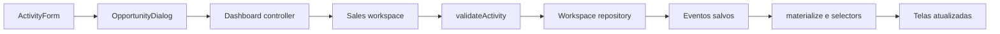

# Guia de continuidade — G4 Sales Priority

## Começar

Leia o README para executar e entender as limitações. Depois leia este mapa e `methodology.md` para as regras comerciais. As referências de design e o process log explicam decisões anteriores; não substituem o comportamento atual do código.

```sh
npm ci
npm run dev
```

No Windows, use `npm.cmd` se o PowerShell bloquear `npm.ps1`. Dependências ficam no `package-lock.json`; não substitua `npm ci` por atualizações indiscriminadas.

## Mapa do projeto

| Local | Responsabilidade |
|---|---|
| `app/page.js` | Carregamento no servidor e entrada da aplicação |
| `app/dashboard.js` | Composição das telas e abertura do modal; não define regras comerciais |
| `components/layout/` | Menu lateral e cabeçalho |
| `components/ui/` | Ícones, score, indicadores, títulos e estados vazios compartilhados |
| `features/today/` | Meu dia, fila de oportunidades e checkpoints |
| `features/pipeline/` | Busca, filas, Kanban e gestos de arraste |
| `features/opportunities/` | Modal, contexto da conta, formulário de atividade, card e SPIN |
| `features/results/` | Filtros, indicadores, funil e histórico |
| `features/priorities/` | Explicação para o vendedor |
| `features/workspace/use-sales-workspace.js` | Restauração, gravação, relógio, preferências e projeção do estado comercial |
| `features/workspace/use-dashboard-controller.js` | Navegação, filtros, seleção, arraste, avisos e exportação |
| `lib/workspace-storage.mjs` | Adaptador do armazenamento local e chaves de compatibilidade |
| `lib/workspace-selectors.mjs` | Consultas puras da carteira, rodadas e filtros |
| `lib/health.mjs` | Saúde v2, fatores, cobertura, riscos e política versionada |
| `lib/priority.mjs` | Classes de ação, urgência, pausa e desempates de potencial |
| `lib/evidence.mjs` | Recorte temporal e projeção idempotente dos eventos |
| `lib/workflow.mjs` | Validação de atividades e reconstrução do estado da oportunidade |
| `lib/scoring.mjs` | Score histórico, corte temporal e referências de ciclo |
| `lib/sales-guide.mjs` | Plano diário, progresso e orientação por ação |
| `lib/presentation.mjs` | Faixas visuais, perguntas SPIN e intenção de movimentação |
| `lib/activity.mjs` | Nomes dos eventos no histórico e nos avisos |
| `lib/contracts.mjs` | Contratos JSDoc dos registros persistidos; não é validação em tempo de execução |
| `lib/format.mjs` | Formatação e pequenos auxiliares de apresentação |
| `lib/data.mjs` | Leitura do snapshot local ou Supabase no servidor |
| `scripts/` | Preparação reproduzível e importação no Supabase |
| `tests/` | Regras comerciais, score, compatibilidade do armazenamento e filtros |

Fluxo de uma gravação:



O formulário coleta dados; a regra valida; o adaptador grava; só então o estado React é atualizado. Uma escolha no seletor ou um arraste não é uma venda confirmada.

## Onde alterar

### Ajustar o score

Mude `lib/scoring.mjs` e os testes de scoring. Execute a preparação dos dados para atualizar o snapshot, revise a metodologia e as explicações ao vendedor. O score é pré-calculado: editar a regra sem regenerar o snapshot não muda os pontos já carregados. Não introduza `close_value` no cálculo de abertas nem anuncie probabilidade sem calibração.

### Alterar cadastro ou registro comercial

Comece em `features/opportunities/activity-form.js`. Se a mudança afetar exigências ou transições, altere `lib/workflow.mjs`; o JSX não deve decidir se uma venda é válida. Para um novo tipo de evento, revise também `lib/activity.mjs`, os contratos, `materialize`, o progresso diário, os rótulos do formulário e os testes. Evite criar uma segunda implementação da mesma regra em uma tela.

### Alterar uma tela

Edite a pasta correspondente em `features/`. Compartilhe um componente quando houver a mesma responsabilidade em mais de uma tela. Componentes recebem dados e ações por propriedades explícitas; não leem diretamente o banco ou o armazenamento do navegador.

### Alterar aparência

`app/globals.css` é somente o índice de importação. A paleta está em `app/styles/tokens.css`. Os módulos de layout, dia, pipeline, resultados e oportunidade contêm os estilos das respectivas áreas. `responsive.css`, `reading.css`, `semantics.css`, `journey.css`, `dark-contrast.css` e `accessibility.css` completam a composição na ordem do índice.

A ordem foi preservada para manter o visual aprovado. Alguns seletores continuam globais e têm variações responsivas/de tema: procure o seletor em `app/styles/` antes de editar. Corrija a regra responsável em vez de acrescentar uma nova sobrescrita no fim do arquivo. Esta etapa não converteu todos os estilos para CSS Modules.

### Evoluir a persistência para vários usuários

O adaptador atual é síncrono e local. A leitura do snapshot do Supabase é separada da gravação das atividades. Uma futura persistência compartilhada exige API autenticada, autorização por carteira, gravação assíncrona, estados de espera/erro e estratégia de concorrência. Adapte o hook e o contrato de gravação do modal para aguardar a confirmação do servidor; não basta trocar uma variável de ambiente. O retorno de `onRecord` hoje é síncrono: `null` em sucesso ou uma mensagem de erro.

## Compatibilidade e recuperação

- A chave `g4-sales-workspace-v2` e o envelope `{version:2,agent,events,plans}` foram mantidos.
- Preferências continuam em `g4-ui-preferences`; não se misturam aos eventos.
- Planos antigos de cinco tarefas continuam sendo migrados por `ensureDailyPlan`, preservando conclusões.
- Falha na leitura bloqueia novas gravações, sem substituir automaticamente os dados corrompidos por um estado vazio.
- Falha na gravação não confirma a atividade. Não trate erro como sucesso.
- Exportar JSON oferece uma cópia dos eventos; ainda não existe restauração desses eventos pela interface.
- Antes da refatoração foi criada uma cópia local em `.backups/refactor-20261106-195217/`, com manifesto SHA-256. Ela contém código, dados públicos e documentação; não contém `node_modules`, `.next`, credenciais ou o armazenamento privado dos navegadores. A pasta fica fora do futuro Git.

Para comparar ou recuperar código, use essa cópia com o servidor parado. Não substitua credenciais nem apague dados do navegador para testar uma mudança. Restaurar arquivos extraídos exige também restaurar o `package.json` e remover somente os novos arquivos identificados no relatório da refatoração; prefira comparação seletiva. A cópia não substitui versionamento Git, previsto para a etapa de entrega.

## Verificação antes de entregar uma mudança

```sh
npm run check
```

Esse comando verifica formatação, executa os testes e compila a aplicação. Pare o servidor antes do build, especialmente no Windows. O `npm test` não exige navegador nem credenciais. As verificações são úteis, mas não substituem a revisão visual ou a validação com vendedores.

Complete também o roteiro de `refactor-validation.md` quando alterar formulários, persistência ou navegação. Use registros rotulados como QA e dados fictícios; nunca envie e-mails ou faça ligações para validar o fluxo.

## Limites deliberadamente preservados

A refatoração preservou originalmente as regras. A etapa seguinte ativou saúde e prioridade v2, documentadas em `health-v2-implementation.md`: novos campos, políticas e casos têm seus módulos/testes próprios. O score histórico e o snapshot continuam iguais. A precedência dos retornos vencidos sobre as rodadas foi corrigida. Autenticação e persistência compartilhada continuam pendentes.

TypeScript, testes de interface automatizados e integração compartilhada continuam como evoluções possíveis. Os contratos atuais são JSDoc, os testes de domínio são automatizados e a conferência de interface desta entrega foi feita no navegador.
