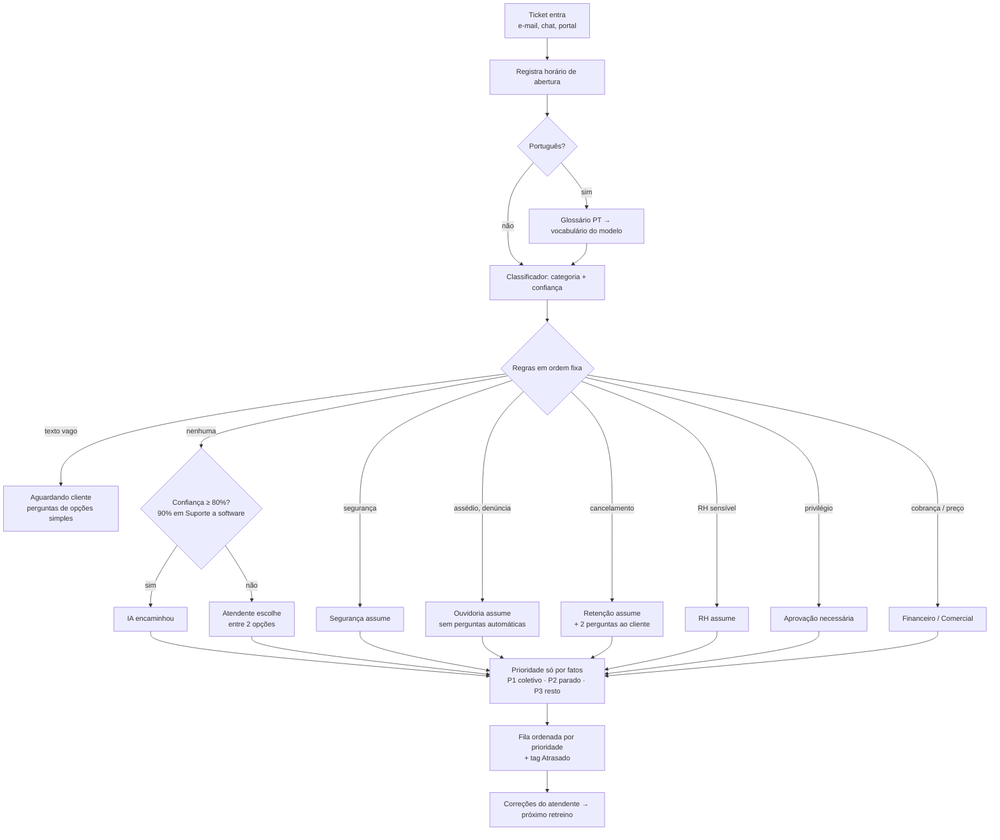

# Submissão — Rafael Moraes — Challenge 002

## Sobre mim

- **Nome:** Rafael Moraes
- **LinkedIn:** https://www.linkedin.com/in/rafa-el-moraes/
- **Challenge escolhido:** 002 — Redesign de Suporte

---

## Executive Summary

O arquivo de suporte não sustenta nenhum gargalo, nenhum fator de satisfação e nenhuma medida de tempo: não tem horário de abertura, metade das resoluções acontece antes da primeira resposta e as distribuições são uniformes. Os "gargalos" que aparecem num gráfico rápido são ruído, e o primeiro passo recomendado é medir. Construí um protótipo de triagem treinado em 38 mil tickets reais de TI interna e testado em 9.568 que nunca viu: nesses dados, encaminha sozinho 61% do volume com 97% de acerto e deixa com pessoas o resto. Ao rodar o mesmo classificador nos textos do arquivo de clientes, só ~12% iria sozinho: um modelo de TI não serve para essa operação. O que se transfere é o método — retreinar com o histórico da empresa, medir, fixar um limiar que protege a qualidade e deixar o volume automatizado crescer com os dados. O retorno (~R$ 22 mil/ano brutos, menos tempo perdido no time errado) é uma hipótese a confirmar depois do retreino.

**Protótipo:** `solution/prototype/index.html` (abre no navegador, PT/EN) · link público: _(preencher)_

### Como o ticket anda

### Teste em 1 minuto

Abra o protótipo, cole cada texto em **"Testar um ticket seu"** e clique em **Classificar**:

| Cole isto | O que deve acontecer |
|---|---|
| `Preciso de um teclado novo` | P3 · **IA encaminhou** para Equipamentos (93%) |
| `Olá, meu monitor parou de funcionar.` | IA encaminhou + **pergunta ao cliente se ele consegue trabalhar**; "estou parado" sobe para P2 |
| `URGENTE!!! preciso trocar o papel de parede` | Continua **P3**: pedir urgência não basta, o que define é o caso |
| `Quero cancelar meu contrato` | **Retenção assume** + duas perguntas: o cliente já decidiu ou quer resolver? |
| `O sistema de vendas está fora do ar para todos` | **P1 Crítica** (impacto coletivo) |
| `tenho uma dúvida` | **Aguardando cliente**: a IA responde com perguntas de opções simples |
| `Como faço pra desistir da assinatura?` | ⚠️ **Limite conhecido:** a IA encaminha sozinha para Acessos. Regra de palavra-chave não entende linguagem natural; em produção, casos sensíveis precisam de classificador próprio (ver Limitações) |

Na aba **Limiar e ROI**, arraste o limiar e troque as premissas para ver o retorno mudar.

### Retorno em uma tabela (hipótese)

Desempenho medido em TI interna aplicado ao volume do briefing (30 mil tickets/ano; R$ 20/h; 3 min de triagem; 3,5 min por reencaminhamento; 40 min perdidos pelo usuário por reencaminhamento). O único número sem fonte é o erro de encaminhamento de hoje, por isso a sensibilidade:

| Erro de encaminhamento hoje | Horas de atendente/ano | R$/ano (bruto) | Reencaminhamentos evitados | Tempo perdido evitado |
|---|---|---|---|---|
| 10% | 985 h | R$ 19,7 mil | 1.257 | 838 h |
| **20% (base)** | **1.092 h** | **R$ 21,8 mil** | **3.081** | **2.054 h** |
| 30% | 1.198 h | R$ 24,0 mil | 4.905 | 3.270 h |

Em todos os cenários, ~568 tickets/ano seriam encaminhados errado pela IA sozinha. Custo de implantação não estimado.

---

## Para o Diretor de Operações

**Onde perdemos tempo?** Com os dados atuais, não dá para saber: o sistema não registra quando o ticket abre nem por quantos times ele passa.

**O que pode ser automatizado?** Classificar e encaminhar tickets, com uma regra fixa: a IA só age sozinha quando está muito confiante; o resto vai para pessoas. **Na TI interna testada**, isso foi ~6 em cada 10 tickets, com ~3 erros em cada 100. **Na sua operação de clientes, o modelo atual assumiria pouco volume (~12% iria sozinho, medido no texto sintético do Dataset 1; o acerto ali não foi medido)**: ele precisa ser retreinado com o seu histórico antes de ligar.

**Quanto histórico é preciso?** Medido no Dataset 2 (TI interna, em inglês, rótulos limpos): com qualquer quantidade de exemplos testada, o limiar manteve o acerto da IA acima de 96%; o que cresceu com os dados foi o volume que ela consegue assumir.

| Tickets rotulados | IA encaminha sozinha | Acerto quando age |
|---|---|---|
| 1.000 | 17% | 99% |
| 2.000 | 27% | 99% |
| 5.000 | 41% | 98% |
| 10.000 | 50% | 98% |
| 38.000 | 64% | 97% |

Se o sistema de tickets já registra a fila de destino, 3 a 6 meses de histórico (7.500 a 15.000 tickets, no volume do briefing) servem de base de rótulos **depois de auditados por amostra**: se 20% dos encaminhamentos de hoje estão errados, o modelo aprenderia esses erros. Se não registra, rotular ~2.000 tickets dá um começo útil (~27% automático no Dataset 2).

**Plano de 30 dias**

| Semana | O quê | Quem |
|---|---|---|
| 1 | Registrar abertura, encaminhamentos, motivo do contato, número de interações; coletar satisfação também de tickets não resolvidos | Operações + TI do sistema de tickets |
| 1–2 | Exportar 3–6 meses de tickets com a fila de destino e auditar uma amostra (corrigir os mal encaminhados); se não houver fila registrada, rotular ~2.000 | Líderes de fila |
| 2–3 | Retreinar o modelo, medir em tickets nunca vistos, fixar o limiar; rotular exemplos de casos sensíveis (segurança, denúncia, cancelamento) para um classificador próprio | Responsável por IA |
| 3 | Rodar em modo "só sugere" ao lado dos atendentes | Atendentes |
| 4 | Ligar o encaminhamento automático acima do limiar, se o acerto auditado passar de 95% | Diretor decide |

**Quando desligar:** acerto auditado semanal abaixo de 95% por 2 semanas = alerta; abaixo de 93% = a IA volta a só sugerir.

**Retorno e custo:** se o modelo retreinado se comportar como o de TI, o ganho é ~R$ 22 mil/ano brutos em horas de atendente e ~2.000 horas/ano de tempo perdido evitado — **hipótese, não estimativa**. O custo de integração não foi estimado; ele precisa caber nesse valor, ou o investimento se justifica pelo tempo do usuário, não pela folha.

---

## Solução

### Abordagem

1. **Desconfiar dos dados antes de analisar.** A inspeção mostrou que o Dataset 1 é sintético. Respondi às três perguntas do Diretor com testes que mostram o que os dados sustentam.
2. **Cruzar os datasets de verdade.** O Dataset 2 treina e mede o classificador; rodar esse classificador nos textos do Dataset 1 mostra o limite do modelo para a operação de clientes.
3. **Definir onde parar antes de construir.** Limiar de confiança confirmado em validação separada, filas humanas por regra, prioridade só por fatos.
4. **Testar tentando quebrar.** Eu testei cada versão; depois, uma auditoria adversarial em outro chat, em duas fases, passou 93 tickets difíceis. Na fase 01 corrigimos o que ela encontrou (43 casos de regressão). Na fase 02 ela mostrou que as regras de palavra-chave tinham sido ajustadas aos testes e erram em casos inéditos — decidimos parar de ajustar e declarar o limite (decisão 25).
5. **Comparar com o baseline.** Rodei o desafio numa IA sem contexto para saber o que ela entrega sozinha.

### Resultados / Findings

**Diagnóstico** — [`solution/diagnostico.md`](solution/diagnostico.md)

- **A. A prioridade registrada não tem efeito:** Critical fica sem resposta tanto quanto Low (32,5% × 33,7%) — hipótese a confirmar com dados reais.
- **B. Os dados não medem o que gera insatisfação:** nenhuma variável explica a nota, e ela só existe nos 32,7% de tickets fechados.
- **C. Os gargalos aparentes são ruído:** a "pior combinação" (80,6% não resolvidos) aparece ao acaso em 26% das permutações.

**Automação** — [`solution/automacao.md`](solution/automacao.md)

| Medido em 9.568 tickets nunca vistos | |
|---|---|
| Acerto geral | 86,1% |
| Encaminhados pela IA (limiar 80%; 90% em Suporte a software; descontadas as filas por regra) | 60,8%, com 96,9% de acerto |
| Atendente escolhe entre 2 opções | 33,9% — a certa está entre elas em 90,3% |
| Desviados para filas humanas por regra | 5,3% |
| Classificador nos textos do Dataset 1 | confiança média 60%, ~12% iria sozinho — não serve para a operação de clientes sem retreino |
| Filas por regra (Segurança, Ouvidoria, Retenção etc.) | sem rótulo para medir; piso de erro: ≥ 23% dos desvios no Dataset 2 são falsos positivos por definição (Retenção e Comercial numa base sem clientes) |

Retorno — **hipótese**, aplicando o desempenho em TI ao volume do briefing (base 20% de erro manual; sensibilidade 10–30% no diagnóstico): 1.092 h/ano liberadas, 3.081 reencaminhamentos evitados, 2.054 h de tempo perdido evitado (estimado pelos usuários), ~568 tickets/ano encaminhados errado pela IA.

**Protótipo** — [`solution/prototype/`](solution/prototype/): fila com cor = prioridade e rótulo = quem age (IA, atendente, Segurança, Ouvidoria, Retenção, RH, Aprovação, Financeiro, Comercial), tag de atraso, perguntas simples ao cliente, fluxo de cancelamento que entende se o cliente já decidiu; aba de limiar e retorno; verificador de qualidade de dados.

### Recomendações

1. **Medir primeiro:** abertura, encaminhamentos, motivo do contato, interações, satisfação de todos os tickets.
2. **Retreinar com o histórico da empresa** e ligar a triagem com limiar e fila humana (plano de 30 dias acima).
3. **Casos sensíveis com classificador próprio:** segurança, denúncia, cancelamento, cobrança e RH. As regras de palavra-chave do protótipo servem como rede de segurança no primeiro dia, não como solução.
4. **Prioridade só por fatos**, com tag de atraso por prioridade.
5. **Integrar no sistema que a empresa já usa** (Microsoft 365 ou Google Workspace).

### Limitações

- O Dataset 1 é sintético e tem 8.469 tickets, não ~30 mil: o diagnóstico vale para este arquivo, não para a operação real.
- O modelo é de TI interna; para a operação do briefing precisa de retreino.
- **As regras de palavra-chave erram para os dois lados em casos inéditos** (auditoria fase 02): "vazamento de memória" vira incidente de segurança P1 e "discriminar os custos" vai para a Ouvidoria; "quero desistir da assinatura" e phishing pelo Teams escapam com a IA. Regra de texto não entende linguagem natural; os 43 casos de regressão foram usados para ajustá-las e não são teste independente.
- Português: 91,1% em 56 tickets traduzidos (otimista) e só 4 tickets de teste independente; o glossário não cobre bem o jeito como o cliente escreve.
- Custos, erro manual, limites de atraso e o ganho das perguntas ao cliente são premissas a medir.

---

## Process Log — Como usei IA

> Detalhes em [`process-log/PROCESS-LOG.md`](process-log/PROCESS-LOG.md); 25 decisões em [`process-log/DECISIONS.md`](process-log/DECISIONS.md); tempo em [`process-log/ACTIVITY-LOG.csv`](process-log/ACTIVITY-LOG.csv).

### Ferramentas usadas

| Ferramenta | Para que usou |
|------------|--------------|
| ChatGPT | Leitura inicial do desafio e primeiro plano |
| Claude (chat de execução) | Revisão do plano, análise em Python, protótipo, testes, documentação |
| Claude (chat separado) | Teste de baseline: o que a IA entrega sozinha |
| Claude (chat auditor) | Auditoria adversarial em fases: 93 tickets difíceis, conferência de fontes, nota por critério do G4 |
| Python / scikit-learn · Node.js / Playwright | Testes estatísticos, classificador, testes de paridade e regressão, capturas de tela |

### Workflow

1. Revisei o plano do ChatGPT contra o repositório — corrigimos 4 pontos, entre eles a armadilha do `.gitignore`.
2. Inspecionei os dados antes de analisar; decidi tratar o Dataset 1 como limitação testada.
3. Diagnóstico com testes estatísticos; a IA apontou uma incoerência na minha escolha de achados.
4. Premissas de custo com a minha experiência e fontes públicas.
5. Baseline num chat separado, comparado linha a linha.
6. Limiar e lista do que não automatizar.
7. Testei o protótipo como atendente e como cliente — 8 versões, a maioria a partir de um teste ou ideia minha.
8. Auditoria adversarial em outro chat, em fases; triei as críticas (corrigir, declarar, discordar), decidi 5 pontos novos e quando parar de ajustar.
9. Documentação e submissão.

### Onde a IA errou e como corrigi

- **ChatGPT** recomendou não cruzar os datasets e não viu que o `.gitignore` esconde a pasta de submissão.
- **Claude** criou uma regra baseada no nome de uma categoria; meu teste mostrou todos os tickets caindo no vermelho.
- **Claude** deixou um cancelamento escapar da Retenção; meu teste pegou.
- **Claude** misturava urgência e "quem age" na mesma cor; separei.
- **A auditoria (fase 01)** mostrou assédio recebendo questionário, phishing indo com a IA, "URGENTE" num pedido trivial subindo a prioridade e a cobertura de 64,4% ignorando as regras — corrigido. **Na fase 02** mostrou que essas correções eram ajuste às palavras dos testes: em 45 tickets inéditos as regras erraram dos dois lados. Decidi parar de ajustar e declarar o limite.
- **O auditor também errou:** disse que a fonte dos 40 min dizia 1h46; conferimos o artigo citado e ele diz 40 min (mas mede usuários de TI, não clientes — isso corrigimos).
- **O baseline** calculou tempos com um campo que ele mesmo declarou inválido e chegou a um retorno ~9 vezes maior que o nosso com custos sem fonte.

### O que eu adicionei que a IA sozinha não faria

A IA construiu rápido, mas pensava como quem analisa dados, não como quem vive a operação. Meu papel foi testar o sistema como atendente e como cliente, e mudar as regras quando algo não funcionaria no dia a dia.

- **Cancelamento nunca fica só com a máquina.** Perder um cliente custa mais do que qualquer ganho de velocidade. E, antes de tratar como perdido, o sistema pergunta: "a ideia é entender se ele realmente já decidiu ou se podemos resolver". Muitas vezes o cliente só está irritado.
- **Não se pergunta ao cliente se é urgente.** "Todo mundo pode pedir prioridade, mas o que define é o caso." Por isso as perguntas são sobre fatos: você consegue trabalhar? Quem mais foi afetado?
- **A cor precisa dizer o que resolver primeiro.** Na operação, o atendente olha a cor e age. Se vermelho significa "caso sensível" e não "urgente", ele se perde. Separei cor (prioridade) de rótulo (quem age), porque "não quero deixar o atendente perdido".
- **Chamado esquecido também é problema.** Criei a tag de atraso para "os atendentes filtrarem inclusive chamado relativamente simples, mas esquecido".
- **O cliente brasileiro escreve em português**, então o sistema tinha que aceitar.

Testando, encontrei erros que a IA não tinha visto: todos os meus chamados caíam no vermelho, e um "quero cancelar" passava direto pela máquina. Depois de duas auditorias, decidi parar de remendar regra por regra: corrigir cada frase que o auditor inventava seria decorar a prova. Preferi assumir o limite com honestidade e dizer o que resolve de verdade em produção.

_Este texto e o motivo da decisão 4 foram redigidos com ajuda da IA a partir das minhas decisões registradas no `DECISIONS.md`, e revisados por mim. Uso IA no meu trabalho todos os dias, minha evolução com ela tem sido constante, e nada me impede de me aperfeiçoar ainda mais — este desafio foi mais um passo._

---

## Evidências

- [x] Screenshots dos testes do protótipo (`process-log/screenshots/`)
- [ ] Screen recording do workflow
- [x] Chat exports (`process-log/chat-exports/`)
- [x] Git history
- [x] Outro: registro de decisões (`process-log/DECISIONS.md`) e de tempo (`process-log/ACTIVITY-LOG.csv`), teste de baseline (`process-log/baseline/`) e as três fases da auditoria adversarial (`process-log/auditoria/auditoria-fase01.pdf`, `-fase02.pdf`, `-fase03.pdf`)

---

_Submissão enviada em: (preencher)_
