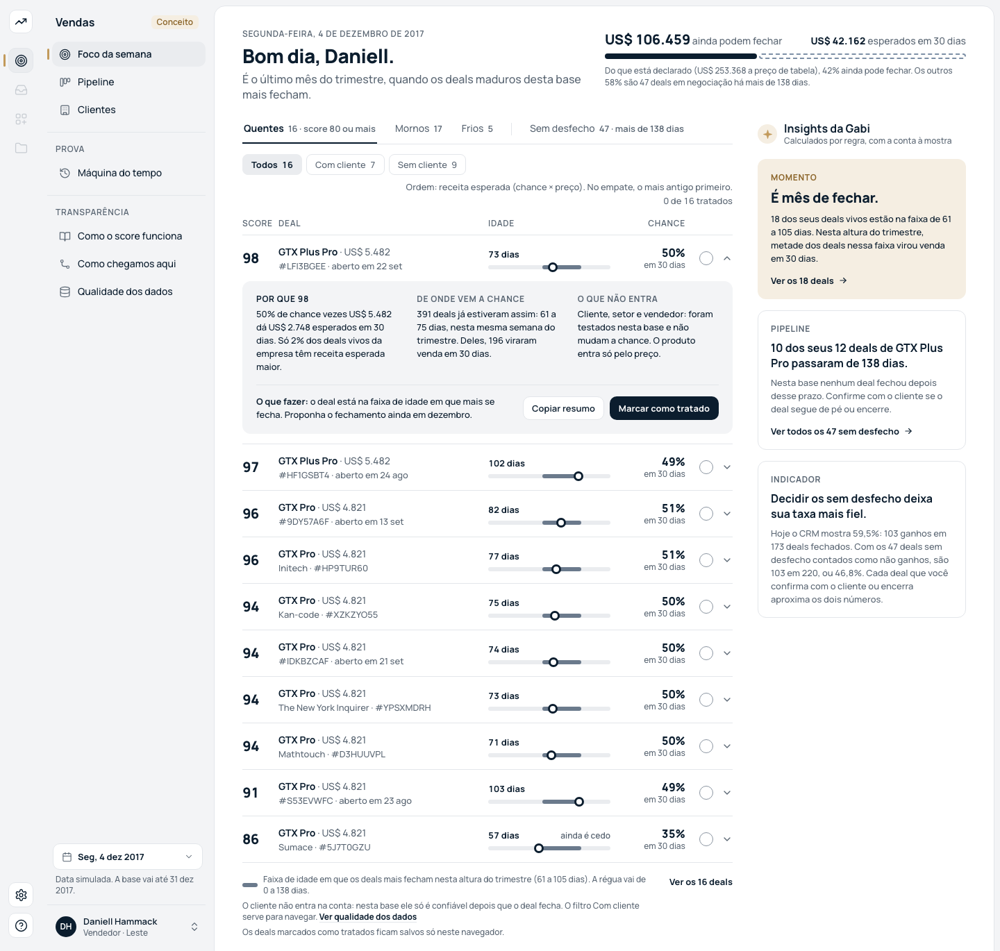
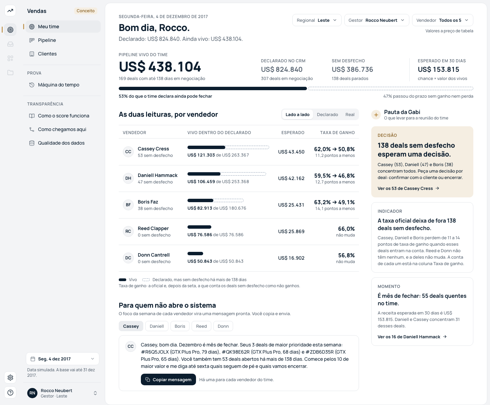
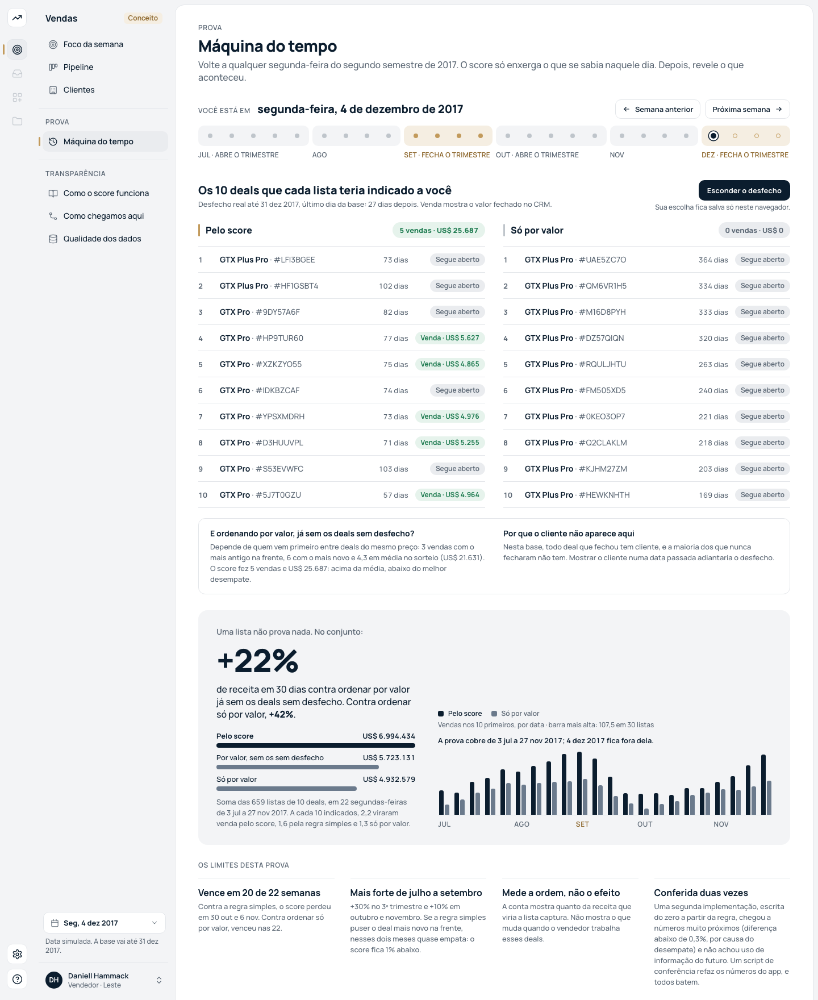

# Submissão — Rodrigo Costa — Challenge 003

> Módulo conceito, com visual inspirado no G4 OS, feito para o desafio; não é produto oficial do G4. Os "Insights da Gabi" são cartões calculados por regra, não um modelo de linguagem.

## Sobre mim

- **Nome:** Rodrigo Costa
- **LinkedIn:** https://www.linkedin.com/in/rodrigopiffer
- **Challenge escolhido:** 003, Lead Scorer

---

## Executive Summary

Construí o "Vendas", um app web que mostra a cada vendedor, numa segunda-feira, a ordem em que trabalhar seus deals abertos, com o motivo de cada posição, e mostra ao gestor o pipeline declarado ao lado do que ainda pode fechar. A base esconde duas armadilhas: nenhum deal fechou depois de 138 dias, e mais de um terço dos abertos em 4 dez 2017 já tinha passado disso (os deals "sem desfecho", que o CRM ainda conta como abertos); e o cliente dos deals abertos não é confiável. O score é a chance de o deal virar venda em 30 dias, pela idade do deal e pela semana do trimestre, vezes o preço de tabela. Em 22 segundas simuladas, a lista do score trouxe +22% de receita em 30 dias contra ordenar por valor já sem os deals sem desfecho; em outubro e novembro a vantagem cai para +10%. A principal recomendação é decidir os deals sem desfecho e usar o score para ordenar a semana, medindo de novo com dados reais.

---

## Solução

### Para ver em um minuto

```bash
cd solution
python3 server.py        # só Python 3.9 ou mais novo, nada para instalar
# abrir http://localhost:8000
```

App publicado: https://lead-scorer-production-75122f84.up.railway.app

1. Na tela de acesso, entre como vendedor **Daniell Hammack**.
2. No Foco da semana, abra o primeiro deal (#LFI3BGEE, score 98) e leia o porquê: chance, base de casos e o que fazer.
3. Abra a **Máquina do tempo** e clique em **Revelar o desfecho**: aparece o que aconteceu nos 30 dias seguintes (27 dias a partir de 4 dez, porque a base acaba em 31 dez) com a lista do score e com a lista ordenada só por valor.
4. No canto de baixo do menu, clique no nome, escolha **Trocar de pessoa** e entre como o gestor **Rocco Neubert**: o time aparece com o declarado e o vivo lado a lado.

Atalhos, com o servidor no ar: [`/#/foco?como=Daniell%20Hammack&data=2017-12-04`](http://localhost:8000/#/foco?como=Daniell%20Hammack&data=2017-12-04) abre direto como o vendedor e [`/#/time?como=Rocco%20Neubert&data=2017-12-04`](http://localhost:8000/#/time?como=Rocco%20Neubert&data=2017-12-04) como o gestor, os dois na data dos números deste texto. Os números de todas as telas vêm da API (`solution/API.md`).

Para conferir os números e rodar os testes, também dentro de `solution/`:

```bash
python3 verify.py                                  # recalcula tudo dos CSVs por outro caminho e compara com o app (189 de 189 batem)
python3 -m unittest discover -s tests -t .         # testes automatizados
```

A data simulada (26 segundas, de 3 jul a 25 dez 2017; padrão 4 dez) troca no menu lateral. Cada tela usa só o que se sabia naquela data.

### Abordagem

1. **Rotina antes do dado.** Antes de qualquer código, três perguntas sobre como vendedor e gestor usam CRM. As respostas definiram o produto: nem todo vendedor abre o sistema; vendedor deixa deal aberto para não registrar a perda; a entrega tem de ser fácil de validar.
2. **Inventário.** O que a base tem sobre clientes e oportunidades, antes de aceitar qualquer análise.
3. **Hipóteses testadas com número.** Tempo de fechamento por produto, faturamento do cliente e histórico de compras. Nenhuma mudou a chance; o teste delas revelou que o cliente dos deals abertos não é confiável.
4. **Score simples e explicável.** Chance por idade e momento do trimestre, vezes preço.
5. **Estudo de UX antes do código.** As 5 primeiras telas, desenhadas no Paper, foram criticadas por IA (usabilidade e regras do desafio); depois o estudo passou a 12 pranchas (`docs/ux/`).
6. **Verificação independente.** Uma segunda implementação da prova, escrita do zero sem ver o código, corrigiu a manchete de +42% para +22%.
7. **Construção.** Motor e API feitos e revisados por agentes de IA; os revisores acharam erros que viraram correções com teste (detalhes no process log). Interface por outro fluxo, a partir das pranchas e da API real, revisada por três agentes e depois testada tela por tela no navegador.

### Resultados / Findings

#### 1. O que a base esconde

| Particularidade | Número | O que o app faz |
|---|---|---|
| Não há fechamento antes de 1 mar 2017 | 1.185 deals entraram antes disso; só aparecem os que demoraram | O score só aprende com retratos a partir de 6 mar 2017 |
| O cliente dos deals abertos não é confiável | No fim da base (31 dez 2017), 68% dos abertos sem cliente (em 4 dez, 52%); nos que têm, a regional do vendedor bate com a do cliente em 32% (95% nos fechados) | Cliente, porte e histórico ficam fora do score |
| Ter cliente adianta o futuro | Em 4 dez 2017: 0 de 549 deals vivos sem cliente fecharam até o fim da base; dos 750 com cliente, 404 viraram venda | O campo fica fora do score e da prova; a Máquina do tempo esconde o cliente |
| O trimestre dita o ritmo | Em 1 abr, 1 jul e 1 out 2017 havia 673, 1.015 e 1.750 deals abertos há mais de 30 dias (o mesmo deal pode contar em mais de uma data); nenhum fechou naquele mês. No último mês do trimestre, 81% dos fechamentos são venda; nos outros, 52% | A chance depende da semana do trimestre, não só da idade |
| Nada fecha depois de 138 dias | Maior ciclo da base, ganho ou perdido. Em 4 dez 2017, 779 dos 2.078 abertos (37%) já tinham passado disso | Esses deals viram "Sem desfecho" e saem da fila |

Também foram testados e descartados: produto (medianas de fechamento de 39 a 52 dias entre produtos; só o GTK 500 foge, com 9 vendas), faturamento e histórico de compras do cliente (não mudam a taxa de ganho entre os fechados).

#### 2. A lógica do score

- **Chance:** de todos os deals que já estiveram na mesma faixa de idade e na mesma semana do trimestre, quantos viraram venda em 30 dias. Usa só segundas-feiras cujo desfecho de 30 dias já era conhecido na data simulada. Se a célula tem menos de 30 casos, sobe para o mês do trimestre, depois só a faixa de idade. Por isso a chance não cresce sempre com a idade: na semana de 4 dez 2017, é 17% de 0 a 14 dias, 6% de 15 a 30 e 50% de 61 a 75. Nesse ponto do trimestre, os deals de 61 a 105 dias foram os que mais viraram venda em 30 dias (`/api/score-model`).
- **Deals em Prospecção** (500) não têm data de entrada na base, então ficam fora do score e aparecem só no kanban.
- **Receita esperada** = chance x preço de tabela. A lista é ordenada por ela.
- **Score de 0 a 100** = posição do deal entre todos os deals vivos da empresa. Quente: 80 ou mais. Morno: 40 a 79. Frio: abaixo de 40. Quente quer dizer "vale mais a sua semana", não "vai fechar": em 3 jul 2017, começo de trimestre, o primeiro deal de Daniell Hammack tinha score 100 e 18% de chance. A chance aparece ao lado do score em cada linha.
- **Sem desfecho:** deal com mais idade que o maior ciclo já visto (138 dias). Fica sem score, numa faixa própria, para o vendedor confirmar ou encerrar.
- **Por que só a data de entrada:** a data prevista de fechamento e o registro de atividade são os dois jeitos de dar cara de ativo a um deal parado. A data de entrada ninguém atualiza.

Exemplo real (Daniell Hammack, 4 dez 2017): **#LFI3BGEE**, GTX Plus Pro, US$ 5.482, aberto há 73 dias. 391 deals já estiveram assim (61 a 75 dias, nesta semana do trimestre); 196 viraram venda em 30 dias. 50% x US$ 5.482 = US$ 2.748 esperados. Só 2% dos deals vivos da empresa têm receita esperada maior: score 98.

O mesmo vendedor tem 85 deals abertos. 47 (US$ 146.909 de US$ 253.368 declarados) passaram de 138 dias. A taxa de ganho que o CRM mostra é 59,5%; contando os sem desfecho como não ganhos, 46,8%.

#### 3. A prova (e os limites dela)

Em 22 segundas (3 jul a 27 nov 2017), para cada vendedor com 10 ou mais abertos, pegamos os 10 primeiros por regra e somamos o que virou venda em 30 dias (659 listas).

| Regra | Receita em 30 dias (US$) | Vendas |
|---|---|---|
| Score | 6.994.434 | 1.437,6 |
| Valor, sem os sem desfecho, mais novo primeiro | 5.822.827 | 1.069,3 |
| Valor, sem os sem desfecho | 5.723.131 | 1.053,1 |
| Só por valor | 4.932.579 | 879,7 |

As vendas têm casas decimais porque, quando deals empatam na regra, a conta usa a média de todos os desempates possíveis.

**+22%** de receita contra ordenar por valor já sem os deals sem desfecho (venceu em 20 de 22 segundas; perdeu em 30 out e 6 nov). Contra ordenar só por valor, +42%; mas boa parte disso vem só de tirar os sem desfecho da frente.

Limites:
- **Mais fraco no fim do período.** De julho a setembro, +30%. Em outubro e novembro, +10%; e contra a regra simples com o deal mais novo na frente, o score fica 1% abaixo nesses dois meses (app e `check2.py`).
- **Não são 22 testes separados.** O desfecho é medido em 30 dias e as listas são semanais, então segundas vizinhas repetem muitos dos mesmos deals. O resultado equivale a poucos meses de teste.
- **Longe do teto.** Escolhendo os 10 já sabendo o desfecho, as mesmas listas somariam US$ 13.039.226. O score pega pouco mais da metade disso.
- **Mede a ordem, não o efeito.** Mostra quanto da receita que viria a lista captura. Não mostra o que muda quando o vendedor trabalha esses deals.
- **Uma lista sozinha varia muito.** Na Máquina do tempo de Daniell Hammack (4 dez), o score fez 5 vendas e US$ 25.687; só por valor, 0. A regra simples depende do desempate entre deals do mesmo preço: 3 vendas com o mais antigo na frente, 6 com o mais novo.
- **Conferida duas vezes.** A segunda implementação (`process-log/evidencias/conferencia-independente/`) chegou a números muito próximos: diferença abaixo de 0,3% nos totais, porque ela desempata por sorteio. O `verify.py` recalcula 189 valores do app e todos batem.

#### 4. O que o app tem

| Tela | Para que serve |
|---|---|
| Acesso simulado | Entrar como qualquer vendedor ou gestor, sem senha |
| Foco da semana (vendedor) | Deals em ordem, com o porquê de cada score e a ação sugerida; três Insights da Gabi |
| Meu time (gestor) | Pipeline declarado e vivo lado a lado, taxa oficial e real por vendedor, Pauta da Gabi e mensagem pronta por vendedor (para quem não abre o sistema) |
| Pipeline | Kanban por fase, com coluna própria para os sem desfecho; deal aberto pode ser arrastado para outra fase (fica salvo só no navegador, não muda o score) |
| Clientes | Lista por regional; painel com três abas: dados, oportunidades abertas e fechadas |
| Máquina do tempo | Revela o desfecho real: lista do score contra lista por valor |
| Como o score funciona / Como chegamos aqui | O cálculo passo a passo, a prova, e quem contribuiu com o quê |
| Qualidade dos dados | As cinco particularidades acima, com número e o que o app faz com cada uma |
| Fontes de dados | De onde vêm os dados, lista de CRMs de referência e o que uma integração real precisaria |

Bônus do desafio: o gestor filtra por **vendedor, gestor e regional** (combináveis), e as telas de trabalho mudam com a data simulada.

O app rodando (capturas reais, `docs/app/`):





O estudo de UX que veio antes do código está em `docs/ux/` (12 pranchas e o PDF único `docs/ux/estudo-de-ux.pdf`). As pranchas são desenho de referência; os textos foram realinhados aos números do app, e onde ainda divergirem vale o app.

### Recomendações

Para a empresa dona do CRM, em ordem:

1. **Decidir os deals sem desfecho.** São 779 de 2.078 abertos (US$ 2.060.421 de US$ 5.006.104 declarados) em 4 dez 2017. Cada um confirmado ou encerrado aproxima a taxa oficial da real.
2. **Exigir cliente em todo deal aberto.** No fim da base, 68% não têm (em 4 dez 2017, 52%), e no restante o cliente parece trocado. Sem isso, porte e histórico do cliente não podem entrar no score.
3. **Registrar o histórico de fase e de data prevista.** A base guarda só o estado final. Com o histórico, dá para ver quem empurra a data e medir há quanto tempo o deal está em cada fase.
4. **Usar o score para ordenar a semana e medir de novo.** A prova mede ordem, não efeito. O teste certo é comparar vendedores que seguem a lista com os que não seguem, por alguns trimestres.
5. **Recalibrar os limites com dados reais.** Os 138 dias e o padrão de trimestre são desta base. Num CRM real, os dois teriam de ser reaprendidos.

### Limitações

- **Base fictícia de 20 out 2016 a 31 dez 2017**, sem fechamentos antes de mar 2017. O padrão de trimestre foi aprendido com poucos trimestres.
- **O limite de 138 dias é desta base.** Num pipeline real com ciclos longos, ele cortaria deals vivos.
- **Prova:** mede ordem, não efeito; ver os limites acima.
- **Escolhas de desenho feitas olhando a base inteira** (faixas de idade, mínimo de 30 casos, horizonte de 30 dias). O motor não usa o futuro em cada data, mas essas escolhas foram feitas depois de ver todos os dados.
- **Deals em Prospecção ficam sem score.** São 500 de 8.800, sem data de entrada na base. Numa integração real, a data de criação do deal resolveria.
- **Sem escrita no CRM.** As ações marcadas ficam só no navegador de quem usa.
- **Deploy ainda não publicado.** Dockerfile e `railway.json` estão prontos em `solution/`. No Railway, o Root Directory do serviço é `/submissions/rodrigo-costa/solution` e o arquivo de configuração é `/submissions/rodrigo-costa/solution/railway.json`.

Para escalar: as integrações listadas na tela Fontes de dados (leitura do CRM, histórico de fase e de data prevista, registro de atividade), um job semanal que reaprende a tabela de chance e a escrita da prioridade de volta no CRM.

---

## Process Log — Como usei IA

> Narrativa completa em [`process-log/README.md`](process-log/README.md). Minhas mensagens, na íntegra, em [`process-log/prompts-do-rodrigo.md`](process-log/prompts-do-rodrigo.md).

Tempo: cerca de 3 horas minhas, de 13 a 15 nov 2026. Os fluxos de agentes rodaram em paralelo, sem mim.

### Ferramentas usadas

| Ferramenta | Para que usou |
|------------|--------------|
| Claude Code (app desktop), modelo Claude Fable 5.2 | Conversa de produto, análise dos dados em Python, testes de hipótese, coordenação dos fluxos de agentes |
| Claude Opus (subagentes) | Construção do motor, da API e da interface; revisões e a segunda implementação da prova, em agentes separados para a revisão ser independente de quem escreveu |
| Paper (via MCP, a conexão que deixa a IA usar o aplicativo) | Estudo de UX com 12 pranchas (`docs/ux/`): eu quis discutir as telas antes do código |
| Documentação do Railway (via MCP) | Preparar o deploy (Dockerfile e `railway.json`); a publicação foi pelo CLI do Railway |
| Python 3.9, só biblioteca padrão | Scripts de análise, motor, servidor e testes; sem dependências, para rodar com um comando |

### Workflow

1. Escolhi o 003, descartei uma primeira tentativa feita no mesmo dia e recomecei do zero, sem olhar soluções de outros candidatos.
2. A IA perguntou como vendedor e gestor usam CRM; minhas respostas viraram a base do produto ("Esfriou é menos pior que Perdeu"). Pedi o inventário da base antes de aceitar qualquer análise.
3. Propus hipóteses (tempo por produto, faturamento e histórico do cliente) e as decisões de produto. A IA testou cada uma com número: nenhuma entrou no score, e o teste revelou a armadilha do cliente.
4. A IA desenhou o estudo de UX no Paper: 5 telas, criticadas por três revisores e auditadas contra as regras do desafio; depois 12 pranchas, com as telas que pedi. No redesenho, a conferência independente trocou a manchete de +42% para +22%.
5. Autorizei o desenvolvimento. Fluxos de agentes construíram o motor, a API e a interface; revisores independentes registraram 36 achados no motor e 38 na interface, tratados um a um.
6. No fim, a IA abriu cada tela no Chrome como vendedor e como gestor, e uma última rodada de cinco revisores conferiu regras, números, instalação do zero e textos (26 achados confirmados e tratados).

As saídas brutas de todas as revisões estão em `process-log/evidencias/revisoes/`.

### Onde a IA errou e como foi corrigido

- **Tempo de fechamento enviesado:** a primeira tabela ignorava que não há fechamentos antes de mar 2017. Refeita com a janela limpa.
- **Ranking de vendedores por deals parados:** era diferença entre regionais, não entre pessoas. Retirado.
- **"Cliente pequeno fecha menos" e "vendedor que nunca vendeu para o cliente perde mais":** sinais falsos, criados pelo cliente trocado nos abertos. Descartados.
- **"+42%":** verdadeiro, mas contra um adversário fraco. A conferência independente levou ao +22% e aos limites.
- **Estudo de UX com números errados:** "deal aberto quase nunca tem cliente" (no fim da base, um em cada três tem) e duas datas misturadas. Pegos quando o app passou a recalcular cada frase a partir do dado.
- **Revisão do motor:** campo "auc.score" que media outra coisa, etiqueta "Maior carteira" falsa em algumas datas, "é mês de fechar" com 6 dias para o fim do trimestre. Corrigidos com teste de regressão.
- **Revisão da interface e teste final:** link da pauta do gestor que prometia os 153 deals do time e abria os 60 de um vendedor; "Ver a conta" que abria uma tela sem a conta; diferença em pontos que não batia com as taxas arredondadas na tela; Máquina do tempo que abria já com o desfecho revelado. Corrigidos.

### O que eu adicionei que a IA sozinha não faria

Cada item, com a frase original e onde aparece no app, está em [`docs/contribuicao-do-rodrigo.md`](docs/contribuicao-do-rodrigo.md).

- **"Esfriou é menos pior que Perdeu":** o vendedor deixa o deal aberto para não registrar a perda. Virou a faixa Sem desfecho e a taxa de ganho que conta esses deals.
- **Como se mascara um deal parado** (empurrar a data de fechamento, registrar atividade): por isso o score usa só a data de entrada.
- **Duas leituras para o gestor,** declarado e real lado a lado, e a mensagem pronta por vendedor, porque nem todo vendedor abre o sistema.
- **"Fácil e rápido de validar":** daí a Máquina do tempo, o acesso simulado e um app que roda com um comando.
- **Exigir o inventário e propor hipóteses:** nenhuma entrou no score, mas testá-las revelou a armadilha do cliente.
- **Decisões de produto e de método:** score por deal, Insights da Gabi, kanban, painel do cliente, tela de fontes com o alerta escrito por mim; recomeçar do zero e discutir antes de construir.

---

## Evidências

- [ ] Screenshots das conversas com IA
- [ ] Screen recording do workflow
- [x] Chat exports: só as minhas mensagens, na íntegra (`process-log/prompts-do-rodrigo.md`). As respostas da IA estão resumidas na narrativa, não exportadas.
- [x] Git history: os commits desta branch, separados por etapa (dados e motor, servidor e API, interface, testes e conferência, documentação e process log). Foram feitos no fim, a partir da pasta pronta; a evolução dia a dia está na narrativa.
- [x] Outro:
  - narrativa escrita: `process-log/README.md`
  - saídas brutas das seis rodadas de revisão por agentes, com o que foi feito com cada achado: `process-log/evidencias/revisoes/`
  - scripts de análise exploratória: `process-log/evidencias/analise/` (rodam com `python3 -I script.py <pasta dos dados>`)
  - segunda implementação independente da prova e a saída dela: `process-log/evidencias/conferencia-independente/`
  - saída do `verify.py`: `process-log/evidencias/saida-verify.txt`
  - estudo de UX (`docs/ux/`) e capturas do app rodando (`docs/app/`)

---

_Submissão enviada em: 15 de novembro de 2026_
