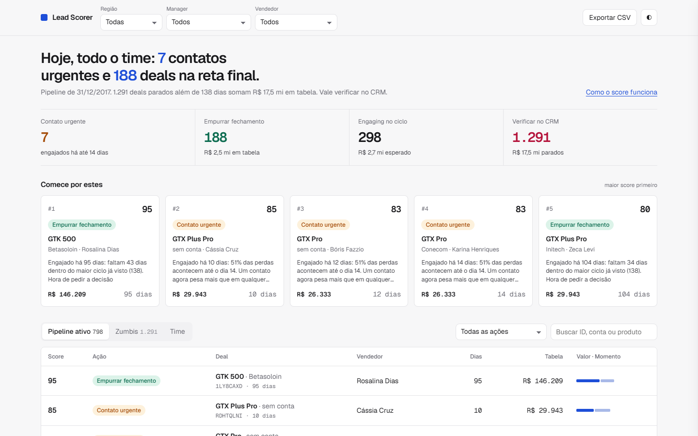
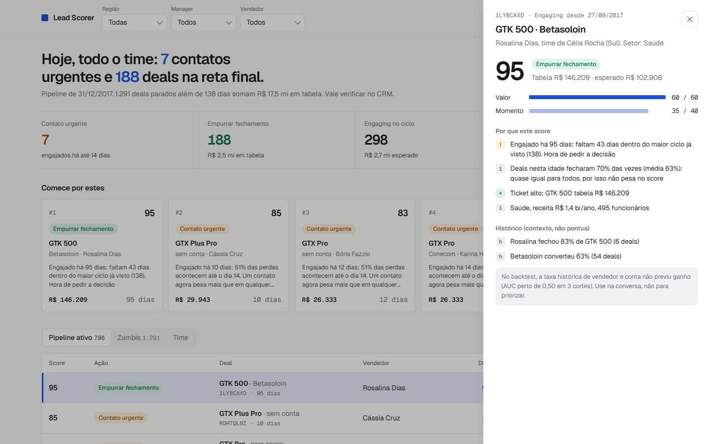
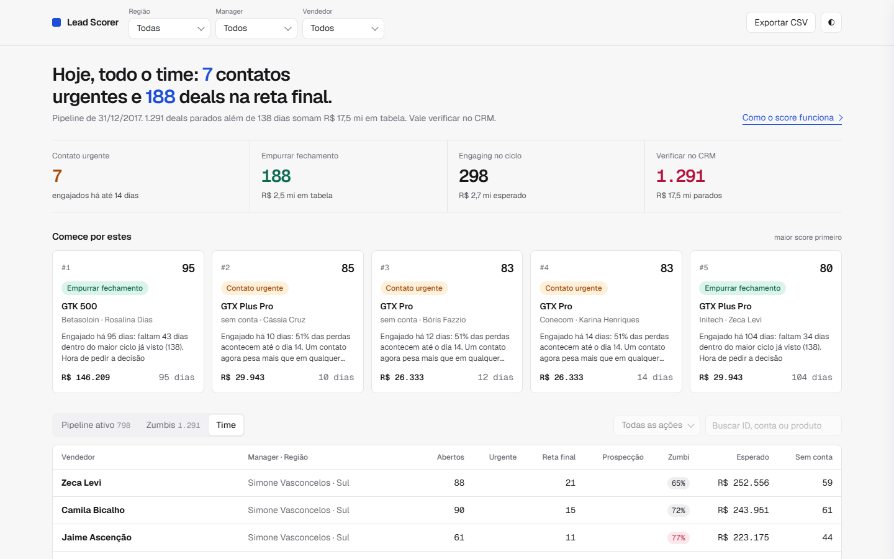

# Submissão: Shogun Stronda, Challenge 003 (Lead Scorer)

## Sobre mim

- **Nome:** Shogun Stronda
- **LinkedIn:** _preencher_
- **Challenge escolhido:** build-003-lead-scorer

---

## Executive Summary

Construí um Lead Scorer que abre com duplo clique (HTML + JS, zero dependências). Ele dá a cada um dos 2.089 deals abertos uma **ação** (Contato urgente, Empurrar fechamento, Manter cadência, Avançar para Engaging, Verificar no CRM), um **score 0 a 100** para ordenar e o **porquê** em português. Antes de pontuar, testei fora da amostra o que um score "padrão" usaria: vendedor, conta, produto, setor, região, porte e até a idade do deal. **Nenhum ordena ganhos melhor que cara ou coroa** (AUC 0,46 a 0,55 em três cortes). Por isso o score não finge prever: é uma política explícita de **valor x momento do ciclo**, apoiada em dois fatos que se sustentam (51% das perdas acontecem nos primeiros 14 dias; nenhum deal levou mais de 138 dias para fechar). O achado para RevOps: **81% dos deals em Engaging já passaram dos 138 dias**. São R$ 17,5 mi dos R$ 27,1 mi nominais, inconsistentes com todo o histórico. O valor esperado do Engaging vivo é **R$ 2,66 mi**.

---

## Solução

### Como rodar

```bash
# usar: abrir solution/app/index.html no navegador

# regerar a partir dos CSVs (Python 3.9+, sem pip install)
cd solution
python scorer.py
python -m unittest discover tests     # 19 testes
```

Setup: [`solution/README.md`](solution/README.md) · Lógica e por quê: [`docs/logica.md`](docs/logica.md) · Backtest: [`docs/validacao.md`](docs/validacao.md) (gerado pelo código)

### Abordagem

1. **Entender o pedido.** "O vendedor abre na segunda e sabe onde focar" pede, por deal: *o que fazer agora*, *em que ordem* e *por quê*.
2. **EDA antes de modelar.** Taxa de ganho ~63% plana em todo recorte; teto duro de ciclo em 138 dias; 1.425 deals sem conta; join de produto quebrado (`GTXPro` vs `GTX Pro`, 1.480 deals).
3. **v1: o score "óbvio"** (taxas de vendedor x produto e conta, com shrinkage bayesiano). Backtest: AUC 0,504, calibração plana. Descartado.
4. **v2: chance pela curva de sobrevivência** + gate automático para atributos.
5. **Crítico independente** (sub-agente sem acesso ao meu raciocínio): mostrou que a chance temporal, testada por snapshot, também não passa no gate. Nota 6/10. [Findings e respostas](process-log/critica.md).
6. **v3: política explícita.** `Score = Valor (log, 60) + Momento (40)`. Ação só depende do momento. Probabilidade sai do score e vira contexto.

### Resultados



**O que o vendedor vê na segunda:**
- Uma frase no topo diz o que fazer hoje. Abaixo, a fila "Comece por estes" com os 5 deals de maior score e o motivo principal de cada um.
- Métricas clicáveis: **7** Contato urgente, **188** Empurrar fechamento, Engaging no ciclo, Verificar no CRM.
- Lista ordenada com ação por deal. Clique: score decomposto e motivos ("Engajado há 95 dias: faltam 43 dias para passar do maior ciclo já visto. Hora de pedir a decisão").
- Filtros por região, manager e vendedor em seletores próprios (teclado completo, digitar para buscar), lembrados entre visitas; exportar CSV que abre direto no Excel pt-BR.
- Animações com função (contadores ao filtrar, cascata de entrada, gaveta que se monta, hover em todo elemento clicável, trilho de rolagem próprio nos seletores), desligadas para quem pede movimento reduzido.



**O que o manager / RevOps vê:**

| Métrica | Valor |
|---|---|
| Pipeline nominal (tabela) | R$ 27.125.963 |
| Engaging além de 138 dias (verificar) | 1.291 deals, R$ 17.471.423 (64%) |
| Engaging dentro do ciclo | 298 deals, valor esperado R$ 2.655.833 |
| Prospecting (chance desconhecida) | 500 deals, R$ 5.866.219 em tabela |
| Deals sem conta no CRM | 1.425 de 2.089 (68%) |
| Região Centro-Oeste | 100% dos Prospecting, 403 zumbis, **5** Engaging vivos |



### Recomendações

1. **Verificar os 1.291 zumbis esta semana.** Na aba Zumbis, ordenados por valor. Ou estão mortos e o forecast está inflado, ou estão vivos e o CRM não registra o avanço. As duas respostas valem dinheiro.
2. **Investigar o Centro-Oeste.** Todos os 500 Prospecting do time estão lá e só 5 Engaging dele estão vivos. Processo de registro diferente ou deals parados: conversa com Marcelo Nogueira e Eduardo Bittencourt.
3. **Proteger os primeiros 14 dias.** Metade das perdas acontece ali. Regra de cadência: segundo contato em até 7 dias após engajar. Medir se a taxa de perda precoce cai.
4. **`account` obrigatório no CRM.** 68% dos deals abertos não têm conta, o que bloqueia qualquer análise por cliente.
5. **Instrumentar antes de modelar.** Os dados não têm atividades (ligações, e-mails, reuniões). "Dias desde o último contato" é o sinal que falta. Com ele, o gate do scorer pode aprovar fatores que hoje não existem.

### Limitações

- **Dataset sintético.** A ausência de sinal nos atributos é provavelmente artefato da geração. 758 zumbis foram engajados no 3º tri/2017, quando todos os fechados do mesmo período fecharam em até 138 dias: pode ser artefato também. Por isso a ação é "verificar", não "encerrar".
- **O score é política, não previsão.** Pesos 60/40 e limites 14/90/138 são julgamento documentado em `docs/logica.md`. Para calibrar: registrar quais deals cada vendedor trabalhou e o resultado, e comparar.
- **Prospecting sem data.** Não há como medir idade nem conversão Prospecting → Engaging.
- **Valor = preço de tabela.** Ganhos fecham entre 87% e 112% da tabela; não captura quantidade ou desconto.
- **Nomes e regiões.** Vendedores, managers e regiões aparecem com nomes brasileiros (Centro-Oeste, Sudeste, Sul) via mapa 1:1 em `solution/data/nomes_br.csv`. Os CSVs originais do Kaggle estão intactos; com um CRM real, o arquivo de mapa é simplesmente apagado.
- **Moeda.** O dataset está em dólar. Todos os valores são convertidos para reais pela PTAX de venda do Banco Central de 05/11/2026 (US$ 1 = R$ 5,4621), fixa em `scorer.py` (`USD_BRL`) para o resultado ser reproduzível. Em produção, ler do CRM já em reais ou atualizar a taxa no build diário.
- **Snapshot estático** em 31/12/2017. Produção: `REF_DATE = date.today()`, ler o CRM por API num cron diário e publicar o HTML ou mandar o top 5 de cada vendedor por Slack/e-mail.

---

## Process Log: como usei IA

Detalhe completo em [`process-log/README.md`](process-log/README.md).

### Ferramentas usadas

| Ferramenta | Para que usou |
|---|---|
| Claude Code (Opus) | EDA, backtests, scorer, app, testes, docs |
| Sub-agente crítico (Claude Code) | Revisão adversarial independente: reproduziu os números e atacou modelo, UI e higiene |
| playwright-cli | Testar a UI no navegador (desktop, mobile, teclado) e gerar screenshots |

### Workflow

1. Li brief, regras, guia e template. Baixei o dataset.
2. EDA por script: números, não intuição.
3. v1 (atributos) com backtest desde o início: falhou.
4. Caça a sinais: só o tempo parecia ter sinal. v2.
5. Crítico independente: o tempo também não passava no gate por snapshot. v3.
6. Testes (19), navegador, docs gerados por código.
7. Valores convertidos para R$ (PTAX oficial) e interface redesenhada com a skill `design-taste-frontend`: abertura em uma frase ("Hoje, time todo: 7 contatos urgentes e 188 deals na reta final"), fila "Comece por estes" com os 5 primeiros, métricas clicáveis, Geist + Geist Mono, um acento só (cobalto), modo claro e escuro.

### Onde a IA errou e como corrigi

- **Score por atributos era ruído** com motivos convincentes ("Cora fecha 79% de GTX Plus Pro"). AUC 0,504. Descartado.
- **A "chance temporal" da v2 também era fraca.** Eu tinha validado só com fechados (lift +5 p.p. estável), não como ordenador. O crítico pegou; implementei o backtest por snapshot e tirei do score.
- **Ação travada por preço** na v2: "Fechar esta semana" exigia ticket ≥ R$ 6,6 mil. Corrigido e testado.
- **Forecast inflado:** Prospecting recebia 63% de chance sem nenhum dado. Agora é "desconhecido".
- **Join quebrado** (`GTXPro`), **bug de formatação** nos motivos, **off-by-one** na curva: todos com teste.

### O que eu adicionei que a IA sozinha não faria

- Exigir validação fora da amostra e **aceitar o resultado negativo** em vez de entregar um número bonito.
- Pôr um **crítico adversarial** na própria entrega e refazer o modelo quando ele achou o furo.
- Separar **ação** (o que fazer, pelo momento) de **ordem** (score, pelo valor).
- Tratar os zumbis como achado de negócio, com linguagem calibrada ("verificar", não "encerrar").
- Investigar a anomalia do Centro-Oeste em vez de aceitar "região sem deals quentes".
- Stack escolhida pelo usuário final: duplo clique, sem instalar nada.

---

## Evidências

- [x] Conversa completa com o Claude Code: [`process-log/chat-exports/claude-code-sessao.txt`](process-log/chat-exports/claude-code-sessao.txt)
- [x] Screenshots: `process-log/screenshots/`
- [x] Scripts e outputs da EDA: `process-log/eda*.py`, `process-log/eda-output-*.txt`
- [x] Revisão crítica e respostas: `process-log/critica.md`
- [x] Git history da branch
- [x] Backtest gerado por código: `docs/validacao.md`

---

_Submissão enviada em: 2026-11-06_
