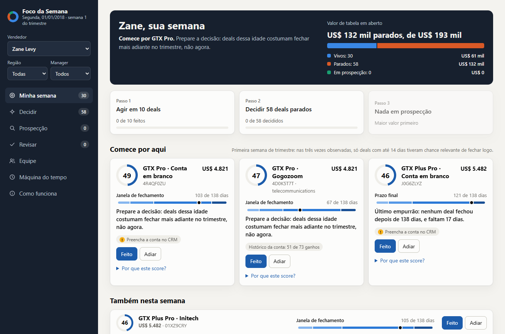

# Submissão — Vinicius Eduardo da Silva — Challenge 003

## Sobre mim

- **Nome:** Vinicius Eduardo da Silva
- **LinkedIn:** [PREENCHER]
- **Challenge escolhido:** 003 — Lead Scorer

---

## Executive Summary

Construí o **Foco da Semana**, uma ferramenta que abre com dois cliques e diz a cada vendedor onde focar e por quê. A análise mudou o problema: **82% dos deals em Engaging já passaram de 138 dias, a maior duração entre todos os deals encerrados**, e características como vendedor, produto e setor quase não preveem o fechamento. Por isso, o score combina valor com o momento do deal, os parados vão para uma triagem rápida, e tudo o que o vendedor marca fica disponível para revisar e exportar. Em 22 segundas-feiras passadas, ele trouxe **42% mais receita que ordenar por valor** e ficou à frente em todas. A principal recomendação é limpar o pipeline parado e confirmar com RevOps o que aconteceu na região Central.

**Para testar:** abra [`solution/app/index.html`](solution/app/index.html) no navegador e escolha um vendedor, como Zane Levy ou Darcel Schlecht. Depois, abra a aba **Máquina do tempo**, escolha uma segunda de 2017 e clique em Revelar para conferir a lista contra o que aconteceu. Documentação técnica em [`solution/README.md`](solution/README.md) e plano de teste em [`docs/plano-piloto.md`](docs/plano-piloto.md).

---

## Solução

### Abordagem

Auditei os dados antes de desenhar o score e testei cada critério em segundas-feiras reconstruídas, usando só o que se sabia em cada data. Um critério só entrava se melhorasse a lista.

### Resultados / Findings

**O pipeline é bem menor do que parece:**

| Fila | Deals | Valor de tabela |
|---|---:|---:|
| Foco: Engaging com até 138 dias | 288 | US$ 665.078 |
| Decidir: Engaging acima de 138 dias | 1.301 | US$ 3.227.151 |
| Prospecção: sem data | 500 | US$ 1.073.986 |

**O score no replay** (top 10 de cada vendedor, receita ganha em 30 dias, média por segunda):

| Estratégia | Jul–set | Out–nov | Ganhos em 30 dias | Parados na lista (de ~300) |
|---|---:|---:|---:|---:|
| **Score** | **US$ 354.201** | **US$ 268.350** | **21,9%** | **0** |
| Maior valor | US$ 248.243 | US$ 191.465 | 13,4% | 53 |
| Mais novo primeiro | US$ 111.280 | US$ 187.248 | 19,8% | 0 |
| Aleatório | US$ 100.257 | US$ 84.045 | 13,1% | 52 |

Ele ficou à frente de "maior valor" em 22 de 22 segundas, e em 5 de 5 ao considerar só segundas cujas janelas de 30 dias não se sobrepõem. Com empates sorteados, a vantagem fica em 41%, contra 42% com desempate por ID.

**Outros achados:**

- **Região Central:** 0 deals vivos, 408 parados e todos os 500 em Prospecting. Seus vendedores seguem fechando negócios, e há um pico de deals engajados em julho de 2017. Isso pode ser processo ou importação de dados.
- **Trimestre:** o win rate é de cerca de 80% no último mês e 50% no primeiro. Na primeira segunda do trimestre, deals com até 14 dias têm 15–19% de vitória em 30 dias, e os mais velhos, 0–2,6%.
- **Valor:** o preço fechado fica com mediana de 99,8% da tabela, então a tabela é uma boa estimativa.

### Recomendações

1. **Esta semana, RevOps:** perguntar à Central o que ocorreu em julho de 2017 e se o efeito de trimestre é processo comercial, como metas e revisão de pipeline.
2. **Nas próximas duas semanas, vendedores:** passar pela fila Decidir, começando pelos deals de maior valor. O pipeline real só fica claro depois disso.
3. **Depois, RevOps:** tornar a conta obrigatória em Engaging, pois ela falta em 68% dos deals abertos.
4. **Antes de escalar:** rodar um teste com grupo de controle por um trimestre completo. Com 30 vendedores, um mês só detectaria ganhos acima de 42% em deals ganhos; um trimestre detecta cerca de 17%. Detalhes em [`docs/plano-piloto.md`](docs/plano-piloto.md).

### Limitações

- O replay mostra que a lista aponta os deals que iam fechar, não que a atenção muda o resultado.
- Ordenar pelo mais novo ganhou mais deals em out–nov (26% contra 19%). O score otimiza receita, não contagem de vitórias.
- O modelo superestima chances altas, por isso os cartões mostram a taxa observada.
- O efeito de trimestre se apoia em no máximo três trimestres e pode ser efeito do dataset.
- Passar de 138 dias não prova que o deal morreu, então a decisão fica com o vendedor.
- O CRM não registra atividade, e deals em Prospecting não têm data nem score.

---

## Process Log — Como usei IA

Registro completo em [`process-log/PROCESS_LOG.md`](process-log/PROCESS_LOG.md), com os scripts de cada etapa em [`process-log/exploration/`](process-log/exploration/).

### Ferramentas usadas

| Ferramenta | Para que usou |
|---|---|
| Claude Code (Claude Opus 5.5) | Leitura do desafio, análise dos dados, código, testes no navegador e primeira versão dos textos |

### Workflow

1. Leitura das regras e escolha do desafio
2. Auditoria dos dados, em busca de problemas e vieses
3. Teste de sinais com validação temporal, que derrubou o plano de score baseado em vendedor e produto
4. Replay de segundas passadas, para decidir cada critério com evidência
5. Interface, testes no navegador e correções
6. Documentação e submissão

### Onde a IA errou e como corrigi

Os erros estão detalhados no process log. O mais sério: a ferramenta mostrava cerca de 14% de chance para um deal de 67 dias em 1º de janeiro, quando o histórico indicava 0–2,6%. O ranking estava bom no replay, então os testes não acusaram; o problema apareceu na revisão da tela.

### O que eu adicionei que a IA sozinha não faria

[PREENCHER com suas palavras: ver o final de `process-log/PROCESS_LOG.md`]

---

## Evidências

- [ ] Screenshots das conversas com IA
- [ ] Screen recording do workflow
- [ ] Chat exports
- [x] Git history
- [x] Outro: scripts de cada etapa em `process-log/exploration/`, resultados em `solution/scoring/backtest_results.json` e telas em `docs/screenshots/`

---

_Submissão enviada em: [PREENCHER]_
