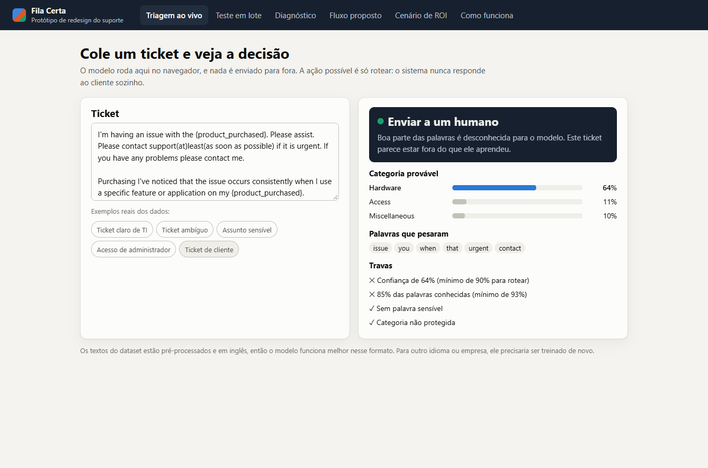

# Submissão — Vinicius Eduardo da Silva — Challenge 002

## Sobre mim

- **Nome:** Vinicius Eduardo da Silva
- **LinkedIn:** https://www.linkedin.com/in/vinicius-silva-ai/
- **Challenge escolhido:** 002 — Redesign de Suporte

---

## Executive Summary

Com o Claude Code, verifiquei se os dados de suporte permitiam responder ao Diretor e construí um protótipo de triagem que roda no navegador. **As três perguntas do Diretor não têm resposta confiável nestes dados:** o aparente gargalo se iguala ao que dados embaralhados produzem, as notas de satisfação são uniformes e 49% dos tickets encerrados são resolvidos antes da primeira resposta. O roteamento automático, por outro lado, é viável: em 9.568 tickets de TI nunca vistos, **52% seriam roteados sozinhos, com 92,7% de acerto**. O cruzamento dos datasets revelou o principal risco: nos tickets de clientes, o modelo erraria com confiança, e uma trava passou a enviar 98,9% deles a uma pessoa. A recomendação é capturar dados confiáveis, treinar com tickets reais e começar em modo sombra.

**Para testar:** abra [`solution/app/index.html`](solution/app/index.html) no navegador, com dois cliques. **Sem baixar nada:** https://viniciuseds.github.io/ai-master-challenge/fila-certa/

1. Em **Triagem ao vivo**, clique nos exemplos ou cole um ticket.
2. Em **Teste em lote**, mova o controle de confiança e veja onde parar a automação.
3. Em **Diagnóstico**, veja a resposta pedida e a prova de que ela é ruído.

| Pasta | O que tem |
|---|---|
| [`docs/relatorio-diretor.md`](docs/relatorio-diretor.md) | Relatório para o Diretor de Operações |
| [`solution/`](solution/README.md) | Protótipo, treino, testes e documentação técnica |
| [`docs/screenshots/`](docs/screenshots/) | Telas do protótipo |
| [`process-log/`](process-log/PROCESS_LOG.md) | Como o trabalho aconteceu e os scripts de cada etapa |

---

## Solução

### Abordagem

Trabalhei com o Claude Code, que fez a análise e o código enquanto eu tomava as decisões. Antes de responder, testamos se os dados sustentavam uma resposta: comparamos cada padrão com dados embaralhados e avaliamos o classificador nas últimas linhas do arquivo, não só em uma divisão aleatória. Depois, testamos o modelo de TI nos tickets de clientes, porque o enunciado aponta o cruzamento como o ponto forte.

### Resultados / Findings

**Diagnóstico (Dataset 1):**

| Pergunta | O que parece | O que os testes mostram |
|---|---|---|
| Onde o fluxo trava? | Chat + High + Refund: 11,4h, contra 4,3h | A diferença de 7,1h é a mesma de dados embaralhados, 6,9h (p = 0,38) |
| O que impacta a satisfação? | Nada se destaca | Notas uniformes (p = 0,80) e nenhum dos 6 fatores relevante (menor p = 0,28) |
| Quanto desperdiçamos? | Não calculável | 49% resolvidos antes da primeira resposta e nenhuma data de abertura |

O arquivo tem 8.469 tickets, não ~30.000, e os textos têm o marcador `{product_purchased}` em 100% dos casos.

**Automação (Dataset 2), nas últimas 20% das linhas:**

| Fila | Tickets | Resultado |
|---|---:|---|
| Rotear sozinho | 51,7% | 92,7% de acerto |
| Sugerir ao atendente | 37,3% | 92,5% com a categoria certa nas 2 primeiras opções |
| Enviar a um humano | 11,0% | Assunto sensível, ticket desconhecido ou modelo inseguro |

**Cruzamento dos datasets:** nos tickets de clientes, o modelo diz Hardware para 70% deles, seja qual for o tipo, e rotearia 19% sozinho. A trava de vocabulário reduz isso a 0,07%.

**Deriva:** o acerto geral cai de 84,8% na divisão aleatória para 80,0% nas últimas linhas, e a categoria Purchase quase some.

### Recomendações

1. **Agora:** capturar datas de abertura, de transferência e de encerramento, o tempo ativo do atendente e a fila correta.
2. **Depois:** treinar com tickets reais e rodar em modo sombra, sem afetar clientes.
3. **Em seguida:** ligar a sugestão ao atendente e medir o tempo de triagem.
4. **Por último:** ligar o roteamento nas categorias aprovadas pelo Diretor.

**O que não automatizar:** a resposta ao cliente, assuntos sensíveis, acessos de administrador e a prioridade. As justificativas e os exemplos reais estão na aba Fluxo proposto e no [relatório](docs/relatorio-diretor.md).

### Limitações

- O modelo não serve hoje para tickets de clientes.
- O dataset de suporte parece artificial, e nada nele descreve uma operação real.
- O limite de confiança foi escolhido vendo o teste, então o acerto pode estar um pouco otimista.
- O arquivo não tem datas, e a ordem das linhas é só uma aproximação do tempo.
- O ROI é um cenário: as 865 horas por ano dependem de premissas que não vêm dos dados.
- A lista de palavras sensíveis e as categorias protegidas são julgamento, sem validação de RH ou jurídico.
- Embeddings e LLMs não foram testados.

---

## Process Log — Como usei IA

Registro completo em [`process-log/PROCESS_LOG.md`](process-log/PROCESS_LOG.md).

### Ferramentas usadas

| Ferramenta | Para que usou |
|---|---|
| Claude Code (Claude Opus 5.5; reta final com Claude Fable 5) | Análise dos dados, modelo, protótipo, testes no navegador e primeira versão dos textos |

### Workflow

1. Diagnóstico rápido dos desafios restantes e escolha do 002
2. Auditoria do dataset de suporte, com comparação contra dados embaralhados
3. Teste do classificador, primeiro em divisão aleatória e depois nas últimas linhas
4. Teste nos tickets de clientes e criação da trava de ticket desconhecido
5. Minhas decisões: como responder ao Diretor e quanto automatizar
6. Protótipo, testes no navegador e documentação

### Onde a IA errou e como corrigi

Os erros estão no process log, com a forma como cada um apareceu. O mais importante: os 99,4% de acerto citados no diagnóstico rápido vieram de uma divisão aleatória e caíram para cerca de 93% em uma avaliação mais realista. O próprio Claude Code detectou o problema ao notar a queda em um bloco da validação.

### O que eu adicionei que a IA sozinha não faria

Minha contribuição foi de direção, não de análise técnica. A partir do que a análise mostrou, tomei três decisões:

- **Seguir para este desafio,** depois de ver o diagnóstico dos dados dos desafios restantes.
- **Dizer a verdade ao Diretor:** mostrar a resposta pedida e provar que ela é ruído, em vez de apresentar um gargalo que os dados não sustentam.
- **Automatizar só o seguro:** depois de ver quantos erros cada opção causaria, escolhi rotear apenas os tickets confiáveis e começar em modo sombra.

**O que eu não fiz:** a análise, o modelo e a detecção dos erros técnicos ficaram com o Claude Code. Também não validei as regras com alguém de suporte, RH ou jurídico, e os minutos e custos do ROI são suposições.

---

## Evidências

- [ ] Screenshots das conversas com IA
- [ ] Screen recording do workflow
- [x] Chat exports: [`../process-log/chat-exports/conversa-claude-code.md`](../process-log/chat-exports/conversa-claude-code.md) — a conversa cobre os dois desafios
- [x] Git history
- [x] Narrativa escrita: [`process-log/PROCESS_LOG.md`](process-log/PROCESS_LOG.md)
- [x] Outro: scripts de cada etapa em `process-log/exploration/`, resultados em `solution/training/results.json` e telas em `docs/screenshots/`

---

_Submissão enviada em: 05/11/2026_
